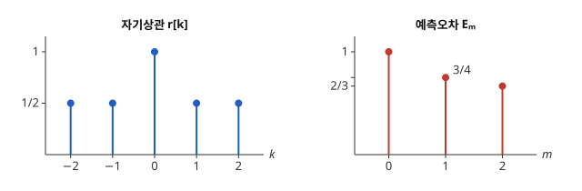

# Levinson–Durbin 알고리즘

# 개요

**Levinson–Durbin 알고리즘(Levinson–Durbin algorithm)** 은 지난 값 $m$ 개로 다음 값을 맞히는 최선의 가중치를 $m=1,2,3,\dots$ 의 순서로, 앞 단계의 답을 고쳐 가며 구하는 알고리즘이다. 지난 값을 하나 더 쓸 때마다 연립방정식을 처음부터 다시 풀면, 가중치 $p$ 개를 구하는 데 미지수가 $p$ 개인 방정식의 소거가 든다. 이 알고리즘은 방정식의 행렬이 대각선을 따라 같은 성분을 갖는다는 것을 써서, 앞 단계의 가중치에 수 하나만 더 계산해 다음 단계의 가중치를 얻는다.

# 직관

평균이 $0$ 인 측정값의 수열이 $\mathbb E\lbrack x\lbrack n\rbrack^2\rbrack=1$ 이고, 한 칸이나 두 칸 떨어진 두 값의 곱의 평균이 모두 $\frac12$ 이다. 지난 값으로 $x\lbrack n\rbrack$ 을 맞혀 제곱오차의 평균을 가장 작게 하려 한다. 이것은 [Wiener 필터](wiener-filter.md)에서 목표를 $d\lbrack n\rbrack=x\lbrack n\rbrack$, 관측을 지난 값으로 둔 경우다.

지난 값 하나를 쓰면 $\hat x\lbrack n\rbrack=a\thinspace x\lbrack n-1\rbrack$ 이고, 오차 $x\lbrack n\rbrack-a\thinspace x\lbrack n-1\rbrack$ 의 제곱 평균 $1-a+a^2$ 은 $a=\frac12$ 에서 가장 작은 값 $\frac34$ 를 갖는다.

지난 값 둘을 쓰면 $\hat x\lbrack n\rbrack=a\_1x\lbrack n-1\rbrack+a\_2x\lbrack n-2\rbrack$ 이고, 두 가중치로 미분해 $0$ 으로 놓으면 $a\_1+\frac12a\_2=\frac12$, $\frac12a\_1+a\_2=\frac12$ 이 나온다. 해는 $a\_1=a\_2=\frac13$ 이고 오차의 제곱 평균은 $\frac23$ 이다.

둘째 연립방정식은 첫째 답 $\frac12$ 를 쓰지 않고 풀었다. 첫째 답을 고쳐 쓰면, 새 가중치는 $a\_2=k$ 와 $a\_1=\frac12-k\cdot\frac12$ 꼴이다. 첫째 방정식에 넣으면 $\frac12-\frac k2+\frac k2=\frac12$ 로 저절로 성립하고, 둘째 방정식 $\frac14-\frac k4+k=\frac12$ 에서 $k=\frac13$ 이 나온다. 새로 정할 수는 $k$ 하나뿐이다.



위 그림의 왼쪽은 이 수열의 자기상관이고, 오른쪽은 지난 값을 $0,1,2$ 개 쓸 때 오차의 제곱 평균이다.

# 정의

## 정규방정식

$x$ 를 자기상관이 $r\lbrack k\rbrack=\mathbb E\lbrack x\lbrack n\rbrack x\lbrack n-k\rbrack\rbrack$ 인 광의 정상 과정이라 한다. 차수 $m$ 의 **선형 예측(linear prediction)** 은 $\hat x\lbrack n\rbrack=\sum_{j=1}^{m}a\_jx\lbrack n-j\rbrack$ 이고, 제곱오차의 평균을 가장 작게 하는 가중치는 다음 연립방정식의 해다.

$$
\sum_{j=1}^{m}a\_j\thinspace r\lbrack i-j\rbrack=r\lbrack i\rbrack,\qquad i=1,\dots,m
$$

이것을 **Yule–Walker 방정식(Yule–Walker equations)** 이라 한다. 계수 행렬 $R\_m$ 의 $(i,j)$ 성분은 $r\lbrack i-j\rbrack$ 이므로 Toeplitz 행렬(Toeplitz matrix)이다. 해를 $a^{(m)}=(a^{(m)}\_1,\dots,a^{(m)}\_m)$ 이라 하고, 그때 오차의 제곱 평균을 $E\_m=r\lbrack 0\rbrack-\sum_{j=1}^{m}a^{(m)}\_jr\lbrack j\rbrack$ 이라 한다. $E\_0=r\lbrack 0\rbrack$ 이다.

## 알고리즘

$m=1,2,\dots,p$ 의 순서로 다음을 계산하는 절차를 **Levinson–Durbin 알고리즘** 이라 한다[^1].

$$
k\_m=\frac{r\lbrack m\rbrack-\sum_{j=1}^{m-1}a^{(m-1)}\_jr\lbrack m-j\rbrack}{E\_{m-1}}
$$

$$
a^{(m)}\_m=k\_m,\qquad a^{(m)}\_j=a^{(m-1)}\_j-k\_m\thinspace a^{(m-1)}\_{m-j}\quad(1\le j\le m-1),\qquad E\_m=(1-k\_m^2)E\_{m-1}
$$

$k\_m$ 을 **반사계수(reflection coefficient)** 라 한다. 직관 절에서 $k\_1=\frac12$, $E\_1=\frac34$, $k\_2=(\frac12-\frac14)/\frac34=\frac13$, $E\_2=\frac34\cdot\frac89=\frac23$ 이다.

```javascript
// r: 자기상관 r[0..p]. 반환: 가중치 a[1..p], 반사계수 k[1..p], 오차 E
function levinsonDurbin(r, p) {
  let a = [0];                   // a[0] 은 쓰지 않는다
  const k = [0];
  let E = r[0];
  for (let m = 1; m <= p; m++) {
    let acc = r[m];
    for (let j = 1; j < m; j++) acc -= a[j] * r[m - j];
    const km = acc / E;
    const next = [0];
    for (let j = 1; j < m; j++) next[j] = a[j] - km * a[m - j];
    next[m] = km;
    a = next;
    k.push(km);
    E = (1 - km * km) * E;
  }
  return { a, k, E };
}
```

# 성질

## 점화식의 정당성

$J$ 를 성분의 순서를 뒤집는 행렬이라 하면 Toeplitz 행렬은 $JR\_{m-1}J=R\_{m-1}$ 을 만족한다. 그래서 $a^{(m-1)}$ 이 우변 $(r\lbrack 1\rbrack,\dots,r\lbrack m-1\rbrack)$ 의 해이면, 뒤집은 $Ja^{(m-1)}$ 은 뒤집은 우변 $(r\lbrack m-1\rbrack,\dots,r\lbrack 1\rbrack)$ 의 해다. 새 가중치를 $(a^{(m-1)}-k\thinspace Ja^{(m-1)},\thinspace k)$ 꼴로 두면 처음 $m-1$ 개 방정식은 $k$ 에 관계없이 성립하고, 마지막 방정식이 $k=k\_m$ 을 정한다. 직관 절의 "저절로 성립" 이 이 계산이다. $E\_m$ 의 식은 $E\_m$ 의 정의에 새 가중치를 넣어 얻는다.

## 계산량

단계 $m$ 은 곱셈이 약 $2m$ 번이므로 차수 $p$ 까지 $O(p^2)$ 번이다. 일반 연립방정식의 소거는 $O(p^3)$ 번이다. 차수 $1,\dots,p$ 의 예측 가중치와 오차가 모두 함께 나온다.

## 반사계수의 크기

$R\_{p+1}$ 이 양의 정부호이면 모든 $m\le p$ 에서 $\lvert k\_m\rvert\lt 1$ 이고, 따라서 $E\_0\ge E\_1\ge\dots\ge E\_p\gt 0$ 이다[^1]. 역으로 $\lvert k\_m\rvert\lt 1$ 인 수 $p$ 개와 $r\lbrack 0\rbrack\gt 0$ 을 주면 양의 정부호인 자기상관이 하나 정해진다. $E\_m=(1-k\_m^2)E\_{m-1}$ 에서 $k\_m=0$ 이면 지난 값을 하나 더 써도 오차가 줄지 않는다.

## 최소 위상

$\lvert k\_m\rvert\lt 1$ 이면 예측오차 필터 $A(z)=1-\sum_{j=1}^{p}a^{(p)}\_jz^{-j}$ 의 영점이 모두 단위원 안에 있다[^1]. 그래서 $1/A(z)$ 는 [z 변환](z-transform.md) 문서의 기준으로 안정한 인과 [IIR 필터](iir-filters.md)(infinite impulse response)다. 직관 절의 $p=2$ 에서 $A(z)=1-\frac13z^{-1}-\frac13z^{-2}$ 의 영점은 $z=(1\pm\sqrt{13})/6$, 곧 약 $0.77$ 과 $-0.43$ 이다.

# 활용

- [Wiener 필터](wiener-filter.md)의 계산. 차수 $M$ 의 Wiener–Hopf 방정식은 계수 행렬이 Toeplitz 이므로, 같은 대칭을 쓰는 Levinson 점화식으로 $O(M^2)$ 번의 연산에 푼다.
- 선형 예측 부호화(linear predictive coding, LPC). 음성의 짧은 구간마다 자기상관을 계산해 예측 가중치를 구하고, 가중치나 반사계수와 예측오차만 보낸다. 반사계수는 $\lvert k\_m\rvert\lt 1$ 만 지키면 받는 쪽 필터 $1/A(z)$ 가 안정이므로 양자화하기 좋다.
- 자기회귀 스펙트럼 추정. [스펙트럼 추정](spectral-estimation.md)의 주기도 대신 $E\_p/\lvert A(e^{i\omega})\rvert^2$ 을 전력 스펙트럼 밀도의 추정값으로 쓴다.

[^1]: S. Haykin, *Adaptive Filter Theory*, 5th ed., Pearson (2014), 3장.

# 연관 문서

## 선수지식

- [Wiener 필터](wiener-filter.md)

## 더 알아보기

아직 연결한 문서가 없다.

#signal_processing #linear_algebra #statistics #algorithms
