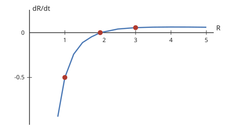

# Lifshitz–Slyozov–Wagner 이론

# 개요

**Lifshitz–Slyozov–Wagner 이론(Lifshitz–Slyozov–Wagner theory)** 은 묽은 합금 속 방울들의 반지름 분포가 시간이 지나며 어떻게 바뀌는지를 계산하는 이론이다. 반지름이 $1, 2, 3$ 인 방울 셋이 있으면 작은 방울은 사라지고 큰 방울은 커지는데, 방울이 수없이 많을 때는 반지름의 분포 전체가 움직인다.

이 이론은 방울 하나의 성장 법칙과 전체 부피의 보존을 합쳐 분포가 따르는 방정식을 세우고, 그 방정식의 자기 닮은 해를 구한다.

# 직관

[Mullins–Sekerka 문제](mullins-sekerka-problem.md)에서 반지름 $R$ 인 공 모양 방울은 멀리서의 화학 퍼텐셜이 정하는 임계 반지름 $R^\ast$ 보다 작으면 줄고 크면 자란다. 상수를 정리하면 속도는 다음과 같다.

$$
\frac{dR}{dt}=\frac{\sigma}{R}\Bigl(\frac{1}{R^\ast}-\frac{1}{R}\Bigr)
$$

방울이 모두 같은 바탕에 잠겨 있으므로 $R^\ast$ 는 모든 방울에 공통이다. 방울들의 부피 합 $\sum R_i^3$ 이 일정해야 하므로 $\sum R_i^2\dot R_i=0$ 이고, 위 식을 넣으면 $\sum R_i/R^\ast=N$ 이 된다. 그러므로 $R^\ast$ 는 반지름의 평균이다.

$\sigma=1$ 이고 반지름이 $1, 2, 3$ 이면 $R^\ast=2$ 다. 속도는 차례로 $-1/2$, $0$, $1/18$ 이고, 부피 변화 $R^2\dot R$ 는 $-1/2$, $0$, $1/2$ 로 합이 $0$ 이다.

그림은 $R^\ast=2$ 일 때의 속도 곡선이다. 평균보다 작은 방울은 빠르게 줄고, 큰 방울은 천천히 자란다. 작은 방울이 사라지면 평균이 커지고, 그러면 $R^\ast$ 가 커져서 다음 방울이 줄기 시작한다.

# 정의

반지름이 $R$ 근처인 방울의 개수 밀도를 $n(R,t)$ 라 한다. 방울은 반지름을 따라 위 속도 $v(R,t)$ 로 움직이므로 $n$ 은 [연속 방정식](continuity-equation.md)을 만족한다.

$$
\partial_t n+\partial_R\bigl(n\thinspace v\bigr)=0,\qquad v(R,t)=\frac{\sigma}{R}\Bigl(\frac{1}{R^\ast(t)}-\frac{1}{R}\Bigr)
$$

$R^\ast(t)$ 는 전체 부피 $\int_0^\infty R^3n\thinspace dR$ 가 일정하도록 정한다. 이 방정식과 조건을 합쳐 **LSW 모형(Lifshitz–Slyozov–Wagner model)** 이라 한다[^1][^2].

$n(R,t)=c(t)\thinspace h(R/R^\ast(t))$ 꼴의 해를 **자기 닮은 해(self-similar solution)** 라 한다. 반지름을 평균으로 나눈 분포의 모양이 시간에 따라 바뀌지 않는 해다.

직관 절의 계산이 이 정의에서 그대로 나온다. 부피의 시간 미분은 $3\int R^2 v\thinspace n\thinspace dR$ 이고, 이것이 $0$ 이면 $R^\ast=\int Rn\thinspace dR\big/\int n\thinspace dR$ 이다.

# 성질

## 평균 반지름의 성장

LSW 모형의 자기 닮은 해에서 평균 반지름은 다음과 같이 자란다.

$$
R^\ast(t)^3=R^\ast(0)^3+\frac{4}{9}\sigma t
$$

증명의 요지. $x=R/R^\ast$ 로 두고 $R^\ast(t)^3=k\sigma t$ 를 가정하면, $x$ 가 따르는 식은 $R^{\ast 3}\dot x/\sigma=(x-1)/x^2-kx/3$ 이다. 분포의 모양이 유지되려면 오른쪽이 $x\gt 0$ 에서 $0$ 이하이고 한 점에서만 $0$ 이어야 한다. $3(x-1)=kx^3$ 과 그 미분 $3=3kx^2$ 을 함께 풀면 $x=3/2$, $k=4/9$ 다.

방울의 전체 부피가 일정하므로 방울의 개수는 $t^{-1}$ 꼴로 줄어든다.

## 자기 닮은 분포

$x=R/R^\ast$ 의 분포는 시간이 지나면 다음 밀도 $h$ 에 비례하는 모양으로 간다고 Lifshitz, Slyozov, Wagner 가 유도했다[^1][^2].

$$
h(x)=\begin{cases}x^2(3+x)^{-7/3}\bigl(\tfrac32-x\bigr)^{-11/3}\exp\Bigl(-\dfrac{x}{3/2-x}\Bigr) & 0\le x\lt 3/2\cr 0 & x\ge 3/2\end{cases}
$$

평균의 $3/2$ 배보다 큰 방울은 없다. $x=3/2$ 은 앞 절에서 속도식이 $0$ 에 닿은 점이다.

## 처음 분포에 대한 의존

자기 닮은 해는 $h$ 하나가 아니라 한 매개변수의 족을 이룬다. 처음 분포의 가장 큰 반지름 근처 꼬리가 어떤 꼴이냐에 따라 오랜 시간 뒤의 모양이 정해지고, $h$ 로 가는 것은 그 꼬리가 특정한 꼴일 때뿐이다[^3].

# 활용

- 합금의 열처리. 석출물의 평균 크기가 $t^{1/3}$ 로 자란다는 예측을 니켈 기반 초합금 같은 재료의 시효 시간을 정하는 데 쓴다.
- [Cahn–Hilliard 방정식](cahn-hilliard-equation.md)의 굵어짐. 부피 비율이 작은 경우 Cahn–Hilliard 방정식의 무늬 크기가 $t^{1/3}$ 로 자라는 것을 이 이론이 설명한다.
- 유화액과 거품. 기름방울이나 거품의 크기 분포가 시간에 따라 넓어지는 Ostwald 숙성(Ostwald ripening)을 같은 모형으로 기술한다.

[^1]: I. M. Lifshitz, V. V. Slyozov, "The kinetics of precipitation from supersaturated solid solutions", *Journal of Physics and Chemistry of Solids* **19** (1961), 35–50.

[^2]: C. Wagner, "Theorie der Alterung von Niederschlägen durch Umlösen (Ostwald-Reifung)", *Zeitschrift für Elektrochemie* **65** (1961), 581–591.

[^3]: B. Niethammer, R. L. Pego, "Non-self-similar behavior in the LSW theory of Ostwald ripening", *Journal of Statistical Physics* **95** (1999), 867–902.

# 연관 문서

## 선수지식

- [Mullins–Sekerka 문제](mullins-sekerka-problem.md)
- [연속 방정식](continuity-equation.md)

## 더 알아보기

아직 연결한 문서가 없다.

#analysis #probability #differential_geometry
