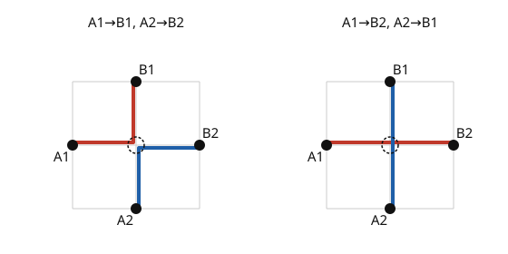

# Lindström–Gessel–Viennot 보조정리

# 개요

**Lindström–Gessel–Viennot 보조정리(Lindström–Gessel–Viennot lemma)** 는 서로 만나지 않는 경로 여러 개의 수를 행렬식 하나로 세는 정리다. 격자에서 두 사람이 각자의 출발점에서 각자의 도착점까지 오른쪽이나 위로만 걷는다고 하자. 한 사람의 경로 수는 이항계수로 바로 나오지만, 두 경로가 한 점도 공유하지 않는다는 조건이 붙으면 직접 세기 어렵다.

이 보조정리는 출발점과 도착점의 쌍마다 경로 수를 세어 행렬로 놓으면 그 행렬식이 만나지 않는 경로 쌍의 수라는 것이다.

# 직관

출발점 $A\_1=(0,1)$, $A\_2=(1,0)$ 과 도착점 $B\_1=(1,2)$, $B\_2=(2,1)$ 을 놓고, 오른쪽이나 위로 한 칸씩 걷는 경로를 센다. $A\_1$ 에서 $B\_1$ 까지는 오른쪽 한 번과 위 한 번이라 $2$ 가지, $A\_2$ 에서 $B\_2$ 까지도 $2$ 가지다. $A\_1$ 에서 $B\_2$ 는 오른쪽 두 번뿐이라 $1$ 가지, $A\_2$ 에서 $B\_1$ 은 위 두 번뿐이라 $1$ 가지다.

$A\_1\to B\_1$ 과 $A\_2\to B\_2$ 의 경로 쌍은 $2\cdot 2=4$ 개이고, 그 가운데 두 경로가 모두 점 $(1,1)$ 을 지나는 쌍 하나가 만난다. 그래서 만나지 않는 쌍은 $3$ 개다. 이 $3$ 은 경로 수를 늘어놓은 행렬의 행렬식과 같다.

$$
\det\begin{pmatrix}2&1\cr 1&2\end{pmatrix}=2\cdot 2-1\cdot 1=3
$$

빼는 항 $1\cdot 1$ 은 $A\_1\to B\_2$ 와 $A\_2\to B\_1$ 의 쌍의 수다. 아래 그림의 왼쪽은 만나는 쌍이고, 두 경로가 처음 만나는 점 $(1,1)$ 에서 뒷부분을 맞바꾸면 오른쪽의 $A\_1\to B\_2$, $A\_2\to B\_1$ 쌍이 된다. 이 맞바꾸기는 만나는 쌍과 엇갈린 쌍을 일대일로 잇는다. 그래서 행렬식에서 엇갈린 쌍을 빼면 만나는 쌍이 지워지고 만나지 않는 쌍만 남는다.

# 정의

$G$ 는 순환이 없는 유향 그래프이고, 간선마다 가중치 $w(e)$ 가 있다. 경로 $P$ 의 가중치 $w(P)$ 는 $P$ 의 간선 가중치의 곱이다. 직관 절은 격자점을 꼭짓점으로, 오른쪽과 위로 한 칸 가는 것을 간선으로 두고 모든 가중치를 $1$ 로 둔 경우다.

## 경로 행렬

두 꼭짓점 $a$, $b$ 에 대해 $a$ 에서 $b$ 로 가는 경로 전체의 가중치 합을 $e(a,b)$ 로 쓴다. 출발점 $a\_1,\dots,a\_n$ 과 도착점 $b\_1,\dots,b\_n$ 이 주어지면 $(i,j)$ 성분이 $e(a\_i,b\_j)$ 인 $n\times n$ 행렬 $M$ 을 **경로 행렬(path matrix)** 이라 한다. 직관 절의 행렬이 $M$ 이다.

## 비교차 경로 체계

순열 $\sigma$ 와 경로 $P\_i:a\_i\to b\_{\sigma(i)}$ 들의 모임 $(P\_1,\dots,P\_n)$ 을 **경로 체계(path system)** 라 한다. 어느 두 경로도 꼭짓점을 공유하지 않으면 **비교차(non-intersecting)** 경로 체계라 한다. 직관 절에서 $\sigma$ 가 항등순열인 경로 체계는 $4$ 개이고 그 가운데 $3$ 개가 비교차다. $\sigma$ 가 맞바꾸기인 경로 체계는 $1$ 개이고 비교차가 아니다.

# 성질

## Lindström–Gessel–Viennot 정리

**정리.** 다음이 성립한다[^1][^2].

$$
\det M=\sum\_{(P\_1,\dots,P\_n)}\mathrm{sgn}(\sigma)\prod\_{i=1}^n w(P\_i)
$$

우변의 합은 비교차 경로 체계 전체에 대한 것이다.

증명의 요지. [행렬식](determinants.md)의 Leibniz 전개 $\det M=\sum\_\sigma\mathrm{sgn}(\sigma)\prod\_i e(a\_i,b\_{\sigma(i)})$ 를 펼치면 모든 경로 체계에 대한 합이 된다. 만나는 경로 체계의 항이 둘씩 지워지는 것을 보이면 된다.

만나는 경로 체계에서, 다른 경로와 만나는 경로 가운데 번호가 가장 작은 $P\_i$ 를 잡는다. $P\_i$ 위에서 다른 경로와 처음 만나는 꼭짓점 $v$ 와, $v$ 를 지나는 다른 경로 가운데 번호가 가장 작은 $P\_j$ 를 잡는다. $P\_i$ 와 $P\_j$ 의 $v$ 뒷부분을 맞바꾸면 가중치의 곱은 그대로이고 $\sigma$ 에 맞바꾸기 하나가 곱해져 부호가 바뀐다. 맞바꾼 뒤에도 같은 $i$, $v$, $j$ 가 잡히므로 이 조작을 두 번 하면 처음으로 돌아온다.

## 평면 그래프에서의 꼴

$G$ 가 평면에 그려져 있고 $a\_1,\dots,a\_n$ 과 $b\_n,\dots,b\_1$ 이 바깥 경계를 따라 이 순서로 놓여 있다고 하자. $a\_i\to b\_j$ 와 $a\_k\to b\_l$ 이 $i\lt k$, $j\gt l$ 이면 두 경로가 평면에서 엇갈려 반드시 만나므로, 비교차 경로 체계는 언제나 $\sigma$ 가 항등순열이다. 이때 $\det M$ 은 비교차 경로 체계의 가중치 합이고, 가중치가 모두 $1$ 이면 그 개수다. 직관 절이 이 경우다.

## 소행렬식의 부호

같은 조건에서 $M$ 의 모든 소행렬식은 출발점과 도착점의 부분집합에 이 정리를 적용한 값이므로, 가중치가 음이 아니면 $0$ 이상이다. 모든 소행렬식이 $0$ 이상인 행렬을 **완전 음 아닌 행렬(totally nonnegative matrix)** 이라 한다. 평면 그래프의 경로 행렬은 완전 음 아닌 행렬이고, 거꾸로 가역인 완전 음 아닌 행렬은 모두 이런 경로 행렬로 적힌다[^3].

# 활용

- Catalan 수의 Hankel 행렬식. [Catalan 수](catalan-numbers.md) $C\_k$ 로 만든 행렬 $\lbrack C\_{i+j}\rbrack\_{0\le i,j\le n-1}$ 의 행렬식은 $1$ 이다. $n=2$ 이면 $C\_0C\_2-C\_1^2=2-1=1$ 이다. $C\_{i+j}$ 는 높이 $0$ 아래로 내려가지 않는 경로의 수로 적히고, 출발점과 도착점을 비스듬히 놓으면 비교차 경로 체계가 하나뿐이어서 행렬식이 $1$ 이다.
- Jacobi–Trudi 항등식. [Schur 다항식](schur-polynomials.md) $s\_\lambda$ 를 $\det(h\_{\lambda\_i-i+j})$ 로 적는 항등식은, 높이 $k$ 에서 오른쪽으로 한 칸 가는 간선에 가중치 $x\_k$ 를 준 격자에 이 정리를 적용해 증명한다. 비교차 경로 체계가 반표준 Young 대각표와 일대일로 대응한다.
- 평면 분할과 마름모 쪽매. 정육각형을 마름모로 채우는 방법은 비교차 경로 체계와 일대일로 대응하고, 상자 안의 평면 분할의 수에 대한 MacMahon 공식(MacMahon's formula)이 이항계수 행렬의 행렬식으로 나온다.
- 결정점과정. 비교차 경로들이 한 단면을 지나는 위치의 분포는 이 정리의 행렬식으로 적히는 [결정점과정](determinantal-point-process.md)이다. 연속 시간에서 서로 부딪히지 않는 [Brown 운동](brownian-motion.md)의 전이 확률을 주는 Karlin–McGregor 공식(Karlin–McGregor formula)이 같은 꼴이다[^4].

[^1]: B. Lindström, "On the vector representations of induced matroids", Bulletin of the London Mathematical Society 5 (1973), 85–90.
[^2]: I. Gessel, G. Viennot, "Binomial determinants, paths, and hook length formulae", Advances in Mathematics 58 (1985), 300–321.
[^3]: S. Fomin, A. Zelevinsky, "Total positivity: tests and parametrizations", The Mathematical Intelligencer 22 (2000), 23–33.
[^4]: S. Karlin, J. McGregor, "Coincidence probabilities", Pacific Journal of Mathematics 9 (1959), 1141–1164.

# 연관 문서

## 선수지식

- [행렬식](determinants.md)

## 더 알아보기

아직 연결한 문서가 없다.

#combinatorics #linear_algebra #graph_theory
