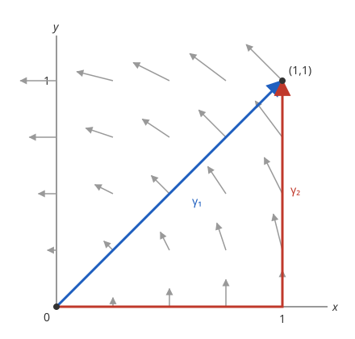

# 선적분

# 개요

**선적분(line integral)** 은 곡선을 따라가며 각 점에서 정해진 양을 더한 값이다. 바람이 부는 평면에서 원점에서 점 $(1,1)$ 까지 자전거로 갈 때, 바람이 밀어 준 일은 대각선으로 곧장 가는지, 오른쪽으로 갔다가 위로 가는지에 따라 다를 수 있다. 선적분은 곡선을 시각 $t$ 로 매개화해 구간 위의 보통 적분으로 바꾸고, 그 값으로 경로마다 받은 일을 계산한다.

# 직관

힘이 일정하고 길이 곧으면 일은 힘과 변위의 내적이다. 힘 $(2,0)$ 을 받으며 $(0,0)$ 에서 $(1,1)$ 까지 곧게 가면 일은 $(2,0)\cdot(1,1)=2$ 다. 바람의 세기와 방향이 점마다 다르면 이 공식을 한 번에 쓸 수 없다.

바람이 점 $(x,y)$ 에서 $F(x,y)=(-y,x)$ 로 분다고 한다. 아래 그림의 회색 화살표가 이 바람이고, 원점 둘레를 시계 반대 방향으로 돈다. 파란 경로 $\gamma_1$ 은 대각선이고, 빨간 경로 $\gamma_2$ 는 $x$ 축을 따라 $(1,0)$ 까지 간 뒤 위로 올라간다.

경로를 잘게 자르면 조각 하나는 거의 곧은 선분이고, 그 위에서 바람은 거의 일정하다. 조각의 일은 바람과 조각 변위의 내적이고, 전체 일은 그 합의 극한이다. 경로를 $\gamma(t)$ 로 매개화하면 시각 $t$ 에서 $\Delta t$ 동안의 변위는 거의 $\gamma'(t)\Delta t$ 이므로, 일은 $F(\gamma(t))\cdot\gamma'(t)$ 를 $t$ 에 대해 적분한 값이다.

$\gamma_1(t)=(t,t)$, $0\le t\le1$ 에서 바람은 $(-t,t)$, 속도는 $(1,1)$ 이고 내적이 $0$ 이다. 그림에서도 대각선 위의 화살표는 경로에 수직이다. 그러므로 $\gamma_1$ 을 따라 받은 일은 $0$ 이다.

$\gamma_2$ 의 첫 구간 $(t,0)$ 에서 바람은 $(0,t)$ 이고 속도 $(1,0)$ 과 수직이라 일은 $0$ 이다. 둘째 구간 $(1,t)$ 에서 바람은 $(-t,1)$, 속도는 $(0,1)$ 이고 내적이 $1$ 이므로 일은 $1$ 이다. 같은 두 점을 잇는데 $\gamma_1$ 은 일 $0$, $\gamma_2$ 는 일 $1$ 을 받는다.

# 정의

## 벡터장의 선적분

$\gamma\colon\lbrack a,b\rbrack\to\mathbb R^n$ 이 연속미분가능한 곡선이고 $F$ 가 $\gamma$ 의 상을 포함하는 집합에서 연속인 [벡터장](vector-fields.md)일 때, $F$ 의 $\gamma$ 를 따른 선적분은 다음이다[^1].

$$
\int_\gamma F\cdot d\mathbf r=\int_a^b F\bigl(\gamma(t)\bigr)\cdot\gamma'(t)\thinspace dt
$$

평면에서 $F=(P,Q)$, $\gamma(t)=(x(t),y(t))$ 이면 이것을 $\int_\gamma P\thinspace dx+Q\thinspace dy$ 로도 쓴다. 직관 절의 바람은 $P=-y$, $Q=x$ 이고, $\gamma_2$ 의 둘째 구간에서 $dx=0$, $dy=dt$ 이므로 $\int_0^1 1\thinspace dt=1$ 이다.

곡선이 연속미분가능한 조각 여럿을 이은 것이면 조각마다 적분해 더한다. $\gamma_2$ 의 값 $0+1=1$ 이 그렇게 얻은 것이다. 시작점과 끝점이 같은 곡선을 **닫힌 곡선(closed curve)** 이라 하고, 그 위의 선적분을 $\oint_\gamma F\cdot d\mathbf r$ 로 쓴다.

## 호길이에 대한 선적분

$f$ 가 $\gamma$ 의 상에서 연속인 함수일 때, **호길이에 대한 선적분(line integral with respect to arc length)** 은 다음이다.

$$
\int_\gamma f\thinspace ds=\int_a^b f\bigl(\gamma(t)\bigr)\thinspace\vert\gamma'(t)\vert\thinspace dt
$$

$f=1$ 이면 [곡선의 길이](arc-length.md)다. 대각선 $\gamma_1$ 을 따라 놓인 철사의 밀도가 점 $(x,y)$ 에서 $x+y$ 이면, $\vert\gamma_1'(t)\vert=\sqrt2$ 이므로 철사의 질량은 $\int_0^1 2t\sqrt2\thinspace dt=\sqrt2$ 다.

## 보존장

열린집합 $U$ 위의 벡터장 $F$ 에 대해 $F=\nabla f$ 인 연속미분가능한 함수 $f$ 가 있으면 $F$ 를 **보존장(conservative vector field)** 이라 하고 $f$ 를 $F$ 의 **퍼텐셜(potential)** 이라 한다. 여기서 $\nabla f$ 는 편미분을 늘어놓은 벡터 $(\partial f/\partial x_1,\dots,\partial f/\partial x_n)$ 인 [기울기 벡터](gradient.md)다.

$f(x,y)=xy$ 이면 $\nabla f=(y,x)$ 이므로 바람 $(y,x)$ 는 보존장이다. 이 바람에서 $\gamma_1$ 을 따른 일은 $\int_0^1(t+t)\thinspace dt=1$ 이고, $\gamma_2$ 를 따른 일은 첫 구간 $0$ 과 둘째 구간 $\int_0^1 1\thinspace dt=1$ 을 더한 $1$ 이다. 두 경로의 값이 같고 $f(1,1)-f(0,0)=1$ 과도 같다.

# 성질

## 매개화에 대한 불변성

$\varphi\colon\lbrack c,d\rbrack\to\lbrack a,b\rbrack$ 가 연속미분가능한 증가 전단사이면 $\gamma\circ\varphi$ 를 따른 선적분은 $\gamma$ 를 따른 선적분과 같다. [치환적분](integration-by-substitution.md)으로 $t=\varphi(u)$ 를 넣으면 $\gamma'(\varphi(u))\varphi'(u)\thinspace du=\gamma'(t)\thinspace dt$ 이므로 두 적분이 같다.

$\varphi$ 가 감소이면, 곧 곡선을 거꾸로 지나면 벡터장의 선적분은 부호가 바뀐다. 호길이에 대한 선적분은 $\vert\gamma'\vert$ 를 쓰므로 바뀌지 않는다. $\gamma_1$ 을 $(1,1)$ 에서 원점으로 지나면 바람 $(y,x)$ 의 일은 $-1$ 이고, 철사의 질량은 그대로 $\sqrt2$ 다.

## 기울기 정리

$F=\nabla f$ 이고 $\gamma$ 가 $p$ 에서 $q$ 로 가는 조각마다 연속미분가능한 곡선이면 다음이 성립한다. 이것을 **기울기 정리(gradient theorem)** 라 한다.

$$
\int_\gamma\nabla f\cdot d\mathbf r=f(q)-f(p)
$$

증명의 요지. [연쇄법칙](chain-rule.md)으로 $\frac{d}{dt}f(\gamma(t))=\nabla f(\gamma(t))\cdot\gamma'(t)$ 이므로, 피적분함수는 $f\circ\gamma$ 의 도함수다. [미적분학의 기본 정리](fundamental-calculus.md)로 적분값은 $f(\gamma(b))-f(\gamma(a))$ 다.

보존장의 선적분은 끝점에만 의존하고, 보존장의 닫힌 곡선 위 선적분은 $0$ 이다.

## 경로 독립성과 보존장

$U$ 가 연결된 열린집합이고 $F$ 가 $U$ 에서 연속이면 다음 셋은 동치다.

1. $F$ 는 보존장이다.
2. $U$ 안의 두 점을 잇는 모든 곡선에서 $F$ 의 선적분이 같다.
3. $U$ 안의 모든 닫힌 곡선에서 $F$ 의 선적분이 $0$ 이다.

1 에서 2 는 기울기 정리다. 2 와 3 은 닫힌 곡선을 두 곡선으로 나누고 한쪽을 거꾸로 지나면 동치다. 2 에서 1 은 기준점 $p_0$ 을 고정하고 $f(p)$ 를 $p_0$ 에서 $p$ 까지의 선적분으로 둔다. $p$ 에서 $x_1$ 방향으로 $h$ 만큼 곧게 가는 선분을 덧붙이면 다음이 나오고, $h\to0$ 에서 $\partial f/\partial x_1=F_1$ 이다.

$$
\frac{f(p+he_1)-f(p)}{h}=\frac1h\int_0^h F_1(p+se_1)\thinspace ds
$$

직관 절의 바람 $(-y,x)$ 는 두 경로에서 값이 $0$ 과 $1$ 로 다르므로 보존장이 아니다.

## 회전 조건과 구멍

평면의 벡터장 $F=(P,Q)$ 가 연속미분가능한 보존장이면 $P=\partial f/\partial x$, $Q=\partial f/\partial y$ 이고, [Schwarz 정리](schwarz-theorem.md)로 이계 편미분의 순서를 바꿀 수 있으므로 다음이 성립한다.

$$
\frac{\partial Q}{\partial x}=\frac{\partial P}{\partial y}
$$

바람 $(-y,x)$ 에서는 좌변이 $1$, 우변이 $-1$ 이므로 이 조건으로도 보존장이 아님을 안다.

역은 영역에 구멍이 있으면 성립하지 않는다. 원점을 뺀 평면에서 다음 벡터장은 조건을 만족하지만, 단위원 $(\cos t,\sin t)$ 를 한 바퀴 도는 선적분이 $\int_0^{2\pi}(\sin^2t+\cos^2t)\thinspace dt=2\pi$ 로 $0$ 이 아니다.

$$
F(x,y)=\Bigl(\frac{-y}{x^2+y^2},\ \frac{x}{x^2+y^2}\Bigr)
$$

영역이 볼록이면, 예를 들어 평면 전체나 원판이면 이 조건만으로 보존장이다. 원점에서 $p$ 로 가는 선분을 따른 선적분으로 $f$ 를 정의하고 미분하면 $\nabla f=F$ 가 나온다.

## 크기의 상한

$\vert F\vert\le M$ 이 $\gamma$ 위에서 성립하면 다음이 성립한다.

$$
\Bigl\vert\int_\gamma F\cdot d\mathbf r\Bigr\vert\le M\thinspace L(\gamma)
$$

여기서 $L(\gamma)$ 는 곡선의 길이다. [Cauchy–Schwarz 부등식](cauchy-schwarz.md)으로 $\vert F\cdot\gamma'\vert\le M\vert\gamma'\vert$ 이고, 양변을 적분하면 부등식이 나온다.

# 활용

- [Green 정리](greens-theorem.md): 평면 영역의 경계를 도는 선적분 $\oint P\thinspace dx+Q\thinspace dy$ 를 영역 위의 이중적분 $\iint(\partial Q/\partial x-\partial P/\partial y)\thinspace dA$ 로 바꾼다. 볼록 영역에서 회전 조건이 보존장을 주는 것도 이 정리로 다시 증명된다.
- [Kelvin–Stokes 정리](kelvin-stokes-theorem.md): 공간의 닫힌 곡선을 따른 선적분, 곧 순환(circulation)을 그 곡선을 가장자리로 하는 곡면 위의 회전(curl)의 유량(flux)으로 바꾼다.
- [정칙함수](holomorphic-functions.md): 복소평면의 곡선 위 적분 $\int_\gamma f(z)\thinspace dz$ 는 실수부와 허수부가 각각 평면의 선적분이다. 크기의 상한은 복소적분의 표준 어림으로 쓰인다.
- [회전수](winding-number.md): 원점을 지나지 않는 닫힌 곡선의 회전수는 회전 조건과 구멍 절의 벡터장의 선적분을 $2\pi$ 로 나눈 값이다.
- [미분형식](differential-forms.md): $P\thinspace dx+Q\thinspace dy$ 는 1 형식(1-form)이고, 선적분은 1 형식을 곡선 위에서 적분한 것이다. 기울기 정리는 $\int_\gamma df=f(q)-f(p)$ 다.
- 역학: 힘이 한 일은 힘의 선적분이다. 중력과 정전기력은 보존장이어서 일은 위치 에너지의 차와 같다.

[^1]: J. Stewart, *Calculus: Early Transcendentals*, 8th ed., Cengage, 2015, 16 장 2~3 절. 경로 독립성과 보존장의 동치는 같은 책 16 장 3 절.

# 연관 문서

## 선수지식

- [곡선의 길이](arc-length.md)
- [기울기 벡터](gradient.md)

## 더 알아보기

- [Green 정리](greens-theorem.md)
- [완전미분방정식](exact-differential-equations.md)

#analysis #differential_geometry #complex_analysis
