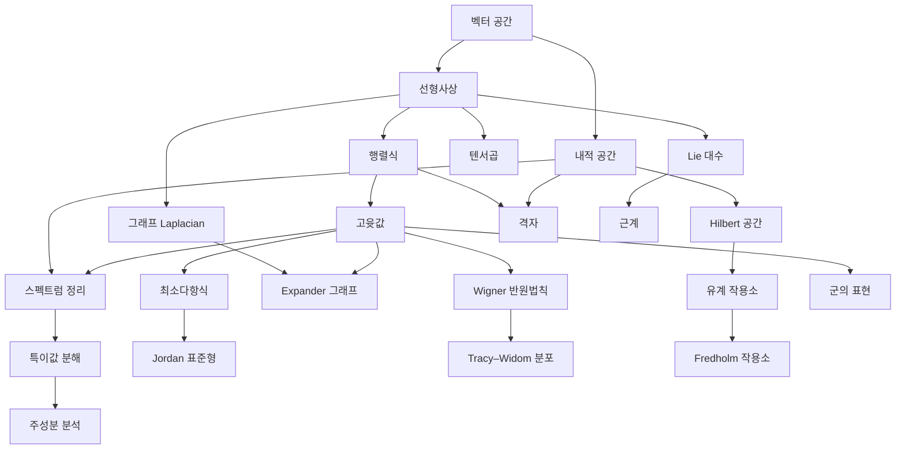

# 선형대수 개관

# 개요

선형대수(linear algebra)는 더하기와 상수배만으로 적히는 관계를 다루는 분야다. 미지수가 셋인 일차방정식 세 개를 동시에 푸는 문제, 평면의 도형을 돌리거나 한 방향으로 늘리는 변환이 이 꼴이다. 이런 문제는 수를 직사각형으로 늘어놓은 행렬 하나로 적히고, 그 행렬을 더 단순한 꼴로 바꾸면 풀린다.

처음 읽는 사람은 [벡터 공간](vector-spaces.md)에서 시작한다.

# 지도

# 갈래

처음 읽는 사람은 공간과 사상, 고윳값과 스펙트럼의 순서로 읽는다. 그 뒤는 관심사에 따라 고른다. 무한차원 작용소와 표현론은 두 기초 갈래만 있으면 읽히고, 수치 선형대수와 통계와 데이터는 무한차원 작용소의 완비성 논의를 쓴다. 그래프의 스펙트럼, 랜덤 행렬, 격자와 부호는 서로 독립이며 각각 그래프, 확률, 정수론의 문서를 하나씩 더 요구한다.

## 공간과 사상

먼저 읽을 것: [함수](functions.md). 시작 문서: [벡터 공간](vector-spaces.md).

- [벡터 공간](vector-spaces.md): 덧셈과 스칼라배가 따르는 공리, 기저와 차원
- [선형사상](linear-maps.md): 두 연산을 보존하는 함수와 그 행렬 표현
  - [쌍대 공간](dual-space.md): 벡터에 스칼라를 대응시키는 범함수 전체와 전치
  - [텐서곱](tensor-products.md): 다중선형 사상을 선형사상으로 바꾸는 공간
- [외대수](exterior-algebra.md): 반대칭 곱, 좌표를 쓰지 않는 행렬식의 정의

## 고윳값과 스펙트럼

먼저 읽을 갈래: 공간과 사상. 시작 문서: [행렬식](determinants.md).

- [행렬식](determinants.md): 열에 다중선형이고 교대적인 유일한 함수, 부피 배율과 가역성 판정
- [고윳값](eigenvalues.md): 방향을 바꾸지 않는 벡터와 그 배율, 대각화 가능성
  - [최소다항식](minimal-polynomial.md): 선형사상을 소멸시키는 최소 차수 다항식, 중근 없음과 대각화의 동치
    - [Jordan 표준형](jordan-canonical-form.md): 대각화되지 않는 행렬의 유사 불변량
    - [유리 표준형](rational-canonical-form.md): 고윳값이 체 밖에 있을 때 쓰는 유사 불변량
  - [Perron–Frobenius 정리](perron-frobenius.md): 음이 아닌 행렬의 최대 고윳값이 단순하고 고유벡터가 양이라는 정리
- [내적 공간](inner-product-spaces.md): 길이와 각도를 정하는 양의 정부호 쌍선형 형식
  - [Cauchy–Schwarz 부등식](cauchy-schwarz.md): 내적의 절댓값이 노름의 곱을 넘지 않는다는 부등식, 각의 정의와 삼각부등식의 근거
- [스펙트럼 정리](spectral-theorem.md): 자기수반 연산자가 정규직교 고유기저를 갖는다는 정리
- [특이값 분해](singular-value-decomposition.md): 직사각행렬을 회전, 축별 확대, 회전의 합성으로 쪼개는 분해

## 무한차원 작용소

먼저 읽을 것: [완비성](completeness.md). 먼저 읽을 갈래: 고윳값과 스펙트럼. 시작 문서: [Hilbert 공간](hilbert-spaces.md).

- [Hilbert 공간](hilbert-spaces.md): 내적이 만드는 거리에 완비인 공간, 정규직교기저의 전개
- [유계 작용소](bounded-operators.md): 연속인 선형사상과 그 스펙트럼
  - [비유계 작용소](unbounded-operators.md): 정의역이 조밀한 미분 작용소의 자기수반성
- [Fredholm 작용소](fredholm-operators.md): 핵과 여핵이 유한차원인 작용소, 지표의 섭동 불변성
- [Fredholm 행렬식](fredholm-determinant.md): 대각합류 작용소로 확장한 행렬식과 그 영점

## 표현론

먼저 읽을 것: [군 작용](group-actions.md), [다양체](manifolds.md). 먼저 읽을 갈래: 고윳값과 스펙트럼. 시작 문서: [군의 표현](group-representations.md).

- [군의 표현](group-representations.md): 군을 가역행렬의 군으로 실현하는 준동형, 기약 분해와 지표
- [Lie 대수](lie-algebras.md): 연속 대칭군의 항등원 접공간에 놓인 괄호 연산
- [근계](root-systems.md): Cartan 부분대수의 동시 고유공간이 주는 벡터 집합과 그 분류
- [Lie 군](lie-groups.md): 지수사상으로 대수에서 복원하는 군
  - [Grassmann 다양체](grassmannian.md): 부분공간 하나하나를 점으로 삼은 공간, Plücker 매장과 Schubert 세포
- [Schur 다항식](schur-polynomials.md): 지표를 행렬식의 비로 적는 대칭 다항식
- [Schur–Weyl 쌍대성](schur-weyl-duality.md): 텐서 거듭제곱 위에서 일반선형군과 대칭군의 작용이 서로의 교환자환인 것
  - [Hecke 작용소](hecke-operators.md): 격자의 지수 p 부분군을 더해 모듈러 형식에 작용시키는 연산자
  - [Sen 이론](sen-theory.md): p 진 표현의 무게를 선형대수의 고윳값으로 읽는 이론
  - [Reidemeister 비틀림](reidemeister-torsion.md): 사슬복합체의 기저 선택이 남기는 행렬식 불변량

## 수치 선형대수

먼저 읽을 갈래: 무한차원 작용소. 시작 문서: [행렬 분해](matrix-factorizations.md).

- [행렬 분해](matrix-factorizations.md): LU, Cholesky, QR 분해와 조건수, 연립방정식을 푸는 계산
- [삼중대각계](tridiagonal-systems.md): 세 대각에만 성분이 놓인 계, 미지수 개수에 비례하는 Thomas 알고리즘과 대각 우세에서의 안정성
- [Krylov 부분공간 방법](krylov-subspace-methods.md): 행렬-벡터 곱만 쓰는 반복법, 공액기울기법과 Lanczos 반복
  - [전처리](preconditioning.md): 스펙트럼을 모아 반복 횟수를 줄이는 행렬의 선택
    - [불완전 LU 분해](incomplete-lu.md): 채움을 버려 저장량을 고정한 근사 분해, M-행렬에서의 존재와 무늬 선택
  - [Schur 보수](schur-complement.md): 블록 소거가 남기는 작은 계, 행렬식과 양의 정부호성의 분리
  - [Sherman–Morrison 공식](sherman-morrison.md): 랭크 $1$ 갱신의 역행렬을 벡터 둘로 적는 식, 행렬식 보조정리와 Woodbury 항등식
- [유한요소법](finite-element-method.md): 약한 꼴 방정식을 조각마다 다항식인 부분공간에서 푸는 방법, Céa 보조정리와 강성행렬의 희소성
  - [혼합 유한요소법](mixed-finite-element-method.md): 해와 그 도함수를 서로 다른 공간에서 동시에 근사하는 이산화, Babuška–Brezzi 조건과 Raviart–Thomas 요소
  - [후처리 오차 추정자](a-posteriori-error-estimator.md): 근사해와 자료만으로 오차의 상한을 계산하는 양, 잔차형 추정자와 Dörfler 표시
- [다중격자](multigrid.md): 주파수대마다 격자 단계를 맡기는 V 사이클, 격자 간격과 무관한 수렴률
  - [완전 다중격자](full-multigrid.md): 성긴 격자의 해를 보간해 초기 근사로 쓰는 절차, 미지수 개수에 비례하는 연산으로 이산화 오차에 닿는 것
  - [완전 근사 저장](full-approximation-scheme.md): 비선형 방정식의 다중격자, 성긴 격자가 오차 대신 해 전체를 풀고 tau 보정이 두 격자의 이산화 차이를 메우는 것
  - [Fourier 국소 해석](local-fourier-analysis.md): 격자 모드마다 반복의 증폭률을 계산해 평활률과 수렴률을 예측하는 방법
    - [선 완화](line-relaxation.md): 비등방 스텐실에서 점 완화의 평활률이 $1$ 로 가는 계산, 강한 결합 방향의 줄을 동시에 푸는 평활자
    - [반좌표 성긴화](semicoarsening.md): 한 방향만 성기게 하는 격자 계층, 격자 계층의 크기와 선 완화와의 비교
  - [대수적 다중격자](algebraic-multigrid.md): 행렬 계수에서 읽은 강한 연결로 성긴 단계를 만드는 방법, C/F 분할과 Galerkin 곱
    - [평활 응집](smoothed-aggregation.md): 변수를 덩어리로 묶고 지시벡터를 완화해 보간을 만드는 방법, 영에너지 모드의 보존
- [영역 분할법](domain-decomposition.md): 부분영역마다 작은 계를 풀어 더하는 가법 Schwarz, 성긴 공간이 주는 조건수 상한

## 통계와 데이터

먼저 읽을 것: [확률변수](random-variables.md). 먼저 읽을 갈래: 무한차원 작용소. 시작 문서: [주성분 분석](principal-component-analysis.md).

- [주성분 분석](principal-component-analysis.md): 사영 분산이 큰 방향을 순서대로 뽑는 방법
  - [확률적 PCA](probabilistic-pca.md)(principal component analysis): 같은 부분공간을 잠재변수 모형의 최대가능도해로 얻는 구성
  - [커널 PCA](kernel-pca.md): 특징사상의 내적만으로 곡면 위의 데이터를 다루는 확장
- [선형회귀](linear-regression.md): 사영으로 푸는 최소제곱 추정과 정규방정식
- [이산 Fourier 변환](fourier.md): 순환 이동을 대각화하는 기저와 그 계수

## 그래프의 스펙트럼

먼저 읽을 것: [그래프](graphs.md). 먼저 읽을 갈래: 고윳값과 스펙트럼. 시작 문서: [그래프 Laplacian](graph-laplacian.md).

- [그래프 Laplacian](graph-laplacian.md): 정점 값과 이웃 값의 차이를 모은 행렬, 영공간의 차원이 연결성분 개수인 것
  - [유효저항](effective-resistance.md): 간선 가중치를 전도도로 본 두 정점 사이의 저항과 그 확률적 해석
    - [스펙트럼 희소화](spectral-sparsification.md): 이차형식을 근사하면서 간선 수를 줄인 그래프의 구성
- [Expander 그래프](expander-graphs.md): 차수가 묶인 채 모든 절단이 큰 그래프, 두 번째 고윳값이 주는 판정

## 랜덤 행렬

먼저 읽을 것: [중심극한정리](central-limit-theorem.md). 먼저 읽을 갈래: 고윳값과 스펙트럼. 시작 문서: [Wigner 반원법칙](wigner-semicircle.md).

- [Wigner 반원법칙](wigner-semicircle.md): 성분을 독립하게 뽑은 대칭행렬의 고윳값 분포가 반원으로 수렴하는 것
  - [Marchenko–Pastur 법칙](marchenko-pastur.md): 차원과 표본수의 비를 고정한 표본공분산행렬의 고윳값 분포
- [결정점과정](determinantal-point-process.md): 상관함수를 핵의 행렬식으로 적는 점과정, 고윳값의 반발
  - [Tracy–Widom 분포](tracy-widom.md): 최대 고윳값의 극한분포와 그 꼬리

## 격자와 부호

먼저 읽을 갈래: 고윳값과 스펙트럼. 시작 문서: [격자](lattices.md).

- [격자](lattices.md): 선형독립인 벡터들의 정수 결합 전체, 판별식과 연속 최소
  - [오류정정부호](error-correcting-codes.md): 유한체 위의 선형 부분공간으로 적는 부호와 최소거리
  - [최단벡터 문제](shortest-vector-problem.md): $0$ 이 아닌 가장 짧은 격자 벡터를 찾는 문제와 그 어려움
    - [격자 기반 후양자 암호](post-quantum-cryptography.md): 격자 문제의 어려움에 기댄 공개키 방식
- [질량 공식](mass-formula.md): 판별식을 고정한 정부호 이차형식의 류를 자기동형군의 크기로 가중해 더한 값
  - [Niemeier 격자](niemeier-lattices.md): $24$ 차원 짝수 유니모듈러 격자 $24$ 개의 분류

# 연관 문서

## 선수지식

- [집합](sets.md)

## 더 알아보기

- [벡터 공간](vector-spaces.md)

#linear_algebra #overview
