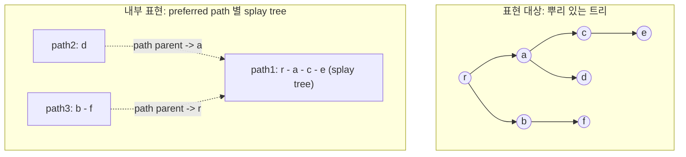

# Link-cut tree

# 개요

**Link-cut tree** 는 간선이 붙고 떨어지는 숲(forest)에서 두 정점이 같은 트리에 있는지, 그 사이 경로의 값이 무엇인지를 빠르게 답하는 자료구조다. 정점 $n$ 개의 숲에서 간선을 하나 끊거나 붙일 때마다 트리를 처음부터 다시 훑으면 질의 하나에 $O(n)$ 이 든다. Link-cut tree 는 각 트리를 경로들로 쪼개 [splay 트리](splay-trees.md)에 담고, 간선 추가, 간선 삭제, 뿌리 찾기, 경로 질의를 모두 [분할상환](amortized-analysis.md) $O(\log n)$ 에 처리한다.

# 직관

뿌리 $r$ 아래에 $a$ 와 $b$ 가 있고, $a$ 아래에 $c$ 와 $d$, $c$ 아래에 $e$, $b$ 아래에 $f$ 가 있는 트리에서 정점마다 값이 붙어 있다. $e$ 에서 뿌리까지 값의 합을 구하려고 부모를 따라 올라가면 $e,c,a,r$ 네 정점을 지난다. 트리가 한 줄로 늘어서 있으면 $n$ 걸음이 들고, 정점마다 뿌리까지의 합을 미리 저장해 두면 간선 $c$–$e$ 를 끊어 $e$ 를 $f$ 아래로 옮길 때 저장한 값을 다시 계산해야 한다.

트리를 경로 몇 개로 쪼개 두면 경로 하나는 정점이 깊이 순서로 늘어선 목록이다. 이 목록을 깊이를 키로 [균형 이진 탐색 트리](balanced-binary-search-trees.md)에 담으면 구간의 합이 로그 시간에 나온다. 위 트리를 $r$–$a$–$c$–$e$, $d$, $b$–$f$ 로 쪼개면 $e$ 에서 뿌리까지는 첫 경로 하나 안에 있고, $d$ 에서 뿌리까지는 $d$ 에서 $a$ 로 한 번 경로를 갈아탄다.

갈아타는 횟수가 적어야 한다. 트리가 고정이면 정점마다 부분트리가 가장 큰 자식으로 경로를 잇는 heavy-light 분해(heavy-light decomposition)를 쓴다. 작은 쪽으로 내려갈 때마다 부분트리 크기가 절반 이하로 줄므로 갈아타기가 $O(\log n)$ 번이다. 간선이 바뀌면 크기를 다시 계산해야 하므로, Link-cut tree 는 마지막으로 접근한 자식으로 경로를 잇고 경로를 splay 트리에 담아, 정점에 접근할 때마다 뿌리에서 그 정점까지를 경로 하나로 다시 잇는다.

그림의 위쪽이 직관 절의 트리이고 아래쪽이 경로 셋으로 쪼갠 내부 표현이다. 점선은 경로의 맨 위 정점에서 그 부모가 속한 경로로 가는 포인터다.

# 정의

## 표현 대상과 연산

**Link-cut tree** 는 정점마다 값이 붙은 뿌리 있는 숲을 유지하며 다음 연산을 지원하는 자료구조다. Sleator 와 Tarjan 이 최대유량 알고리즘을 위해 고안했다[^1].

- `link(v, w)`: 서로 다른 트리에 속한 $v$ (자기 트리의 뿌리)를 $w$ 의 자식으로 붙인다.
- `cut(v)`: $v$ 와 그 부모 사이의 간선을 끊는다.
- `findroot(v)`: $v$ 가 속한 트리의 뿌리를 반환한다.
- `evert(v)` (= `makeroot`): $v$ 를 트리의 뿌리로 바꾼다. 뿌리 없는 숲을 다룰 때 쓴다.
- `path(v, w)`: $v$ 에서 $w$ 까지의 경로 위 값들의 결합값(합, 최댓값 등)을 반환하거나 그 경로에 일괄 갱신을 한다.

결합값은 결합법칙을 만족하는 연산이어야 한다. 경로 뒤집기를 지원하려면 교환적이거나 좌우 두 방향의 값을 함께 들고 있어야 한다.

예. 직관 절의 트리에서 `findroot(e)` 는 $r$ 이다. `cut(e)` 를 하면 $e$ 가 혼자인 트리가 떨어져 나오고, 이어서 `link(e, f)` 를 하면 $e$ 가 $f$ 의 자식이 된다. 그 뒤 `path(e, r)` 은 $e,f,b,r$ 의 값을 결합한다.

## Preferred path 분해

각 정점은 자식 가운데 하나를 **preferred child** 로 가질 수 있고, 가지지 않을 수도 있다. 정점과 그 preferred child 를 잇는 간선을 preferred edge 라 하고, preferred edge 들의 극대 사슬을 **preferred path** 라 한다. 간선이 없는 정점 하나도 preferred path 다. preferred path 들은 정점 집합을 겹치지 않게 나눈다.

예. 직관 절의 트리에서 $r$, $a$, $c$, $b$ 의 preferred child 가 각각 $a$, $c$, $e$, $f$ 이면 preferred path 는 $r$–$a$–$c$–$e$, $d$, $b$–$f$ 셋이고, 이것이 그림의 아래쪽이다.

## 보조 트리

**보조 트리(auxiliary tree)** 는 preferred path 하나를 담은 splay 트리다. 정렬 기준(key)은 경로 위에서의 깊이다. 키를 실제로 저장하지는 않고 중위 순회 순서가 얕은 쪽에서 깊은 쪽 순서가 되도록 유지한다.

- 보조 트리 내부의 부모-자식 포인터는 양방향이다.
- 보조 트리의 뿌리는 그 경로의 가장 얕은 정점의 부모(다른 경로에 속한다)를 가리키는 **path parent** 포인터를 갖는다. 이 포인터는 단방향이고, 부모 쪽에서 자식 포인터로 가리키지 않는다.

어떤 노드가 자기 보조 트리의 뿌리인지는 다음으로 판정한다. 부모가 없거나, 부모의 두 자식 포인터 가운데 어느 것도 자신을 가리키지 않으면 뿌리다.

예. 경로 $r$–$a$–$c$–$e$ 의 보조 트리는 중위 순회가 $r,a,c,e$ 인 splay 트리다. 경로 $d$ 의 보조 트리의 뿌리 $d$ 는 path parent 로 $a$ 를, 경로 $b$–$f$ 의 보조 트리의 뿌리는 path parent 로 $r$ 을 가리킨다. $a$ 의 자식 포인터는 $d$ 를 가리키지 않으므로 $d$ 는 자기 보조 트리의 뿌리로 판정된다.

## access 연산

`access(v)` 는 뿌리에서 $v$ 까지의 모든 간선을 preferred edge 로 만들고 $v$ 의 preferred child 를 없애는 연산이며, 다음을 수행한다.

1. $v$ 를 자기 보조 트리에서 splay 해 뿌리로 올린다.
2. $v$ 의 오른쪽 부분트리(경로 상 $v$ 보다 깊은 부분)를 잘라 별도의 preferred path 로 만든다. 잘린 부분트리의 뿌리는 $v$ 를 path parent 로 갖는다.
3. $v$ 의 path parent $u$ 가 있으면 $u$ 를 splay 하고, $u$ 의 오른쪽 부분트리를 $v$ 의 보조 트리로 바꿔 두 경로를 잇는다. $v$ 를 $u$ 자리로 옮겨 1번부터 반복한다.
4. 뿌리에 도달하면 마지막으로 $v$ 를 다시 splay 한다.

끝나면 뿌리에서 $v$ 까지가 하나의 preferred path 가 되고, 그 보조 트리의 뿌리가 $v$ 다. 나머지 연산은 `access` 로 적힌다.

- `findroot(v)` 는 `access(v)` 뒤 보조 트리에서 가장 왼쪽 노드다.
- `path(v, w)` 는 `evert(v)` 뒤 `access(w)` 를 하면 보조 트리의 뿌리에 담긴 결합값이다.
- 뿌리를 $v$ 로 바꾸면 뿌리에서 $v$ 까지의 깊이 순서가 거꾸로 되므로, `evert(v)` 는 `access(v)` 뒤 보조 트리 전체에 뒤집기 표시(lazy reversal)를 단다.

예. 그림의 상태에서 `access(d)` 를 하면 $d$ 의 path parent $a$ 를 splay 하고, 경로 $r$–$a$–$c$–$e$ 에서 $a$ 보다 깊은 $c$–$e$ 를 잘라 path parent 가 $a$ 인 경로로 만든 뒤 $d$ 를 그 자리에 잇는다. 경로는 $r$–$a$–$d$, $c$–$e$, $b$–$f$ 가 된다.

# 성질

## 분할상환 복잡도

**정리.** $n$ 개의 정점에 대해 $m$ 번의 연산을 수행하면 총 시간은 $O((n+m)\log n)$ 이다. 즉 연산당 분할상환 $O(\log n)$ 이다.

**(1) preferred child 변경 횟수.** 정적 heavy-light 논법을 동적으로 옮긴다. 부분트리 크기가 부모의 절반을 넘는 자식으로 가는 간선을 heavy, 나머지를 light 라 하면 어떤 뿌리-정점 경로에도 light 간선은 $O(\log n)$ 개다.

- 한 번의 `access`에서 preferred child 가 바뀌는 횟수를 센다. light 간선이 preferred 가 되는 경우는 경로당 $O(\log n)$ 번뿐이다.
- heavy 간선이 preferred 가 되는 경우는 잠재함수 논법으로 상쇄한다. "preferred 가 아닌 heavy 간선의 개수"를 잠재함수로 두면, heavy 간선이 preferred 가 될 때마다 잠재가 1 줄고, 잠재가 늘어나는 것은 light 간선이 preferred 가 되는 순간(경로당 $O(\log n)$ 번)과 `link`/`cut`으로 트리 모양이 바뀌는 순간뿐이다.

$m$ 번의 access 에서 preferred child 변경의 총합은 $O((n+m)\log n)$ 이다.

**(2) splay 의 비용.** 각 변경은 splay 한 번에 대응한다. splay 트리의 접근 정리(access lemma)[^2]에 따라 크기 $k$ 의 splay 트리에서 splay 한 번의 분할상환 비용은 $O(\log k)$ 이며, 여러 splay 트리를 오가는 경우에도 전체 정점 수를 가중치로 삼는 잠재함수를 쓰면 각 splay 가 $O(\log n)$ 으로 묶인다. 이 잠재함수 분석이 Sleator–Tarjan 의 것이다[^1].

두 결과를 합치면 연산당 $O(\log n)$ 이 나온다. 여기서 $O(\log n)$ 은 분할상환이며 한 번의 연산은 최악의 경우 선형 시간이 걸릴 수 있다. 최악의 경우에도 $O(\log n)$ 을 보장하려면 splay 대신 globally biased search tree 를 쓰면 되지만, 구현이 훨씬 복잡하고 상수가 크다.

## 연산별 비용

- **경로 질의.** 합, 최댓값, 최솟값, lazy 전파를 통한 경로 일괄 갱신을 모두 지원한다. `access` 뒤에는 splay 트리 뿌리 하나만 읽으면 된다.
- **부분트리 질의.** 부분트리는 여러 preferred path 에 흩어지므로, 각 노드가 "preferred 가 아닌 자식들의 결합값"(virtual subtree)을 따로 유지해야 한다. 갱신 가능한 결합 연산(예: 합)에서는 가능하지만, 최댓값처럼 값을 빼기 어려운 연산에서는 다중집합을 들고 있어야 해 상수가 커진다.
- **경로 뒤집기.** 지연 표시로 처리한다. 결합값이 교환적이 아니면 정방향·역방향 두 값을 함께 유지한다.
- 사이클을 허용하지 않는다. 일반 그래프에서는 신장 숲만 이 구조로 유지하고, 나머지 간선은 별도로 관리한다.

## 다른 구조와의 비교

| 구조 | 경로 질의 | 부분트리 질의 | 비고 |
| --- | --- | --- | --- |
| Link-cut tree | 지원 | 추가 구현 필요 | 분할상환 $O(\log n)$ |
| Euler tour tree | 어려움 | 지원 | 구현이 단순, 무뿌리 숲에 적합 |
| Top tree | 지원 | 지원 | 일반적이지만 무겁다 |
| Heavy-light 분해 | 지원 | 지원 | 트리가 고정된 경우에만 |

[동적 연결성](dynamic-connectivity.md)의 일반 그래프 문제에서는 Euler tour tree 를 계층적으로 쌓는 방법이 분할상환 $O(\log^2 n)$ 을 준다. Link-cut tree 는 숲에 특화된 대신 경로 정보를 직접 다룰 수 있다는 장점이 있다.

# 활용

## 동적 숲 연결성

`connected(v, w)` 는 `findroot` 두 번으로 끝난다. 간선 추가와 삭제가 섞여 들어오는 온라인 질의를 그래프가 숲인 한 $O(\log n)$ 에 처리한다. 간선 추가만 있다면 [서로소 집합 자료구조](union-find.md)가 거의 상수 시간에 처리한다. 삭제나 경로 질의가 필요할 때 link-cut tree 를 쓴다.

## 동적 최소 신장트리

[최소 신장트리](minimum-spanning-tree.md)를 온라인으로 유지하는 문제에서 link-cut tree 는 교환 논법을 그대로 구현한다. 간선마다 정점을 하나 끼워 그 정점의 값으로 가중치를 두고 경로 최댓값 질의를 쓴다. 새 간선 $(u,w)$ 가 들어오면 다음을 수행한다.

1. $u$ 와 $w$ 가 다른 트리면 그냥 `link`한다.
2. 같은 트리면 $u$ 에서 $w$ 까지 경로의 최대 가중치 간선을 찾는다.
3. 그 간선이 새 간선보다 무거우면 `cut`하고 새 간선을 `link`한다. 아니면 새 간선을 버린다.

각 단계가 $O(\log n)$ 이므로 간선당 로그 시간이다. 이 교환 규칙의 정당성은 [Matroid](matroids.md)의 순환 성질(cycle property)에서 온다. 사이클에서 가장 무거운 간선은 어떤 최소 신장트리에도 속하지 않는다.

## 최대유량

Sleator 와 Tarjan 은 최대유량 알고리즘을 위해 이 자료구조를 만들었다[^1]. Dinic 류 알고리즘에서 blocking flow 를 찾을 때, 단순 구현은 증가 경로를 한 간선씩 따라가며 병목을 찾고 잔여 용량을 갱신하므로 경로 길이에 비례하는 시간이 든다. Link-cut tree 에 현재 탐색 숲을 담아 두면 다음이 가능하다.

- 경로 위 최소 잔여 용량 찾기: 경로 최솟값 질의.
- 그 경로 전체의 용량을 한꺼번에 줄이기: 경로 일괄 갱신(lazy).
- 포화된 간선 제거: `cut`.

그 결과 blocking flow 한 단계가 $O(E\log V)$ 가 되고 전체가 $O(VE\log V)$ 가 된다. 같은 아이디어가 [네트워크 흐름](network-flow.md)의 여러 변형과 최소비용 유량에도 쓰인다.

## 트리 경로 질의와 동적 그래프 알고리즘

- **트리 경로 질의의 온라인 버전.** 트리 모양이 고정이면 heavy-light 분해로 충분하지만, 간선이 바뀌면 link-cut tree 가 필요하다. **LCA**(lowest common ancestor)도 `access`의 반환값으로 얻는다.
- **동적 그래프 알고리즘의 부품.** 신장 숲을 link-cut tree 로 유지하고 나머지 간선을 계층적으로 관리하는 방식이 동적 연결성과 동적 이중연결성 알고리즘의 표준 구성이다.
- **계산 기하와 구간 문제.** 구간 병합, 오프라인 질의의 온라인화 등에서 트리 구조 갱신이 필요한 경우에 등장한다.
- **그래프 알고리즘의 일반화.** [그래프](graphs.md) 위의 흐름·매칭 알고리즘에서 경로를 따라가며 상태를 갱신하는 단계를 이 구조로 가속한다.

[^1]: D. D. Sleator, R. E. Tarjan, "A Data Structure for Dynamic Trees", Journal of Computer and System Sciences 26(3):362–391, 1983, https://doi.org/10.1016/0022-0000(83)90006-5
[^2]: D. D. Sleator, R. E. Tarjan, "Self-Adjusting Binary Search Trees", Journal of the ACM 32(3):652–686, 1985, https://doi.org/10.1145/3828.3835

# 연관 문서

## 선수지식

- [Splay 트리](splay-trees.md)
- [동적 연결성](dynamic-connectivity.md)

## 더 알아보기

아직 연결한 문서가 없다.

#data_structures #algorithms #graph_theory
