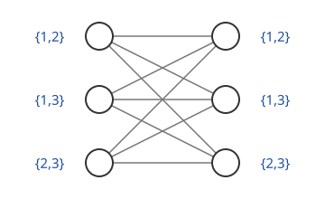

# 목록 색칠

# 개요

**목록 색칠(list coloring)** 은 그래프의 정점마다 허용된 색의 목록을 주고, 각 정점이 자기 목록 안의 색을 받으며 인접한 두 정점이 다른 색을 받게 칠하는 것이다. 무선 기지국마다 쓸 수 있는 주파수가 지역 규정으로 다르게 정해져 있을 때, 이웃한 기지국끼리 같은 주파수를 쓰지 않게 배정하는 문제가 이 꼴이다. 목록이 정점마다 몇 개 이상이면 언제나 칠할 수 있는지를 그래프의 구조로부터 계산한다.

# 직관

양쪽에 정점이 셋씩 있고 왼쪽의 모든 정점이 오른쪽의 모든 정점과 이웃한 그래프 $K_{3,3}$ 은 왼쪽을 색 $1$, 오른쪽을 색 $2$ 로 칠하면 되므로 채색수가 $2$ 다. 이제 왼쪽 세 정점에 목록 $\lbrace 1,2\rbrace$, $\lbrace 1,3\rbrace$, $\lbrace 2,3\rbrace$ 을, 오른쪽 세 정점에도 같은 세 목록을 준다.

왼쪽 세 정점은 서로 이웃하지 않으므로 아무렇게나 골라도 되지만, 세 목록에서 하나씩 고르면 쓰인 색은 적어도 두 가지다. 쓰인 색이 세 가지이면 오른쪽의 어느 정점도 색을 받을 수 없다. 쓰인 색이 두 가지이면 그 두 색이 바로 세 목록 가운데 하나이고, 그 목록을 가진 오른쪽 정점이 색을 받을 수 없다. 그래서 크기 $2$ 인 목록으로는 칠할 수 없는 경우가 있고, $K_{3,3}$ 의 선택수는 $3$ 이상이다.

# 정의

$G=(V,E)$ 를 그래프라 한다. 정점마다 유한집합 $L(v)$ 를 주는 함수 $L$ 을 목록 배정이라 하고, $c(v)\in L(v)$ 이며 $uv\in E$ 이면 $c(u)\ne c(v)$ 인 함수 $c$ 를 $L$ 색칠이라 한다.

함수 $f:V\to\mathbb N$ 에 대해 $\lvert L(v)\rvert\ge f(v)$ 인 모든 $L$ 에 $L$ 색칠이 존재하면 $G$ 는 $f$ 선택 가능(f-choosable)하다고 한다. $f$ 가 상수 $k$ 이면 $k$ 선택 가능이라 하고, $k$ 선택 가능한 가장 작은 $k$ 가 **선택수(choice number)** $\mathrm{ch}(G)$ 다. 목록 채색수(list chromatic number)라고도 한다. 모든 목록이 같으면 보통의 [그래프 색칠](graph-coloring.md)이므로 선택수는 채색수 이상이다. P. Erdős, A. L. Rubin, H. Taylor 와 V. G. Vizing 이 따로 도입했다[^1].

$$
\chi(G)\le\mathrm{ch}(G)\le\Delta(G)+1
$$

여기서 $\Delta(G)$ 는 최대 차수다. 오른쪽 부등식은 정점을 아무 순서로 칠할 때 이미 칠한 이웃이 많아야 $\Delta(G)$ 개라는 데서 나온다.

# 성질

## 이분그래프의 선택수

완전이분그래프 $K_{m,m}$ 에서 $m=\binom{2k-1}{k}$ 이면 $\mathrm{ch}(K_{m,m})\gt k$ 다[^1]. 직관 절의 구성에서 색을 $2k-1$ 개로 늘리고 그 $k$ 원소 부분집합 전체를 양쪽의 목록으로 주면, 왼쪽에 쓰인 색이 $k$ 개 이상이 되어 오른쪽의 어느 목록을 전부 덮는다. 채색수가 $2$ 인 그래프의 선택수가 이렇게 한없이 커진다.

## Alon–Tarsi 정리

[조합적 영점 정리](combinatorial-nullstellensatz.md)로 선택수의 상한을 얻는다. 정점에 $v_1,\dots,v_n$ 으로 번호를 붙이고 그래프 다항식을

$$
P_G(x_1,\dots,x_n)=\prod_{v_iv_j\in E,\thinspace i\lt j}(x_i-x_j)
$$

로 둔다. 색칠 $c$ 가 $L$ 색칠인 것은 $c(v_i)\in L(v_i)$ 이고 $P_G(c(v_1),\dots,c(v_n))\ne 0$ 인 것과 동치다. $P_G$ 의 전체 차수는 간선 수 $\lvert E\rvert$ 이므로, $d_1+\cdots+d_n=\lvert E\rvert$ 인 단항식 $x_1^{d_1}\cdots x_n^{d_n}$ 의 계수가 $0$ 이 아니면 조합적 영점 정리의 둘째 판본에 따라 $G$ 는 $v_i\mapsto d_i+1$ 선택 가능하다.

**Alon–Tarsi 정리(Alon–Tarsi theorem)** 는 이 계수를 방향 짓기로 계산한다[^2]. 정점 $v_i$ 에서 나가는 간선이 $d_i$ 개인 방향 짓기 $D$ 에서, 모든 정점에서 들어오는 간선 수와 나가는 간선 수가 같은 부분 간선 집합 가운데 원소가 짝수 개인 것과 홀수 개인 것의 개수가 다르면 그 계수가 $0$ 이 아니다. 이분그래프에서는 그런 부분 간선 집합이 방향 있는 순환들로 나뉘고 순환이 모두 짝수 길이이므로 원소가 늘 짝수 개다. 빈 집합이 그 가운데 하나이므로 두 개수가 다르고, 나가는 간선이 정점마다 $d$ 개 이하인 방향 짓기가 있는 이분그래프는 $d+1$ 선택 가능하다. 평면 이분그래프는 이 방법으로 $3$ 선택 가능하다는 것이 증명된다.

## Thomassen 정리

**Thomassen 정리(Thomassen's theorem)** 는 모든 [평면 그래프](planar-graphs.md)가 $5$ 선택 가능하다는 정리다[^3]. 증명은 더 강한 명제의 귀납법이다. 바깥 경계가 순환 $C$ 이고 안쪽 면이 모두 삼각형인 평면 그래프에서, $C$ 위의 이웃한 두 정점을 서로 다른 색으로 미리 칠하고 $C$ 의 다른 정점에 크기 $3$ 의 목록, 안쪽 정점에 크기 $5$ 의 목록을 주면 색칠이 존재한다. $C$ 에 현이 있으면 현으로 나눈 두 쪽에 차례로 귀납 가정을 쓰고, 현이 없으면 미리 칠한 정점 $x$ 의 다른 쪽 경계 이웃 $v$ 를 지우고, $L(v)$ 에서 $x$ 의 색이 아닌 두 색을 골라 $v$ 의 안쪽 이웃들의 목록에서 뺀 뒤 귀납 가정을 쓴다. 그 이웃들은 새 경계에 놓이므로 목록이 $3$ 개 이상이면 되고, 남겨 둔 두 색 가운데 하나가 $v$ 에 남는다.

M. Voigt 는 $4$ 선택 가능이 아닌 평면 그래프를 구성했다[^4]. 그래서 평면 그래프의 선택수 상한 $5$ 는 개선되지 않고, 4색 정리(four color theorem)와 달리 $4$ 로 내려가지 않는다.

## Galvin 정리

**Galvin 정리(Galvin's theorem)** 는 이분그래프의 간선에 크기 $\Delta$ 의 목록을 주면 꼭짓점을 공유하는 두 간선이 다른 색을 받는 목록 색칠이 존재한다는 정리다[^5]. $n\times n$ 칸마다 크기 $n$ 의 목록을 주면 같은 행과 같은 열의 칸이 서로 다른 수를 받게 채울 수 있다는 Dinitz 추측(Dinitz conjecture)이 $K_{n,n}$ 의 간선에 대한 이 정리의 특수한 경우다. 증명은 간선들 사이에 방향을 주어 [안정 매칭](stable-matching.md)의 존재로 핵(kernel)을 찾는다.

# 활용

- 주파수 배정. 송신기마다 쓸 수 있는 주파수가 다를 때 이웃한 송신기가 다른 주파수를 받는 배정이 목록 색칠이다.
- [Latin 방진](latin-squares.md)의 완성. Galvin 정리는 칸마다 허용된 수가 다른 Latin 방진이 존재할 조건을 준다.

[^1]: P. Erdős, A. L. Rubin, H. Taylor, "Choosability in graphs", Proceedings of the West Coast Conference on Combinatorics, Graph Theory and Computing, Congressus Numerantium 26 (1979), 125–157.
[^2]: N. Alon, M. Tarsi, "Colorings and orientations of graphs", Combinatorica 12 (1992), 125–134.
[^3]: C. Thomassen, "Every planar graph is 5-choosable", Journal of Combinatorial Theory, Series B 62 (1994), 180–181.
[^4]: M. Voigt, "List colourings of planar graphs", Discrete Mathematics 120 (1993), 215–219.
[^5]: F. Galvin, "The list chromatic index of a bipartite multigraph", Journal of Combinatorial Theory, Series B 63 (1995), 153–158.

# 연관 문서

## 선수지식

- [그래프 색칠](graph-coloring.md)
- [조합적 영점 정리](combinatorial-nullstellensatz.md)

## 더 알아보기

아직 연결한 문서가 없다.

#graph_theory #combinatorics #algebra
