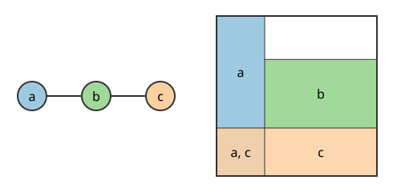

# 국소 보조정리의 Shearer 경계

# 개요

**국소 보조정리의 Shearer 경계(Shearer's bound for the local lemma)** 는 나쁜 사건들의 확률과 얽힘의 구조만 알 때, 사건을 모두 피할 확률이 양수라고 보장할 수 있는 확률의 정확한 범위다. [Lovász 국소 보조정리](lovasz-local-lemma.md)는 사건마다 얽힌 사건이 둘이면 확률이 $1/(3e)\approx 0.123$ 이하일 때 결론을 주는데, 세 사건이 한 줄로 얽힌 경우 실제로는 $0.38$ 까지 결론이 성립한다. Shearer 경계는 얽힘을 나타내는 그래프의 독립집합 다항식이 양수인 범위로 이 한계를 정확히 계산한다.

# 직관

나쁜 사건 $A\_a$, $A\_b$, $A\_c$ 의 확률이 모두 $p$ 이고, $A\_b$ 는 $A\_a$, $A\_c$ 와 얽혀 있고 $A\_a$ 와 $A\_c$ 는 서로 독립이다. 얽힘을 그래프로 그리면 아래 그림 왼쪽의 경로 $a\text{–}b\text{–}c$ 다.

세 사건을 모두 피할 확률이 가장 작아지게 사건을 놓아 본다. 오른쪽 그림은 넓이가 $1$ 인 정사각형이고, 넓이가 확률이다. $A\_a$ 는 왼쪽 띠, $A\_c$ 는 아래 띠이며 두 띠의 겹침 넓이가 $p^2$ 이라 서로 독립이다. 얽힌 사건과 겹치면 덮는 넓이가 줄어드니, $A\_b$ 는 두 띠와 겹치지 않게 오른쪽 위 사각형 안에 넣는다.

두 띠가 덮는 넓이는 $2p-p^2$ 이고 $A\_b$ 가 $p$ 를 더 덮으므로, 흰 부분의 넓이는 $1-3p+p^2$ 이다. 그림의 $p=0.3$ 에서는 $0.19$ 다. 이 값은 $p\lt(3-\sqrt5)/2\approx 0.382$ 에서 양수이고, $p$ 가 이보다 크면 오른쪽 위 사각형에 $A\_b$ 가 다 들어가지 않아 세 사건이 정사각형 전체를 덮을 수 있다.

$1-3p+p^2$ 의 항은 경로에서 이웃하지 않는 정점의 묶음, 곧 독립집합 $\varnothing$, $\lbrace a\rbrace$, $\lbrace b\rbrace$, $\lbrace c\rbrace$, $\lbrace a,c\rbrace$ 마다 $(-p)^{\text{크기}}$ 를 더한 것이다. Shearer 는 어느 의존성 그래프에서나 가장 나쁜 배치가 이 꼴의 값을 준다는 것을 증명했다.

# 정의

## 독립집합 다항식

그래프 $G=(V,E)$ 의 **다변수 독립집합 다항식(multivariate independence polynomial)** 은 다음이다.

$$
Z\_G(x)=\sum\_{I\in\mathcal I(G)}\prod\_{v\in I}x\_v
$$

$\mathcal I(G)$ 는 $G$ 의 [독립집합](independent-set.md) 전체이고 공집합을 포함한다. $S\subseteq V$ 에 대해 $Z\_S$ 는 $S$ 가 만드는 유도 부분그래프의 다항식이다. 모든 $x\_v$ 가 같은 $\lambda$ 이면 [단단한 알갱이 모형](hard-core-model.md)의 분배함수 $Z\_G(\lambda)$ 다. 직관 절의 경로에서 $Z\_G(-p)=1-3p+p^2$ 이다.

## Shearer 영역

확률의 벡터 $p=(p\_v)\_{v\in V}$ 가 모든 $S\subseteq V$ 에서 $Z\_S(-p)\gt 0$ 을 만족하면 $p$ 가 $G$ 의 **Shearer 영역(Shearer region)** 에 있다고 한다. 직관 절의 경로에서 모든 $p\_v=p$ 이면 정점 하나에서 $1-p$, 간선 하나에서 $1-2p$, $\lbrace a,c\rbrace$ 에서 $(1-p)^2$, 전체에서 $1-3p+p^2$ 이므로, Shearer 영역은 $p\lt(3-\sqrt5)/2$ 다.

# 성질

## Shearer 정리

정리. 사건 $A\_v$ ($v\in V$) 의 의존성 그래프가 $G$ 이고 $\Pr(A\_v)\le p\_v$ 라 하자. $p$ 가 Shearer 영역에 있으면 다음이 성립한다.

$$
\Pr\Bigl(\bigcap\_{v\in V}\overline{A\_v}\Bigr)\ge Z\_G(-p)\gt 0
$$

$p$ 가 Shearer 영역 밖에 있으면, 의존성 그래프가 $G$ 이고 $\Pr(A\_v)=p\_v$ 이면서 모든 $A\_v$ 를 피할 확률이 $0$ 인 사건들이 있다[^1].

증명의 요지. $P\_S$ 를 $S$ 의 사건을 모두 피할 확률로 두고, $v\in S$ 마다 $P\_S/P\_{S\setminus v}\ge Z\_S(-p)/Z\_{S\setminus v}(-p)$ 를 $\vert S\vert$ 에 대한 귀납법으로 보인다. 독립집합을 $v$ 를 포함하는 것과 포함하지 않는 것으로 나누면 다음 항등식이 나온다.

$$
Z\_S(-p)=Z\_{S\setminus v}(-p)-p\_v\thinspace Z\_{S\setminus N\lbrack v\rbrack}(-p)
$$

$N\lbrack v\rbrack$ 는 $v$ 와 그 이웃의 집합이다. 확률 쪽에서는 $A\_v$ 가 $S\setminus N\lbrack v\rbrack$ 의 사건들과 독립이므로 $P\_S\ge P\_{S\setminus v}-p\_v P\_{S\setminus N\lbrack v\rbrack}$ 이다. $S\setminus v$ 에서 이웃을 하나씩 지우며 귀납 가정의 비를 곱하면 $P\_{S\setminus N\lbrack v\rbrack}/P\_{S\setminus v}\le Z\_{S\setminus N\lbrack v\rbrack}/Z\_{S\setminus v}$ 이고, 이것을 넣으면 항등식의 비가 나온다.

반대쪽은 직관 절처럼 이웃한 사건을 서로 겹치지 않게, 이웃하지 않은 사건을 독립으로 놓는다. 이때 [포함배제 원리](inclusion-exclusion.md)의 항 가운데 이웃한 두 사건의 교집합을 담는 항이 모두 $0$ 이 되어 사건을 모두 피할 확률이 정확히 $Z\_G(-p)$ 다.

## 최대 차수로 하는 경계

최대 차수가 $d$ 인 모든 그래프에서, 모든 $p\_v$ 가 다음 값 이하이면 $p$ 가 Shearer 영역에 있다[^1].

$$
p\le\frac{(d-1)^{d-1}}{d^d}
$$

모든 정점의 차수가 $d$ 인 무한 나무를 깊이에서 자른 유한 나무들에서 Shearer 영역의 경계가 이 값으로 내려오므로 상수를 더 키울 수 없다. $d$ 를 곱하면 $1/e$ 로 가므로, 국소 보조정리의 대칭형 조건 $e\thinspace p\thinspace(d+1)\le 1$ 의 상수 $e$ 도 더 줄일 수 없다.

$d=2$ 에서 값은 $1/4$ 이다. 경로 $P\_n$ 의 끝 정점에 위의 항등식을 쓰면 다음 점화식이 나온다.

$$
Z\_{P\_n}(-p)=Z\_{P\_{n-1}}(-p)-p\thinspace Z\_{P\_{n-2}}(-p)
$$

이 점화식의 특성방정식 $r^2-r+p=0$ 은 $p\le 1/4$ 에서 양의 실근을 가지고, $p\gt 1/4$ 이면 두 근이 복소수라 $Z\_{P\_n}(-p)$ 가 부호를 바꾸며 진동하다가 음수가 된다. 직관 절의 $0.382$ 는 정점 셋의 경로에서의 값이고, 경로가 길어질수록 $1/4$ 로 내려간다.

## 영점 없는 다원판

A. D. Scott 와 A. D. Sokal 은 $p$ 가 Shearer 영역에 있는 것과 $\vert x\_v\vert\le p\_v$ 인 모든 복소수 $x$ 에서 $Z\_G(x)\ne 0$ 인 것이 동치임을 증명했다[^2]. 그래서 국소 보조정리의 조건은 반발하는 격자 기체(repulsive lattice gas)의 분배함수에 영점이 없다는 통계역학의 조건과 같다.

# 활용

- 국소 보조정리의 판정. 비대칭형 국소 보조정리의 조건을 만족하는 $p$ 는 Shearer 영역에 있고, 의존성 그래프가 작으면 $Z\_S(-p)$ 를 직접 계산해 더 넓은 범위에서 결론을 얻는다.
- 알고리즘. K. Kolipaka 와 M. Szegedy 는 [Moser–Tardos 알고리즘](moser-tardos-algorithm.md)이 Shearer 영역 전체에서 유한한 기대 횟수의 다시 뽑기로 멈춤을 증명했다[^3].
- 근사 세기. [Barvinok 보간법](barvinok-interpolation.md)은 독립집합 다항식이 원판 $\vert\lambda\vert\lt(d-1)^{d-1}/d^d$ 에서 영점을 갖지 않는다는 이 경계를 써서 분배함수를 근사한다.

[^1]: J. B. Shearer, "On a problem of Spencer", *Combinatorica* 5 (1985), 241–245.
[^2]: A. D. Scott, A. D. Sokal, "The repulsive lattice gas, the independent-set polynomial, and the Lovász local lemma", *Journal of Statistical Physics* 118 (2005), 1151–1261.
[^3]: K. Kolipaka, M. Szegedy, "Moser and Tardos meet Lovász", *Proceedings of the 43rd ACM Symposium on Theory of Computing* (2011), 235–244.

# 연관 문서

## 선수지식

- [Lovász 국소 보조정리](lovasz-local-lemma.md)
- [단단한 알갱이 모형](hard-core-model.md)

## 더 알아보기

아직 연결한 문서가 없다.

#combinatorics #probability #graph_theory
