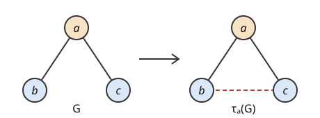

# 국소 보완

# 개요

**국소 보완(local complementation)** 은 [그래프](graphs.md)의 한 정점을 골라, 그 정점의 이웃끼리 이어진 간선은 지우고 이어지지 않은 쌍은 잇는 연산이다. 정점 셋을 일렬로 이은 그래프와 세 정점을 모두 이은 삼각형은 서로 다른 그래프이지만, 둘로 만든 그래프 상태는 큐비트마다 한 큐비트 게이트를 걸면 서로 바뀐다. 국소 보완은 그래프 상태가 이렇게 한 큐비트 게이트만으로 서로 바뀌는 경우를 그래프의 연산 하나로 적는다.

# 직관

[측정 기반 양자 계산](measurement-based-quantum-computation.md)은 그래프 상태를 먼저 만들고 큐비트를 하나씩 측정한다. 큐비트마다 한 큐비트 게이트를 거는 일은 측정 기저를 돌리는 것과 같으므로, 한 큐비트 게이트로 서로 바뀌는 두 그래프 상태는 계산에 똑같이 쓰인다. 그래서 두 그래프의 그래프 상태가 언제 이렇게 바뀌는지를 묻는다.

정점 $b,a,c$ 를 일렬로 이은 그래프 $G$ 를 본다. 그래프 상태는 연산자 $K\_v=X\_v\prod\_{w\in N(v)}Z\_w$ 전체를 곱해도 그대로인 유일한 상태이므로, $G$ 의 그래프 상태는 다음 세 연산자로 정해진다.

$$
Z\_bX\_aZ\_c,\qquad Z\_aX\_b,\qquad Z\_aX\_c
$$

정점 $a$ 에 $V=e^{-i\pi X/4}$ 를, $b$ 와 $c$ 에 $W=e^{i\pi Z/4}$ 를 건다. $V$ 는 $X$ 를 그대로 두고 $Z$ 를 $-Y$ 로 보내고, $W$ 는 $Z$ 를 그대로 두고 $X$ 를 $-Y$ 로 보낸다. 그러면 세 연산자는 각각 $Z\_bX\_aZ\_c$, $Y\_aY\_b$, $Y\_aY\_c$ 로 간다.

세 정점을 모두 이은 삼각형의 그래프 상태는 $X\_aZ\_bZ\_c$, $Z\_aX\_bZ\_c$, $Z\_aZ\_bX\_c$ 로 정해진다. 첫째와 둘째를 곱하면 $(XZ)\_a(ZX)\_b=Y\_aY\_b$ 이고, 첫째와 셋째를 곱하면 $Y\_aY\_c$ 다. 그래서 게이트를 건 상태가 삼각형의 그래프 상태다. 아래 그림의 왼쪽이 $G$, 오른쪽이 삼각형이고, 점선이 $a$ 의 두 이웃 $b,c$ 사이에 새로 생긴 간선이다.

# 정의

## 국소 보완

그래프 $G$ 와 정점 $a$ 에 대해, $a$ 의 이웃 $N(a)$ 의 두 정점 쌍마다 간선이 있으면 지우고 없으면 더한 그래프를 $\tau\_a(G)$ 라 하고 $G$ 의 $a$ 에서의 **국소 보완(local complementation)** 이라 한다. $N(a)$ 안의 쌍이 아닌 간선은 바꾸지 않는다. 직관 절의 $G$ 에서 $N(a)=\lbrace b,c\rbrace$ 이므로 $\tau\_a(G)$ 는 간선 $bc$ 를 더한 삼각형이고, 삼각형에서 다시 $a$ 에서 국소 보완하면 $bc$ 가 지워져 $G$ 로 돌아온다.

## 국소 Clifford 동치

[Gottesman–Knill 정리](gottesman-knill.md)의 Clifford 군에서 한 큐비트 원소를 **한 큐비트 Clifford 게이트(single-qubit Clifford gate)** 라 한다. $n$ 큐비트 상태 $\vert\psi\rangle,\vert\phi\rangle$ 에 대해 한 큐비트 Clifford 게이트 $C\_1,\dots,C\_n$ 이 있어서

$$
\vert\psi\rangle=(C\_1\otimes\cdots\otimes C\_n)\vert\phi\rangle
$$

이면 두 상태가 **국소 Clifford 동치(local Clifford equivalent)** 라 한다. 직관 절의 $V$ 와 $W$ 는 한 큐비트 Clifford 게이트이므로 일렬 그래프와 삼각형의 그래프 상태는 국소 Clifford 동치다.

# 성질

## 국소 보완 규칙

그래프 $G$ 와 정점 $a$ 에 대해 다음이 전체 위상을 빼고 성립한다[^1].

$$
\vert\tau\_a(G)\rangle=e^{-i\pi X\_a/4}\prod\_{b\in N(a)}e^{i\pi Z\_b/4}\thinspace\vert G\rangle
$$

증명의 요지. 오른쪽 게이트를 $U$ 라 하고 $G$ 의 안정자 $K\_v$ 가 $UK\_vU^\dagger$ 로 가는 곳을 본다. $K\_a$ 는 $X\_a$ 와 $N(a)$ 위의 $Z$ 들로 되어 있어 그대로이고, $a$ 와 이웃이 아닌 $v$ 의 $K\_v$ 도 그대로다. $b\in N(a)$ 이면 $K\_b$ 의 $X\_b$ 와 $Z\_a$ 가 $-Y\_b$ 와 $-Y\_a$ 로 가서 $Y\_aY\_b\prod\_{c\in N(b)\setminus a}Z\_c$ 가 된다.

$\tau\_a(G)$ 에서 $b$ 의 이웃은 $N(b)$ 와 $N(a)\setminus b$ 의 대칭차다. 그래서 $\tau\_a(G)$ 의 $K\_aK\_b$ 를 계산하면 $(XZ)\_a(ZX)\_b$ 에 $N(b)\setminus a$ 위의 $Z$ 들이 붙어 위 연산자와 같다. 두 상태가 같은 안정자 군을 가지므로 같은 상태다.

## Van den Nest–Dehaene–De Moor 정리

두 그래프 상태 $\vert G\rangle,\vert H\rangle$ 가 국소 Clifford 동치인 것과, $G$ 에서 국소 보완을 몇 번 해서 $H$ 를 얻는 것은 동치다[^1]. 이것이 Van den Nest–Dehaene–De Moor 정리(Van den Nest–Dehaene–De Moor theorem)다. 국소 보완 규칙이 한쪽 방향이다. 반대 방향은 Gottesman–Knill 정리의 이진 표현으로 국소 Clifford 동치를 $\mathbb F\_2$ 위의 방정식으로 적고, 그 해가 국소 보완의 열에서 나온다는 것을 보여 증명한다. 같은 논문은 모든 안정자 상태가 어떤 그래프 상태와 국소 Clifford 동치라는 것도 보였다.

정점 $a$ 를 가운데에 둔 별 그래프에서 $a$ 에서 국소 보완하면 이웃끼리 모두 이어져 완전 그래프가 된다. 그래서 별 그래프와 완전 그래프의 그래프 상태는 국소 Clifford 동치이고, 둘 다 GHZ(Greenberger–Horne–Zeilinger) 상태 $\tfrac1{\sqrt 2}(\vert 0\cdots 0\rangle+\vert 1\cdots 1\rangle)$ 와 국소 Clifford 동치다.

## Pauli 측정 규칙

그래프 상태의 정점 $a$ 를 $Y$ 의 고윳값으로 측정하면, 나머지 큐비트는 $N(a)$ 위의 한 큐비트 Clifford 게이트를 빼고 $\vert\tau\_a(G)-a\rangle$ 이다[^2]. 정점 $a$ 를 계산 기저로 측정하면 $N(a)$ 위의 $Z$ 를 빼고 $\vert G-a\rangle$ 이므로, $Y$ 측정은 국소 보완을 한 뒤 정점을 지우는 것이다. 직관 절의 $G$ 에서 $a$ 를 $Y$ 로 측정하면 삼각형에서 $a$ 를 지운 간선 $bc$ 가 남아, 처음에 이어져 있지 않던 $b$ 와 $c$ 가 얽힌 쌍이 된다.

$X$ 측정도 국소 보완 세 번과 정점 지우기로 적힌다[^2]. 그래서 Pauli 측정만으로 된 측정 패턴은 그래프를 고쳐 쓰는 규칙으로 따라갈 수 있다.

# 활용

- 정점 부분 그래프. 국소 보완과 정점 지우기를 되풀이해 얻는 그래프를 **정점 부분 그래프(vertex-minor)** 라 한다. A. Bouchet 가 등방 체계(isotropic system)를 연구하며 도입했다[^3]. 그래프 상태에서는 Pauli 측정과 한 큐비트 Clifford 게이트로 얻을 수 있는 그래프 상태가 정점 부분 그래프다.
- 계수 폭. 그래프의 계수 폭(rank-width)은 국소 보완으로 바뀌지 않고, 정점 부분 그래프에서 커지지 않는다[^4]. 계수 폭이 유계인 그래프 족의 그래프 상태에서는 측정 기반 계산이 고전적으로 흉내 내진다[^5]. 정사각형 격자는 계수 폭이 한 변의 길이와 함께 커지므로 이 결과에 걸리지 않는다.
- 회로 간소화. 양자 회로를 그래프 꼴의 도형으로 적고 국소 보완과 그 변형으로 Clifford 부분의 정점을 지워 게이트 수를 줄이는 방법이 있다[^6].

[^1]: M. Van den Nest, J. Dehaene, B. De Moor, Graphical description of the action of local Clifford transformations on graph states, *Physical Review A* 69 (2004), 022316.
[^2]: M. Hein, J. Eisert, H. J. Briegel, Multiparty entanglement in graph states, *Physical Review A* 69 (2004), 062311.
[^3]: A. Bouchet, Graphic presentations of isotropic systems, *Journal of Combinatorial Theory, Series B* 45 (1988), 58–76.
[^4]: S. Oum, Rank-width and vertex-minors, *Journal of Combinatorial Theory, Series B* 95 (2005), 79–100.
[^5]: M. Van den Nest, W. Dür, G. Vidal, H. J. Briegel, Classical simulation versus universality in measurement-based quantum computation, *Physical Review A* 75 (2007), 012337.
[^6]: R. Duncan, A. Kissinger, S. Perdrix, J. van de Wetering, Graph-theoretic simplification of quantum circuits with the ZX-calculus, *Quantum* 4 (2020), 279.

# 연관 문서

## 선수지식

- [측정 기반 양자 계산](measurement-based-quantum-computation.md)

## 더 알아보기

아직 연결한 문서가 없다.

#computation #graph_theory #group_theory
