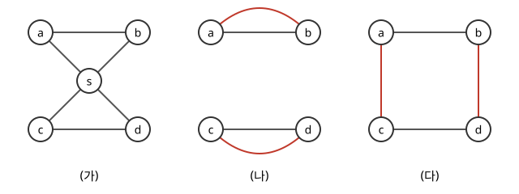

# Lovász 떼어내기 정리

# 개요

**Lovász 떼어내기 정리(Lovász's splitting-off theorem)** 는 그래프에서 정점 하나를 없애면서 그 정점의 간선을 둘씩 이어 붙여, 남은 정점들 사이의 간선 연결도를 그대로 지킬 수 있다는 정리다. 교차로 $s$ 를 없애고 $s$ 로 모이던 도로를 둘씩 이어 입체교차로로 바꾸려 하면, 잇는 짝을 잘못 고른 탓에 남은 지점들이 두 덩어리로 갈라질 수 있다.

이 정리는 $s$ 에 닿는 도로 수가 짝수이고 남은 지점들이 도로 둘 이상으로 이어져 있으면, 연결도를 깨지 않는 짝이 언제나 있다고 답한다.

# 직관

정점 $a,b,c,d$ 와 간선 $ab$, $cd$ 가 있고, 정점 $s$ 가 넷 모두와 이어진 그래프가 아래 그림의 (가)다. $a,b,c,d$ 가운데 어느 지점을 몇 개 골라 묶어도 그 묶음의 경계를 지나는 간선이 둘 이상이다. 묶음 $\lbrace a,b\rbrace$ 의 경계에는 $sa$, $sb$ 둘이 있다.

$s$ 를 없애고 $sa$ 와 $sb$ 를 이어 간선 $ab$ 를, $sc$ 와 $sd$ 를 이어 간선 $cd$ 를 만들면 (나)가 된다. 묶음 $\lbrace a,b\rbrace$ 의 경계를 지나던 $sa$, $sb$ 가 둘 다 묶음 안의 간선 $ab$ 로 바뀌었으므로 경계에 간선이 하나도 없다. 남은 그래프는 두 덩어리로 갈라진다.

$sa$ 와 $sc$, $sb$ 와 $sd$ 를 이으면 (다)가 된다. 네 정점이 순환 $a\text{–}b\text{–}d\text{–}c\text{–}a$ 를 이루어 어느 묶음의 경계에도 간선이 둘 이상이다.

(나)가 실패한 이유는 $a$ 와 $b$ 를 함께 담고 경계 간선이 적은 묶음 $\lbrace a,b\rbrace$ 가 있었기 때문이다. 이어 붙일 두 끝점을 함께 담는 그런 묶음이 없으면 이어 붙여도 된다.

# 정의

$G$ 는 다중 간선을 허용하는 유한 그래프이고, 정점 집합은 $V\cup\lbrace s\rbrace$ 다. 정점 집합 $X\subseteq V$ 에 대해 $X$ 의 정점과 $X$ 밖의 정점(곧 $s$ 를 포함한다)을 잇는 간선의 수를 $d(X)$ 로 쓴다.

$s$ 의 간선 $su$, $sv$ 를 지우고 간선 $uv$ 를 더하는 것을 **떼어내기(splitting off)** 라 한다. $s$ 의 간선을 모두 짝지어 떼어내고 $s$ 를 지우는 것을 **완전 떼어내기(complete splitting)** 라 한다. 직관 절의 (나)와 (다)가 (가)의 두 완전 떼어내기다.

공집합도 $V$ 도 아닌 모든 $X\subseteq V$ 에서 $d(X)\ge k$ 이면 $G$ 가 **$V$ 에서 간선 $k$ 연결(k-edge-connected in V)** 이라 한다. [Menger 정리](menger-theorem.md)에 따라 이것은 $V$ 의 어느 두 정점 사이에도 간선을 공유하지 않는 경로가 $k$ 개 있는 것과 같다. 직관 절의 (가)는 $V=\lbrace a,b,c,d\rbrace$ 에서 간선 $2$ 연결이다.

# 성질

## 정리

**정리(Lovász, 1976).** $k\ge 2$ 이고, $G$ 가 $V$ 에서 간선 $k$ 연결이며, $s$ 의 차수가 짝수라 하자. 그러면 $s$ 의 어느 간선 $su$ 에 대해서도 간선 $sv$ 가 있어, $su$, $sv$ 를 떼어낸 그래프가 여전히 $V$ 에서 간선 $k$ 연결이다[^1].

이 단계를 $s$ 의 차수의 절반만큼 되풀이하면 간선 $k$ 연결을 지키는 완전 떼어내기가 나온다.

## 조건

$s$ 의 차수가 홀수이면 간선 하나가 짝 없이 남는다. $k=1$ 이면 정리가 성립하지 않는다. 직관 절의 (가)에서 간선 $ab$, $cd$ 를 지운 그래프는 $V$ 에서 간선 $1$ 연결이지만, 어느 완전 떼어내기도 네 정점 위에 간선 두 개만 남겨 그래프가 갈라진다.

## 증명의 요지

$X\subseteq V$ 가 $u$, $v$ 를 모두 포함하면 $su$, $sv$ 를 떼어낼 때 $d(X)$ 가 $2$ 줄고, 그렇지 않으면 $d(X)$ 는 그대로다. 그러므로 $su$, $sv$ 를 떼어낼 수 없는 것은 $u,v$ 를 모두 포함하고 $d(X)\le k+1$ 인 $X$ 가 있는 것과 동치다. 이런 $X$ 를 **위험한 집합(dangerous set)** 이라 한다. 직관 절의 $\lbrace a,b\rbrace$ 가 위험한 집합이다.

$su$ 의 짝이 없다고 하면 $s$ 의 모든 이웃이 $u$ 를 포함하는 위험한 집합에 들어간다. 함수 $d$ 는 다음 두 부등식을 만족한다.

$$
\begin{aligned}
d(X)+d(Y)&\ge d(X\cap Y)+d(X\cup Y)\cr
d(X)+d(Y)&\ge d(X\setminus Y)+d(Y\setminus X)
\end{aligned}
$$

$u$ 를 포함하는 극대 위험한 집합 둘에 이 부등식을 적용해 경계 간선을 세면, $s$ 의 차수가 짝수이고 $k\ge 2$ 라는 가정과 모순된다[^2].

## 국소 판본

Mader 는 두 정점 사이의 간선 연결도를 모든 쌍에서 따로 지키는 판본을 증명했다. $s$ 가 절단점이 아니고 차수가 $3$ 이 아니면, $V$ 의 모든 두 정점 $x,y$ 사이의 간선 서로소 경로의 최대 수를 바꾸지 않는 떼어내기가 있다[^3]. 이것을 Mader 떼어내기 정리(Mader's splitting-off theorem)라 한다.

# 활용

- [Nash-Williams 방향 정리](nash-williams-orientation-theorem.md). 극소 간선 $2k$ 연결 그래프의 차수 $2k$ 인 정점에서 완전 떼어내기를 하고, 귀납법으로 얻은 방향을 떼어낸 간선을 따라 원래 그래프로 옮긴다.
- 간선 연결도 증강(edge-connectivity augmentation). 그래프에 간선을 가장 적게 더해 간선 $k$ 연결로 만드는 문제다. 새 정점 $s$ 를 가장 적은 간선으로 이어 $V$ 에서 간선 $k$ 연결로 만들고 완전 떼어내기를 하면, 떼어내기로 생긴 간선이 더할 간선이다[^2]. $k\ge 2$ 이면 더할 간선의 최소 수는 $V$ 의 서로소인 부분집합 $X_1,\dots,X_t$ 를 모두 훑은 다음 값이다.

$$
\Bigl\lceil\frac12\max\sum_{i=1}^t\bigl(k-d(X_i)\bigr)\Bigr\rceil
$$

- 간선 $2k$ 연결 그래프의 구성. Lovász 는 모든 간선 $2k$ 연결 그래프가, 고리 $k$ 개를 단 정점 하나에서 시작해 간선을 더하는 것과 간선 $k$ 개의 가운데에 새 정점을 넣어 묶는 것을 되풀이해 만들어진다는 것을 이 정리로 증명했다[^1]. 묶는 연산은 떼어내기의 역이다.

[^1]: L. Lovász, "On some connectivity properties of Eulerian graphs", *Acta Mathematica Academiae Scientiarum Hungaricae* 28 (1976), 129–138.
[^2]: A. Frank, "Augmenting graphs to meet edge-connectivity requirements", *SIAM Journal on Discrete Mathematics* 5 (1992), 25–53.
[^3]: W. Mader, "A reduction method for edge-connectivity in graphs", *Annals of Discrete Mathematics* 3 (1978), 145–164.

# 연관 문서

## 선수지식

- [Menger 정리](menger-theorem.md)

## 더 알아보기

- [Nash-Williams 방향 정리](nash-williams-orientation-theorem.md)

#graph_theory #combinatorics #optimization
