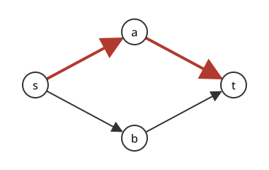

# Lucchesi–Younger 정리

# 개요

**Lucchesi–Younger 정리(Lucchesi–Younger theorem)** 는 유향 그래프에서 방향을 무시하면 연결되어 있을 때, 모든 유향 절단과 만나는 간선 집합의 최소 크기가 서로 겹치지 않는 유향 절단의 최대 개수와 같다는 정리다. 일방통행 도로만 있는 도시에서 몇 개의 도로를 양방향으로 바꿔야 모든 곳에서 모든 곳으로 갈 수 있는지가 이 꼴이다. 정리는 바꿔야 하는 도로의 최소 개수가, 바깥으로 나가는 길만 있고 들어오는 길이 없는 구역을 서로 겹치는 도로 없이 몇 개 찾을 수 있는지와 같다고 답한다.

# 직관

아래 그림은 도시 $s,a,b,t$ 와 일방통행 도로 $s\to a$, $s\to b$, $a\to t$, $b\to t$ 다. $t$ 에서는 어디로도 갈 수 없고 $s$ 로는 어디서도 올 수 없다.

구역 $S=\lbrace s\rbrace$ 에서는 나가는 도로 $s\to a$, $s\to b$ 만 있고 들어오는 도로가 없다. 이 구역에 다른 곳에서 들어오려면 둘 가운데 하나를 양방향으로 바꿔야 한다. 같은 꼴의 구역이 $\lbrace s,a\rbrace$, $\lbrace s,b\rbrace$, $\lbrace s,a,b\rbrace$ 이고, 나가는 도로는 차례로 $\lbrace s\to b,a\to t\rbrace$, $\lbrace s\to a,b\to t\rbrace$, $\lbrace a\to t,b\to t\rbrace$ 다.

구역 $\lbrace s\rbrace$ 와 $\lbrace s,a,b\rbrace$ 의 도로는 겹치지 않으므로 서로 다른 도로를 적어도 두 개 바꿔야 한다. 그림의 굵은 도로 $s\to a$, $a\to t$ 를 양방향으로 바꾸면 네 구역의 도로 집합과 모두 만나고, $t\to a\to s\to b\to t$ 로 모든 도시가 이어진다. 바꾼 도로 수 $2$ 가 겹치지 않는 구역 수 $2$ 와 같다.

# 정의

## 유향 절단

유향 [그래프](graphs.md) $D=(V,A)$ 가 방향을 무시하면 연결되어 있다. $\emptyset\ne S\subsetneq V$ 에서 $S$ 로 들어오는 간선이 없을 때, $S$ 에서 나가는 간선의 집합 $\delta^{+}(S)$ 를 **유향 절단(directed cut)** 이라 한다. 직관 절의 그래프에는 유향 절단이 네 개 있다.

## 유향 절단 덮개

모든 유향 절단과 만나는 간선 집합 $J\subseteq A$ 를 **유향 절단 덮개(dijoin)** 라 한다. $J$ 의 간선을 양방향으로 바꾸거나 $J$ 의 간선을 축약하면 강하게 연결(strongly connected)되는 것과 $J$ 가 유향 절단 덮개인 것은 동치다. 직관 절의 $\lbrace s\to a,a\to t\rbrace$ 가 유향 절단 덮개다.

# 성질

## Lucchesi–Younger 정리

정리. 방향을 무시하면 연결된 유향 그래프에서 유향 절단 덮개의 최소 크기는 서로 겹치지 않는 유향 절단의 최대 개수와 같다[^1].

겹치지 않는 유향 절단 $k$ 개가 있으면 덮개는 각 절단에서 서로 다른 간선을 하나씩 가져야 하므로 최소 크기가 $k$ 이상이다. 등호가 정리의 내용이다.

## 가중치 판본과 전체 쌍대 정수성

간선마다 음 아닌 정수 가중치 $w$ 가 있을 때, 유향 절단 덮개의 최소 가중치는 각 간선 $e$ 가 많아야 $w(e)$ 개의 절단에 쓰이도록 고른 유향 절단 모임의 최대 크기와 같다. 이것은 부등식계

$$
x\ge 0,\qquad \sum_{e\in C}x_e\ge 1\quad(C\text{ 는 유향 절단})
$$

이 [전체 쌍대 정수성](total-dual-integrality.md)을 갖는다는 것과 같다. Edmonds 와 Giles 는 이 계를 부분모듈 흐름(submodular flow)의 특수한 경우로 놓고 TDI(totally dual integral) 성질을 증명했다[^2].

증명의 요지. 유향 절단의 모임은 교차하는 두 절단 $\delta^{+}(S)$, $\delta^{+}(T)$ 에 대해 $\delta^{+}(S\cap T)$ 와 $\delta^{+}(S\cup T)$ 도 유향 절단이 되는 교차 모임이다. 쌍대 최적해를 교차하지 않는 절단들 위로 옮기는 정리 과정을 거치면 남은 절단의 제약 행렬이 [완전 단일모듈 행렬](totally-unimodular-matrices.md)이 된다. ∎

## 평면 그래프의 되먹임 간선 집합

평면 유향 그래프의 쌍대 그래프에서 유향 절단은 유향 순환이 된다. 그래서 평면 유향 그래프에서 모든 유향 순환과 만나는 간선 집합, 곧 **되먹임 간선 집합(feedback arc set)** 의 최소 크기는 서로 간선을 공유하지 않는 유향 순환의 최대 개수와 같다. 일반 유향 그래프에서는 이 등식이 성립하지 않는다.

## Woodall 추측

Woodall 추측(Woodall's conjecture)은 유향 절단의 최소 크기가 서로 겹치지 않는 유향 절단 덮개의 최대 개수와 같다는 추측이다. Lucchesi–Younger 정리에서 절단과 덮개의 역할을 바꾼 진술이다.

# 활용

- 도로망의 양방향화. 일방통행 도로망을 강하게 연결된 망으로 만드는 데 바꿔야 하는 도로의 최소 수를 구하고, 겹치지 않는 유향 절단이 그 하한의 증거가 된다. 최소 유향 절단 덮개는 부분모듈 흐름 알고리즘으로 다항 시간에 구해진다.
- 평면 그래프의 되먹임 간선 집합. 일반 그래프에서 NP-난해(NP-hard, nondeterministic polynomial time hard)인 최소 되먹임 간선 집합 문제가 평면 유향 그래프에서는 위 쌍대로 다항 시간에 풀린다.

[^1]: C. L. Lucchesi, D. H. Younger, "A minimax theorem for directed graphs", *Journal of the London Mathematical Society* (2) **17** (1978), 369–374.
[^2]: Jack Edmonds, Rick Giles, "A min-max relation for submodular functions on graphs", *Annals of Discrete Mathematics* **1** (1977), 185–204.

# 연관 문서

## 선수지식

- [전체 쌍대 정수성](total-dual-integrality.md)

## 더 알아보기

아직 연결한 문서가 없다.

#graph_theory #optimization #combinatorics
