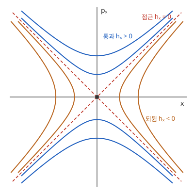

# Lyapunov 궤도

# 개요

**Lyapunov 궤도(Lyapunov orbit)** 는 원 제한 삼체 문제에서 Lagrange 점 $L\_1$ 이나 $L\_2$ 를 둘러싸고 도는 주기 궤도다. [Hill 영역](hill-regions.md) 문서에서 Jacobi 상수가 $C\_1$ 보다 조금 작으면 지구 쪽과 달 쪽이 $L\_1$ 근처의 좁은 목으로 이어지지만, 목이 열려 있다고 해서 그 목으로 들어간 우주선이 반대쪽으로 나가는 것은 아니다.

Lyapunov 궤도와 그 궤도에 점근하는 궤도들이 목 안에서 반대쪽으로 지나가는 궤도와 되튀어 나오는 궤도를 가른다.

# 직관

[Lagrange 점](lagrange-points.md) 문서의 회전 좌표계에서 $L\_1$ 을 원점으로 옮기고 위치를 $(x,y)$ 로 쓴다. 원점 근처에서 운동 방정식을 선형화하면 다음이 나온다.

$$
x''-2y'-(1+2c\_2)x=0,\qquad y''+2x'+(c\_2-1)y=0
$$

$c\_2$ 는 $\mu$ 와 $L\_1$ 의 위치로 정해지는 상수이고, 지구–달에서 $c\_2\approx 5.15$ 다. 해를 $e^{st}$ 꼴로 두면 $s$ 는 다음 방정식의 근이다.

$$
s^4+(2-c\_2)s^2+(1+2c\_2)(1-c\_2)=0
$$

$s^2$ 에 대한 이차방정식으로 풀면 $s=\pm 2.93$ 과 $s=\pm 2.33i$ 가 나온다.

실수 근 $\pm\lambda$ 는 원점에서 멀어지거나 원점으로 다가가는 운동이고, 허수 근 $\pm i\nu$ 는 원점 둘레를 도는 운동이다. 좌표를 알맞게 바꾸면 두 운동이 나뉘고, 에너지는 다음 두 항의 합이 된다.

$$
h=\underbrace{\tfrac12\bigl(p\_x^2-\lambda^2x^2\bigr)}\_{h\_x}+\underbrace{\tfrac12\bigl(p\_y^2+\nu^2y^2\bigr)}\_{h\_y}
$$

새 좌표에서도 $x$ 가 음수인 쪽이 지구 쪽, 양수인 쪽이 달 쪽이다. 두 항은 따로 보존되고 $h\_y\ge 0$ 이므로, 에너지 $h\gt 0$ 을 정하면 $h\_x$ 는 $h$ 이하의 값을 갖는다.

아래 그림은 $(x,p\_x)$ 평면에서 $h\_x$ 의 등위선이다. $h\_x\gt 0$ 인 위아래 곡선은 $x=0$ 을 지나므로 지구 쪽에서 달 쪽으로, 또는 반대로 목을 통과한다. $h\_x\lt 0$ 인 좌우 곡선은 $x=0$ 에 닿지 못하고 들어온 쪽으로 되튄다.

두 종류를 가르는 것은 빨간 점선 $h\_x=0$ 이다. $x=p\_x=0$ 이면 에너지가 모두 $h\_y=h$ 에 있고, 우주선은 원점 둘레에서 진폭 $\sqrt{2h}/\nu$ 로 주기 $2\pi/\nu\approx 2.69$ 인 운동을 한다. 이것이 Lyapunov 궤도다. 점선 위의 다른 점은 이 주기 궤도로 다가가거나 이 주기 궤도에서 멀어진다.

# 정의

## 원 제한 삼체 문제의 평면 운동

질량비 $\mu$ 의 원 제한 삼체 문제에서 회전 좌표계의 평면 운동은 다음 Hamilton 함수로 정해지는 [Hamilton 역학](hamiltonian-mechanics.md)의 계다.

$$
H(x,y,p\_x,p\_y)=\tfrac12\bigl(p\_x^2+p\_y^2\bigr)+yp\_x-xp\_y-\frac{1-\mu}{r\_1}-\frac{\mu}{r\_2}
$$

$r\_1$, $r\_2$ 는 두 천체까지의 거리다. $H$ 의 값을 $h$ 라 하면 Jacobi 상수는 $C=-2h$ 다.

## Lyapunov 궤도

$L\_1$ 또는 $L\_2$ 에서 선형화한 평면 운동의 고윳값이 $\pm\lambda$, $\pm i\nu$ ($\lambda,\nu\gt 0$) 라 하자. 평면 위의 주기 궤도들의 연속족 가운데 진폭이 $0$ 으로 갈 때 그 점으로 줄어들고 주기가 $2\pi/\nu$ 로 가는 것을 **평면 Lyapunov 궤도(planar Lyapunov orbit)** 라 한다. 직관 절의 $x=p\_x=0$, $h\_y=h$ 인 궤도가 선형 모형에서의 평면 Lyapunov 궤도다.

공간 운동에서 선형화한 수직 방향의 진동수를 $\nu\_z$ 라 하면, 같은 방식으로 수직 방향 진동에서 생기는 족을 **수직 Lyapunov 궤도(vertical Lyapunov orbit)** 라 한다. 지구–달의 $L\_1$ 에서 $\nu\_z=\sqrt{c\_2}\approx 2.27$ 이다.

## 통과 궤도와 점근 궤도

$C$ 가 $C\_1$ 보다 조금 작을 때 $L\_1$ 근처의 목에서, 지구 쪽에서 들어와 달 쪽으로 나가거나 그 반대로 지나는 궤도를 **통과 궤도(transit orbit)**, 들어온 쪽으로 되돌아 나가는 궤도를 **비통과 궤도(non-transit orbit)** 라 한다. 시간이 $+\infty$ 또는 $-\infty$ 로 갈 때 Lyapunov 궤도에 다가가는 궤도를 **점근 궤도(asymptotic orbit)** 라 한다. 직관 절의 그림에서 파란 곡선이 통과 궤도, 주황 곡선이 비통과 궤도, 빨간 점선이 점근 궤도다.

# 성질

## Lyapunov 중심 정리

**정리(Lyapunov 중심 정리, Lyapunov center theorem).** Hamilton 계의 평형점에서 선형화한 고윳값이 $\pm i\nu$ 와 그 밖의 $\mu\_3,\dots,\mu\_{2n}$ 이고, 모든 $j$ 에서 $\mu\_j/(i\nu)$ 가 정수가 아니면, 평형점을 지나는 주기 궤도의 일매개변수족이 있고 평형점에 가까워질수록 주기가 $2\pi/\nu$ 로 간다[^1].

지구–달 $L\_1$ 의 평면 운동에서 다른 고윳값은 실수 $\pm\lambda$ 이므로 조건이 성립하고, 평면 Lyapunov 궤도가 존재한다. 공간 운동에서는 $\nu\_z/\nu\approx 0.97$ 과 $\nu/\nu\_z$ 가 정수가 아니므로 평면 족과 수직 족이 모두 존재한다.

## Conley 의 분류

**정리(Conley, 1968).** $C$ 가 $C\_1$ 보다 조금 작으면 $L\_1$ 근처의 목에 있는 궤도는 Lyapunov 궤도, 점근 궤도, 통과 궤도, 비통과 궤도의 네 종류로 나뉜다[^2].

증명의 요지. 원점 근처에서 비선형 계도 좌표를 바꾸면 에너지가 $xp\_x$ 에 해당하는 양과 $h\_y$ 에 해당하는 양의 함수가 되고, 두 양이 각각 보존된다. 이 좌표 변환이 수렴한다는 것은 Moser 가 보였다. 그래서 직관 절의 선형 모형의 구분이 그대로 남고, McGehee 는 이 구분으로 목 영역의 궤도를 전부 기술했다[^3].

## 불변 다양체의 관

Lyapunov 궤도의 점근 궤도 전체는 원과 직선의 곱 꼴의 원기둥 둘을 이룬다. 하나는 시간이 $+\infty$ 로 갈 때 Lyapunov 궤도로 다가가는 안정 다양체이고, 다른 하나는 $-\infty$ 로 갈 때 다가가는 불안정 다양체다. 직관 절의 선형 모형에서는 $h\_x=0$, $h\_y=h$ 이므로 $(y,p\_y)$ 가 원을 그리고 $x$ 가 한 방향으로 움직여 원기둥이 된다.

목을 통과하는 궤도는 모두 이 원기둥 안쪽에 있다. 그래서 지구 쪽에서 달 쪽으로 가는 궤도를 찾는 문제는 안정 다양체의 관 안쪽에 드는 초기값을 고르는 문제가 된다[^4].

## Halo 궤도

평면 Lyapunov 궤도의 진폭을 키우면 그 궤도에서 선형화한 수직 방향의 진동수가 평면 방향의 진동수와 같아지는 진폭이 나온다. 그 진폭에서 평면 족과 갈라져 평면 밖으로 휘는 공간 주기 궤도의 족이 생기고, 이 궤도를 **halo 궤도(halo orbit)** 라 한다. 평면 Lyapunov 궤도와 달리 지구에서 보면 $L\_1$ 이나 $L\_2$ 를 둘러싼 고리로 보인다.

# 활용

- 관측 위성의 궤도. 1978 년 ISEE-3(International Sun–Earth Explorer 3)는 태양–지구 $L\_1$ 의 halo 궤도에 처음 들어갔다. 태양–지구 $L\_1$ 근처의 궤도는 태양을 계속 볼 수 있어 태양풍 관측에 쓰인다.
- 달 뒷면 중계. 지구–달 $L\_2$ 의 halo 궤도는 달 뒤에 있으면서 지구에서 가려지지 않으므로, 달 뒷면 착륙선과 지구 사이의 통신 중계에 쓰인다.
- 저에너지 전이. 한 계의 $L\_1$ Lyapunov 궤도의 불안정 다양체와 다른 Lyapunov 궤도의 안정 다양체가 만나는 궤도를 따라가면, 연료를 거의 쓰지 않고 한 영역에서 다른 영역으로 옮겨 간다[^4]. [Hill 영역](hill-regions.md) 문서의 달 전이 궤도가 이 방법으로 설계된다.
- 혜성의 일시 포획. 목성 둘레에 잠시 붙잡혔다가 떠나는 혜성의 궤도는 태양–목성 $L\_1$, $L\_2$ 의 관을 따라간다[^4].

[^1]: A. M. Lyapunov, *The General Problem of the Stability of Motion*, Taylor & Francis, 1992 (원저 1892). 현대적 서술은 K. R. Meyer, G. R. Hall, D. Offin, *Introduction to Hamiltonian Dynamical Systems and the N-Body Problem*, 2nd ed., Springer, 2009.
[^2]: C. Conley, "Low energy transit orbits in the restricted three-body problem", *SIAM Journal on Applied Mathematics* 16 (1968), 732–746.
[^3]: R. McGehee, *Some homoclinic orbits for the restricted three-body problem*, PhD thesis, University of Wisconsin, 1969.
[^4]: W. S. Koon, M. W. Lo, J. E. Marsden, S. D. Ross, "Heteroclinic connections between periodic orbits and resonance transitions in celestial mechanics", *Chaos* 10 (2000), 427–469.

# 연관 문서

## 선수지식

- [Hill 영역](hill-regions.md)

## 더 알아보기

아직 연결한 문서가 없다.

#analysis #differential_geometry
