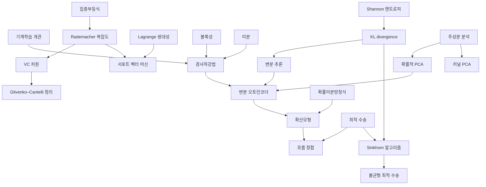

# 기계학습 개관

# 개요

기계학습(machine learning)은 예시 자료에서 규칙을 찾아 새 자료의 예측에 쓰는 분야다. 집 넓이와 가격 $100$ 쌍을 보고 처음 보는 집의 가격을 맞히려면, 직선이든 곡선이든 함수의 모양을 정하고 그 함수가 $100$ 쌍에서 내는 오차를 줄여야 한다. 오차를 줄이는 계수를 반복 계산으로 찾고, 그 함수가 보지 못한 집에서도 오차가 작은지를 확률로 따진다.

처음 읽는 사람은 [경사하강법](gradient-descent.md)에서 시작한다.

# 지도

# 갈래

처음 읽는 사람은 최적화, 일반화 이론, 분포 사이의 거리의 순서로 읽는다. 그 뒤는 표현과 차원 축소, 확률적 모형, 생성모형의 순서로 이어진다. 순차 결정과 그래프 학습은 일반화 이론까지 읽고도 들어갈 수 있다.

## 최적화

먼저 읽을 것: [미분](derivative.md)(해석 개관), [볼록성](convexity.md)(최적화 개관). 시작 문서: [경사하강법](gradient-descent.md).

- [경사하강법](gradient-descent.md) — 기울기 반대 방향으로 반복한다. 볼록과 강볼록에서 수렴률이 다르고 보폭이 Lipschitz 상수에 묶인다

## 일반화 이론

먼저 읽을 갈래: 최적화. 먼저 읽을 것: [측도](measure.md)(측도론 개관), [큰 수의 법칙](law-of-large-numbers.md)(확률 개관). 시작 문서: [집중부등식](concentration-inequalities.md).

- [집중부등식](concentration-inequalities.md) — 표본평균이 기댓값에서 벗어날 확률의 지수 한계. 일반화 오차를 표본 수로 제한하는 데 쓴다
- [Rademacher 복잡도](rademacher-complexity.md) — 함수족이 무작위 부호열과 갖는 상관의 기댓값. 무한 가설류의 일반화 오차를 가설 개수 없이 막는다
  - [VC 차원](vc-dimension.md)(Vapnik–Chervonenkis dimension) — 가설족이 부수는 집합의 최대 크기. 성장함수가 다항식인지 지수인지를 가른다
  - [서포트 벡터 머신](support-vector-machine.md) — 마진을 최대화하는 초평면. 쌍대문제가 자료의 내적만으로 적히고 마진이 일반화 경계에 들어간다

## 분포 사이의 거리

먼저 읽을 갈래: 일반화 이론. 먼저 읽을 것: [엔트로피](entropy.md)(정보이론 개관). 시작 문서: [KL divergence](kl-divergence.md).

- [KL divergence](kl-divergence.md) — 밀도의 비를 평균한 양. 증거 하한과 변분 추론의 손실을 이 양으로 쓴다
- [최적 수송](optimal-transport.md) — 질량을 옮기는 최소 비용. 받침이 겹치지 않는 분포 사이에서도 유한하다
- [Sinkhorn 알고리즘](sinkhorn.md) — 엔트로피 항을 더한 수송 문제를 행렬 스케일링 반복으로 푼다
  - [불균형 최적 수송](unbalanced-optimal-transport.md) — 총질량이 다른 두 측도 사이로 수송을 확장한다

## 표현과 차원 축소

먼저 읽을 갈래: 분포 사이의 거리. 먼저 읽을 것: [특이값 분해](singular-value-decomposition.md)(선형대수 개관), [재생핵 Hilbert 공간](reproducing-kernel-hilbert-space.md)(함수해석 개관). 시작 문서: [주성분 분석](principal-component-analysis.md).

- [주성분 분석](principal-component-analysis.md) — 공분산행렬의 고유벡터로 분산이 큰 방향을 찾는다
- [확률적 PCA](probabilistic-pca.md) — 주성분 분석을 잠재변수와 Gauss 잡음을 가진 생성모형으로 다시 쓴다
  - [k 평균 군집화](k-means.md) — 점을 k 개 묶음으로 나누어 묶음 안 제곱거리의 합을 줄인다. 배정과 중심을 번갈아 갱신한다
  - [커널 PCA](kernel-pca.md) — 특징 사상 뒤의 공분산을 내적만으로 다룬다
  - [핵 능형회귀](kernel-ridge-regression.md) — 재생핵 Hilbert 공간에서 제곱오차와 노름 벌점을 최소화한다. 해가 n 차 선형계 하나다

## 확률적 모형

먼저 읽을 갈래: 표현과 차원 축소. 먼저 읽을 것: [Markov 연쇄](markov-chains.md)(확률 개관). 시작 문서: [Bayes 추론](bayesian-inference.md).

- [Bayes 추론](bayesian-inference.md) — 사전분포와 가능도에서 사후분포를 얻고 예측분포로 옮긴다
  - [Gauss 과정](gaussian-processes.md) — 함수 위의 사전분포. 유한 차원 주변분포가 모두 Gauss 분포다
  - [조건부 무작위장](conditional-random-fields.md) — 라벨열의 조건부 분포를 지수족으로 적고 전향 후향 재귀로 분할함수와 기울기를 구한다
- [변분 추론](variational-inference.md) — 사후분포를 분포족 안에서 근사하고 KL divergence 최소화를 증거 하한 최대화로 바꾼다

## 생성모형

먼저 읽을 갈래: 확률적 모형. 먼저 읽을 것: [마팅게일](martingales.md)과 [확률미분방정식](stochastic-differential-equations.md)(확률 개관). 시작 문서: [변분 오토인코더](variational-autoencoder.md).

- [변분 오토인코더](variational-autoencoder.md) — 사후분포를 인코더로 근사하고 증거 하한을 최대화한다
- [확산모형](diffusion-models.md) — 자료에 잡음을 더하는 확률미분방정식을 시간 역방향으로 푼다
- [흐름 정합](flow-matching.md) — 두 분포를 잇는 확률경로의 속도장을 회귀로 직접 학습한다

## 순차 결정

먼저 읽을 갈래: 일반화 이론. 시작 문서: [Markov 결정 과정](markov-decision-process.md).

- [Markov 결정 과정](markov-decision-process.md) — 상태마다 행동을 고르는 연쇄. Bellman 방정식의 값 반복이 강화학습의 기반이다
- [확률근사](stochastic-approximation.md) — 잡음이 섞인 관측만으로 방정식의 해를 찾는 반복. 보폭 조건이 수렴을 준다
- [Q 학습](q-learning.md) — 전이확률을 모르고 표본 하나마다 시간차 오차로 갱신한다
- [정책 경사](policy-gradient.md) — 가치함수를 거치지 않고 정책을 직접 미분한다. 점수함수 추정량이 전이확률을 지운다
  - [신뢰영역 정책 최적화](trust-region-policy-optimization.md) — 보폭을 KL divergence 로 재는 제약 갱신. 잘라낸 대리 목적이 제약을 1차 계산으로 바꾼다
- [행위자–비평자](actor-critic.md) — 시간차 오차 하나로 정책과 가치를 함께 갱신한다
  - [다중 슬롯머신](multi-armed-bandits.md) — 상태가 하나뿐인 경우. 신뢰상한이 탐색과 활용을 한 식에 담는다
  - [최적 정지](optimal-stopping.md) — 행동이 멈춤과 계속 둘뿐인 경우. Snell 포락이 언제 멈출지를 정한다

## 그래프 학습

먼저 읽을 갈래: 일반화 이론. 먼저 읽을 것: [Color refinement](color-refinement.md)(그래프 개관). 시작 문서: [그래프 신경망의 표현력](gnn-expressivity.md).

- [그래프 신경망의 표현력](gnn-expressivity.md) — 메시지 전달 신경망의 구별 능력이 Color refinement 를 넘지 못한다

# 연관 문서

## 선수지식

- [집합](sets.md)

## 더 알아보기

- [경사하강법](gradient-descent.md)

#machine_learning #statistics #optimization #probability #overview
