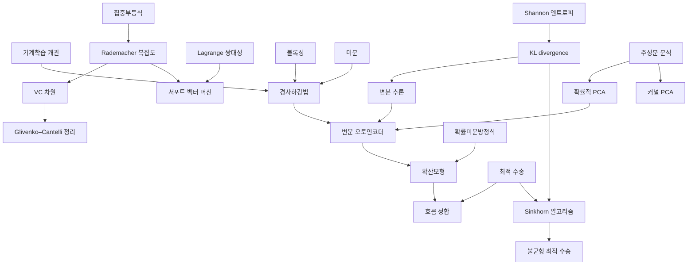

# 기계학습 개관

# 개요

기계학습(machine learning)은 예시 자료에서 규칙을 찾아 새 자료의 예측에 쓰는 분야다. 집 넓이와 가격 $100$ 쌍을 보고 처음 보는 집의 가격을 맞히려면, 직선이든 곡선이든 함수의 모양을 정하고 그 함수가 $100$ 쌍에서 내는 오차를 줄여야 한다. 오차를 줄이는 계수를 반복 계산으로 찾고, 그 함수가 보지 못한 집에서도 오차가 작은지를 확률로 따진다.

처음 읽는 사람은 [경사하강법](gradient-descent.md)에서 시작한다.

# 지도

# 갈래

처음 읽는 사람은 최적화, 일반화 이론, 분포 사이의 거리의 순서로 읽는다. 그 뒤는 표현과 차원 축소, 확률적 모형, 생성모형의 순서로 이어진다. 순차 결정과 그래프 학습은 일반화 이론까지 읽고도 들어갈 수 있다.

## 최적화

먼저 읽을 것: [미분](derivative.md)(해석 개관), [볼록성](convexity.md)(최적화 개관). 시작 문서: [경사하강법](gradient-descent.md).

- [경사하강법](gradient-descent.md) — 기울기 반대 방향으로 반복한다. 볼록과 강볼록에서 수렴률이 다르고 보폭이 Lipschitz 상수에 묶인다
- [퍼셉트론](perceptron.md) — 틀린 점을 부호와 함께 법선 벡터에 더해 두 부류를 가르는 직선을 찾는다. 고치는 횟수가 여백으로 정해진다
- [다층 퍼셉트론](multilayer-perceptron.md) — 직선 판정을 층층이 합성한 함수와 역전파, 은닉층 하나의 보편 근사와 깊이에 따른 조각 수
- [합성곱 신경망](convolutional-neural-networks.md) — 작은 커널을 모든 위치에 같은 가중치로 대는 층, 이동 등변성과 이동과 교환하는 선형사상의 분류, 수용 영역, 커널의 역전파
  - [잔차 신경망](residual-networks.md) — 층의 입력을 출력에 더하는 잔차 연결, 기울기의 항등 항과 2^L 개 경로의 합, Euler 걸음으로 본 블록과 Lipschitz 조건의 가역성

## 일반화 이론

먼저 읽을 갈래: 최적화. 먼저 읽을 것: [측도](measure.md)(측도론 개관), [큰 수의 법칙](law-of-large-numbers.md)(확률 개관). 시작 문서: [집중부등식](concentration-inequalities.md).

- [집중부등식](concentration-inequalities.md) — 표본평균이 기댓값에서 벗어날 확률의 지수 한계. 일반화 오차를 표본 수로 제한하는 데 쓴다
- [Rademacher 복잡도](rademacher-complexity.md) — 함수족이 무작위 부호열과 갖는 상관의 기댓값. 무한 가설류의 일반화 오차를 가설 개수 없이 막는다
  - [VC 차원](vc-dimension.md)(Vapnik–Chervonenkis dimension) — 가설족이 부수는 집합의 최대 크기. 성장함수가 다항식인지 지수인지를 가른다
  - [서포트 벡터 머신](support-vector-machine.md) — 마진을 최대화하는 초평면. 쌍대문제가 자료의 내적만으로 적히고 마진이 일반화 경계에 들어간다

## 분포 사이의 거리

먼저 읽을 갈래: 일반화 이론. 먼저 읽을 것: [엔트로피](entropy.md)(정보이론 개관). 시작 문서: [KL divergence](kl-divergence.md).

- [KL divergence](kl-divergence.md) — 밀도의 비를 평균한 양. 증거 하한과 변분 추론의 손실을 이 양으로 쓴다
- [최적 수송](optimal-transport.md) — 질량을 옮기는 최소 비용. 받침이 겹치지 않는 분포 사이에서도 유한하다
- [Sinkhorn 알고리즘](sinkhorn.md) — 엔트로피 항을 더한 수송 문제를 행렬 스케일링 반복으로 푼다
  - [불균형 최적 수송](unbalanced-optimal-transport.md) — 총질량이 다른 두 측도 사이로 수송을 확장한다

## 표현과 차원 축소

먼저 읽을 갈래: 분포 사이의 거리. 먼저 읽을 것: [특이값 분해](singular-value-decomposition.md)(선형대수 개관), [재생핵 Hilbert 공간](reproducing-kernel-hilbert-space.md)(함수해석 개관). 시작 문서: [주성분 분석](principal-component-analysis.md).

- [주성분 분석](principal-component-analysis.md) — 공분산행렬의 고유벡터로 분산이 큰 방향을 찾는다
- [확률적 PCA](probabilistic-pca.md) — 주성분 분석을 잠재변수와 Gauss 잡음을 가진 생성모형으로 다시 쓴다
  - [k 평균 군집화](k-means.md) — 점을 k 개 묶음으로 나누어 묶음 안 제곱거리의 합을 줄인다. 배정과 중심을 번갈아 갱신한다
  - [커널 PCA](kernel-pca.md) — 특징 사상 뒤의 공분산을 내적만으로 다룬다
  - [핵 능형회귀](kernel-ridge-regression.md) — 재생핵 Hilbert 공간에서 제곱오차와 노름 벌점을 최소화한다. 해가 n 차 선형계 하나다

## 확률적 모형

먼저 읽을 갈래: 표현과 차원 축소. 먼저 읽을 것: [Markov 연쇄](markov-chains.md)(확률 개관). 시작 문서: [Bayes 추론](bayesian-inference.md).

- [Bayes 추론](bayesian-inference.md) — 사전분포와 가능도에서 사후분포를 얻고 예측분포로 옮긴다
  - [Gauss 과정](gaussian-processes.md) — 함수 위의 사전분포. 유한 차원 주변분포가 모두 Gauss 분포다
  - [조건부 무작위장](conditional-random-fields.md) — 라벨열의 조건부 분포를 지수족으로 적고 전향 후향 재귀로 분할함수와 기울기를 구한다
- [변분 추론](variational-inference.md) — 사후분포를 분포족 안에서 근사하고 KL divergence 최소화를 증거 하한 최대화로 바꾼다
  - [잠재 Dirichlet 할당](latent-dirichlet-allocation.md) — 문서를 주제의 혼합으로, 주제를 낱말의 분포로 두는 생성 모형. 평균장 변분 추론과 붕괴 Gibbs 표집, 사전분포의 희소성, 음이 아닌 행렬 분해와의 관계. 통계 개관의 Dirichlet 분포를 먼저 읽는다
- [n-gram 언어 모형](n-gram-language-models.md) — 앞 n−1 개 낱말로 다음 낱말을 예측하는 Markov 모형, 셈에서 할인을 덜어 짧은 문맥으로 나누는 절대 할인과 이어짐 확률의 Kneser–Ney 평활, 혼잡도, 계층적 Pitman–Yor 과정과의 관계. 통계 개관의 Laplace 계승 규칙을 먼저 읽는다
  - [단어 임베딩](word-embeddings.md) — 낱말마다 짧은 벡터를 주어 쓰임이 비슷한 낱말을 가깝게 둔다. 점별 상호정보 행렬의 특이값 분해, 음수 표집 skip-gram 과 그 최적 내적이 점별 상호정보에서 log k 를 뺀 값이라는 Levy–Goldberg 정리, 신경망 언어 모형, 벡터의 차로 적히는 유추
    - [GloVe](glove.md) — 동시 출현 횟수의 로그를 낱말 벡터와 문맥 벡터의 내적과 치우침으로 맞추는 가중 최소제곱. 횟수 비율의 로그로 본 벡터의 차, 0 아닌 성분만 쓰는 무게 함수, 점별 상호정보와의 관계
    - [잡음 대조 추정](noise-contrastive-estimation.md) — 자료와 잡음을 가려내는 분류로 softmax 분모 없이 확률 모형을 맞추는 방법. 최적 로짓이 자료와 잡음의 확률비의 로그라는 것, 잡음 표본 수와 효율, 음수 표집과의 차이, 자기 정규화. 통계 개관의 최대가능도 추정을 먼저 읽는다
    - [계층적 softmax](hierarchical-softmax.md) — 어휘를 잎으로 하는 이진 나무의 갈림길 확률을 곱해 낱말 확률을 정하는 방법. 합이 저절로 1 이 되는 까닭, 경로 길이에 비례하는 비용과 Huffman 나무, 나무가 정하는 모형. 정보이론 개관의 Huffman 부호를 먼저 읽는다
    - [주의 메커니즘](attention-mechanism.md) — 질의와 비슷한 키에 큰 무게를 주어 값을 평균하는 계산. 축척 내적 주의, 자기 주의와 인과 가림, 여러 머리, 순서 등변성과 위치 부호화, 길이의 제곱에 비례하는 비용, Transformer
      - [Transformer](transformers.md) — 여러 머리 자기 주의와 자리마다의 전방 신경망을 층 정규화와 더해 넘기는 연결로 쌓은 구조. 앞 정규화와 뒤 정규화, 층마다 12d² 개의 매개변수, 교차 주의, 보편 근사. 최적화 갈래의 잔차 신경망을 먼저 읽는다
        - [위치 부호화](positional-encoding.md) — 자리마다 벡터를 정해 순서를 넣는 방법. 사인 위치 부호화의 내적이 자리의 차만의 함수라는 것, 옮김이 회전이라는 것, 회전 위치 부호화의 상대성, 학습 길이 밖의 자리
          - [선형 치우침 주의](attention-linear-biases.md) — 위치 벡터 없이 주의 점수에서 거리의 머리별 배수를 빼는 방법, 기하급수로 줄어드는 기울기, 학습 길이 밖의 예측
        - [BERT](bert.md) — 낱말 몇 개를 가리고 양쪽 문맥으로 맞히게 학습한 Transformer. 가린 언어 모형의 80, 10, 10 나눔, 다음 문장 예측, 모형 크기, 미세 조정
          - [어댑터 모듈](adapter-modules.md) — 층 사이에 폭이 좁은 신경망을 끼워 원래 출력에 변화량을 더하는 미세 조정. 병목 폭, 거의 항등인 초기값, 매개변수 수, 합쳐 넣을 수 없어 늘어나는 추론 비용
          - [저계수 적응](low-rank-adaptation.md) — 가중치는 고정하고 변화량만 두 얇은 행렬의 곱으로 학습하는 미세 조정. 계수 r 이하의 변화량, 특이값 분해로 본 최선의 근사, 영행렬 초기값과 처음 단계의 기울기, 추론 비용이 늘지 않는 합치기. 선형대수 개관의 특이값 분해를 먼저 읽는다
          - [접두 조정](prefix-tuning.md) — 가중치는 고정하고 각 층의 주의에 학습하는 키와 값을 앞에 붙이는 미세 조정. 프롬프트 조정, 주의 출력의 볼록 결합, 바뀌지 않는 원래 무게의 비, 2ℓdL 개의 매개변수
      - [선형 주의](linear-attention.md) — 무게를 특성 벡터의 내적으로 바꾸어 키와 값을 먼저 합치는 주의. 길이에 비례하는 비용, 인과 선형 주의의 상태 갱신, 계수 r 이하의 무게, 지수 핵의 양의 무작위 특성
        - [구조적 상태 공간 모형](structured-state-space-models.md) — 상태 벡터를 원소마다 같은 선형 규칙으로 고치는 서열 모형. 영차 유지 이산화, 순환과 합성곱의 동치, 대각 핵, 전달 함수의 극과 안정성, 입력에 따라 바뀌는 계수와 병렬 스캔. 신호처리 개관의 IIR 필터와 해석학 개관의 행렬 지수를 먼저 읽는다
          - [HiPPO](hippo.md) — 지금까지의 신호를 Legendre 다항식으로 근사한 계수를 선형 미분방정식으로 고쳐 가는 기억. HiPPO-LegS 방정식, 시간 축척 불변성, 정규 행렬과 계수 1 행렬의 합, S4 의 초기값. 해석학 개관의 직교다항식을 먼저 읽는다

## 생성모형

먼저 읽을 갈래: 확률적 모형. 먼저 읽을 것: [마팅게일](martingales.md)과 [확률미분방정식](stochastic-differential-equations.md)(확률 개관). 시작 문서: [변분 오토인코더](variational-autoencoder.md).

- [변분 오토인코더](variational-autoencoder.md) — 사후분포를 인코더로 근사하고 증거 하한을 최대화한다
- [확산모형](diffusion-models.md) — 자료에 잡음을 더하는 확률미분방정식을 시간 역방향으로 푼다
- [흐름 정합](flow-matching.md) — 두 분포를 잇는 확률경로의 속도장을 회귀로 직접 학습한다

## 순차 결정

먼저 읽을 갈래: 일반화 이론. 시작 문서: [Markov 결정 과정](markov-decision-process.md).

- [Markov 결정 과정](markov-decision-process.md) — 상태마다 행동을 고르는 연쇄. Bellman 방정식의 값 반복이 강화학습의 기반이다
- [확률근사](stochastic-approximation.md) — 잡음이 섞인 관측만으로 방정식의 해를 찾는 반복. 보폭 조건이 수렴을 준다
- [Q 학습](q-learning.md) — 전이확률을 모르고 표본 하나마다 시간차 오차로 갱신한다
- [정책 경사](policy-gradient.md) — 가치함수를 거치지 않고 정책을 직접 미분한다. 점수함수 추정량이 전이확률을 지운다
  - [신뢰영역 정책 최적화](trust-region-policy-optimization.md) — 보폭을 KL divergence 로 재는 제약 갱신. 잘라낸 대리 목적이 제약을 1차 계산으로 바꾼다
- [행위자–비평자](actor-critic.md) — 시간차 오차 하나로 정책과 가치를 함께 갱신한다
  - [다중 슬롯머신](multi-armed-bandits.md) — 상태가 하나뿐인 경우. 신뢰상한이 탐색과 활용을 한 식에 담는다
  - [최적 정지](optimal-stopping.md) — 행동이 멈춤과 계속 둘뿐인 경우. Snell 포락이 언제 멈출지를 정한다

## 그래프 학습

먼저 읽을 갈래: 일반화 이론. 먼저 읽을 것: [Color refinement](color-refinement.md)(그래프 개관). 시작 문서: [그래프 신경망의 표현력](gnn-expressivity.md).

- [그래프 신경망의 표현력](gnn-expressivity.md) — 메시지 전달 신경망의 구별 능력이 Color refinement 를 넘지 못한다

# 연관 문서

## 선수지식

- [집합](sets.md)

## 더 알아보기

- [경사하강법](gradient-descent.md)
- [퍼셉트론](perceptron.md)

#machine_learning #statistics #optimization #probability #overview
