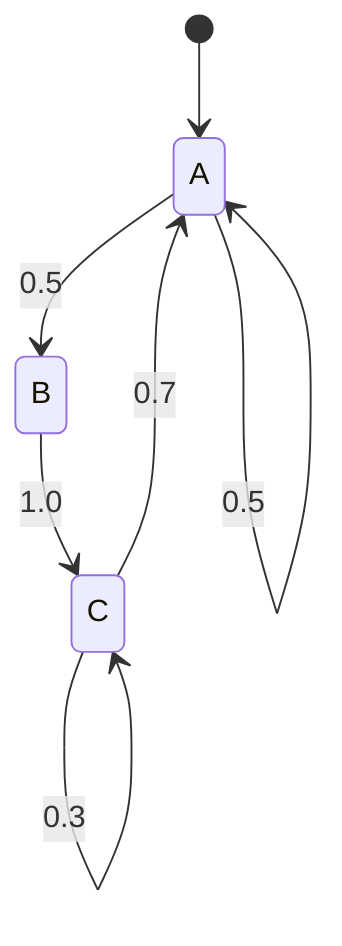

# Markov 연쇄

# 개요

**Markov 연쇄(Markov chain)** 는 다음에 어디로 갈지가 지금 있는 곳만으로 정해지는 무작위 이동이다. 세 웹 페이지 사이를 링크를 따라 무작위로 옮겨 다니는 사람이 오래 돌아다닌 뒤 각 페이지에 머무는 시간의 비율이 얼마인지가 이런 문제다. 이동 확률을 [행렬](matrices.md) 하나로 적고 확률벡터에 그 행렬을 거듭 곱하면, 그 비율은 고윳값 $1$ 의 고유벡터로 구해진다.

# 직관

세 페이지 A, B, C 가 있고 사람이 매 걸음 링크를 따라 옮긴다. A 에서는 반반의 확률로 A 에 머물거나 B 로 가고, B 에서는 반드시 C 로 가며, C 에서는 확률 $0.7$ 로 A 로, $0.3$ 으로 C 에 머문다. 다음 위치의 확률은 지금 위치만으로 정해지고, 그 전에 어디를 거쳐 왔는지는 쓰이지 않는다.

A 에서 출발하면 한 걸음 뒤 (A, B, C) 에 있을 확률은 $(0.5,\thinspace 0.5,\thinspace 0)$, 두 걸음 뒤는 $(0.25,\thinspace 0.25,\thinspace 0.5)$, 세 걸음 뒤는 $(0.475,\thinspace 0.125,\thinspace 0.4)$ 다. 한 걸음마다 하는 일은 확률 세 개를 정해진 비율로 섞어 새 확률 세 개를 만드는 것이고, 이것은 세 성분 벡터에 같은 [행렬](matrices.md)을 곱하는 [선형사상](linear-maps.md)이다.

걸음을 계속하면 확률이 $(14/31,\thinspace 7/31,\thinspace 10/31)\approx(0.452,\thinspace 0.226,\thinspace 0.323)$ 에 다가가고, B 나 C 에서 출발해도 같은 값에 다가간다. 이 벡터는 한 걸음 더 가도 바뀌지 않는 벡터이고, 오래 돌아다닌 사람이 각 페이지에 머무는 시간의 비율이다.

모든 연쇄가 이렇게 한 값에 다가가지는 않는다. 상태 공간이 서로 오갈 수 없는 두 덩어리로 나뉘면 바뀌지 않는 벡터가 여러 개 생기고, 두 상태를 확률 $1$ 로 왕복하면 확률이 홀짝으로 진동해 수렴하지 않는다. 그때에도 머무는 시간의 비율은 수렴한다.

# 정의

가산 상태 공간 $S$ 위의 [확률변수](random-variables.md) 열 $X_0,X_1,\dots$ 가 다음 조건을 만족하면 **Markov 연쇄** 라 한다.

$$
\Pr\lbrack X_{n+1}=j \mid X_n=i,\ X_{n-1}=i_{n-1},\dots,X_0=i_0\rbrack
=\Pr\lbrack X_{n+1}=j \mid X_n=i\rbrack
$$

오른쪽이 $n$ 에 의존하지 않으면 **시간 동질(time-homogeneous)** 이라 하고, 다음 행렬 $P$ 를 **전이행렬(transition matrix)** 이라 한다.

$$
P=(p_{ij}),\qquad p_{ij}=\Pr\lbrack X_{n+1}=j\mid X_n=i\rbrack,\qquad
p_{ij}\ge 0,\ \ \sum_{j\in S}p_{ij}=1
$$

성분이 음이 아니고 각 행의 합이 $1$ 인 행렬을 **확률행렬(stochastic matrix)** 이라 한다. 분포는 행벡터로 두어 오른쪽에서 곱한다.

$$
\mu_n=\mu_0 P^{\thinspace n},\qquad (\mu_n)\_j=\Pr\lbrack X_n=j\rbrack
$$

직관 절의 연쇄는 상태 순서를 A, B, C 로 두면 다음 전이행렬을 갖는다. $\mu_0=(1,0,0)$ 이면 $\mu_2=\mu_0P^2=(0.25,\thinspace 0.25,\thinspace 0.5)$ 다.

$$
P=\begin{pmatrix}0.5 & 0.5 & 0\cr 0 & 0 & 1\cr 0.7 & 0 & 0.3\end{pmatrix}
$$

## 보조 정의

- $n$ 단계 전이확률: $P$ 의 $n$ 제곱의 $(i,j)$ 성분을 $p_{ij}^{(n)}$ 로 쓴다.
- $i$ 에서 $j$ 로 도달 가능: 어떤 $n\ge 0$ 에 대해 $p_{ij}^{(n)}\gt 0$ 이다. 서로 도달 가능한 관계는 [동치관계](equivalence-relations.md)이고 그 동치류를 communicating class 라 한다.
- **기약(irreducible)**: 상태 공간 전체가 하나의 communicating class 다. 직관 절의 연쇄는 A, B, C, A 로 돌 수 있으므로 기약이다.
- **주기(period)**: 상태 $i$ 의 주기는 다음 값이다. 주기가 $1$ 이면 **비주기적(aperiodic)** 이다. 직관 절의 연쇄에서 $p_{AA}=0.5\gt 0$ 이므로 $d(A)=1$ 이다. 두 상태를 확률 $1$ 로 왕복하는 연쇄에서는 짝수 걸음에만 돌아오므로 주기가 $2$ 다.

$$
d(i)=\gcd\lbrace\thinspace n\ge 1 : p_{ii}^{(n)}\gt 0\thinspace\rbrace
$$

- **재귀성(recurrence)**: $T_i=\min\lbrace n\ge 1 : X_n=i\rbrace$ 를 첫 복귀시각이라 하고, 이 시각이 확률 $1$ 로 유한하면 $i$ 가 **재귀적(recurrent)** 이라 한다. 기댓값까지 유한하면 **양재귀적(positive recurrent)** 이다.
- **정상분포(stationary distribution)**: 다음을 만족하는 확률분포 $\pi$ 다. 직관 절의 연쇄에서 $\pi P=\pi$ 의 첫 성분 식 $0.5\pi\_A+0.7\pi\_C=\pi\_A$ 와 둘째 성분 식 $0.5\pi\_A=\pi\_B$ 를 성분 합 $1$ 과 연립하면 $\pi=\tfrac{1}{31}(14,\thinspace 7,\thinspace 10)$ 이다.

$$
\pi P=\pi,\qquad \pi_j\ge 0,\ \ \sum_{j\in S}\pi_j=1
$$

# 성질

## 기약성과 주기

기약 연쇄에서는 모든 상태가 같은 주기를 가진다.

## Chapman–Kolmogorov

$m,n\ge0$ 에 대해 중간 시점을 전개하면 행렬 곱이 나온다.

$$
p_{ij}^{(m+n)}=\sum_{k\in S}p_{ik}^{(m)}\thinspace p_{kj}^{(n)}
\qquad\Longleftrightarrow\qquad P^{\thinspace m+n}=P^{\thinspace m}P^{\thinspace n}
$$

증명에는 전체확률의 법칙과 Markov 성질만 쓴다. 이 등식이 연쇄의 해석을 행렬 거듭제곱으로 바꾼다.

## 정상분포의 존재와 유일성

기약이고 양재귀적인 연쇄는 유일한 정상분포를 가지며, 그 값은 평균 복귀시간의 역수다[^1].

$$
\pi_i=\frac{1}{\mathbb{E}\_i[T_i]}
$$

유한 상태에서 기약이면 양재귀적이므로 기약성만으로 충분하다. 존재는 [Perron–Frobenius 정리](perron-frobenius.md)로도 얻는다. 확률행렬은 전부 1 인 열벡터를 [고윳값](eigenvalues.md) 1 의 오른쪽 고유벡터로 가지므로 1 이 스펙트럼에 있고 모든 고윳값의 절댓값이 1 이하다. 기약이고 성분이 음이 아니면 고윳값 1 의 고유공간이 1 차원이고 대응하는 왼쪽 고유벡터를 양의 성분으로 잡을 수 있다.

무한 상태에서는 재귀성만으로 부족하다. 정수 위의 단순 대칭 무작위 걷기는 기약이고 재귀적이지만 영재귀적(null recurrent)이라 정상분포가 없다. 균일 측도는 불변이되 유한 측도가 아니다.

## 수렴 정리

기약 · 비주기 · 양재귀 연쇄에서 초기 상태와 무관하게 수렴한다[^1].

$$
\lim_{n\to\infty}p_{ij}^{(n)}=\pi_j\qquad(\forall i,j\in S)
$$

유한 상태에서는 총변동 거리로 기하급수적 수렴이 성립하고, 속도는 1 다음으로 큰 고윳값의 절댓값 $\vert\lambda\_2\vert$ 가 정한다.

$$
\big\Vert\mu_0P^{\thinspace n}-\pi\big\Vert_{\mathrm{TV}}\ \le\ C\thinspace\vert\lambda_2\vert^{\thinspace n}
$$

비주기성을 빼면 결론이 깨진다. 두 상태를 확정적으로 왕복하는 연쇄에서는 $P^2$ 이 항등행렬이라 $n$ 단계 전이확률이 0 과 1 사이를 진동한다. 그때에도 정상분포는 각 성분 $1/2$ 로 유일하게 존재하고 시간 평균은 수렴한다([에르고딕 정리](ergodic-theorem.md)). 기약이고 양재귀인 연쇄에서 $f$ 가 $\pi$ 에 대해 적분 가능하면 확률 1 로 다음이 성립한다.

$$
\frac{1}{n}\sum_{k=0}^{n-1}f(X_k)\ \longrightarrow\ \sum_{j\in S}\pi_j\thinspace f(j)
$$

## 가역성과 상세균형

다음 조건을 상세균형(detailed balance)이라 하고, 이를 만족하는 $\pi$ 는 정상분포다.

$$
\pi_i\thinspace p_{ij}=\pi_j\thinspace p_{ji}\qquad(\forall i,j)
$$

양변을 $i$ 에 대해 더하면 $\pi P=\pi$ 가 나온다. 역은 성립하지 않으므로 상세균형은 충분조건이다. 가역 연쇄에서는 $P$ 가 적절한 내적에 대해 [자기수반](spectral-theorem.md)이 되어 고윳값이 모두 [실수](real-numbers.md)이고 스펙트럼 이론을 쓸 수 있다. [그래프](graphs.md) 위의 단순 무작위 걷기가 그 예이고 정상분포가 차수에 비례한다.

$$
\pi_v=\frac{\deg v}{2\vert E\vert}
$$

이 관계가 [그래프 Laplacian](graph-laplacian.md)과 [유효저항](effective-resistance.md)을 통해 도달시간 · 혼합시간 추정으로 이어진다.

# 활용

## PageRank

웹 링크 그래프의 전이행렬 $P$ 는 기약이 아닐 수 있고, 나가는 링크가 없는 페이지에서 행 합이 0 이 된다. 그런 행을 균일분포로 채운 뒤 감쇠 인자 $\alpha$ 를 섞는다. $J$ 는 모든 성분이 1 인 $n$ 차 정사각행렬이다.

$$
P'=\alpha P+(1-\alpha)\frac{1}{n}J,\qquad \alpha=0.85
$$

$P'$ 는 모든 성분이 양수이므로 기약이고 비주기적이다.[^2] 수렴 정리에 따라 PageRank 가 그 유일한 정상분포이고, 반복법의 수렴 속도는 $\vert\lambda\_2\vert\le\alpha$ 에서 나온다.

## Markov 연쇄 Monte Carlo

[Markov 연쇄 Monte Carlo](markov-chain-monte-carlo.md)는 목표 분포 $\pi$ 를 정상분포로 갖는 연쇄를 설계해 오래 돌리고 그 궤적을 표본으로 쓴다. Metropolis–Hastings 의 수락확률에 $\pi$ 의 비만 나타나므로 정규화 상수를 몰라도 되고, 기약성과 비주기성 아래 에르고딕 정리가 표본 평균의 수렴을 준다. $\vert\lambda\_2\vert$ 가 1 에 가까우면 혼합이 느려진다.

## 대기행렬, 은닉 Markov 모형, 알고리즘 분석

- 대기행렬과 재고 모형. 상태를 대기 인원으로 두고 정상분포에서 평균 대기 길이를 구한다.
- [은닉 Markov 모형](hidden-markov-model.md). 관측이 상태의 잡음 섞인 함수일 때 전이구조를 추정한다.
- 확률적 알고리즘 분석. 무작위화 알고리즘의 상태 변화를 연쇄로 보고 혼합시간으로 실행시간을 평가한다.

[^1]: Karl Sigman, Limiting distribution for a Markov chain (Columbia IEOR 강의노트), 정상분포의 존재·유일성, 평균 복귀시간 공식, 기약·비주기·양재귀 조건 아래의 수렴 정리. http://www.columbia.edu/~ks20/stochastic-I/stochastic-I-MCII.pdf
[^2]: PageRank, Wikipedia (damping factor 0.85, dangling node 처리, 확률행렬의 유일한 정상분포로서의 정의). https://en.wikipedia.org/wiki/PageRank

# 연관 문서

## 선수지식

- [확률변수](random-variables.md)
- [선형사상](linear-maps.md)

## 더 알아보기

### 궤적과 수렴

- [무작위 걷기](random-walks.md)
- [Markov 연쇄의 혼합시간](mixing-time.md)

### 다른 Markov 과정

- [Poisson 과정](poisson-process.md)
- [분지과정](branching-processes.md)

### 추론과 제어

- [Markov 연쇄 Monte Carlo](markov-chain-monte-carlo.md)
- [은닉 Markov 모형](hidden-markov-model.md)
- [Markov 결정 과정](markov-decision-process.md)

#probability #linear_algebra #statistics #computation
