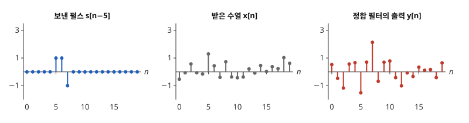

# 정합 필터

# 개요

**정합 필터(matched filter)** 는 모양을 아는 파형이 잡음 속 어디에 있는지 찾을 때, 그 자리의 출력이 잡음에 비해 가장 크게 튀도록 가중치를 고른 [FIR 필터](fir-filters.md)(finite impulse response)다. 레이더는 정해진 펄스 $(1,1,-1)$ 을 보내고 잡음에 묻혀 돌아온 반사에서 펄스가 언제 왔는지를 읽어야 한다. 정합 필터는 펄스를 뒤집은 가중치로 받은 수열을 훑고, 출력이 가장 큰 시각을 펄스가 돌아온 시각으로 읽는다.

# 직관

펄스 $s=(1,1,-1)$ 이 $n=5,6,7$ 에 돌아오고, 받은 수열은 $x\lbrack n\rbrack=s\lbrack n-5\rbrack+w\lbrack n\rbrack$ 이다. 잡음 $w\lbrack n\rbrack$ 은 평균 $0$, 분산 $\sigma^2$ 이고 시점끼리 무상관이다. 가중치 $h=(h\_0,h\_1,h\_2)$ 의 필터 출력을 펄스가 끝나는 $n=7$ 에서 본다.

$$
y\lbrack n\rbrack=h\_0x\lbrack n\rbrack+h\_1x\lbrack n-1\rbrack+h\_2x\lbrack n-2\rbrack
$$

$y\lbrack 7\rbrack$ 의 펄스 부분은 $h\_0\cdot(-1)+h\_1\cdot 1+h\_2\cdot 1$ 이고, 잡음 부분의 분산은 $\sigma^2(h\_0^2+h\_1^2+h\_2^2)$ 이다. 세 값의 평균 $h=(\frac13,\frac13,\frac13)$ 을 쓰면 펄스 부분은 $\frac13$, 잡음 분산은 $\frac{\sigma^2}3$ 이고, 펄스 부분의 제곱을 잡음 분산으로 나눈 값은 $\frac1{3\sigma^2}$ 이다. 펄스 $+1,+1,-1$ 이 서로 지워져 펄스 부분이 작다.

펄스 부분은 벡터 $h$ 와 뒤집은 펄스 $(-1,1,1)$ 의 내적이다. 잡음 분산은 $\lVert h\rVert^2$ 에 비례하므로, 길이가 같은 $h$ 가운데 내적이 가장 큰 것은 $(-1,1,1)$ 과 같은 방향의 $h$ 다. $h=(-1,1,1)$ 이면 펄스 부분은 $3$, 잡음 분산은 $3\sigma^2$ 이고, 비는 $\frac3{\sigma^2}$ 으로 평균의 9 배다.

아래 그림은 $\sigma=0.5$ 일 때 한 번 뽑은 잡음으로 그린 것이다. 가운데의 받은 수열에서는 펄스가 어디 있는지 보이지 않고, 오른쪽의 $h=(-1,1,1)$ 출력은 $n=7$ 에서 가장 크다.

# 정의

## 신호 대 잡음비

길이 $L$ 의 파형 $s\lbrack 0\rbrack,\dots,s\lbrack L-1\rbrack$ 과 잡음 $w$ 에 대해 $x\lbrack n\rbrack=s\lbrack n-n\_0\rbrack+w\lbrack n\rbrack$ 을 받는다. 가중치 $h\lbrack 0\rbrack,\dots,h\lbrack L-1\rbrack$ 의 FIR 필터 출력 $y=h\ast x$ 에서, 시각 $n\_0+L-1$ 의 파형 부분의 제곱을 잡음 부분의 분산으로 나눈 값

$$
\mathrm{SNR}(h)=\frac{\bigl(\sum_jh\lbrack j\rbrack\thinspace s\lbrack L-1-j\rbrack\bigr)^2}{\mathrm{Var}\bigl(\sum_jh\lbrack j\rbrack\thinspace w\lbrack n-j\rbrack\bigr)}
$$

을 **신호 대 잡음비(signal-to-noise ratio, SNR)** 라 한다. 직관 절은 $L=3$, $n\_0=5$ 인 경우다.

## 정합 필터

잡음이 분산 $\sigma^2$ 이고 시점끼리 무상관일 때, 다음 가중치의 필터를 $s$ 의 **정합 필터** 라 한다[^1].

$$
h\lbrack j\rbrack=s\lbrack L-1-j\rbrack,\qquad j=0,\dots,L-1
$$

곧 파형을 시간 순서로 뒤집은 것이다. 직관 절의 $(-1,1,1)$ 이 $s=(1,1,-1)$ 의 정합 필터다.

# 성질

## 신호 대 잡음비의 최대

시점끼리 무상관인 잡음에서 모든 $h\ne 0$ 에 대해 $\mathrm{SNR}(h)\le\lVert s\rVert^2/\sigma^2$ 이고, 등호는 $h$ 가 정합 필터의 상수배일 때만 성립한다.

증명의 요지. 분모는 $\sigma^2\lVert h\rVert^2$ 이고, 분자는 $h$ 와 뒤집은 파형 $\tilde s$ 의 내적의 제곱이다. [Cauchy–Schwarz 부등식](cauchy-schwarz.md)에서 $\langle h,\tilde s\rangle^2\le\lVert h\rVert^2\lVert\tilde s\rVert^2$ 이고, 등호는 $h$ 가 $\tilde s$ 의 상수배일 때다. 직관 절에서 $\lVert s\rVert^2=3$ 이므로 최댓값 $3/\sigma^2$ 이 $h=(-1,1,1)$ 에서 나온다.

## 상호상관으로 본 출력

정합 필터의 출력은 $y\lbrack n\rbrack=\sum_{k=0}^{L-1}s\lbrack k\rbrack\thinspace x\lbrack n-L+1+k\rbrack$ 이므로, 받은 수열의 길이 $L$ 구간과 파형의 내적이다. 잡음이 없으면 출력은 파형의 자기상관을 옮긴 것이다. 직관 절에서 잡음 없는 출력은 $n=5,\dots,9$ 에서 $(-1,0,3,0,-1)$ 이고, 가운데 $3=\lVert s\rVert^2$ 이 봉우리다.

## 상관된 잡음

잡음 벡터 $(w\lbrack n\rbrack,w\lbrack n-1\rbrack,\dots,w\lbrack n-L+1\rbrack)$ 의 공분산 행렬이 양의 정부호 $C$ 이면, 신호 대 잡음비를 최대로 하는 가중치는 뒤집은 파형에 $C^{-1}$ 을 곱한 것이고 최댓값은 $\tilde s^{\top}C^{-1}\tilde s$ 다. 내적 $\langle u,v\rangle\_C=u^{\top}Cv$ 에서 같은 Cauchy–Schwarz 계산을 하면 나온다. $C=\sigma^2I$ 이면 위의 정합 필터로 돌아간다.

## 주파수 응답

정합 필터의 주파수 응답은 $H(e^{i\omega})=e^{-i\omega(L-1)}\overline{S(e^{i\omega})}$ 다. $S(e^{i\omega})=\sum_ks\lbrack k\rbrack e^{-i\omega k}$ 는 [z 변환](z-transform.md)의 $z$ 에 $e^{i\omega}$ 를 넣은 것이다. 크기는 파형의 크기 스펙트럼과 같아서, 파형의 성분이 큰 주파수를 많이 통과시킨다.

# 활용

- 펄스 압축. 레이더는 짧고 강한 펄스 대신 길고 약한 부호열을 보내고 정합 필터로 봉우리를 만든다. 부호 $(1,1,-1)$ 은 자기상관의 곁봉우리가 크기 $1$ 이하인 Barker 부호(Barker code)의 하나다.
- 디지털 통신의 수신기. 기호마다 정해진 파형을 보내면 수신기는 각 파형의 정합 필터 출력을 기호 간격마다 읽어 기호를 가린다.
- 검출. 잡음이 정규분포이면 정합 필터 출력을 문턱값과 비교하는 것이 [가능도비 검정](likelihood-ratio-test.md)과 같다. 두 가설 "잡음만" 과 "파형과 잡음" 의 로그 가능도비가 출력의 일차식이다.

[^1]: S. M. Kay, *Fundamentals of Statistical Signal Processing, Volume II: Detection Theory*, Prentice Hall (1998), 4장.

# 연관 문서

## 선수지식

- [FIR 필터](fir-filters.md)

## 더 알아보기

아직 연결한 문서가 없다.

#signal_processing #statistics #linear_algebra
