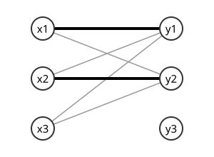

# 매칭

# 개요

**매칭(matching)** 은 [그래프](graphs.md)에서 끝점을 함께 쓰지 않는 간선들의 모임이다. 지원자 몇 명과 자리 몇 개가 있고 지원자마다 맡을 수 있는 자리가 정해져 있을 때, 모든 지원자에게 서로 다른 자리를 하나씩 줄 수 있는지가 매칭의 문제다. 지원자와 자리를 점으로, 맡을 수 있는 관계를 선으로 그리면 한 사람에게 한 자리씩 고른 선들이 매칭이고, 매칭의 크기를 한 번에 하나씩 키우는 절차와 모두에게 자리가 돌아가는 조건으로 이 문제를 푼다.

# 직관

한쪽 줄이 지원자, 다른 줄이 자리이고 간선이 맡을 수 있는 관계인 이분 그래프(bipartite graph)를 그린다. 모든 지원자에게 서로 다른 자리를 하나씩 주려면 간선을 지원자마다 하나씩, 자리가 겹치지 않게 골라야 한다.

지원자 집합 $S$ 가 통틀어 $\lvert S\rvert$ 개보다 적은 자리만 바라보면 그렇게 고를 수 없다. 아래 그림에서 $x_1,x_2,x_3$ 은 모두 $y_1,y_2$ 만 맡을 수 있다. 굵은 두 선처럼 두 사람에게 자리를 주면 $x_3$ 에게 줄 자리가 남지 않는다.

어느 지원자 집합에서도 이 일이 생기지 않으면 모든 지원자에게 자리를 줄 수 있다. 이것이 Hall 결혼 정리(Hall's marriage theorem)이고 성질 절에서 증명한다.

# 정의

## 매칭

그래프 $G = (V, E)$ 의 부분집합 $M \subseteq E$ 가 어떤 두 간선도 공통 끝점을 갖지 않으면 $M$ 을 **매칭** 이라 한다. 정점 $v$ 가 $M$ 의 어떤 간선의 끝점이면 $v$ 는 $M$ 에 **덮였다(saturated)** 고 한다.

- 크기가 가장 큰 매칭이 **최대 매칭(maximum matching)** 이고, 그 크기를 $\nu(G)$ 로 쓴다.
- 간선을 더 넣을 수 없는 매칭이 **극대 매칭(maximal matching)** 이다.
- 모든 정점을 덮는 매칭이 **완전 매칭(perfect matching)** 이다.

이분 그래프 $G = (X \cup Y, E)$ 에서 $X$ 의 모든 정점을 덮는 매칭을 **$X$ 포화 매칭(X-saturating matching)** 이라 한다.

직관 절의 그림에서 $M=\lbrace x_1y_1,x_2y_2\rbrace$ 는 매칭이고 $y_1,y_2$ 를 모두 덮으므로 $Y$ 포화 매칭이다. 어느 매칭도 $y_1,y_2$ 가운데 하나를 끝점으로 쓰므로 크기가 $2$ 이하이고, $\nu=2$ 다. $X$ 포화 매칭은 없다. 정점이 $v_1,v_2,v_3,v_4$ 이고 간선이 $v_1v_2,v_2v_3,v_3v_4$ 인 경로 $P_4$ 에서 $\lbrace v_2v_3\rbrace$ 는 다른 간선이 모두 $v_2$ 나 $v_3$ 을 쓰므로 극대 매칭이지만, $\lbrace v_1v_2,v_3v_4\rbrace$ 가 더 크므로 최대 매칭이 아니다. $\lbrace v_1v_2,v_3v_4\rbrace$ 는 완전 매칭이다.

## 교대 경로와 증가 경로

매칭 $M$ 이 주어졌을 때, $M$ 의 간선과 $M$ 밖의 간선이 번갈아 나오는 경로를 **교대 경로(alternating path)** 라 한다. 양 끝점이 모두 $M$ 에 덮이지 않은 교대 경로를 **$M$ 증가 경로(M-augmenting path)** 라 한다.

$P_4$ 에서 $M=\lbrace v_2v_3\rbrace$ 이면 $v_1,v_2,v_3,v_4$ 는 간선이 $M$ 밖, $M$, $M$ 밖 순으로 나오고 $v_1,v_4$ 가 덮이지 않았으므로 $M$ 증가 경로다.

## 정점 덮개와 독립집합

모든 간선의 적어도 한 끝점을 포함하는 정점 집합을 **정점 덮개(vertex cover)** 라 하고, 최소 크기를 $\tau(G)$ 로 쓴다. 서로 인접하지 않은 정점들의 집합을 **독립집합(independent set)** 이라 하고, 최대 크기를 $\alpha(G)$ 로 쓴다.

직관 절의 그림에서 $\lbrace y_1,y_2\rbrace$ 는 모든 간선의 끝점을 포함하므로 정점 덮개이고, $\lbrace x_1,x_2,x_3\rbrace$ 는 독립집합이다.

## 이웃 집합

$S \subseteq V$ 에 대해

$$
N(S) = \lbrace\thinspace v \in V : \exists u \in S,\ uv \in E \thinspace\rbrace
$$

를 $S$ 의 **이웃 집합(neighbourhood)** 이라 한다. 직관 절의 그림에서 $N(\lbrace x_1,x_2,x_3\rbrace)=\lbrace y_1,y_2\rbrace$ 다.

# 성질

## 증가 경로와 대칭차

$P$ 가 $M$ 증가 경로이면 $P$ 의 간선 수는 홀수이고, 대칭차 $M \triangle E(P)$ 는 크기가 $\lvert M \rvert + 1$ 인 매칭이다. $P$ 위의 간선 가운데 $M$ 밖의 것이 $M$ 의 것보다 하나 많고, 양 끝점이 덮이지 않았으므로 바꿔 넣어도 끝점이 겹치지 않는다. $P_4$ 의 예에서 $\lbrace v_2v_3\rbrace\triangle\lbrace v_1v_2,v_2v_3,v_3v_4\rbrace=\lbrace v_1v_2,v_3v_4\rbrace$ 다.

완전 매칭의 크기는 $\lvert V \rvert / 2$ 다. 극대 매칭은 최대 매칭의 크기의 절반 이상이다. 최대 매칭의 각 간선은 극대 매칭의 간선과 끝점을 공유하고, 극대 매칭의 간선 하나는 끝점이 둘이므로 최대 매칭의 간선을 많아야 두 개 막는다.

## 덮개와 독립집합의 관계

$C$ 가 정점 덮개인 것과 $V\setminus C$ 가 독립집합인 것은 동치다. 따라서 $\tau(G)+\alpha(G)=\lvert V\rvert$ 다. 직관 절의 그림에서 $\tau=2$, $\alpha=3$ 이고 합이 $5$ 다. 매칭의 각 간선은 덮개의 서로 다른 정점을 필요로 하므로 $\nu(G)\le\tau(G)$ 다.

## Berge 정리

Berge 정리(Berge's theorem, 1957)는 매칭 $M$ 이 최대 매칭인 것과 $M$ 증가 경로가 존재하지 않는 것이 동치라는 정리다.

증가 경로가 있으면 대칭차로 더 큰 매칭을 얻으므로 최대가 아니다. 역방향은 대우로 보인다. $M$ 이 최대가 아니면 $\lvert M'\rvert\gt \lvert M\rvert$ 인 매칭 $M'$ 이 있다. 대칭차 $H=M\thinspace\triangle\thinspace M'$ 에서 각 정점은 $M$ 의 간선을 많아야 하나, $M'$ 의 간선을 많아야 하나 받으므로 $H$ 의 차수는 $2$ 이하다. 그래서 $H$ 의 연결 성분은 두 매칭의 간선이 번갈아 나오는 경로나 짝수 길이 순환이고, 순환은 두 매칭의 간선을 같은 수만큼 쓴다. $\lvert M'\rvert\gt \lvert M\rvert$ 이므로 $M'$ 의 간선이 더 많은 성분이 있고, 그것은 양 끝 간선이 $M'$ 에 속하는 경로, 곧 $M$ 증가 경로다. ∎

증가 경로를 찾을 수 있는 동안 대칭차로 매칭을 키우는 알고리즘이 이 정리로 최대 매칭에서 멈춘다. [네트워크 흐름](network-flow.md)의 잔여 그래프 증가 경로가 같은 논법을 쓰고, 이분 매칭은 최대 흐름 문제의 특수한 경우다.

## Hall 결혼 정리

Hall 결혼 정리[^1]는 이분 그래프 $G = (X \cup Y, E)$ 가 $X$ 포화 매칭을 가질 필요충분조건이

$$
\forall S \subseteq X : \ \lvert N(S)\rvert \ge \lvert S\rvert
$$

라는 정리다. 직관 절의 그림은 $S=\lbrace x_1,x_2,x_3\rbrace$ 에서 $\lvert N(S)\rvert=2\lt 3$ 이어서 조건이 깨진다.

필요성. $X$ 포화 매칭 $M$ 이 있으면 $S$ 의 각 원소는 $M$ 을 통해 서로 다른 $Y$ 의 정점으로 가므로 $\lvert N(S) \rvert \ge \lvert S \rvert$ 다.

충분성은 $\lvert X\rvert$ 에 대한 귀납법이다. $\lvert X\rvert=1$ 이면 조건에서 $x$ 의 이웃이 있고 그 간선 하나가 매칭이다. 두 경우로 나눈다.

- 공집합이 아닌 모든 진부분집합 $S \subsetneq X$ 에서 $\lvert N(S) \rvert \ge \lvert S \rvert + 1$ 인 경우. 아무 간선 $xy$ 를 고르고 $G' = G - x - y$ 를 본다. $S \subseteq X \setminus \lbrace x\rbrace$ 는 이웃을 $y$ 하나만 잃으므로 $\lvert N_{G'}(S) \rvert \ge \lvert N_G(S) \rvert - 1 \ge \lvert S \rvert$ 다. 귀납 가정으로 $G'$ 에 $X\setminus\lbrace x\rbrace$ 포화 매칭이 있고 거기에 $xy$ 를 더한다.
- 공집합이 아닌 어떤 $S \subsetneq X$ 에서 $\lvert N(S) \rvert = \lvert S \rvert$ 인 경우. $S$ 와 $N(S)$ 가 이루는 부분그래프는 Hall 조건을 만족하므로 귀납 가정으로 $S$ 포화 매칭 $M_1$ 이 있다. $T \subseteq X \setminus S$ 에 대해 $\lvert N(S \cup T) \rvert \ge \lvert S \rvert + \lvert T \rvert$ 이고 $N(S \cup T) = N(S) \cup N(T)$ 이므로 $Y \setminus N(S)$ 안에서 $T$ 의 이웃은 $\lvert T \rvert$ 개 이상이다. 귀납 가정으로 $X\setminus S$ 와 $Y\setminus N(S)$ 사이의 매칭 $M_2$ 를 얻고, $M_1 \cup M_2$ 가 $X$ 포화 매칭이다. ∎

따름정리로 $\lvert X\rvert=\lvert Y\rvert$ 이고 모든 정점의 차수가 $k\ge 1$ 인 이분 그래프에는 완전 매칭이 있다. $S$ 에서 나가는 간선 $k\lvert S\rvert$ 개가 모두 $N(S)$ 로 들어가고 $N(S)$ 로 들어오는 간선은 $k\lvert N(S)\rvert$ 개 이하이므로 Hall 조건이 성립한다. 완전 매칭을 하나씩 빼면 간선 집합이 완전 매칭 $k$ 개로 나뉜다.

## König 정리

König 정리(Kőnig's theorem, 1931)는 이분 그래프에서

$$
\nu(G) = \tau(G)
$$

라는 정리다. Egerváry 가 가중치 판본을 같은 해에 증명했다. 직관 절의 그림에서 $\nu=\tau=2$ 다.

$\nu \le \tau$ 는 덮개와 독립집합의 관계에서 나왔다. 반대 방향은 최대 매칭 $M$ 에서 덮개를 만든다. $U \subseteq X$ 를 $M$ 에 덮이지 않은 $X$ 의 정점들이라 하고, $Z$ 를 $U$ 에서 출발하는 $M$ 교대 경로로 도달 가능한 정점 전체라 하자. Berge 정리로 증가 경로가 없으므로 $Z \cap Y$ 의 모든 정점은 $M$ 에 덮여 있다.

$$
C = (X \setminus Z) \cup (Y \cap Z)
$$

로 두면 $X \cap Z$ 에서 $Y \setminus Z$ 로 가는 간선은 $Z$ 의 정의에 어긋나므로 $C$ 는 정점 덮개다. $C$ 의 각 정점은 $M$ 의 서로 다른 간선의 끝점이므로 $\lvert C \rvert = \lvert M \rvert$ 다. ∎

이분 그래프의 간선과 정점의 접합 [행렬](matrices.md)은 완전 단모듈러(totally unimodular)이므로, 매칭의 [선형계획법](linear-programming.md)(linear programming, LP) 완화의 최적해가 정수해이고, 그 쌍대 LP 가 정점 덮개의 완화다. König 정리는 이 두 LP 의 쌍대성 등식이다. 덮개와 독립집합의 관계와 합치면 이분 그래프의 최대 독립집합 크기는 $\lvert V \rvert - \nu(G)$ 다.

## Tutte 정리

삼각형은 Hall 조건과 같은 꼴의 이웃 조건을 만족하지만 정점이 세 개라 완전 매칭이 없다. 일반 그래프에서는 홀수 성분을 센다.

Tutte 정리(Tutte's theorem, 1947)는 그래프 $G$ 가 완전 매칭을 가질 필요충분조건이

$$
\forall S \subseteq V : \ o(G - S) \le \lvert S\rvert
$$

라는 정리다. 여기서 $o(H)$ 는 $H$ 의 홀수 크기 연결 성분의 개수다. 삼각형에서 $S=\varnothing$ 이면 $o(G)=1\gt 0$ 이다.

필요성. 완전 매칭에서 $G-S$ 의 각 홀수 성분은 적어도 한 정점을 $S$ 의 정점과 짝지어야 하고, 그 대응은 단사다. 충분성은 간선을 더해도 완전 매칭이 생기지 않는 극대 반례의 구조를 분석해 증명한다.

일반 그래프에서는 Tutte–Berge 공식(Tutte–Berge formula)

$$
\nu(G) = \frac{1}{2}\left( \lvert V\rvert - \max_{S \subseteq V} \big( o(G - S) - \lvert S\rvert \big) \right)
$$

이 성립하고, Tutte 정리는 최댓값이 $0$ 인 경우다. 따름정리로 다리가 없는 3-정규 그래프에는 완전 매칭이 있다는 Petersen 정리(Petersen's theorem)를 얻는다. 이 공식의 최댓값을 주는 집합의 구조는 [Gallai–Edmonds 분해](gallai-edmonds-decomposition.md)가 정한다.

## 알고리즘과 복잡도

- 증가 경로를 한 번에 하나씩 찾으면 매칭 크기마다 한 번의 [그래프 탐색](graph-search.md)이 필요하므로 이분 그래프에서 $O(\lvert V\rvert\lvert E\rvert)$ 시간이 든다.
- Hopcroft–Karp 알고리즘(Hopcroft–Karp algorithm)[^2]은 한 단계에서 최단 증가 경로들의 극대 모임을 한꺼번에 반영한다. 최단 증가 경로의 길이가 단계마다 늘어나므로 단계 수가 $O(\sqrt{\lvert V\rvert})$ 이고 전체가 $O(\lvert E\rvert\sqrt{\lvert V\rvert})$ 다.
- 헝가리안 방법(Hungarian method, Kuhn 1955)은 간선에 가중치가 있을 때 최소 비용 완전 매칭을 푸는 [원시-쌍대](primal-dual-method.md) 알고리즘이다. 정점마다 쌍대 변수를 두고, 쌍대 제약이 등호로 성립하는 간선만으로 된 부분그래프에서 증가 경로를 찾는다. 찾지 못하면 쌍대 변수를 바꿔 그런 간선을 새로 만든다. 구현에 따라 $O(\lvert V\rvert^3)$ 시간이다. 이름은 König 과 Egerváry 의 결과에서 왔다.
- 일반 그래프에서는 홀수 순환 때문에 이분 그래프의 탐색이 증가 경로를 놓친다. Edmonds 의 꽃 알고리즘(blossom algorithm)은 홀수 순환을 한 정점으로 축약하며 탐색해 $O(\lvert V\rvert^3)$ 시간에 최대 매칭을 찾고, 개선판은 $O(\lvert E\rvert\sqrt{\lvert V\rvert})$ 다.

# 활용

- 흐름과 절단. 원천(source)에서 $X$ 의 각 정점으로, $Y$ 의 각 정점에서 싱크(sink)로 용량 $1$ 인 간선을 붙이면 이분 매칭이 최대 흐름 문제가 되고, König 정리는 이 경우의 최대 흐름 최소 절단 정리다.
- 다면체. 이분 매칭 다면체는 $x_e \ge 0$ 과 정점별 차수 제약만으로 기술되고 꼭짓점이 모두 정수점이다. 일반 그래프에서는 홀수 집합 제약이 더 필요하다. 두 경우 모두 [매칭 다면체](matching-polytope.md)에서 다룬다.
- [Matroid](matroids.md) 교집합. 이분 매칭은 두 분할 matroid 의 교집합 문제이고, [Matroid 교집합 정리](matroid-intersection.md)의 최소-최대 공식이 König 정리를 일반화한다.
- 서로 다른 대표계. Hall 정리는 집합족에서 원소를 하나씩 서로 다르게 고르는 서로 다른 대표계(system of distinct representatives, SDR)의 존재 정리다. [Latin 방진](latin-squares.md)의 완성과 이분 그래프의 간선 색칠에 정규 이분 그래프의 따름정리를 쓴다.
- 배정 문제. 가중 매칭은 사람과 일의 배정 문제이고, [안정 매칭](stable-matching.md)은 양쪽의 선호 순서를 더한 문제다. 안정 매칭은 늘 존재하지만 최대 매칭과는 다른 개념이다.

[^1]: P. Hall, "On Representatives of Subsets", Journal of the London Mathematical Society s1-10 (1935), https://doi.org/10.1112/jlms/s1-10.37.26
[^2]: J. E. Hopcroft, R. M. Karp, "An $n^{5/2}$ Algorithm for Maximum Matchings in Bipartite Graphs", SIAM Journal on Computing 2 (1973), https://doi.org/10.1137/0202019

# 연관 문서

## 선수지식

- [그래프](graphs.md)
- [셈의 기본 원리](counting-principles.md)

## 더 알아보기

### 최소최대 정리와 일반화

- [Dilworth 정리](dilworth-theorem.md)
- [안정 매칭](stable-matching.md)
- [Matroid 교집합 정리](matroid-intersection.md)
- [Gallai–Edmonds 분해](gallai-edmonds-decomposition.md)

### 다면체와 계산

- [매칭 다면체](matching-polytope.md)
- [고립 보조정리](isolation-lemma.md)
- [영구식](permanent.md)

#graph_theory #combinatorics
