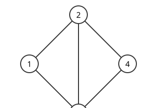
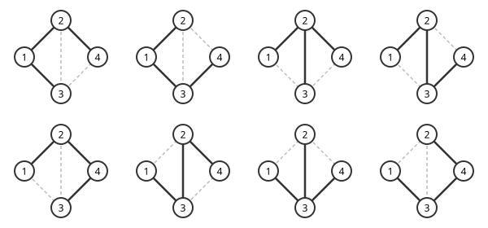

# 행렬-트리 정리

# 개요

**행렬-트리 정리(matrix-tree theorem)** 는 그래프의 신장트리 개수가 그래프에서 만든 행렬 하나의 행렬식과 같다는 정리다. 도시 네 곳을 잇는 도로 다섯 개 가운데 모든 도시가 계속 이어지도록 남길 최소한의 도로를 고르는 방법이 몇 가지인지 세려면, 도로를 고르는 조합을 하나씩 늘어놓고 순환이 생기는 것을 지워야 한다. 이 정리는 그 개수를 [그래프 Laplacian](graph-laplacian.md)에서 한 행과 한 열을 지운 행렬의 [행렬식](determinants.md)으로 계산한다.

# 직관

아래 그래프는 정점 네 개와 간선 다섯 개로 되어 있다. 정점 $1$ 과 $4$ 사이에만 간선이 없다.

모든 정점을 잇고 순환이 없는 간선 집합을 센다. 정점이 넷이면 그런 집합은 간선이 정확히 셋이다. 다섯 개에서 셋을 고르는 방법은 $10$ 가지이고, 그 가운데 삼각형 $1,2,3$ 과 삼각형 $2,3,4$ 는 순환이라 뺀다. 남는 것은 $8$ 가지다.

아래 그림이 그 여덟 가지다. 굵은 선이 고른 간선이고 점선이 버린 간선이다.

간선이 많아지면 이 방법은 막힌다. 간선 $m$ 개에서 $n-1$ 개를 고르는 조합의 수가 빠르게 늘고, 조합마다 순환이 있는지 따로 확인해야 한다.

같은 그래프의 각 정점에 차수를 대각선에 적고, 이웃한 두 정점의 자리에 $-1$ 을 적는다. 그다음 정점 $1$ 의 행과 열을 지우면 다음 행렬이 남는다.

$$
\begin{pmatrix}3&-1&-1\cr -1&3&-1\cr -1&-1&2\end{pmatrix}
$$

이 행렬의 행렬식은 $3\cdot 5-(-1)\cdot(-3)+(-1)\cdot 4=8$ 이다. 조합을 하나도 늘어놓지 않고 같은 $8$ 이 나온다.

# 정의

$G$ 를 정점 $\lbrace 1,\dots,n\rbrace$ 위의 유한 무향 [그래프](graphs.md)라 한다. **신장트리(spanning tree)** 는 $G$ 의 모든 정점을 포함하고 순환이 없는 연결 부분그래프다. 신장트리는 간선이 $n-1$ 개다.

직관 절의 그림 여덟 개가 마름모 그래프의 신장트리 전부다. $G$ 의 신장트리 개수를 $\tau(G)$ 로 쓴다. 마름모 그래프에서 $\tau=8$ 이다.

간선 $e$ 에 양의 가중치 $w_e$ 가 있으면 **가중 신장트리 개수(weighted spanning tree count)** 를 다음으로 정의한다.

$$
\tau_w(G)=\sum_{T}\prod_{e\in T}w_e
$$

합은 $G$ 의 신장트리 $T$ 전체에 걸친다. 모든 가중치가 $1$ 이면 $\tau_w=\tau$ 다.

$L$ 을 $G$ 의 Laplacian 행렬이라 하고 정점 $v$ 를 하나 고른다. $L$ 에서 $v$ 번째 행과 $v$ 번째 열을 지운 $(n-1)\times(n-1)$ 행렬을 **축소 Laplacian(reduced Laplacian)** 이라 하고 $L_v$ 로 쓴다. 직관 절의 $3\times 3$ 행렬이 마름모 그래프의 $L_1$ 이다.

# 성질

## 행렬-트리 정리

임의의 정점 $v$ 에 대해 다음이 성립한다. Kirchhoff 가 1847 년에 전기 회로를 풀면서 얻었다.[^1]

$$
\tau_w(G)=\det L_v
$$

우변은 $v$ 를 어느 것으로 골라도 같다. 마름모 그래프에서 정점 $4$ 의 행과 열을 지워도 행렬식은 $8$ 이다.

증명의 요지. [그래프 Laplacian](graph-laplacian.md)의 발생 행렬 분해 $L=B^{\mathsf T}B$ 에서 $B$ 의 $v$ 번째 열을 지운 $m\times(n-1)$ 행렬을 $B_v$ 라 하면 $L_v=B_v^{\mathsf T}B_v$ 다. [Cauchy–Binet 공식](cauchy-binet-formula.md)은 $k\times m$ 행렬 $A$ 와 $m\times k$ 행렬 $C$ 에 대해 $\det(AC)$ 가 $k$ 개의 열과 행을 고른 소행렬식의 곱을 모든 선택에 걸쳐 더한 값이라는 공식이다. 이것을 적용하면 다음이 나온다.

$$
\det L_v=\sum_{S}\bigl(\det B_v\lbrack S\rbrack\bigr)^2
$$

합은 간선 $n-1$ 개로 된 집합 $S$ 전체에 걸치고, $B_v\lbrack S\rbrack$ 는 $S$ 의 행만 남긴 정사각행렬이다.

남은 것은 $\det B_v\lbrack S\rbrack$ 의 값이다. $S$ 가 신장트리가 아니면 간선이 $n-1$ 개이므로 연결이 아니고, $v$ 를 포함하지 않는 연결성분이 있다. 그 성분의 정점에 해당하는 열을 모두 더하면 각 행에서 $\sqrt{w_e}$ 와 $-\sqrt{w_e}$ 가 지워져 $0$ 이 되므로 행렬식이 $0$ 이다.

$S$ 가 신장트리이면 $v$ 가 아닌 잎이 있고, 그 잎의 열에는 성분이 하나뿐이다. 그 열로 전개하고 잎을 지운 나무에 같은 논증을 되풀이하면 $\det B_v\lbrack S\rbrack=\pm\prod_{e\in S}\sqrt{w_e}$ 다. 제곱해 더하면 $\tau_w(G)$ 다.

## 고윳값으로 쓴 꼴

$L$ 의 [고윳값](eigenvalues.md)을 $0=\lambda_1\le\lambda_2\le\dots\le\lambda_n$ 이라 하면 다음이 성립한다.

$$
\tau(G)=\frac{1}{n}\lambda_2\lambda_3\cdots\lambda_n
$$

증명의 요지. 특성다항식 $\det(xI-L)$ 에서 $x$ 의 계수는 $(-1)^{n-1}\lambda_2\cdots\lambda_n$ 이다. 같은 계수는 $(-1)^{n-1}$ 에 $L$ 의 $(n-1)\times(n-1)$ 주소행렬식 $n$ 개의 합을 곱한 값이고, 행렬-트리 정리로 그 $n$ 개가 모두 $\tau(G)$ 다.

마름모 그래프의 Laplacian 고윳값은 $0,2,4,4$ 이고 $2\cdot 4\cdot 4/4=8$ 이다. 완전그래프 $K_n$ 의 Laplacian 은 고윳값이 $0$ 하나와 $n$ 이 $n-1$ 개이므로 $\tau(K_n)=n^{n-1}/n=n^{n-2}$ 이다. 이것이 [Cayley 공식](cayley-formula.md)이다.

## 유향 판본

유향 그래프에서 정점 $r$ 로 모이는 [유향 신장트리](arborescences.md)(arborescence)는 $r$ 이 아닌 정점마다 나가는 호가 정확히 하나이고, 어느 정점에서 출발해 그 호를 따라가도 $r$ 에 닿는 부분그래프다. 나가는 차수의 대각행렬을 $D_{\mathrm{out}}$, 인접행렬을 $A$ 라 하고 $L_{\mathrm{out}}=D_{\mathrm{out}}-A$ 로 둔다. $r$ 로 모이는 유향 신장트리의 개수를 $\tau_r(G)$ 로 쓰면, Tutte 의 유향 행렬-트리 정리(directed matrix-tree theorem)는 다음이다.[^2]

$$
\tau_r(G)=\det\bigl(L_{\mathrm{out}}\bigr)\_r
$$

우변은 $L_{\mathrm{out}}$ 에서 $r$ 번째 행과 열을 지운 행렬의 행렬식이다. 무향 그래프의 간선을 양방향 호 두 개로 바꾸면 $L_{\mathrm{out}}=L$ 이 되어 무향 판본이 나온다. 유향 판본에서는 $r$ 을 바꾸면 값이 달라질 수 있다.

세 호 $1\to 2$, $2\to 3$, $3\to 1$ 로 된 유향 순환에서 정점 $1$ 로 모이는 유향 신장트리는 호 $2\to 3$ 과 $3\to 1$ 로 된 하나뿐이다. $L_{\mathrm{out}}$ 에서 $1$ 번째 행과 열을 지우면 다음이 나온다.

$$
\det\begin{pmatrix}1&-1\cr 0&1\end{pmatrix}=1
$$

# 활용

- [Euler 회로](eulerian-circuits.md)의 개수. BEST 정리(BEST theorem, de Bruijn–van Aardenne-Ehrenfest–Smith–Tutte theorem)는 유향 Euler 회로의 수를 한 정점으로 모이는 유향 신장트리의 수와 차수의 계승으로 쓴다. 유향 판본이 그 수를 행렬식 하나로 계산하므로 Euler 회로의 수를 다항시간에 센다. [de Bruijn 수열](de-bruijn-sequences.md)의 개수가 이 계산으로 나온다.
- [유효저항](effective-resistance.md). 간선 $e=(u,v)$ 의 가중치와 두 끝점 사이 유효저항의 곱은 가중치에 비례하는 확률로 뽑은 신장트리가 $e$ 를 포함할 확률과 같다. 그 확률의 분자와 분모가 모두 행렬-트리 정리의 행렬식이다.
- [강한 Rayleigh 측도](strongly-rayleigh-measures.md). 신장트리를 고르게 뽑는 측도의 생성다항식이 축소 Laplacian 의 행렬식이므로 실안정이다.
- [Tutte 다항식](tutte-polynomial.md). 연결 그래프에서 $T(G;1,1)=\tau(G)$ 다. Tutte 다항식의 값 대부분은 계산이 어렵지만 이 점은 행렬식으로 다항시간에 계산된다.

[^1]: G. Kirchhoff, "Ueber die Auflösung der Gleichungen, auf welche man bei der Untersuchung der linearen Vertheilung galvanischer Ströme geführt wird", *Annalen der Physik und Chemie* **72** (1847), 497–508.

[^2]: W. T. Tutte, "The dissection of equilateral triangles into equilateral triangles", *Proceedings of the Cambridge Philosophical Society* **44** (1948), 463–482. 증명은 R. P. Stanley, *Algebraic Combinatorics*, 2판, Springer, 2018, 10 장에 있다.

# 연관 문서

## 선수지식

- [그래프 Laplacian](graph-laplacian.md)
- [Cauchy–Binet 공식](cauchy-binet-formula.md)

## 더 알아보기

- [균등 신장트리](uniform-spanning-tree.md)

#graph_theory #linear_algebra #combinatorics
