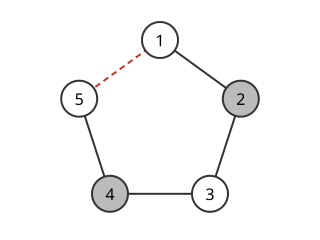

# 최대 절단

# 개요

**최대 절단(maximum cut)** 은 그래프의 정점을 두 무리로 나눠 두 무리 사이를 잇는 변이 가장 많게 하는 문제다. 다섯 사람이 둥글게 앉아 이웃끼리 사이가 나쁠 때 두 방에 나눠 넣어 사이가 나쁜 이웃을 되도록 많이 떼어 놓는 일이 이 꼴이다. 정점이 많으면 나누는 방법을 모두 시험할 수 없으므로, 정점을 하나씩 옮겨 고치는 방법이나 [반정부호 계획법](semidefinite-programming.md)으로 최적값에 가까운 나눔을 찾는다.

# 직관

아래 그림은 다섯 사람 $1,2,3,4,5$ 가 둥글게 앉은 자리이고, 변은 이웃한 두 사람을 잇는다. 흰 정점은 방 $A$, 회색 정점은 방 $B$ 에 넣은 사람이다.

$1$ 부터 방을 번갈아 정하면 $1,3,5$ 가 $A$, $2,4$ 가 $B$ 다. 실선 변 넷은 다른 방의 두 사람을 잇고, 점선 변 $15$ 만 같은 방 $A$ 의 두 사람을 잇는다. 떼어 놓은 이웃은 다섯 쌍 가운데 넷이다.

다섯 쌍을 모두 떼어 놓을 수는 없다. 둘레를 따라 $1$ 에서 한 바퀴 돌면 떼어 놓은 쌍을 지날 때마다 방이 바뀌고, $1$ 로 돌아오면 처음 방이어야 하므로 방이 바뀐 횟수는 짝수다. 다섯은 홀수이므로 한 쌍은 같은 방에 남고, 최댓값은 $4$ 다.

정점이 많으면 나누는 방법이 너무 많아 하나씩 시험할 수 없다. 대신 아무 나눔에서 시작해, 같은 방에 있는 이웃이 다른 방에 있는 이웃보다 많은 사람을 다른 방으로 옮긴다. 옮길 때마다 떼어 놓은 쌍이 늘고, 더 옮길 사람이 없으면 모든 사람이 이웃의 절반 이상과 떨어져 있다.

# 정의

## 절단

그래프 $G=(V,E)$ 와 정점 집합 $S\subseteq V$ 에 대해, 한 끝은 $S$ 에 있고 다른 끝은 $V\setminus S$ 에 있는 변의 집합을 **절단(cut)** $\delta(S)$ 라 한다. 직관 절에서 $S=\lbrace 1,3,5\rbrace$ 이면 $\delta(S)=\lbrace 12,23,34,45\rbrace$ 이고 크기는 $4$ 다.

## 최대 절단

$\lvert\delta(S)\rvert$ 의 최댓값을 $\mathrm{mc}(G)$ 로 쓰고, 그 값을 주는 $S$ 를 찾는 문제를 **최대 절단 문제** 라 한다. 변마다 가중치 $w(e)\ge 0$ 이 있으면 $\delta(S)$ 의 가중치 합을 최대로 한다. 다섯 정점의 순환 $C\_5$ 에서 $\mathrm{mc}(C\_5)=4$ 다.

정점마다 $x\_v\in\lbrace -1,+1\rbrace$ 를 주면 변 $uv$ 가 절단에 드는 것은 $x\_u\ne x\_v$ 인 것, 곧 $(1-x\_ux\_v)/2=1$ 인 것이다. 그래서 최대 절단은 다음 이차식의 최대화다.

$$
\mathrm{mc}(G)=\max_{x\in\lbrace -1,+1\rbrace^V}\sum_{uv\in E}\frac{1-x_ux_v}{2}
$$

## 국소 최적 나눔

$S$ 에서 정점 하나를 다른 쪽으로 옮겨도 $\lvert\delta(S)\rvert$ 가 늘지 않으면 $S$ 를 **국소 최적(locally optimal)** 이라 한다. 직관 절의 나눔에서 $1$ 은 이웃 $2$ 와 떨어지고 $5$ 와 같은 방이라 옮겨도 절단 크기가 $4$ 그대로이므로, 이 나눔은 국소 최적이다.

# 성질

## 이분 그래프

$\mathrm{mc}(G)=\lvert E\rvert$ 인 것과 $G$ 가 이분 그래프인 것은 동치다. 모든 변이 절단에 들면 $S$ 와 $V\setminus S$ 가 두 부분이다. [그래프](graphs.md)의 정리에 따라 이분 그래프는 홀수 순환이 없는 그래프이므로, 홀수 순환이 있으면 직관 절의 논증처럼 그 순환의 변 하나는 절단에 들지 못한다.

## 절반 하한

모든 그래프에서 $\mathrm{mc}(G)\ge\lvert E\rvert/2$ 다. 국소 최적 나눔에서는 정점 $v$ 마다 절단에 드는 변이 $\deg v/2$ 개 이상이고, 이것을 모든 정점에 대해 더하면 절단의 변은 두 번씩 세어지므로 $2\lvert\delta(S)\rvert\ge\sum\_v\deg v/2=\lvert E\rvert$ 다.

정점마다 동전을 던져 방을 정해도 변마다 절단에 들 확률이 $1/2$ 이므로 절단 크기의 기댓값이 $\lvert E\rvert/2$ 다. 이 논증이 [확률적 방법](probabilistic-method.md)이다.

## Edwards 하한

C. S. Edwards 는 절반 하한을 다음으로 높였다[^1].

$$
\mathrm{mc}(G)\ge\frac{\lvert E\rvert}{2}+\frac{\sqrt{8\lvert E\rvert+1}-1}{8}
$$

정점 $n$ 개의 완전그래프에서는 $8\lvert E\rvert+1=(2n-1)^2$ 이므로 오른쪽이 $(n^2-1)/4$ 이고, $n$ 이 홀수이면 정점을 $(n-1)/2$ 개와 $(n+1)/2$ 개로 나눈 절단이 이 값과 같다.

## 계산 복잡도

가중치 있는 최대 절단의 판정 문제는 R. Karp 가 1972 년에 [NP(nondeterministic polynomial time)-완전](np-completeness.md)으로 보인 21 문제 가운데 하나다[^2]. 정확한 다항 시간 알고리즘이 있는 경우는 다음과 같다.

- 평면 그래프. 평면 쌍대 그래프에서 차수가 홀수인 정점을 짝수로 맞추는 가장 가벼운 변 집합이 절단 밖의 변과 대응하므로, [중국인 우편배달부 문제](chinese-postman-problem.md)의 [T-join](t-joins.md) 계산으로 풀린다[^3].
- 이분 그래프. 두 부분이 그대로 최대 절단이다.

이와 달리 절단의 크기를 가장 작게 하는 최소 절단은 [네트워크 흐름](network-flow.md)이나 [Karger 축약 알고리즘](karger-min-cut.md)으로 다항 시간에 풀린다.

## 근사

M. Goemans 와 D. Williamson 은 이차식의 $x\_v$ 를 단위벡터로 바꾼 반정부호 계획을 풀고 무작위 초평면으로 벡터를 나눠, 기댓값이 최적값의 $0.878$ 배 이상인 절단을 얻었다[^4]. [유일게임 추측](unique-games.md)이 참이면 $0.878$ 보다 나은 비율의 다항 시간 근사는 없고, 추측 없이도 $16/17$ 보다 나은 비율의 근사는 NP-어렵다(NP-hard)[^5].

# 활용

- 통계역학. [Ising 모형](ising-model.md)에서 이웃한 스핀이 반대이길 바라는 상호작용만 있으면 에너지가 가장 낮은 상태가 가중 최대 절단이다. 상호작용의 부호가 섞인 평면 격자의 스핀 유리 바닥 상태도 쌍대 그래프의 T-join 계산으로 구한다.
- 회로 배선. 전선을 두 층에 나눠 깔 때 층을 바꾸는 구멍의 수를 줄이는 문제가 평면 그래프의 최대 절단이 된다.
- 양자 최적화. [양자 근사 최적화 알고리즘](quantum-approximate-optimization.md)의 표준 시험 문제가 최대 절단이다.
- 근사 알고리즘. 반정부호 계획의 무작위 초평면 반올림이 이 문제에서 처음 쓰였고[^4], 같은 반올림이 [근사 알고리즘](approximation-algorithms.md)에서 최대 2-SAT(maximum 2-satisfiability) 같은 다른 문제에도 쓰인다.

[^1]: C. S. Edwards, "Some extremal properties of bipartite subgraphs", Canadian Journal of Mathematics 25 (1973), 475–485.
[^2]: R. M. Karp, "Reducibility among combinatorial problems", in Complexity of Computer Computations, Plenum (1972), 85–103.
[^3]: F. Hadlock, "Finding a maximum cut of a planar graph in polynomial time", SIAM Journal on Computing 4 (1975), 221–225.
[^4]: M. X. Goemans, D. P. Williamson, "Improved approximation algorithms for maximum cut and satisfiability problems using semidefinite programming", Journal of the ACM 42 (1995), 1115–1145.
[^5]: J. Håstad, "Some optimal inapproximability results", Journal of the ACM 48 (2001), 798–859.

# 연관 문서

## 선수지식

- [그래프](graphs.md)
- [NP-완전성과 Cook–Levin 정리](np-completeness.md)

## 더 알아보기

아직 연결한 문서가 없다.

#graph_theory #combinatorics #optimization #complexity
