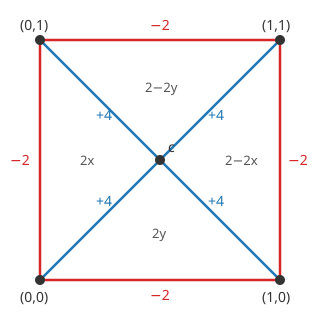

# Maxwell–Cremona 대응

# 개요

**Maxwell–Cremona 대응(Maxwell–Cremona correspondence)** 은 평면 그래프의 직선 그림에서 간선에 건 힘이 모든 정점에서 평형을 이루는 것과, 그 그림이 다면체 곡면을 위에서 내려다본 그림인 것이 같은 일이라는 정리다. 정사각형의 네 꼭짓점과 가운데 점을 이은 그림은 피라미드를 위에서 본 그림이고, 가운데 네 간선을 당기고 테두리 네 간선을 밀면 다섯 정점 모두에서 힘이 평형을 이룬다. 이 대응으로 평형인 힘을 찾는 선형 문제를 풀어 그림을 3 차원 다면체로 들어 올린다.

# 직관

꼭짓점 $(0,0)$, $(1,0)$, $(1,1)$, $(0,1)$ 과 가운데 점 $c=(1/2,1/2)$ 의 피라미드를 본다. 가운데 높이를 $1$, 테두리 높이를 $0$ 으로 두면 네 옆면의 높이는 아래 그림과 같이 $2y$, $2-2x$, $2-2y$, $2x$ 이고 바깥은 높이 $0$ 이다.

간선 $(0,0)c$ 를 사이에 둔 두 면의 기울기는 $(2,0)$ 과 $(0,2)$ 이고, 차 $(2,-2)$ 는 간선 방향 $(1,1)$ 에 수직이다. 두 평면이 그 간선 위에서 높이가 같으므로 기울기의 차는 언제나 간선에 수직이다. 그 차가 간선을 돌린 벡터의 몇 배인지를 간선의 수로 적으면 가운데 간선은 $4$, 테두리 간선은 $-2$ 다.

이 수를 간선의 장력으로 읽는다. 가운데 점에서는 네 간선의 장력 $4$ 가 네 방향으로 당겨 합이 $0$ 이다. 꼭짓점 $(0,0)$ 에서는 가운데 간선이 $4(1/2,1/2)=(2,2)$ 로 당기고 두 테두리 간선이 $-2(1,0)$ 과 $-2(0,1)$ 로 밀어 합이 $0$ 이다. 높이를 정한 그림에서 모든 정점의 힘이 평형인 장력이 나왔다.

# 정의

$G$ 가 평면 그래프이고 $p:V\to\mathbb R^2$ 가 간선이 엇갈리지 않는 직선 그림이다. 바깥 면을 포함해 모든 면이 그림에서 다각형 영역이다.

간선마다 실수 $\omega\_{ij}=\omega\_{ji}$ 를 주어 모든 정점 $i$ 에서 다음이 성립하면 $\omega$ 를 **평형 응력(equilibrium stress)** 이라 한다.

$$
\sum\_{j:\thinspace ij\in E}\omega\_{ij}\bigl(p\_j-p\_i\bigr)=0
$$

정점마다 높이 $z\_i$ 를 주어 각 면의 점 $(p\_i,z\_i)$ 들이 한 평면 위에 있으면 $z$ 를 그림의 **들어올림(lifting)** 이라 한다. 면 $f$ 의 평면을 $z=a\_f\cdot x+b\_f$ 로 쓰고, $a\_f$ 를 그 면의 기울기라 한다. 직관 절의 피라미드는 바깥 면의 높이가 $0$ 인 들어올림이고, $\omega$ 는 가운데 간선에 $4$, 테두리 간선에 $-2$ 를 준 평형 응력이다.

$J$ 를 평면에서 시계 방향으로 직각만큼 돌리는 사상이라 한다. 간선 $i\to j$ 의 왼쪽 면을 $f$, 오른쪽 면을 $g$ 라 할 때 들어올림과 응력이 다음을 만족하면 둘이 **대응한다** 고 한다.

$$
a\_f-a\_g=\omega\_{ij}\thinspace J(p\_j-p\_i)
$$

직관 절의 간선 $(0,0)\to c$ 에서 왼쪽 면은 $2x$, 오른쪽 면은 $2y$ 이고, $(2,-2)=4\cdot J(1/2,1/2)$ 이다.

# 성질

## Maxwell–Cremona 정리

정리. $G$ 가 3-연결 평면 그래프이고 $p$ 가 그 직선 그림이면, 바깥 면의 높이가 $0$ 인 들어올림과 평형 응력은 위의 관계로 일대일 대응한다. 이 대응은 선형이다[^1][^2].

증명의 요지. 들어올림이 주어지면 이웃한 두 면의 평면이 공통 간선 위에서 높이가 같으므로 $a\_f-a\_g$ 는 간선에 수직이고, 위 식으로 $\omega\_{ij}$ 가 정해진다. 정점 $i$ 둘레의 면을 한 바퀴 돌며 기울기의 차를 더하면 $0$ 이므로 $\sum\_j\omega\_{ij}J(p\_j-p\_i)=0$ 이고, $J$ 를 풀면 평형 식이다.

거꾸로 응력이 주어지면 바깥 면의 기울기를 $0$ 으로 두고 간선을 하나씩 건너며 위 식으로 기울기를 정한다. 한 정점 둘레를 도는 길에서 기울기가 어긋나지 않는다는 조건이 그 정점의 평형 식이다. 평면에서 면 사이를 잇는 닫힌 길은 정점 둘레의 길들로 쪼개지므로 기울기가 모든 면에서 하나로 정해진다.

## 접힘의 방향

$J$ 를 시계 방향으로 잡으면 $\omega\_{ij}\gt 0$ 인 간선은 들어 올린 곡면이 위로 솟는 능선이고, $\omega\_{ij}\lt 0$ 인 간선은 아래로 꺼지는 골짜기다. 직관 절의 피라미드에서 가운데 간선은 능선, 테두리 간선은 골짜기다. 바깥 면의 경계가 아닌 모든 간선이 능선이면 들어 올린 곡면은 바깥 면 위로 솟은 볼록 다면체의 겉면이다.

# 활용

- [Steinitz 정리](steinitz-theorem.md)의 증명. 3-연결 평면 그래프의 바깥 면을 삼각형으로 고정하고 대칭인 양의 가중치로 가중 [Tutte 그리기](tutte-embedding.md)를 구하면, 그 가중치가 안쪽 간선의 양의 평형 응력이 되고 바깥 삼각형의 간선에는 음의 응력을 맞출 수 있다. 이 응력에 대응하는 들어올림이 그 그래프를 갖는 볼록 다면체다[^2].
- 도식 정역학(graphic statics). 트러스의 간선 힘이 평형인지를 Maxwell 은 힘의 다각형을 이어 붙인 상반 도형(reciprocal figure)으로 판정했고, 상반 도형이 있는 것과 들어올림이 있는 것이 같다[^1].
- 정칙 분할. 평면 점들의 가중 [Delaunay 삼각분할](delaunay-triangulation.md)처럼 3 차원 볼록 다면체의 아래 면을 내려다본 분할이 정칙 분할(regular subdivision)이다. 주어진 분할이 정칙인지는 이 대응으로 안쪽 간선마다 양수인 평형 응력이 있는지를 묻는 선형 부등식 문제가 된다.

[^1]: J. C. Maxwell, "On reciprocal figures and diagrams of forces", *Philosophical Magazine* 27 (1864), 250–261.
[^2]: L. Lovász, *Graphs and Geometry*, American Mathematical Society Colloquium Publications 65 (2019).

# 연관 문서

## 선수지식

- [Tutte 그리기](tutte-embedding.md)

## 더 알아보기

아직 연결한 문서가 없다.

#graph_theory #combinatorics #linear_algebra
