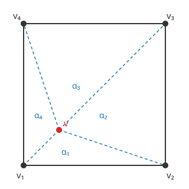

# 평균값 좌표

# 개요

**평균값 좌표(mean value coordinates)** 는 다각형 안의 점을 꼭짓점들의 가중 평균으로 쓰는 가중치를 꼭짓점이 몇 개이든 하나로 정하는 방법이다. 삼각형 안의 점은 세 꼭짓점의 가중 평균으로 쓰는 방법이 하나뿐이지만, 정사각형 안의 점은 네 꼭짓점의 가중 평균으로 쓰는 방법이 무수히 많다. 평균값 좌표는 조화함수의 평균값 성질에서 가중치를 끌어내, 점이 움직이면 매끄럽게 따라 바뀌고 볼록 다각형 안에서는 늘 양수인 가중치를 준다.

# 직관

정사각형의 꼭짓점을 $v\_1=(0,0)$, $v\_2=(1,0)$, $v\_3=(1,1)$, $v\_4=(0,1)$ 로 두고 안의 점 $v=(1/4,1/4)$ 을 본다. 음 아닌 수 $\lambda\_1,\dots,\lambda\_4$ 의 합이 $1$ 이고 $\sum\lambda\_iv\_i=v$ 인 것을 찾는다. 삼각형 $v\_1v\_2v\_4$ 의 무게중심 좌표(barycentric coordinates)로는 $(1/2,1/4,0,1/4)$ 이고, 대각선 $v\_1v\_3$ 위의 점으로 보면 $(3/4,0,1/4,0)$ 이다.

두 답 모두 정사각형을 삼각형으로 자른 방식에 따라 정해졌다. 자르는 대각선을 바꾸면 답이 바뀌고, 점이 대각선을 넘어가면 가중치가 꺾인다. [Tutte 그리기](tutte-embedding.md)로 삼각망을 평면에 펼 때는 정점마다 이웃의 가중 평균을 써야 하므로, 자르는 방식에 기대지 않고 점의 위치에 따라 매끄럽게 바뀌는 양의 가중치가 필요하다.

평균값 좌표는 $v$ 에서 네 꼭짓점을 바라보는 각과 거리로 가중치를 정한다. 아래 그림의 $\alpha\_i$ 는 $v$ 에서 $v\_i$ 와 $v\_{i+1}$ 을 바라보는 각이다.

$\alpha\_1=\alpha\_4=116.57^\circ$, $\alpha\_2=\alpha\_3=63.43^\circ$ 이고, 각의 절반의 탄젠트는 황금비 $\varphi=1.618$ 과 그 역수 $0.618$ 이다. 이 각으로 정한 가중치는 $(0.573,0.177,0.073,0.177)$ 이고, 넷 다 양수이며 $\sum\lambda\_iv\_i=v$ 를 만족한다.

# 정의

꼭짓점이 반시계 방향으로 $v\_1,\dots,v\_n$ 인 다각형과 그 안의 점 $v$ 를 둔다. 첨자는 $n$ 으로 나눈 나머지로 읽는다. $r\_i=\vert v\_i-v\vert$ 이고, $\alpha\_i$ 는 $v$ 에서 $v\_i-v$ 와 $v\_{i+1}-v$ 가 이루는 부호 있는 각이다. 다음 $\lambda\_i(v)$ 를 $v$ 의 **평균값 좌표** 라 한다[^1].

$$
w\_i=\frac{\tan(\alpha\_{i-1}/2)+\tan(\alpha\_i/2)}{r\_i},\qquad\lambda\_i(v)=\frac{w\_i}{\sum\_{j=1}^nw\_j}
$$

직관 절의 정사각형에서는 $r\_1=\sqrt2/4$, $r\_2=r\_4=\sqrt{10}/4$, $r\_3=3\sqrt2/4$ 이다. 그러므로 $w\_1=4\sqrt2\varphi=9.153$, $w\_2=w\_4=2\sqrt2=2.828$, $w\_3=1.165$ 이고, 합 $15.975$ 로 나누면 직관 절의 $(0.573,0.177,0.073,0.177)$ 이 나온다. $w\_2$ 에서는 $\varphi+1/\varphi=\sqrt5$ 를 썼다.

# 성질

## 평균값 성질에서 나온 가중치

$v$ 를 중심으로 다각형을 부채꼴 삼각형 $vv\_iv\_{i+1}$ 으로 나누고, 함수 $u$ 가 각 삼각형에서 일차식이며 $u(v\_i)=u\_i$ 를 만족한다. $v$ 를 중심으로 하는 작은 원 위에서 $u$ 의 평균이 $u(v)$ 와 같다는 조건이 다음과 같다.

$$
\sum\_{i=1}^nw\_i\bigl(u\_i-u(v)\bigr)=0
$$

[조화함수](harmonic-functions.md)는 이 평균값 성질을 만족하므로, 평균값 좌표는 꼭짓점 값 $u\_i$ 에서 $u(v)=\sum\lambda\_iu\_i$ 를 정하는 일차 보간이다[^1]. 원의 반지름은 식에 남지 않는다.

## 일차 정확성

정리. $\sum\_i\lambda\_i(v)=1$ 이고 $\sum\_i\lambda\_i(v)v\_i=v$ 다.

증명의 요지. $e(\theta)=(\cos\theta,\sin\theta)$ 이고 $e\_i$ 가 $v\_i-v$ 방향의 단위벡터이면, $e\_i$ 에서 $e\_{i+1}$ 까지의 각 $\alpha\_i$ 위에서 다음이 성립한다.

$$
\int e(\theta)\thinspace d\theta=\tan(\alpha\_i/2)\thinspace(e\_i+e\_{i+1})
$$

$i$ 에 대해 더하면 왼쪽은 원 한 바퀴의 적분 $0$ 이고, 오른쪽은 $\sum\_iw\_i(v\_i-v)$ 다. 그러므로 $\sum w\_iv\_i=(\sum w\_i)v$ 이다.

## 양수성과 매끄러움

$v$ 가 볼록 다각형의 안에 있으면 모든 $\alpha\_i$ 가 $0$ 과 $\pi$ 사이에 있어 $\tan(\alpha\_i/2)\gt 0$ 이므로 모든 $\lambda\_i$ 가 양수다. 볼록이 아니어도 $v$ 에서 모든 꼭짓점이 보이는 별 모양 다각형이면 같은 이유로 양수다[^1]. $\lambda\_i$ 는 다각형 안에서 $v$ 의 무한 번 미분 가능한 함수이고, 변 위에서는 두 끝점 사이의 일차 보간이 된다.

## 오목 다각형

부호 있는 각을 쓰면 정의의 식은 단순 다각형 안의 모든 점에서 뜻이 있고 일차 정확성도 그대로 성립한다. 이때 $\lambda\_i$ 가 음수가 될 수 있다[^2].

## Wachspress 좌표

볼록 다각형에서는 **Wachspress 좌표(Wachspress coordinates)** 도 합이 $1$ 이고 일차 정확하며 양수인 가중치다[^4]. $A(p,q,s)$ 를 삼각형 $pqs$ 의 넓이라 하면 다음과 같다.

$$
w\_i=\frac{A(v\_{i-1},v\_i,v\_{i+1})}{A(v,v\_{i-1},v\_i)\thinspace A(v,v\_i,v\_{i+1})},\qquad\lambda\_i=\frac{w\_i}{\sum\_jw\_j}
$$

직관 절의 정사각형에서 $v=(1/4,1/4)$ 의 Wachspress 좌표는 $(9/16,3/16,1/16,3/16)$ 이고, 정사각형의 쌍일차 보간과 같다. 평균값 좌표 $(0.573,0.177,0.073,0.177)$ 과는 다르다. Wachspress 좌표는 $v$ 의 유리함수이지만, 오목 다각형에서는 분모가 $0$ 이 되는 점이 다각형 안에 생겨 정의되지 않는다.

# 활용

- 삼각망의 매개화. Floater 는 삼각망의 각 내부 정점에서 이웃 정점들을 평면에 펼친 뒤 평균값 좌표를 가중치로 삼아 가중 Tutte 그리기를 구했다. 가중치가 양수라 삼각형이 뒤집히지 않고, 평면 삼각망에 쓰면 원래 위치가 그대로 나온다[^1].
- 틀 변형. 3 차원 모형을 닫힌 다면체 틀로 감싸고 모형의 점을 틀 꼭짓점의 평균값 좌표로 적어 두면, 틀의 꼭짓점을 옮길 때 모형이 매끄럽게 따라 변형된다. 닫힌 삼각망 위의 평균값 좌표가 이 용도로 정의되었다[^3].
- 다각형 안의 보간. 경계 꼭짓점에서만 값이 주어진 함수를 다각형 안으로 매끄럽게 잇는다. 그림 변형과 유한요소의 다각형 요소가 이렇게 쓴다.

[^1]: M. S. Floater, "Mean value coordinates", *Computer Aided Geometric Design* 20 (2003), 19–27.
[^2]: K. Hormann, M. S. Floater, "Mean value coordinates for arbitrary planar polygons", *ACM Transactions on Graphics* 25 (2006), 1424–1441.
[^3]: T. Ju, S. Schaefer, J. Warren, "Mean value coordinates for closed triangular meshes", *ACM Transactions on Graphics* 24 (2005), 561–566.
[^4]: E. L. Wachspress, *A Rational Finite Element Basis*, Academic Press (1975).

# 연관 문서

## 선수지식

- [Tutte 그리기](tutte-embedding.md)
- [조화함수](harmonic-functions.md)

## 더 알아보기

아직 연결한 문서가 없다.

#graph_theory #analysis #linear_algebra
