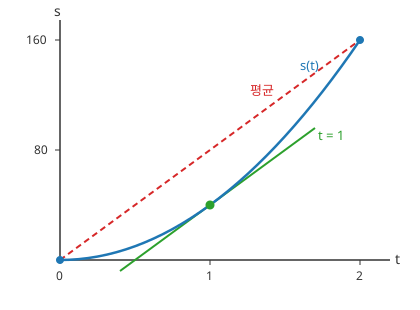

# 평균값 정리

# 개요

**평균값 정리(mean value theorem)** 는 끊기지 않고 매끄럽게 변하는 양의 평균 변화율이 어느 한 순간의 변화율과 같다는 정리다. 자동차가 2 시간에 160 km 를 갔으면 평균 속력은 시속 80 km 이고, 도중에 속도계가 정확히 80 을 가리킨 순간이 있다. 평균값 정리는 구간 양 끝의 값만으로 그런 순간이 존재함을 보이고, 거꾸로 순간 변화율의 크기로 두 시각 사이의 변화량을 제한한다.

# 직관

자동차의 위치를 시각 $t$ 시간에 출발점에서 $s(t)$ km 로 적는다. 정지 상태에서 출발해 고르게 가속하는 차를 $s(t)=40t^2$ 으로 두면 $s(0)=0$ 이고 $s(2)=160$ 이다. 속도계가 가리키는 값은 [미분](derivative.md) $s'(t)=80t$ 이다.

그림의 점선은 처음과 끝 위치를 잇는 선분이고 기울기가 평균 속력 $80$ 이다. 실선은 $t=1$ 에서 곡선에 닿는 접선이고 기울기가 $s'(1)=80$ 이다. 두 선이 평행하다.

이런 순간을 $s$ 의 식 없이 찾는다. 같은 시각에 출발해 시속 80 km 로 일정하게 달리는 차를 하나 더 두고, 두 차의 거리 차 $g(t)=s(t)-80t$ 를 본다. 출발 때도 도착 때도 두 차는 같은 자리에 있으므로 $g(0)=g(2)=0$ 이다.

$g$ 가 늘 $0$ 이 아니면 사이 어딘가에서 차이가 가장 큰 순간이 있다. 그 직전에는 차이가 벌어지는 중이고 직후에는 줄어드는 중이므로, 그 순간 $g$ 의 변화율은 $0$ 이고 두 차의 속력이 같다. 예에서는 $g(t)=40t^2-80t$ 가 $t=1$ 에서 가장 뒤처지고 $g'(1)=0$ 이다.

# 정의

## Rolle 정리

**Rolle 정리(Rolle's theorem)** 는 다음이다. $f$ 가 $\lbrack a,b\rbrack$ 에서 [연속](continuity.md)이고 $(a,b)$ 에서 미분 가능하며 $f(a)=f(b)$ 이면 $f'(c)=0$ 인 $c\in(a,b)$ 가 존재한다.

직관 절의 $g(t)=40t^2-80t$ 가 $\lbrack 0,2\rbrack$ 에서 이 정리의 가정을 만족하고, $c=1$ 에서 $g'(c)=0$ 이다.

## 평균값 정리

평균값 정리는 다음이다. $f$ 가 $\lbrack a,b\rbrack$ 에서 연속이고 $(a,b)$ 에서 미분 가능하면 다음을 만족하는 $c\in(a,b)$ 가 존재한다.

$$
\frac{f(b)-f(a)}{b-a}=f'(c)
$$

좌변은 두 끝점을 잇는 선분의 기울기이고 우변은 $c$ 에서의 접선의 기울기다. 직관 절의 $s(t)=40t^2$ 에서 좌변은 $160/2=80$ 이고 $c=1$ 이다. $f(a)=f(b)$ 인 경우가 Rolle 정리다.

# 성질

## 증명

Rolle 정리. [최대·최소 정리](extreme-value-theorem.md)로 $f$ 는 $\lbrack a,b\rbrack$ 에서 최댓값과 최솟값을 갖는다. 이 정리는 [Heine–Borel 정리](heine-borel.md)에서 유도된다. 둘 다 끝점에서만 나오면 $f(a)=f(b)$ 이므로 $f$ 는 상수이고 $f'$ 이 어디서나 $0$ 이다.

그렇지 않으면 최댓값이나 최솟값이 안쪽 점 $c$ 에서 나온다. $c$ 가 최대점이면 $h\gt 0$ 일 때 차분몫 $(f(c+h)-f(c))/h$ 는 $0$ 이하이고 $h\lt 0$ 일 때 $0$ 이상이다. 두 극한이 모두 $f'(c)$ 이므로 $f'(c)=0$ 이다.

평균값 정리. 두 끝점을 잇는 직선과 $f$ 의 차

$$
g(x)=f(x)-f(a)-\frac{f(b)-f(a)}{b-a}(x-a)
$$

는 $g(a)=g(b)=0$ 을 만족한다. Rolle 정리로 $g'(c)=0$ 인 $c$ 가 있고, $g'(c)=0$ 을 풀면 평균값 정리의 식이 나온다. 직관 절의 $g(t)=s(t)-80t$ 가 이 $g$ 다.

## 가정의 역할

$\lbrack -1,1\rbrack$ 위의 $f(x)=\vert x\vert$ 는 연속이고 $f(-1)=f(1)=1$ 이지만 $f'$ 은 $-1$ 이나 $1$ 이어서 $0$ 이 되는 점이 없다. $f$ 가 $x=0$ 에서 미분 가능하지 않기 때문이다.

$\lbrack 0,1\rbrack$ 위에서 $x\lt 1$ 이면 $f(x)=x$, $f(1)=0$ 인 함수는 $(0,1)$ 에서 미분 가능하고 $f(0)=f(1)=0$ 이지만 $f'=1$ 이다. 끝점 $x=1$ 에서 연속이 아니기 때문이다.

## 따름정리

구간 $I$ 에서 미분 가능한 $f$ 와 $I$ 의 두 점 $x\lt y$ 에 평균값 정리를 쓰면 $f(y)-f(x)=f'(c)(y-x)$ 이다. 여기서 다음이 나온다.

- $I$ 에서 $f'=0$ 이면 $f$ 는 상수다.
- $I$ 에서 $f'\gt 0$ 이면 $f$ 는 순증가(strictly increasing)하고, $f'\lt 0$ 이면 순감소(strictly decreasing)한다.
- $I$ 에서 $\vert f'\vert\le M$ 이면 $\vert f(y)-f(x)\vert\le M\vert y-x\vert$ 이다. $f$ 는 상수 $M$ 의 [Lipschitz 사상](lipschitz-maps.md)이다.

직관 절의 차로는, 속도계가 내내 100 이하였던 차는 2 시간에 200 km 를 넘게 가지 못한다.

## Cauchy 평균값 정리

**Cauchy 평균값 정리(Cauchy's mean value theorem)** 는 다음이다. $f,g$ 가 $\lbrack a,b\rbrack$ 에서 연속이고 $(a,b)$ 에서 미분 가능하면 다음을 만족하는 $c\in(a,b)$ 가 존재한다.

$$
\bigl(f(b)-f(a)\bigr)g'(c)=\bigl(g(b)-g(a)\bigr)f'(c)
$$

다음 함수 $h$ 는 $h(a)=h(b)$ 를 만족하므로 Rolle 정리를 $h$ 에 쓰면 된다.

$$
h(x)=\bigl(f(b)-f(a)\bigr)g(x)-\bigl(g(b)-g(a)\bigr)f(x)
$$

$g(x)=x$ 이면 평균값 정리다. 이 정리로 $0/0$ 꼴 극한을 도함수의 비로 계산하는 [L'Hôpital 법칙](lhopital-rule.md)이 증명된다[^1].

## Darboux 정리

**Darboux 정리(Darboux's theorem)** 는 다음이다. $f$ 가 $\lbrack a,b\rbrack$ 에서 미분 가능하고 $f'(a)\lt y\lt f'(b)$ 이면 $f'(c)=y$ 인 $c\in(a,b)$ 가 존재한다.

$f'$ 이 연속이 아니어도 성립하므로, 도함수는 [중간값 정리](intermediate-value-theorem.md)와 같은 결론을 연속성 없이 만족한다. 증명의 요지. $h(x)=f(x)-yx$ 는 $\lbrack a,b\rbrack$ 에서 최솟값을 갖는다. $h'(a)\lt 0$ 이므로 $a$ 바로 오른쪽에 $h(a)$ 보다 작은 값이 있고, $h'(b)\gt 0$ 이므로 $b$ 바로 왼쪽에도 $h(b)$ 보다 작은 값이 있다. 최소점 $c$ 는 안쪽 점이고 $h'(c)=0$, 곧 $f'(c)=y$ 다[^1].

## 벡터값 함수

값이 평면의 점인 함수에서는 등식이 성립하지 않는다. $f(t)=(\cos t,\sin t)$ 는 $\lbrack 0,2\pi\rbrack$ 에서 원을 한 바퀴 돌아 $f(2\pi)-f(0)=0$ 이지만, $f'(t)=(-\sin t,\cos t)$ 는 길이가 늘 $1$ 이어서 $0$ 이 되는 $t$ 가 없다.

성립하는 것은 부등식이다. $f\colon\lbrack a,b\rbrack\to\mathbb R^m$ 이 연속이고 $(a,b)$ 에서 미분 가능하면 다음을 만족하는 $c\in(a,b)$ 가 존재한다.

$$
\Vert f(b)-f(a)\Vert\le(b-a)\Vert f'(c)\Vert
$$

$u=f(b)-f(a)$ 로 두고 실숫값 함수 $\varphi(t)=\langle u,f(t)\rangle$ 에 평균값 정리를 쓴 뒤 [Cauchy–Schwarz 부등식](cauchy-schwarz.md)을 쓴다[^1]. 다변수 함수 $F\colon\mathbb R^n\to\mathbb R^m$ 에서는 선분 위로 제한해 같은 부등식을 얻고, 이것이 [역함수 정리](inverse-function-theorem.md)의 증명에 쓰인다.

# 활용

- [미적분학의 기본 정리](fundamental-calculus.md)의 증명. 분할의 조각마다 원시함수의 증가량을 평균값 정리로 $f(\xi_i)\Delta x_i$ 로 바꾸어 Riemann 합을 만든다.
- [다항식 보간](polynomial-interpolation.md)의 오차 공식. 보간점 $n+1$ 개와 한 점에서 $0$ 인 함수에 Rolle 정리를 $n+1$ 번 거듭 써서 $f^{(n+1)}(\xi)$ 가 든 오차항을 얻는다. [Taylor 정리](taylor-theorem.md)의 Lagrange 형 나머지항도 같은 방법으로 얻는다.
- [축약사상 고정점 정리](banach-fixed-point.md)의 적용. 구간에서 $\vert g'\vert\le q\lt 1$ 이면 따름정리의 셋째로 $g$ 가 축약사상이고 반복 $x_{n+1}=g(x_n)$ 이 수렴한다. [Newton 법](newton-method.md)의 국소 수렴이 이 판정을 쓴다.
- [균등수렴](uniform-convergence.md)과 미분의 교환. 도함수열이 균등수렴하면 $f_n-f_m$ 에 평균값 정리를 써서 함수열도 균등수렴하고 극한의 도함수가 도함수의 극한임을 보인다.
- [곡선의 길이](arc-length.md)의 공식. 꺾은선의 조각마다 높이 차를 $f'(\xi_i)\Delta x_i$ 로 바꾸어 $\int\sqrt{1+f'^2}$ 의 Riemann 합을 얻는다.

[^1]: W. Rudin, *Principles of Mathematical Analysis*, 3rd ed., McGraw-Hill, 1976, Theorem 5.9–5.13, 5.19.

# 연관 문서

## 선수지식

- [미분](derivative.md)

## 더 알아보기

- [L'Hôpital 법칙](lhopital-rule.md)
- [Taylor 정리](taylor-theorem.md)
- [다항식 보간](polynomial-interpolation.md)

#analysis #optimization
