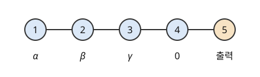

# 측정 기반 양자 계산

# 개요

**측정 기반 양자 계산(measurement-based quantum computation, MBQC)** 은 얽힌 큐비트 여러 개를 먼저 만들어 두고, 그 뒤로는 큐비트를 하나씩 측정하기만 해서 [양자 회로](quantum-circuits.md)의 계산을 해내는 방법이다. 광자로 만든 큐비트는 하나씩 측정하기는 쉽지만 두 큐비트에 게이트를 거는 일은 확률적으로만 성공해서, 회로를 게이트 순서대로 실행하기 어렵다. 측정 기반 계산에서는 두 큐비트 게이트를 계산 전에 정해진 꼴의 얽힌 상태를 만드는 데만 쓰고, 계산하는 동안에는 측정 기저의 각도를 골라 원하는 게이트를 건다.

# 직관

[양자 순간이동](quantum-teleportation.md)에서는 앨리스가 측정하면 상태가 밥의 큐비트로 옮겨 갔다. 같은 일이 큐비트 두 개만으로도 일어난다. 큐비트 1 의 상태가 $\tfrac35\vert 0\rangle+\tfrac45\vert 1\rangle$ 이고 큐비트 2 의 상태가 $\vert +\rangle=\tfrac1{\sqrt 2}(\vert 0\rangle+\vert 1\rangle)$ 이라 한다.

두 큐비트에 $\vert 11\rangle$ 의 부호만 뒤집는 제어 Z 게이트(controlled-Z gate) $\mathrm{CZ}=\mathrm{diag}(1,1,1,-1)$ 를 걸면 상태는 다음과 같다.

$$
\tfrac35\vert 0\rangle\vert +\rangle+\tfrac45\vert 1\rangle\vert -\rangle,\qquad \vert -\rangle=\tfrac1{\sqrt 2}(\vert 0\rangle-\vert 1\rangle)
$$

큐비트 1 을 기저 $\vert +\rangle,\vert -\rangle$ 로 측정한다. 결과가 $+$ 이면 큐비트 2 는 $\tfrac35\vert +\rangle+\tfrac45\vert -\rangle$ 에 비례하고, 이것을 $\vert 0\rangle,\vert 1\rangle$ 로 풀어 크기를 맞추면 $\tfrac1{5\sqrt 2}(7\vert 0\rangle-\vert 1\rangle)$ 이다. 결과가 $-$ 이면 큐비트 2 는 $\tfrac1{5\sqrt 2}(-\vert 0\rangle+7\vert 1\rangle)$ 이다. 두 결과는 확률 $1/2$ 씩 나온다.

양자 회로의 Hadamard 게이트 $H$ 를 처음 상태에 걸면 $\tfrac1{5\sqrt 2}(7\vert 0\rangle-\vert 1\rangle)$ 이 나온다. 그래서 측정 한 번으로 상태가 큐비트 1 에서 큐비트 2 로 옮겨 가면서 $H$ 가 걸렸다. 결과가 $-$ 이면 여기에 $\vert 0\rangle$ 과 $\vert 1\rangle$ 을 맞바꾸는 $X$ 가 더 걸려 있고, 측정 결과를 보았으므로 $X$ 를 한 번 더 걸어 지울 수 있다.

측정 기저를 $\vert +\rangle,\vert -\rangle$ 에서 돌리면 큐비트 2 에 걸리는 게이트가 바뀐다. 큐비트를 사슬로 늘어놓고 이웃마다 $\mathrm{CZ}$ 를 걸어 두면, 왼쪽부터 하나씩 측정할 때마다 상태가 한 칸씩 오른쪽으로 옮겨 가며 게이트가 하나씩 걸린다. 계산하는 동안 하는 일은 측정 기저를 고르는 것뿐이고, 두 큐비트 게이트 $\mathrm{CZ}$ 는 계산 전에 전부 걸어 둔다.

# 정의

## 한 비트 순간이동

각 $\theta$ 에 대해 기저

$$
\vert\pm\_\theta\rangle=\tfrac1{\sqrt 2}\big(\vert 0\rangle\pm e^{-i\theta}\vert 1\rangle\big)
$$

로 측정하는 것을 **각 $\theta$ 측정** 이라 하고, 결과가 $+$ 이면 $m=0$, $-$ 이면 $m=1$ 로 적는다. 위상 게이트를 $P(\theta)=\mathrm{diag}(1,e^{i\theta})$ 로 적고 $J(\theta)=HP(\theta)$ 라 한다.

큐비트 1 이 $\vert\psi\rangle=\alpha\vert 0\rangle+\beta\vert 1\rangle$, 큐비트 2 가 $\vert +\rangle$ 일 때 $\mathrm{CZ}$ 를 걸고 큐비트 1 을 각 $\theta$ 로 측정하면, 결과 $m$ 이 확률 $1/2$ 씩 나오고 큐비트 2 는 다음 상태가 된다.

$$
X^mJ(\theta)\vert\psi\rangle
$$

이 절차를 **한 비트 순간이동(one-bit teleportation)** 이라 하고, $X^m$ 을 **부산물(byproduct)** 이라 한다. 직관 절의 측정은 $\theta=0$ 인 경우다. $P(0)=I$ 이므로 큐비트 2 에는 $X^mH\vert\psi\rangle$ 이 남는다.

## 그래프 상태

[그래프](graphs.md) $G=(V,E)$ 의 정점마다 큐비트를 하나 두고 모두 $\vert +\rangle$ 으로 놓은 뒤 간선마다 $\mathrm{CZ}$ 를 건 상태

$$
\vert G\rangle=\prod\_{\lbrace a,b\rbrace\in E}\mathrm{CZ}\_{ab}\thinspace\vert +\rangle^{\otimes V}
$$

를 **그래프 상태(graph state)** 라 한다. $\mathrm{CZ}$ 끼리는 가환이므로 간선의 순서는 상관없다. 그래프가 사슬이나 정사각형 격자이면 **클러스터 상태(cluster state)** 라 한다[^1]. 직관 절의 두 큐비트는 입력 $\vert\psi\rangle$ 대신 $\vert +\rangle$ 을 넣으면 정점 두 개와 간선 하나인 그래프의 그래프 상태다.

## 측정 패턴

그래프 상태 하나, 측정할 정점의 순서, 정점마다의 측정 각, 그리고 앞 측정의 결과에 따라 각을 바꾸는 규칙을 묶은 것을 **측정 패턴(measurement pattern)** 이라 한다[^2]. 측정하지 않고 남는 정점이 출력 큐비트이고, 마지막에 출력 큐비트에 부산물을 지우는 Pauli 게이트를 건다.

아래 그림은 정점 다섯 개의 사슬이다. 정점 1 부터 4 까지를 각 $\alpha,\beta,\gamma,0$ 으로 차례로 측정하고 정점 5 를 출력으로 남기는 패턴이다.

# 성질

## 한 큐비트 게이트

각 $\alpha,\beta,\gamma,0$ 으로 사슬을 측정하면 부산물을 빼고 출력은 다음과 같다.

$$
J(0)J(\gamma)J(\beta)J(\alpha)\vert +\rangle=P(\gamma)\thinspace HP(\beta)H\thinspace P(\alpha)\vert +\rangle
$$

$HP(\beta)H$ 는 전체 위상을 빼고 $x$ 축 둘레의 회전 $R\_x(\beta)$ 이고, $P$ 는 $z$ 축 둘레의 회전이다. 한 큐비트 유니터리는 모두 Euler 각(Euler angles) 세 개로 $z$, $x$, $z$ 축 회전의 곱으로 쓰이므로, 정점 다섯 개의 사슬로 $\vert +\rangle$ 에 임의의 한 큐비트 게이트를 건다[^2].

## 부산물과 적응 측정

부산물은 다음 측정을 지나며 옮겨진다. $P(\theta)X=e^{i\theta}XP(-\theta)$ 와 $HX=ZH$, $HZ=XH$ 에서 다음이 나온다.

$$
J(\theta)X=e^{i\theta}ZJ(-\theta),\qquad J(\theta)Z=XJ(\theta)
$$

그래서 앞 측정에서 $X$ 부산물이 남았으면 다음 정점을 각 $-\theta$ 로 측정하면 원하는 $J(\theta)$ 가 걸리고, 부산물은 Pauli 행렬로 남는다. 측정 각의 부호가 앞 결과에 따라 정해지므로 측정은 순서대로 해야 한다. 이것을 **적응 측정(adaptive measurement)** 이라 한다.

## Pauli 측정의 동시 수행

$\theta$ 가 $\pi/2$ 의 정수배이면 각 $\theta$ 측정과 각 $-\theta$ 측정은 같은 기저를 쓰고 결과의 이름만 바뀐다. $\theta=\pi/2$ 이면 두 측정 모두 기저 $\tfrac1{\sqrt 2}(\vert 0\rangle\pm i\vert 1\rangle)$ 을 쓴다. 이런 측정은 $X$ 나 $Y$ 의 고윳값을 재는 Pauli 측정이고, 앞 결과를 기다릴 필요가 없다. 그래서 패턴에서 Pauli 측정은 전부 첫 단계에 한꺼번에 할 수 있다[^2]. [Gottesman–Knill 정리](gottesman-knill.md)가 고전적으로 흉내 내는 Clifford 회로는 측정 각이 전부 $\pi/2$ 의 정수배인 패턴으로 구현되므로, 측정 기반 계산에서는 Clifford 회로가 측정 한 단계로 끝난다.

## 그래프 상태의 안정자

정점 $a$ 의 이웃을 $N(a)$ 라 하면 그래프 상태는 연산자

$$
K\_a=X\_a\prod\_{b\in N(a)}Z\_b
$$

전체를 곱해도 그대로인 유일한 상태다[^3]. $\vert +\rangle^{\otimes V}$ 는 $X\_a$ 를 곱해도 그대로이고, $\mathrm{CZ}\_{ab}(X\_a\otimes I)\mathrm{CZ}\_{ab}=X\_a\otimes Z\_b$ 이므로 간선마다 $Z$ 가 하나씩 붙는다. $K\_a$ 들은 서로 가환이고 독립인 $\vert V\vert$ 개이므로 그래프 상태는 안정자 상태다. 직관 절의 두 정점 그래프에서는 $X\otimes Z$ 와 $Z\otimes X$ 다.

## 정점 지우기

그래프 상태의 정점 $a$ 를 계산 기저로 측정한다. $a$ 에 걸린 $\mathrm{CZ}$ 들을 마지막에 걸었다고 보면 그래프 상태는 다음과 같다.

$$
\vert G\rangle=\tfrac1{\sqrt 2}\Big(\vert 0\rangle\_a\vert G-a\rangle+\vert 1\rangle\_a\prod\_{b\in N(a)}Z\_b\vert G-a\rangle\Big)
$$

그래서 결과가 $0$ 이면 나머지 큐비트는 $\vert G-a\rangle$ 이 되고, $1$ 이면 $\prod\_{b\in N(a)}Z\_b\vert G-a\rangle$ 이 된다. 둘째 경우의 $Z$ 는 부산물로 처리한다. 그래서 큰 격자의 클러스터 상태에서 필요 없는 정점을 계산 기저 측정으로 지우면 그 부분그래프의 그래프 상태가 남는다.

## 정사각형 격자의 보편성

정사각형 격자의 클러스터 상태에서 측정만으로 임의의 양자 회로를 흉내 낼 수 있다[^1]. 논리 큐비트마다 가로 사슬 하나를 쓰고, 두 사슬의 같은 자리를 세로 간선 하나로 이어 두면 그 간선의 $\mathrm{CZ}$ 가 두 논리 큐비트 사이의 $\mathrm{CZ}$ 가 된다. $\mathrm{CZ}$ 끼리는 가환이고 다른 정점의 측정과도 가환이므로, 세로 간선의 $\mathrm{CZ}$ 는 두 논리 큐비트가 그 두 정점에 옮겨 와 있을 때 걸었다고 볼 수 있다. 한 큐비트 게이트 전체와 $\mathrm{CZ}$ 는 보편 게이트 집합이고, 필요 없는 정점과 세로 간선은 정점 지우기로 없앤다.

# 활용

- 광자 양자 계산. 광자 두 개를 잇는 연산이 확률적으로만 성공해도, 실패하면 다시 시도해 클러스터 상태를 조각씩 키운 뒤 측정만으로 계산한다[^4]. 이 방식은 두 큐비트 게이트를 계산 도중에 걸지 않는다.
- 맹목 양자 계산(blind quantum computation). 사용자가 측정 각에 무작위 각을 더해 서버에 보내면, 서버는 정사각형 격자를 측정해 계산하면서도 어떤 회로를 돌리는지, 입력과 출력이 무엇인지 알 수 없다[^5].
- 오류정정. 3 차원 격자의 클러스터 상태를 측정하면 [토러스 부호](toric-code.md)와 같은 표면 부호 위의 오류정정 계산이 된다[^6]. [양자 오류정정부호](quantum-error-correction.md)의 문턱 정리를 측정 패턴으로 얻는다.
- 회로 깊이의 비교. Pauli 측정을 첫 단계에 모으므로 Clifford 부분은 측정 한 단계이고, 측정 단계의 수는 각이 $\pi/2$ 의 정수배가 아닌 측정 사이의 의존 관계로 정해진다[^2].

[^1]: R. Raussendorf, H. J. Briegel, A one-way quantum computer, *Physical Review Letters* 86 (2001), 5188–5191.
[^2]: R. Raussendorf, D. E. Browne, H. J. Briegel, Measurement-based quantum computation on cluster states, *Physical Review A* 68 (2003), 022312.
[^3]: M. Hein, J. Eisert, H. J. Briegel, Multiparty entanglement in graph states, *Physical Review A* 69 (2004), 062311.
[^4]: D. E. Browne, T. Rudolph, Resource-efficient linear optical quantum computation, *Physical Review Letters* 95 (2005), 010501.
[^5]: A. Broadbent, J. Fitzsimons, E. Kashefi, Universal blind quantum computation, *50th Annual IEEE Symposium on Foundations of Computer Science* (2009), 517–526.
[^6]: R. Raussendorf, J. Harrington, K. Goyal, Topological fault-tolerance in cluster state quantum computation, *New Journal of Physics* 9 (2007), 199.

# 연관 문서

## 선수지식

- [양자 순간이동](quantum-teleportation.md)
- [Gottesman–Knill 정리](gottesman-knill.md)

## 더 알아보기

- [국소 보완](local-complementation.md)

#computation #linear_algebra #graph_theory
