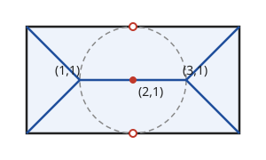

# 중심축

# 개요

**중심축(medial axis)** 은 평면 도형 안의 점 가운데 도형의 경계에서 가장 가까운 점이 둘 이상인 점들의 모임이다. 가로 $4$, 세로 $2$ 인 직사각형 판에서 가운데를 따라 가로로 그은 선분 위의 점은 위 변과 아래 변에서 같은 거리에 있다. 이런 점들을 이으면 도형 가운데를 지나는 가는 선이 그려지고, 도형이 어디서 갈라지고 어디가 두꺼운지가 드러난다.

중심축 위의 각 점에 경계까지의 거리를 반지름으로 붙이면, 그 반지름의 원들을 합쳐 도형을 다시 만들 수 있다. 그래서 도형을 선과 반지름만으로 저장하고 비교한다.

# 직관

직사각형 $\lbrack 0,4\rbrack\times\lbrack 0,2\rbrack$ 를 본다. 점 $(2,1)$ 에서 경계까지 가장 가까운 점은 아래 변의 $(2,0)$ 과 위 변의 $(2,2)$ 둘이고, 거리는 $1$ 이다. $1\le x\le 3$ 인 점 $(x,1)$ 은 모두 이렇다.

점 $(0.5,0.5)$ 에서 가장 가까운 점은 왼쪽 변의 $(0,0.5)$ 와 아래 변의 $(0.5,0)$ 이다. 왼쪽 아래 모서리 $(0,0)$ 에서 $(1,1)$ 까지의 대각선 위의 점은 모두 왼쪽 변과 아래 변에서 같은 거리다. 다른 세 모서리에서도 같은 대각선이 나온다.

그림의 실선이 중심축이다. 점선 원은 중심축 위의 점 $(2,1)$ 을 중심으로 직사각형 안에 넣을 수 있는 가장 큰 원이고, 위 변과 아래 변에 동시에 닿는다.

# 정의

## 중심축

평면의 닫힌 유계 영역 $\Omega$ 와 그 경계 $\partial\Omega$ 를 둔다. $\Omega$ 의 점 $x$ 가운데 $\partial\Omega$ 에서 $x$ 와 가장 가까운 점이 둘 이상인 것들의 모임을 $\Omega$ 의 **중심축(medial axis)** 이라 한다. 직관 절의 직사각형에서 중심축은 선분 $(1,1)\text{–}(3,1)$ 과 네 대각선이다.

## 최대 내접 원판과 중심축 변환

$\Omega$ 에 포함되는 원판 가운데 $\Omega$ 에 포함되는 더 큰 원판에 들어가지 않는 것을 **최대 내접 원판(maximal inscribed disk)** 이라 한다. 중심축 위의 점마다 그 점에서 경계까지의 거리를 짝지은 것을 **중심축 변환(medial axis transform)** 이라 한다(Blum).[^1]

직관 절에서 $(2,1)$ 에 짝지어진 거리는 $1$ 이고, 반지름 $1$ 인 원판이 최대 내접 원판이다. 모서리 $(0,0)$ 에 가까운 대각선 위의 점 $(t,t)$ 에는 거리 $t$ 가 짝지어진다.

# 성질

## 최대 내접 원판의 중심

중심축의 점은 모두 최대 내접 원판의 중심이고, 최대 내접 원판의 중심은 모두 중심축의 폐포에 있다. 영역 $\Omega$ 는 최대 내접 원판들의 합집합이므로, 중심축 변환에서 $\Omega$ 가 다시 만들어진다.[^1]

## 다각형의 중심축

$\Omega$ 가 단순 다각형이면 중심축은 유한 개의 선분과 포물선 호로 된다. 두 변에서 같은 거리인 점들은 두 변이 이루는 각의 이등분선 위에 있고, 한 변과 안으로 꺾인 꼭짓점에서 같은 거리인 점들은 포물선 위에 있다. 볼록 다각형에는 안으로 꺾인 꼭짓점이 없어 중심축이 선분만으로 된다.

다각형의 중심축은 변들과 안으로 꺾인 꼭짓점들을 사이트로 둔 [Voronoi 도형](voronoi-diagrams.md)의 다각형 안쪽 부분에서, 안으로 꺾인 꼭짓점에 붙은 변을 뺀 것이다. 단순 다각형의 중심축은 트리다.

## 계산

볼록 다각형의 중심축은 $O(n)$ 시간에 계산된다(Aggarwal, Guibas, Saxe, Shor).[^2] 단순 다각형의 중심축은 D. T. Lee 가 $O(n\log n)$ 시간에 계산했고, F. Chin, J. Snoeyink, C. A. Wang 이 $O(n)$ 시간으로 줄였다.[^3][^4]

## 경계의 작은 변화에 대한 민감성

경계를 조금만 바꾸어도 중심축에 긴 가지가 새로 생길 수 있다. 직관 절의 직사각형 위 변 가운데에 높이 $\varepsilon$ 의 작은 혹을 붙이면 혹의 두 기슭이 경계의 새 모서리가 되고, 두 기슭에서 같은 거리인 점들이 $(2,1)$ 근처에서 혹까지 뻗는 가지를 이룬다. 이 가지의 길이는 $\varepsilon$ 이 $0$ 으로 가도 $1$ 가까이 남는다. 그래서 측정 잡음이 있는 경계에서는 짧은 반지름 변화만 만드는 가지를 잘라 낸 뒤 쓴다.

# 활용

- 모양 인식. Blum 은 생물의 윤곽을 중심축으로 바꾸어, 가지의 수와 반지름의 변화로 모양을 비교했다.[^1] 손글씨 글자의 획을 추출하는 세선화도 같은 생각이다.
- 공작 기계의 경로. 평면 가공에서 공구가 벽에 닿지 않고 움직일 수 있는 가장 넓은 길과, 각 자리에서 쓸 수 있는 공구의 최대 반지름이 중심축 변환에서 나온다.
- 격자 생성. 영역을 중심축의 가지마다 조각으로 나누면 각 조각이 단순한 꼴이 되어 사각형 격자를 깔기 쉽다.

[^1]: H. Blum, "A transformation for extracting new descriptors of shape", in *Models for the Perception of Speech and Visual Form*, MIT Press (1967), 362–380.
[^2]: A. Aggarwal, L. J. Guibas, J. Saxe, P. W. Shor, "A linear-time algorithm for computing the Voronoi diagram of a convex polygon", *Discrete & Computational Geometry* **4** (1989), 591–604.
[^3]: D. T. Lee, "Medial axis transformation of a planar shape", *IEEE Transactions on Pattern Analysis and Machine Intelligence* **4** (1982), 363–369.
[^4]: F. Chin, J. Snoeyink, C. A. Wang, "Finding the medial axis of a simple polygon in linear time", *Discrete & Computational Geometry* **21** (1999), 405–420.

# 연관 문서

## 선수지식

- [Voronoi 도형](voronoi-diagrams.md)

## 더 알아보기

아직 연결한 문서가 없다.

#algorithms #computation #data_structures
