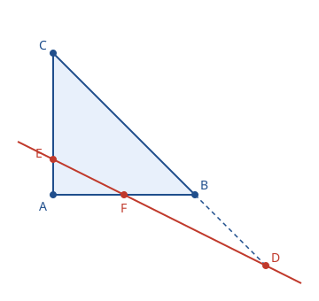

# Menelaus 정리

# 개요

**Menelaus 정리(Menelaus's theorem)** 는 삼각형의 세 변을 지나는 직선 하나가 각 변을 나누는 비를 곱하면 $-1$ 이라는 정리다. 삼각형 $ABC$ 의 세 변이나 그 연장선 위에 점을 하나씩 찍었을 때, 세 점이 한 직선 위에 있는지 좌표를 쓰지 않고 판정하려고 한다. 각 점이 변을 나누는 부호 있는 비 세 개를 곱해 $-1$ 이 되는지만 보면 판정이 끝난다.

# 직관

좌표평면에 $A=(0,0)$, $B=(4,0)$, $C=(0,4)$ 를 두고 직선 $x+2y=2$ 를 긋는다. 이 직선은 $AB$ 와 $F=(2,0)$ 에서, $CA$ 와 $E=(0,1)$ 에서, $BC$ 의 연장선과 $D=(6,-2)$ 에서 만난다.

그림에서 $F$ 와 $E$ 는 변 위에 있고 $D$ 는 $B$ 바깥의 연장선 위에 있다. 각 점이 변을 어떤 비로 나누는지 잰다.

- $F$ 는 $AB$ 의 중점이므로 $AF:FB=1:1$ 이다.
- $E$ 는 $C$ 에서 $A$ 쪽으로 $3$ 만큼, $A$ 까지 $1$ 만큼 떨어져 있으므로 $CE:EA=3:1$ 이다.
- $D$ 는 $B$ 에서 $C$ 와 반대쪽으로 $BC$ 의 절반만큼 나가 있으므로 $BD$ 의 길이는 $DC$ 의 $1/3$ 이고, $D$ 가 선분 바깥에 있으므로 방향이 반대다.

방향이 반대인 것을 음의 부호로 적으면 세 비는 $-1/3$, $3$, $1$ 이고 곱은 $-1$ 이다. 직선을 다른 것으로 바꿔도 곱은 $-1$ 이고, 세 점이 한 직선 위에 있지 않으면 곱이 $-1$ 이 아니다.

# 정의

## 부호 있는 비

서로 다른 두 점 $P$, $Q$ 를 지나는 직선 위의 점 $X\ne Q$ 에 대해 다음을 만족하는 실수 $\lambda$ 를 **부호 있는 비(signed ratio)** 라 하고 $\dfrac{PX}{XQ}$ 로 쓴다.

$$
X-P=\lambda\thinspace(Q-X)
$$

$X$ 가 선분 $PQ$ 안에 있으면 $\lambda\gt 0$ 이고, 바깥에 있으면 $\lambda\lt 0$ 이다. 직관 절의 $D=(6,-2)$ 에서 $D-B=(2,-2)$ 이고 $C-D=(-6,6)$ 이므로 $BD/DC=-1/3$ 이다.

## Menelaus 정리

삼각형 $ABC$ 의 직선 $BC$, $CA$, $AB$ 위에 꼭짓점이 아닌 점 $D$, $E$, $F$ 가 있다. 세 점이 한 직선 위에 있는 것은 다음과 동치다.

$$
\frac{BD}{DC}\cdot\frac{CE}{EA}\cdot\frac{AF}{FB}=-1
$$

직관 절의 세 비 $-1/3$, $3$, $1$ 이 이 식을 만족한다. 세 점을 지나는 직선을 **횡단선(transversal)** 이라 한다.

## Ceva 정리

같은 조건에서 세 직선 $AD$, $BE$, $CF$ 가 한 점에서 만나거나 모두 평행한 것은 다음과 동치다. 이것이 **Ceva 정리(Ceva's theorem)** 다.

$$
\frac{BD}{DC}\cdot\frac{CE}{EA}\cdot\frac{AF}{FB}=1
$$

직관 절의 삼각형에서 $D$, $E$, $F$ 를 세 변의 중점으로 두면 세 비가 모두 $1$ 이고, 세 중선 $AD$, $BE$, $CF$ 는 무게중심 $(4/3,4/3)$ 에서 만난다.

# 성질

## 부호 있는 거리로 하는 증명

횡단선 $\ell$ 을 $\varphi(x,y)=0$ 꼴로 쓴다. $\varphi$ 는 일차함수 $\alpha x+\beta y+\gamma$ 다. $a=\varphi(A)$, $b=\varphi(B)$, $c=\varphi(C)$ 로 두면, $D=(B+\lambda C)/(1+\lambda)$ 이고 $\varphi(D)=0$ 이므로 $b+\lambda c=0$ 이다. 따라서 다음이 나온다.

$$
\frac{BD}{DC}=-\frac bc,\qquad\frac{CE}{EA}=-\frac ca,\qquad\frac{AF}{FB}=-\frac ab
$$

세 식을 곱하면 $-1$ 이다. 직관 절의 직선 $\varphi=x+2y-2$ 에서는 $a=-2$, $b=2$, $c=6$ 이고, 세 비는 $-2/6$, $-6/(-2)$, $-(-2)/2$ 로 $-1/3$, $3$, $1$ 이다.

역은 직선 $EF$ 가 $BC$ 와 만나는 점을 $D'$ 이라 놓고 정리를 적용하면 나온다. $BD'/D'C=BD/DC$ 이고, 직선 위의 점은 부호 있는 비로 하나로 정해지므로 $D'=D$ 다. $EF$ 가 $BC$ 와 평행하면 곱이 $-1$ 이 될 수 없다.

## 무게중심 좌표로 하는 Ceva 정리의 증명

세 직선이 한 점 $P$ 에서 만난다고 하고, $P=uA+vB+wC$, $u+v+w=1$ 로 쓴다. 이 $(u,v,w)$ 가 $P$ 의 무게중심 좌표(barycentric coordinates)다. 직선 $AP$ 위의 점은 $A$ 와 $vB+wC$ 의 일차결합이므로, $AP$ 가 $BC$ 와 만나는 점은 $D=(vB+wC)/(v+w)$ 이고 $BD/DC=w/v$ 다. 같은 방법으로 $CE/EA=u/w$, $AF/FB=v/u$ 이고 곱은 $1$ 이다.

역은 Menelaus 정리의 역과 같은 논법이다. $BE$ 와 $CF$ 의 교점과 $A$ 를 이은 직선이 $BC$ 와 만나는 점을 $D'$ 으로 두고 비를 비교한다.

## 삼각형의 중심

Ceva 정리로 삼각형의 세 선이 한 점에서 만나는 것이 증명된다. 변의 길이를 $a=BC$, $b=CA$, $c=AB$ 로 둔다.

| 세 선 | 비 $BD/DC$ | 만나는 점 |
| --- | --- | --- |
| 중선 | $1$ | 무게중심 |
| 각의 이등분선 | $c/b$ | 내심 |
| 수선 | $\tan C/\tan B$ | 수심 |

이등분선의 비 $c/b$ 는 각의 이등분선 정리(angle bisector theorem)다. 세 비를 곱하면 $(c/b)(a/c)(b/a)=1$ 이다.

## 아핀 변환에서의 불변성

가역 아핀 변환 $x\mapsto Mx+t$ 는 직선을 직선으로 보내고, 한 직선 위의 부호 있는 비를 보존한다. 어느 삼각형이든 아핀 변환으로 $A=(0,0)$, $B=(1,0)$, $C=(0,1)$ 로 옮길 수 있으므로, 두 정리는 이 삼각형 하나에서 확인하면 된다. 사영 변환은 부호 있는 비를 보존하지 않으므로, 사영기하에서는 비 대신 복비(cross-ratio)를 쓴다.

# 활용

- [Desargues 정리](desargues-theorem.md)의 유클리드 평면 증명. 원근의 중심을 지나는 세 직선과 두 삼각형이 만드는 세 삼각형에 Menelaus 정리를 한 번씩 쓰고 세 식을 곱하면, 대응하는 변의 세 교점에 대한 비의 곱이 $-1$ 이 되어 세 교점이 한 직선 위에 있다.
- [Pappus 정리](pappus-theorem.md)와 [Pascal 정리](pascal-theorem.md)의 초등 증명. 세 교점이 한 직선 위에 있다는 결론을 Menelaus 정리의 역으로 확인하고, 필요한 비는 보조 삼각형의 횡단선에 Menelaus 정리를 되풀이해 구한다.
- 평면 위 점의 공선 판정. 컴퓨터 기하에서 세 점의 좌표로 행렬식을 계산하는 판정과 같은 내용을 비의 곱으로 적은 것이고, 삼각형 안의 길이 계산 문제에서 좌표 없이 비를 구하는 데 쓴다.

# 연관 문서

## 선수지식

- [벡터 공간](vector-spaces.md)

## 더 알아보기

- [Euler 직선](euler-line.md)

#algebra #combinatorics #linear_algebra
