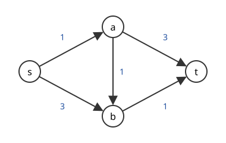
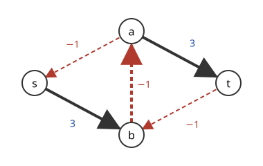

# 최소 비용 흐름

# 개요

**최소 비용 흐름(minimum-cost flow)** 은 간선마다 용량과 한 단위를 보내는 비용이 정해진 유향 그래프에서, 정해진 양을 보내는 흐름 가운데 비용의 합이 가장 작은 것을 찾는 문제다. 창고 두 곳의 물건을 매장 세 곳으로 나를 때 길마다 실을 수 있는 양과 한 개당 운송비가 다르면, 어느 길로 몇 개씩 보낼지가 이 꼴이다. 가장 싼 경로로 보내되, 이미 보낸 양을 취소하면 그 비용이 빠지는 거꾸로 간선을 함께 두고 가장 싼 경로를 다시 찾기를 되풀이하면 최소 비용의 흐름이 나온다.

# 직관

아래 그림은 [네트워크 흐름](network-flow.md) 문서의 네트워크에서 용량을 모두 $1$ 로 두고, 간선마다 한 단위를 보내는 비용을 적은 것이다. $s$ 에서 $t$ 로 $2$ 를 보내면서 비용의 합을 가장 작게 하려고 한다.



경로는 셋이다. $s\to a\to b\to t$ 의 비용은 $1+1+1=3$ 이고, $s\to a\to t$ 와 $s\to b\to t$ 의 비용은 둘 다 $4$ 다. 가장 싼 $s\to a\to b\to t$ 에 $1$ 을 보내면 $s\to a$, $a\to b$, $b\to t$ 가 모두 차서 남은 경로가 없고, 보낸 양은 $1$ 에서 멈춘다.

$s\to a\to t$ 와 $s\to b\to t$ 에 하나씩 보내면 $2$ 가 가고 비용은 $4+4=8$ 이다. 첫 선택에서 $a\to b$ 에 보낸 $1$ 이 길을 막았으므로, 네트워크 흐름에서처럼 그 $1$ 을 취소하는 거꾸로 간선 $b\to a$ 를 둔다. 취소하면 $a\to b$ 에 냈던 비용 $1$ 이 빠지므로 거꾸로 간선의 비용은 $-1$ 이다.

아래 그림은 첫 경로에 $1$ 을 보낸 뒤 남은 간선이다. 점선이 거꾸로 간선이고, 굵은 선이 $s\to b\to a\to t$ 다.



$s\to b\to a\to t$ 의 비용은 $3-1+3=5$ 다. 이 경로로 $1$ 을 더 보내면 $a\to b$ 의 흐름이 취소되어 $s\to a\to t$ 와 $s\to b\to t$ 에 하나씩 흐르는 흐름이 남고, 비용은 $3+5=8$ 로 위에서 찾은 값과 같다. 첫 단위에 $3$, 둘째 단위에 $5$ 가 들었으므로 보내는 양이 늘수록 한 단위의 비용이 커진다.

# 정의

## 최소 비용 흐름 문제

유향 [그래프](graphs.md) $G=(V,E)$ 와 용량 $c:E\to\mathbb R\_{\ge 0}$, **비용(cost)** $w:E\to\mathbb R$, 합이 $0$ 인 **공급량(supply)** $\beta:V\to\mathbb R$ 가 주어진다. **최소 비용 흐름 문제(minimum-cost flow problem)** 는 다음 선형계획 문제다.

$$
\begin{aligned}
\min\quad & \sum_{e\in E}w(e)\thinspace f(e)\cr
\text{s.t.}\quad & 0\le f(e)\le c(e)\quad(\forall e\in E)\cr
& \sum_{e\in\delta^{+}(v)}f(e)-\sum_{e\in\delta^{-}(v)}f(e)=\beta(v)\quad(\forall v\in V)
\end{aligned}
$$

$\delta^+(v)$ 와 $\delta^-(v)$ 는 $v$ 에서 나가는 간선과 $v$ 로 들어오는 간선의 집합이다. $\beta(v)\gt 0$ 인 정점은 물건을 내보내고, $\beta(v)\lt 0$ 인 정점은 받는다.

직관 절의 문제는 $\beta(s)=2$, $\beta(t)=-2$, $\beta(a)=\beta(b)=0$ 이고 용량이 모두 $1$ 이다. 최적해는 $a\to b$ 에 $0$, 나머지 네 간선에 $1$ 을 흘리는 흐름이고 비용은 $8$ 이다.

## 잔여 그래프와 비용

흐름 $f$ 와 간선 $e=(u,v)$ 의 잔여 용량은 네트워크 흐름 문서와 같이 앞방향 $(u,v)$ 가 $c(e)-f(e)$, 거꾸로 $(v,u)$ 가 $f(e)$ 다. 앞방향 간선의 비용은 $w(e)$ 이고, 거꾸로 간선의 비용은 $-w(e)$ 다. 잔여 용량이 양수인 간선과 이 비용으로 된 그래프를 **잔여 그래프(residual graph)** $G\_f$ 라 하고, 경로나 순환의 비용은 그 위 간선 비용의 합이다.

직관 절의 둘째 그림이 $s\to a\to b\to t$ 에 $1$ 을 흘린 흐름의 잔여 그래프다. 그 안의 순환 $s\to b\to a\to s$ 의 비용은 $3-1-1=1$ 이다.

## 퍼텐셜과 축소 비용

정점의 함수 $\pi:V\to\mathbb R$ 를 **퍼텐셜(potential)** 이라 한다. 잔여 그래프의 간선 $(u,v)$ 에서 다음 값을 **축소 비용(reduced cost)** 이라 한다.

$$
w^{\pi}(u,v)=w(u,v)+\pi(u)-\pi(v)
$$

직관 절의 최적해에 $\pi(s)=0$, $\pi(a)=2$, $\pi(b)=3$, $\pi(t)=5$ 를 주면, 잔여 그래프의 간선 다섯 개 $a\to b$, $a\to s$, $b\to s$, $t\to a$, $t\to b$ 의 축소 비용은 차례로 $0,1,0,0,1$ 이다. 예를 들어 거꾸로 간선 $a\to s$ 는 비용이 $-1$ 이므로 축소 비용이 $-1+2-0=1$ 이다.

# 성질

## 음수 순환 조건

정리. 공급 조건을 만족하는 흐름 $f$ 가 최소 비용인 것은 $G\_f$ 에 비용이 음수인 순환이 없는 것과 동치다[^1].

증명의 요지. 음수 순환이 있으면 그 순환을 따라 잔여 용량의 최솟값만큼 흘린다. 공급 조건은 그대로이고 비용이 줄어든다.

거꾸로, 공급 조건을 만족하는 다른 흐름 $f'$ 의 차 $f'-f$ 는 $G\_f$ 의 간선 위에서 모든 정점의 유입과 유출이 같은 흐름이고, $G\_f$ 의 순환들에 양수를 곱해 더한 것으로 분해된다. 비용의 차는 그 순환 비용에 양수를 곱한 합이므로, 음수 순환이 없으면 $f'$ 의 비용이 $f$ 의 비용 이상이다. ∎

직관 절의 최적해에서는 $s$ 에서 나가는 두 간선이 차서 $s$ 를 떠나는 잔여 간선이 없고, $t$ 로 들어오는 두 간선이 차서 $t$ 에 닿는 잔여 간선이 없다. 남은 $a$ 와 $b$ 사이의 잔여 간선은 $a\to b$ 하나뿐이므로 잔여 그래프에 순환이 없다.

## 퍼텐셜 조건

정리. 흐름 $f$ 가 최소 비용인 것은 $G\_f$ 의 모든 간선에서 $w^\pi\ge 0$ 인 퍼텐셜 $\pi$ 가 존재하는 것과 동치다.

증명의 요지. 순환을 한 바퀴 돌면 $\pi(u)-\pi(v)$ 항이 모두 지워지므로 순환의 축소 비용 합은 원래 비용 합과 같다. 그래서 그런 $\pi$ 가 있으면 음수 순환이 없다. 거꾸로 음수 순환이 없으면 새 정점에서 모든 정점으로 비용 $0$ 인 간선을 더한 그래프의 [최단경로](shortest-paths.md) 거리를 $\pi$ 로 잡는다. 삼각부등식 $\pi(v)\le\pi(u)+w(u,v)$ 에서 $w^\pi\ge 0$ 이 나온다. ∎

원래 간선 $e=(u,v)$ 로 옮겨 쓰면 다음 세 조건이다. $0\lt f(e)\lt c(e)$ 이면 $w^\pi(u,v)=0$ 이고, $f(e)=0$ 이면 $w^\pi(u,v)\ge 0$ 이고, $f(e)=c(e)$ 이면 $w^\pi(u,v)\le 0$ 이다. 이것은 정의 절의 [선형계획법](linear-programming.md) 문제와 그 쌍대 문제의 상보 여유 조건(complementary slackness)이고, $\pi$ 가 보존식에 붙은 쌍대 변수다.

## 연속 최단 경로법

**연속 최단 경로법(successive shortest path method)** 은 $f=0$ 에서 시작해 $G\_f$ 에서 $s$ 로부터 $t$ 로 가는 비용 최소의 경로를 찾아 흘리기를, 정한 양을 다 보낼 때까지 되풀이하는 절차다. 직관 절의 계산이 이것이다.

```javascript
function successiveShortestPath(G, s, t, k) {
  let f = zeroFlow(G);
  let sent = 0;
  while (sent < k) {
    const path = cheapestPath(residualGraph(G, f), s, t); // 거꾸로 간선의 비용은 음수다
    if (path === null) return null;                       // 값 k 를 보낼 수 없다
    const delta = Math.min(k - sent, bottleneck(path));
    augment(f, path, delta); // 거꾸로 간선은 원래 간선의 흐름을 줄인다
    sent += delta;
  }
  return f;
}
```

정리. $f$ 가 값 $k$ 인 흐름 가운데 최소 비용이면, $G\_f$ 의 비용 최소인 $s$–$t$ 경로를 따라 $\delta$ 만큼 흘린 흐름은 값 $k+\delta$ 인 흐름 가운데 최소 비용이다. 여기서 $\delta$ 는 그 경로의 잔여 용량 최솟값 이하다[^2].

증명의 요지. $\pi$ 를 $G\_f$ 에서 $s$ 로부터의 최단거리로 잡으면 $G\_f$ 의 모든 간선에서 $w^\pi\ge 0$ 이고, 최단경로 위의 간선에서는 $w^\pi=0$ 이다. 흘린 뒤 새로 생기는 간선은 그 경로 간선의 거꾸로이므로 축소 비용이 $0$ 이다. 퍼텐셜 조건이 유지되므로 새 흐름은 최소 비용이다. ∎

같은 논증에서 $t$ 까지의 최단거리는 흘릴 때마다 줄지 않는다. 그래서 보내는 양 $k$ 에 대한 최소 비용은 기울기가 커지는 꺾은선 함수다. 직관 절에서 기울기는 $3$ 에서 $5$ 로 커졌다. 정의 절의 퍼텐셜은 첫 경로를 흘린 뒤 잔여 그래프에서 $s$ 로부터의 최단거리이고, $\pi(t)-\pi(s)=5$ 가 둘째 단위의 비용이다.

## 정수성

용량과 공급량이 모두 정수이면 최소 비용 흐름 가운데 값이 모두 정수인 것이 존재한다. 연속 최단 경로법이 정수 $\delta$ 만 흘리므로 정수 흐름을 낸다. 선형계획법으로는, 보존식의 계수 행렬이 유향 그래프의 접합 행렬(incidence matrix)이고 이것이 [완전 단일모듈 행렬](totally-unimodular-matrices.md)이어서 허용 영역의 꼭짓점이 정수점이다.

## 계산 시간

- 연속 최단 경로법은 정수 자료에서 많아야 $k$ 번 흘린다. 퍼텐셜로 축소 비용을 음수 아닌 값으로 바꾸면 매번 Dijkstra 알고리즘(Dijkstra's algorithm)을 쓸 수 있다[^2]. 횟수가 $k$ 에 비례하므로 다항 시간은 아니다.
- 음수 순환을 찾아 없애기를 되풀이하는 순환 제거법(cycle canceling)은 Klein 이 제안했다[^1]. 비용 합을 간선 수로 나눈 평균이 가장 작은 순환을 고르면 횟수가 용량과 비용의 크기에 무관한 강다항 시간(strongly polynomial time)이 된다[^3].
- Orlin 의 용량 스케일링 알고리즘은 $O(\lvert E\rvert\log\lvert V\rvert\thinspace(\lvert E\rvert+\lvert V\rvert\log\lvert V\rvert))$ 시간이다[^4]. 정수 자료에서는 $\lvert E\rvert^{1+o(1)}$ 시간 알고리즘이 있다[^5].

# 활용

- [최단경로](shortest-paths.md). $\beta(s)=1$, $\beta(t)=-1$ 이고 용량을 무한대로 두면, 음수 순환이 없을 때 최소 비용 흐름은 $s$ 에서 $t$ 로 가는 최단경로다.
- [네트워크 흐름](network-flow.md)의 최대 흐름. 모든 공급량을 $0$ 으로, 원래 간선의 비용을 $0$ 으로 두고 용량 무한대, 비용 $-1$ 인 간선 $t\to s$ 를 더하면 최소 비용 흐름이 최대 흐름이다. 같은 값의 흐름 가운데 비용이 최소인 최소 비용 최대 흐름도 이 틀로 푼다.
- 수송 문제(transportation problem). 공급점에서 수요점으로 가는 간선만 있는 이분 그래프의 최소 비용 흐름이다. 이산 확률분포 사이의 [최적 수송](optimal-transport.md)이 이 꼴이다.
- 할당 문제(assignment problem). 수송 문제에서 공급량과 수요량이 모두 $1$ 인 경우이고, [매칭](matchings.md)의 헝가리안 방법(Hungarian method)이 이 문제를 퍼텐셜로 푼다.
- [단체법](simplex-method.md)을 정의 절의 선형계획 문제에 쓰면 기저가 신장 트리에 대응하고, 피벗은 트리에 간선 하나를 넣고 순환 위의 간선 하나를 빼는 연산이다. 이것을 네트워크 단체법(network simplex method)이라 한다.
- [가격 무정부](price-of-anarchy.md). 중앙에서 배정한 최소 비용 흐름과, 각자 자기 비용을 줄이는 경로를 고른 균형 흐름의 비용을 견준다.

[^1]: Morton Klein, "A primal method for minimal cost flows with applications to the assignment and transportation problems", *Management Science* **14** (1967), 205–220.
[^2]: J. Edmonds, R. M. Karp, "Theoretical Improvements in Algorithmic Efficiency for Network Flow Problems", *Journal of the ACM* **19** (1972), https://doi.org/10.1145/321694.321699
[^3]: Andrew V. Goldberg, Robert E. Tarjan, "Finding minimum-cost circulations by canceling negative cycles", *Journal of the ACM* **36** (1989), 873–886.
[^4]: James B. Orlin, "A faster strongly polynomial minimum cost flow algorithm", *Operations Research* **41** (1993), 338–350.
[^5]: L. Chen, R. Kyng, Y. P. Liu, R. Peng, M. Probst Gutenberg, S. Sachdeva, "Maximum Flow and Minimum-Cost Flow in Almost-Linear Time", 63rd IEEE Symposium on Foundations of Computer Science (2022), https://doi.org/10.1109/FOCS54457.2022.00064

# 연관 문서

## 선수지식

- [네트워크 흐름](network-flow.md)
- [최단경로](shortest-paths.md)

## 더 알아보기

아직 연결한 문서가 없다.

#graph_theory #optimization #algorithms
