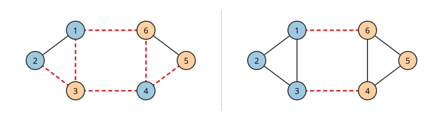

# 최소 이등분

# 개요

**최소 이등분(minimum bisection)** 은 그래프의 정점을 같은 수의 두 무리로 나누면서 두 무리 사이의 간선을 가장 적게 끊는 나눔이다. 작업 여섯 개를 컴퓨터 두 대에 세 개씩 맡기고, 자료를 주고받는 작업 쌍을 간선으로 이으면, 서로 다른 컴퓨터에 놓인 쌍마다 통신이 생긴다. 최소 이등분은 이 통신을 가장 적게 하는 배정이고, 두 무리의 정점을 맞바꾸며 끊는 간선을 줄이거나 [그래프 Laplacian](graph-laplacian.md)의 [고윳값](eigenvalues.md)으로 끊어야 하는 간선 수의 하한을 계산해 다룬다.

# 직관

작업 $1,\dots,6$ 이 있고 자료를 주고받는 쌍은 $1\text{–}2$, $2\text{–}3$, $1\text{–}3$, $4\text{–}5$, $5\text{–}6$, $4\text{–}6$, $3\text{–}4$, $1\text{–}6$ 의 여덟 쌍이다. 세 개씩 맡긴다는 조건이 없으면 여섯 작업을 한 컴퓨터에 몰아 통신을 $0$ 으로 만들 수 있다. 문제가 되는 것은 개수를 맞춘 나눔이다.

아래 그림의 왼쪽은 $\lbrace 1,2,4\rbrace$ 를 파란 컴퓨터에, $\lbrace 3,5,6\rbrace$ 을 주황 컴퓨터에 맡긴 배정이다. 붉은 점선이 두 컴퓨터 사이의 통신이고 여섯 개다. 오른쪽은 작업 $4$ 와 $3$ 을 맞바꾼 배정이고 붉은 점선이 $3\text{–}4$ 와 $1\text{–}6$ 두 개로 줄었다.



맞바꿀 쌍은 이렇게 고른다. 작업마다 다른 컴퓨터로 가는 통신 수에서 같은 컴퓨터 안의 통신 수를 뺀다. 왼쪽 배정에서 작업 $4$ 는 이웃 $3,5,6$ 이 모두 주황 쪽이라 $3-0=3$ 이고, 작업 $3$ 도 이웃 $1,2,4$ 가 모두 파란 쪽이라 $3$ 이다.

둘을 맞바꾸면 각자의 값만큼 통신이 준다. 다만 둘 사이의 통신 $3\text{–}4$ 는 맞바꾼 뒤에도 끊긴 채로 남는데 두 값에 한 번씩 들어 있으므로 줄어드는 양에서 $2$ 를 뺀다. 줄어드는 양은 $3+3-2=4$ 이고, 통신은 $6$ 에서 $2$ 가 된다.

오른쪽 배정보다 나은 것은 없다. 두 세 쌍 $\lbrace 1,2,3\rbrace$, $\lbrace 4,5,6\rbrace$ 은 서로 모두 통신하므로, 어느 한 쪽이 두 컴퓨터에 갈리면 그 안에서만 통신이 둘 끊긴다. 갈리지 않으면 배정은 오른쪽 그림과 같고 통신은 $2$ 다.

# 정의

## 이등분과 이등분 폭

정점이 $n$ 개($n$ 은 짝수)인 그래프 $G=(V,E)$ 에서 $\vert S\vert=n/2$ 인 $S\subset V$ 를 **이등분(bisection)** 이라 한다. $S$ 와 $V\setminus S$ 를 잇는 간선의 집합을 $\delta(S)$ 로 쓴다. 이등분 가운데 $\vert\delta(S)\vert$ 의 최솟값이 **이등분 폭(bisection width)** 이다.

$$
\mathrm{bw}(G)=\min\_{\vert S\vert=n/2}\vert\delta(S)\vert
$$

최솟값을 이루는 이등분을 찾는 문제가 최소 이등분 문제다. 간선마다 무게 $c\_e\ge 0$ 이 있으면 $\vert\delta(S)\vert$ 대신 무게의 합 $c(\delta(S))$ 를 쓴다. 직관 절의 그래프는 $\mathrm{bw}(G)=2$ 이고 $S=\lbrace 1,2,3\rbrace$ 에서 나온다.

## 균형 절단

$0\lt b\le 1/2$ 에 대해 $b n\le\vert S\vert\le(1-b)n$ 인 $S$ 를 **$b$-균형 절단($b$-balanced cut)** 이라 한다. $b=1/2$ 이면 이등분이다. 직관 절의 왼쪽 배정 $\lbrace 1,2,4\rbrace$ 는 이등분이므로 $1/3$-균형 절단이기도 하고, 정점 하나 $\lbrace 2\rbrace$ 만 떼는 $S$ 는 $b\le 1/6$ 일 때만 $b$-균형 절단이다.

# 성질

## 계산의 어려움

균형 조건이 없는 최소 절단은 [Stoer–Wagner 알고리즘](stoer-wagner-algorithm.md)으로 다항 시간에 구한다. 개수를 맞추는 조건을 붙인 최소 이등분은 NP(nondeterministic polynomial time) 완전이다[^1]. 이등분 $S$ 하나에서 $G$ 와 여그래프에서 끊기는 간선 수를 더하면 $n^2/4$ 이므로, $G$ 의 최대 이등분은 여그래프의 최소 이등분과 같다. 최대 이등분에는 고립 정점 $n$ 개를 더해 [최대 절단](max-cut.md)이 환원된다.

## 고윳값 하한

그래프 Laplacian $L$ 의 둘째로 작은 고윳값을 $\lambda\_2$ 로 두면 다음이 성립한다.

$$
\mathrm{bw}(G)\ge\frac{\lambda\_2\thinspace n}{4}
$$

증명의 요지. 이등분 $S$ 에서 $x\_v=1$ ($v\in S$), $x\_v=-1$ ($v\notin S$) 로 두면 $x$ 의 성분의 합은 $0$ 이므로 $x$ 는 모든 성분이 $1$ 인 벡터와 직교한다. 끊긴 간선마다 $(x\_u-x\_v)^2=4$ 이고 나머지 간선에서는 $0$ 이므로 $x^{\mathsf T}Lx=4\vert\delta(S)\vert$ 이고 $x^{\mathsf T}x=n$ 이다. [Rayleigh 몫](rayleigh-quotient.md)의 최소 원리로 $\lambda\_2\le 4\vert\delta(S)\vert/n$ 이다.

$d$ 차원 [초입방체 그래프](hypercube-graphs.md) $Q\_d$ 는 Laplacian 고윳값이 $2i$ ($i=0,\dots,d$) 이므로 $\lambda\_2=2$ 이고 하한은 $2^{d-1}$ 이다. 첫 좌표가 $0$ 인 꼭짓점들을 $S$ 로 두면 끊기는 간선이 정확히 $2^{d-1}$ 개이므로 $\mathrm{bw}(Q\_d)=2^{d-1}$ 이다.

## 맞바꾸기 국소 탐색

Kernighan–Lin 방법(Kernighan–Lin heuristic)은 직관 절의 맞바꾸기를 되풀이한다[^2]. 이등분 $(A,B)$ 에서 정점 $v$ 의 값 $D(v)$ 는 다른 쪽 이웃으로 가는 간선 무게의 합에서 같은 쪽 이웃으로 가는 간선 무게의 합을 뺀 것이다. $a\in A$ 와 $b\in B$ 를 맞바꾸면 끊긴 간선 무게가 다음만큼 준다.

$$
g(a,b)=D(a)+D(b)-2c\_{ab}
$$

한 번의 훑기는 잠기지 않은 쌍 가운데 $g$ 가 가장 큰 쌍을 골라 맞바꾼 것으로 치고 잠그는 일을 $n/2$ 번 한다. 음수인 $g$ 도 받아들이고, 다 끝난 뒤 앞에서부터 더한 이득이 가장 큰 지점까지만 실제로 맞바꾼다. 음수 이득 뒤에 큰 이득이 오는 경우를 놓치지 않으려는 것이다.

```javascript
// 한 번의 훑기. A, B 는 크기가 같은 정점 집합, c(u, v) 는 간선 무게(없으면 0).
function kernighanLinPass(A, B, c) {
  const D = new Map();
  for (const v of [...A, ...B]) {
    const same = A.has(v) ? A : B;
    const other = A.has(v) ? B : A;
    let ext = 0, int = 0;
    for (const u of other) ext += c(v, u);
    for (const u of same) if (u !== v) int += c(v, u);
    D.set(v, ext - int);
  }
  const locked = new Set();
  const swaps = [];
  for (let step = 0; step < A.size; step++) {
    let best = null;
    for (const a of A) if (!locked.has(a))
      for (const b of B) if (!locked.has(b)) {
        const g = D.get(a) + D.get(b) - 2 * c(a, b);
        if (best === null || g > best.g) best = { a, b, g };
      }
    locked.add(best.a); locked.add(best.b);
    swaps.push(best);
    for (const x of A) if (!locked.has(x))
      D.set(x, D.get(x) + 2 * c(x, best.a) - 2 * c(x, best.b));
    for (const y of B) if (!locked.has(y))
      D.set(y, D.get(y) + 2 * c(y, best.b) - 2 * c(y, best.a));
  }
  let sum = 0, bestSum = 0, k = 0;
  swaps.forEach((s, i) => { sum += s.g; if (sum > bestSum) { bestSum = sum; k = i + 1; } });
  for (const { a, b } of swaps.slice(0, k)) {
    A.delete(a); B.delete(b); A.add(b); B.add(a);
  }
  return bestSum; // 0 이면 이 훑기로 나아지지 않는다
}
```

직관 절의 왼쪽 배정에서 첫 쌍은 $g(4,3)=4$ 다. 맞바꾼 뒤의 오른쪽 배정에서는 모든 $D$ 가 $-1$ 이나 $-2$ 이므로 모든 $g$ 가 음수이고 훑기는 이 한 쌍에서 멈춘다. 이 방법은 국소 최적에서 멈출 뿐 최소 이등분을 보장하지 않는다.

## 나무에서의 동적 계획법

$G$ 가 나무이면 [동적 계획법](dynamic-programming.md)으로 다항 시간에 푼다. 뿌리를 정하고, 정점 $v$ 의 부분나무에서 파란 쪽에 놓인 정점이 $k$ 개이고 $v$ 의 색이 $\gamma$ 일 때 부분나무 안에서 끊기는 간선 수의 최솟값을 $f\_v(k,\gamma)$ 로 둔다. 자식 $w$ 를 하나씩 붙일 때 다음으로 고친다.

$$
f\_v(k,\gamma)\leftarrow\min\_{j}\Bigl(f\_v(k-j,\gamma)+\min\_{\gamma'}\bigl(f\_w(j,\gamma')+\lbrack\gamma\ne\gamma'\rbrack\bigr)\Bigr)
$$

$\lbrack\gamma\ne\gamma'\rbrack$ 는 두 색이 다르면 $1$, 같으면 $0$ 이다. 답은 뿌리 $r$ 에서 $\min\_\gamma f\_r(n/2,\gamma)$ 다. 자식을 붙일 때마다 $j$ 의 범위를 부분나무 크기로 제한하면 전체 계산량은 $O(n^2)$ 다. 같은 계산을 나무 분해 위에서 하면 [트리너비](treewidth.md)가 상수인 그래프에서도 다항 시간이다.

## 가장 희소한 절단과의 관계

모든 쌍의 수요가 $1$ 인 [가장 희소한 절단](sparsest-cut.md)의 희소도 $\varphi(G)$ 와 비교하면, 이등분 $S$ 는 갈라지는 쌍이 $n^2/4$ 개이므로 $\varphi(G)\le 4\thinspace\mathrm{bw}(G)/n^2$ 이다.

정리(Leighton–Rao). 양쪽 정점이 각각 $n/3$ 이상이고 끊는 간선이 $O(\log n)\thinspace\mathrm{bw}(G)$ 이하인 절단을 다항 시간에 찾는다[^3].

증명의 요지. 큰 쪽에 남은 정점이 $2n/3$ 보다 많은 동안, 그 쪽에서 희소한 절단을 근사로 찾아 작은 조각을 떼어 낸다. 최소 이등분은 남은 쪽을 두 무리로 가르며 두 무리 모두 $n/6$ 개보다 많으므로, 남은 쪽에도 희소도가 작은 절단이 있다. 떼어 낸 조각마다 끊은 간선을 그 조각의 크기에 비례하게 어림하고 더한다. 같은 절차를 [음형 거리](negative-type-metrics.md)의 반정부호 계획 완화로 하면 $O(\log n)$ 이 $O(\sqrt{\log n})$ 으로 준다[^4].

이 정리의 절단은 이등분이 아니다. 양쪽을 정확히 $n/2$ 로 맞추는 근사로는 Feige 와 Krauthgamer 의 $O(\log^{1.5}n)$ 배[^5]와 Räcke 의 $O(\log n)$ 배[^6]가 있다.

# 활용

- 병렬 계산의 부하 분배. 계산 격자나 유한 요소 그물을 프로세서마다 같은 양으로 나누고 프로세서 사이 통신을 줄인다. [영역 분할법](domain-decomposition.md)의 부분 영역과 [중첩 분할](nested-dissection.md)의 분리자를 이런 나눔으로 고른다.
- 상호 연결망의 성능. 병렬 컴퓨터의 연결망을 반으로 나눌 때 끊기는 회선 수가 이등분 폭이고, 두 반쪽 사이에 한 번에 보낼 수 있는 자료량을 정한다. 초입방체의 $2^{d-1}$ 이 그 예다.
- 회로 배치. 소자를 두 영역에 같은 수로 나누고 영역 사이 배선을 줄이는 일을 되풀이해 칩 위의 자리를 정한다. Kernighan–Lin 방법이 이 문제에서 나왔다.
- 숨은 두 무리의 복원. 정점을 같은 크기의 두 무리로 몰래 나누고 같은 무리 안에서는 간선을 높은 확률로, 무리 사이에는 낮은 확률로 그은 무작위 그래프에서, 최소 이등분이나 Laplacian 의 $\lambda\_2$ 에 대응하는 고유벡터의 부호로 숨은 나눔을 찾는다.

[^1]: M. R. Garey, D. S. Johnson, L. Stockmeyer, "Some simplified NP-complete graph problems", *Theoretical Computer Science* 1 (1976), 237–267.
[^2]: B. W. Kernighan, S. Lin, "An efficient heuristic procedure for partitioning graphs", *Bell System Technical Journal* 49 (1970), 291–307.
[^3]: T. Leighton, S. Rao, "Multicommodity max-flow min-cut theorems and their use in designing approximation algorithms", *Journal of the ACM* 46 (1999), 787–832.
[^4]: S. Arora, S. Rao, U. Vazirani, "Expander flows, geometric embeddings and graph partitioning", *Journal of the ACM* 56 (2009), Article 5.
[^5]: U. Feige, R. Krauthgamer, "A polylogarithmic approximation of the minimum bisection", *SIAM Journal on Computing* 31 (2002), 1090–1118.
[^6]: H. Räcke, "Optimal hierarchical decompositions for congestion minimization in networks", *Proceedings of the 40th ACM Symposium on Theory of Computing* (2008), 255–264.

# 연관 문서

## 선수지식

- [가장 희소한 절단](sparsest-cut.md)
- [그래프 Laplacian](graph-laplacian.md)

## 더 알아보기

아직 연결한 문서가 없다.

#graph_theory #algorithms #optimization #complexity
