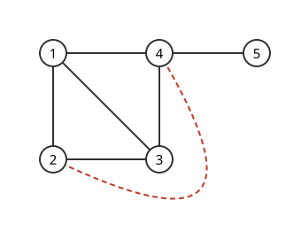

# 최소 차수 순서

# 개요

**최소 차수 순서(minimum degree ordering)** 는 희소한 대칭 연립방정식을 [Gauss 소거법](gaussian-elimination.md)으로 풀 때, 매 단계 남은 미지수 가운데 다른 미지수와 가장 적게 엮인 것을 골라 소거하는 순서다. 소거할 미지수가 엮인 상대가 적을수록 그 소거로 새로 0 아닌 값이 되는 계수가 적다. 최소 차수 순서는 이 어림을 단계마다 적용해, 분리자를 찾지 않고도 채움이 적은 소거 순서를 빠르게 정한다.

# 직관

아래 그림의 검은 실선은 미지수 $1,\dots,5$ 가운데 한 식에 함께 들어간 짝이다. 정점의 차수는 $1$ 이 $3$, $2$ 가 $2$, $3$ 이 $3$, $4$ 가 $3$, $5$ 가 $1$ 이다.

[중첩 분할](nested-dissection.md)의 소거 그래프로 보면 $1$ 을 먼저 소거할 때 이웃 $2,3,4$ 를 서로 이어야 하고, $2\text{–}4$ 가 없으므로 빨간 점선이 채움으로 생긴다.

차수가 가장 작은 $5$ 부터 소거하면 이웃이 $4$ 하나뿐이라 채움이 없다.

남은 그래프에서 $4$ 와 $2$ 의 차수가 $2$ 로 가장 작고, $4$ 의 이웃 $1,3$ 은 이어져 있어 채움이 없다. 그 뒤 $2$, $1$, $3$ 도 채움 없이 소거되어 순서 $5,4,2,1,3$ 의 채움은 $0$ 이다.

# 정의

그래프 $G$ 에서 시작해, 매 단계 현재 소거 그래프에서 차수가 가장 작은 정점 $v$ 를 고르고 $v$ 를 소거한다. 소거는 $v$ 를 지우고 $v$ 의 이웃끼리를 모두 잇는 것이다. 고른 순서를 **최소 차수 순서** 라 한다. 차수가 같은 정점이 여럿이면 정해 둔 규칙으로 하나를 고른다.

직관 절의 $5,4,2,1,3$ 이 최소 차수 순서다.

대칭이 아닌 행렬에서 행과 열의 0 아닌 성분 수의 곱 $(r\_i-1)(c\_j-1)$ 이 가장 작은 성분을 다음 축으로 고르는 규칙을 Markowitz 규칙(Markowitz rule)이라 하고, 대칭 행렬에서 이것이 최소 차수 순서가 된다[^1].

# 성질

## 한 단계의 채움 상한

차수가 $d$ 인 정점을 소거하면 이웃 $d$ 개 가운데 이어지지 않은 쌍이 채움이 되므로 채움은 $d(d-1)/2$ 이하다. 최소 차수 순서는 단계마다 이 상한을 가장 작게 하는 정점을 고른다. 전체 채움이 가장 작다는 보장은 없다. 채움을 가장 작게 하는 순서를 찾는 문제는 NP-완전(NP-complete, NP 는 nondeterministic polynomial time)이다.

## 최소 채움 규칙과 현 그래프

차수 대신 그 정점을 소거할 때 실제로 생기는 채움의 수가 가장 작은 정점을 고르는 규칙을 최소 채움 규칙(minimum fill rule)이라 한다. [현 그래프](chordal-graphs.md)에는 채움이 $0$ 인 단체 정점이 있고 그것을 지운 그래프도 현 그래프이므로, 최소 채움 규칙은 현 그래프에서 언제나 채움이 $0$ 인 순서를 준다.

## 근사 최소 차수

소거할 때마다 이웃끼리 간선을 실제로 더하면 그래프가 커진다. 소거한 정점들을 묶음으로 남겨 두고 차수를 묶음을 거쳐 계산하는 몫 그래프(quotient graph)를 쓰면 저장량이 원래 그래프의 크기를 넘지 않는다. 차수를 정확히 세는 대신 상한으로 어림하는 근사 최소 차수(approximate minimum degree, AMD) 순서는 정확한 최소 차수와 비슷한 채움을 주면서 훨씬 빠르다[^2].

# 활용

- 희소 Cholesky 분해와 LU(lower–upper) 분해의 순서 정하기. 희소 행렬 프로그램이 기본으로 쓰는 순서이고, 큰 2 차원·3 차원 격자에서는 중첩 분할과 견주어 고른다.
- 전력망 해석. 송전망의 마디 방정식을 직접 소거로 풀 때 차수가 작은 마디부터 소거하는 순서가 처음 쓰였다[^3].
- [선형계획법](linear-programming.md). [단체법](simplex-method.md)에서 기저 행렬의 LU 분해를 갱신할 때 Markowitz 규칙으로 축을 골라 채움을 줄인다.

[^1]: H. M. Markowitz, "The elimination form of the inverse and its application to linear programming", *Management Science* **3** (1957), 255–269.
[^2]: P. R. Amestoy, T. A. Davis, I. S. Duff, "An approximate minimum degree ordering algorithm", *SIAM Journal on Matrix Analysis and Applications* **17** (1996), 886–905.
[^3]: W. F. Tinney, J. W. Walker, "Direct solutions of sparse network equations by optimally ordered triangular factorization", *Proceedings of the IEEE* **55** (1967), 1801–1809.

# 연관 문서

## 선수지식

- [중첩 분할](nested-dissection.md)

## 더 알아보기

아직 연결한 문서가 없다.

#graph_theory #linear_algebra #algorithms
