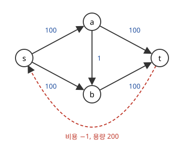

# 최소 평균 순환 제거법

# 개요

**최소 평균 순환 제거법(minimum-mean cycle canceling)** 은 흐름의 잔여 그래프에서 간선당 평균 비용이 가장 작은 순환을 골라 흘리기를 되풀이해 최소 비용 흐름을 찾는 알고리즘이다. 음수 순환을 아무렇게나 고르면 용량 하나가 $100$ 일 때 $200$ 번을 돌아야 끝나는 네트워크가 있다. 평균이 가장 작은 순환을 고르면 같은 네트워크가 두 번에 끝나고, 일반적으로도 반복 횟수가 용량과 비용의 크기와 무관한 정점 수와 간선 수의 다항식으로 묶인다.

# 직관

아래 그림은 [네트워크 흐름](network-flow.md) 문서의 네트워크에서 $a\to b$ 의 용량을 $1$, 나머지 네 간선의 용량을 $100$ 으로 두고, 비용이 $-1$ 이고 용량이 $200$ 인 간선 $t\to s$ 를 더한 것이다. 나머지 간선의 비용은 $0$ 이다. 모든 정점에서 들어오는 양과 나가는 양이 같은 흐름 가운데 비용이 가장 작은 것을 찾으면, $t\to s$ 에 흐르는 양이 $s$ 에서 $t$ 로 보낼 수 있는 최대 흐름이다.

흐름 $0$ 에서 시작한다. [최소 비용 흐름](min-cost-flow.md)의 음수 순환 조건에 따라, 잔여 그래프에 비용이 음수인 순환이 있으면 그 순환을 따라 흘릴 수 있는 만큼 흘려 비용을 줄인다. 음수 순환은 $s$ 에서 $t$ 로 가는 경로에 $t\to s$ 를 붙인 것이고 비용이 전부 $-1$ 이다.

순환 $s\to a\to b\to t\to s$ 를 고르면 $a\to b$ 의 용량 $1$ 만 흐른다. 다음에 $a\to b$ 의 거꾸로 간선을 쓰는 $s\to b\to a\to t\to s$ 를 고르면 또 $1$ 만 흐르고 $a\to b$ 가 다시 비워진다. 이 둘을 번갈아 고르면 $t\to s$ 에 $200$ 이 흐를 때까지 $200$ 번을 돈다.

비용 $-1$ 을 순환의 간선 수로 나누면 $s\to a\to t\to s$ 와 $s\to b\to t\to s$ 는 $-1/3$ 이고 $a\to b$ 를 지나는 두 순환은 $-1/4$ 이다. 평균이 가장 작은 순환을 고르면 $s\to a\to t\to s$ 에 $100$, $s\to b\to t\to s$ 에 $100$ 을 흘려 두 번에 끝난다. 남은 잔여 그래프에는 음수 순환이 없다.

# 정의

## 순환 제거법

비용 $w$ 와 용량이 주어진 유향 그래프에서 공급 조건을 만족하는 흐름 $f$ 하나로 시작한다. 잔여 그래프 $G\_f$ 에 음수 순환 $C$ 가 있는 동안, $C$ 의 간선들의 잔여 용량 가운데 최솟값만큼 $C$ 를 따라 흘린다. 이 반복을 **순환 제거법(cycle canceling)** 이라 하고, 한 번 흘리는 것을 순환을 **제거한다(cancel)** 고 한다[^1].

[최소 평균 순환](minimum-mean-cycle.md)은 간선 비용의 합을 간선 수로 나눈 값이 가장 작은 순환이다. 매번 $G\_f$ 의 최소 평균 순환을 제거하는 순환 제거법이 **최소 평균 순환 제거법** 이다. 최소 평균 순환은 Karp 공식으로 $O(nm)$ 시간에 찾는다. 이 문서에서 $n$ 은 정점 수, $m$ 은 간선 수다.

직관 절의 두 번째 고르기가 최소 평균 순환 제거법이고, 첫 번째 고르기는 그렇지 않은 순환 제거법이다.

## ε 최적 흐름

$\varepsilon\ge 0$ 에 대해 퍼텐셜 $\pi$ 가 존재해서 $G\_f$ 의 모든 간선의 축소 비용이 $w^\pi(u,v)=w(u,v)+\pi(u)-\pi(v)\ge-\varepsilon$ 이면 $f$ 를 **ε 최적(ε-optimal)** 이라 한다. 그런 $\varepsilon$ 의 최솟값을 $\varepsilon(f)$ 라 쓴다. $\varepsilon=0$ 이면 최소 비용 흐름의 퍼텐셜 조건이고 $f$ 는 최적이다.

직관 절의 흐름 $0$ 에서 $\pi=0$ 으로 두면 축소 비용이 $t\to s$ 만 $-1$ 이고 나머지는 $0$ 이므로 $\varepsilon=1$ 의 최적이다. 아래 정리에 따르면 $\varepsilon(0)=1/3$ 이다.

# 성질

## ε 과 최소 평균 순환 값

$G\_f$ 의 최소 평균 순환 값을 $\mu(f)$ 라 하면 $\mu(f)\lt 0$ 일 때 $\varepsilon(f)=-\mu(f)$ 이다.

증명의 요지. $f$ 가 ε 최적인 것은 비용을 $w+\varepsilon$ 으로 바꾼 $G\_f$ 에서 축소 비용을 모두 $0$ 이상으로 만드는 퍼텐셜이 있는 것이다. 최소 비용 흐름의 퍼텐셜 조건에 따라 이것은 $w+\varepsilon$ 에 음수 순환이 없는 것과 동치이고, 간선이 $k$ 개인 순환의 비용이 $k\varepsilon$ 늘어나므로 $\mu(f)\ge-\varepsilon$ 과 동치다. ∎

## ε 의 단조성

최소 평균 순환 $C$ 를 제거한 흐름을 $f'$ 이라 하면 $\varepsilon(f')\le\varepsilon(f)$ 이다.

증명의 요지. $\varepsilon=\varepsilon(f)$ 를 주는 퍼텐셜 $\pi$ 를 잡는다. $C$ 의 축소 비용의 평균은 $-\varepsilon$ 이고 각 간선은 $-\varepsilon$ 이상이므로 $C$ 의 간선은 모두 축소 비용이 정확히 $-\varepsilon$ 이다. $G\_{f'}$ 에 새로 생기는 간선은 $C$ 의 간선의 거꾸로 간선뿐이고 축소 비용이 $\varepsilon\ge-\varepsilon$ 이다. 같은 $\pi$ 가 $f'$ 의 ε 최적을 보인다. ∎

## m 번마다 줄어드는 비율

연속한 $m$ 번의 제거 뒤의 흐름 $f''$ 은 $\varepsilon(f'')\le(1-1/n)\varepsilon(f)$ 를 만족한다.

증명의 요지. $\pi$ 를 고정하고 축소 비용이 음수인 간선을 센다. 제거한 순환의 간선이 전부 음수 축소 비용을 가지면, 제거는 그 가운데 적어도 하나를 포화시켜 잔여 그래프에서 없애고 새로 생기는 거꾸로 간선은 축소 비용이 양수다. 그래서 그런 제거가 $m$ 번 이어질 수 없고, $m$ 번 안에 축소 비용이 $0$ 이상인 간선을 가진 순환 $C$ 가 제거된다. $C$ 의 나머지 간선은 $-\varepsilon$ 이상이므로 평균은 $-(1-1/\lvert C\rvert)\varepsilon\ge-(1-1/n)\varepsilon$ 이상이고, 앞의 두 정리로 그 시점의 $\varepsilon$ 이 이 값 이하다. ∎

## 반복 횟수

정리(Goldberg–Tarjan). 최소 평균 순환 제거법은 다음 횟수 안에 끝난다[^2].

- 비용이 정수이고 절댓값이 $W$ 이하이면 $O(nm\log(nW))$ 번.
- 비용이 실수이면 $O(nm^2\log n)$ 번.

증명의 요지. 정수 비용에서는 처음 $\varepsilon\le W$ 이다. $\varepsilon\lt 1/n$ 이면 모든 순환의 평균이 $-1/n$ 보다 크고 비용 합이 $-1$ 보다 큰 정수이므로 $0$ 이상이고 흐름은 최적이다. $(1-1/n)^n\le 1/e$ 이므로 $nm$ 번마다 $\varepsilon$ 이 $1/e$ 배 이하로 줄어 $O(nm\log(nW))$ 번 안에 $1/n$ 아래로 내려간다.

실수 비용에서는 $O(nm\log n)$ 번마다 $\varepsilon$ 이 $1/(2n)$ 배 이하로 준다. 그 사이에 축소 비용의 절댓값이 $2n\varepsilon$ 보다 큰 간선이 하나 생기고, 그런 간선의 흐름은 그 뒤로 바뀌지 않는다. 간선이 $m$ 개이므로 $O(nm^2\log n)$ 번 안에 끝난다.

한 번의 제거는 Karp 공식의 $O(nm)$ 시간이 들므로, 실수 비용에서 전체 시간은 용량과 비용의 크기와 무관한 $O(n^2m^3\log n)$ 이다. 이런 시간 한계를 **강다항 시간(strongly polynomial time)** 이라 한다.

## 최대 흐름의 최단 경로 선택

직관 절처럼 $t\to s$ 만 비용이 $-1$ 이고 나머지가 $0$ 이면, $s$ 에서 $t$ 로 가는 간선 $k$ 개의 경로에 $t\to s$ 를 붙인 순환의 평균은 $-1/(k+1)$ 이다. 최소 평균 순환은 간선 수가 가장 적은 증가 경로를 고르는 것이 되고, 이것은 최대 흐름에서 Edmonds–Karp 알고리즘(Edmonds–Karp algorithm)의 선택 규칙이다.

# 활용

- 최소 비용 흐름의 강다항 시간 해법. Tardos 의 알고리즘에 이어 최소 비용 흐름을 강다항 시간에 푸는 방법이다[^2].
- 수송 문제와 할당 문제. [수송 문제](transportation-problem.md)와 [할당 문제](assignment-problem.md)를 최소 비용 흐름으로 적으면 이 알고리즘이 정수 해를 강다항 시간에 준다.
- 비용 척도 조정(cost scaling). ε 최적 흐름에서 ε 을 반씩 줄여 가는 Goldberg–Tarjan 의 비용 척도 조정 알고리즘이 같은 ε 최적 개념을 쓴다.

[^1]: Morton Klein, "A primal method for minimal cost flows with applications to the assignment and transportation problems", *Management Science* **14** (1967), 205–220.
[^2]: Andrew V. Goldberg, Robert E. Tarjan, "Finding minimum-cost circulations by canceling negative cycles", *Journal of the ACM* **36** (1989), 873–886.

# 연관 문서

## 선수지식

- [최소 비용 흐름](min-cost-flow.md)
- [최소 평균 순환](minimum-mean-cycle.md)

## 더 알아보기

아직 연결한 문서가 없다.

#graph_theory #optimization #algorithms
