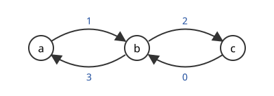

# 최소 평균 순환

# 개요

**최소 평균 순환(minimum mean cycle)** 은 간선마다 비용이 있는 유향 그래프의 순환 가운데, 비용의 합을 간선 수로 나눈 평균이 가장 작은 순환이다. 기계가 상태 사이를 옮겨 다니며 한 번 옮길 때마다 비용을 내고 이 일을 끝없이 되풀이하면, 오래 돌린 뒤의 한 걸음당 평균 비용은 결국 기계가 머무는 순환의 평균이 된다. 최소 평균 순환은 그 평균이 가장 작아지는 경로를 고르는 문제이고, Karp 의 공식은 걸음 수마다의 [최단경로](shortest-paths.md) 값만으로 그 평균을 계산한다.

# 직관

아래 그림은 상태 $a,b,c$ 와 옮길 때의 비용이다. $a\to b$ 는 $1$, $b\to a$ 는 $3$, $b\to c$ 는 $2$, $c\to b$ 는 $0$ 이다.

순환은 $a\to b\to a$ 와 $b\to c\to b$ 둘이다. 앞의 것은 두 걸음에 $4$ 가 들어 한 걸음당 $2$ 이고, 뒤의 것은 두 걸음에 $2$ 가 들어 한 걸음당 $1$ 이다. 오래 돌리면 $b$ 와 $c$ 사이를 오가는 것이 한 걸음당 $1$ 로 가장 싸다.

순환을 하나씩 세는 대신, 어디서 출발하든 정확히 $k$ 걸음으로 각 상태에 도착하는 최소 비용 $D\_k(v)$ 를 센다. $D\_0$ 은 모두 $0$ 이고, $D\_k(v)$ 는 $v$ 로 들어오는 간선 $(u,v)$ 마다 $D\_{k-1}(u)$ 에 비용을 더한 값의 최솟값이다.

| 걸음 수 | a | b | c |
| --- | --- | --- | --- |
| 0 | 0 | 0 | 0 |
| 1 | 3 | 0 | 2 |
| 2 | 3 | 2 | 2 |
| 3 | 5 | 2 | 4 |

상태 $b$ 에서 $3$ 걸음 값 $2$ 와 $1$ 걸음 값 $0$ 의 차를 걸음 수 차 $2$ 로 나누면 $1$ 이다. 그 사이의 두 걸음이 $b\to c\to b$ 를 한 바퀴 돈 것이고, 이 계산이 최소 평균을 낸다.

# 정의

유향 그래프 $G=(V,E)$ 와 비용 $w:E\to\mathbb R$ 에서 순환 $C$ 의 **평균 비용(mean weight)** 은 다음 값이다.

$$
\mu(C)=\frac{1}{\lvert C\rvert}\sum_{e\in C}w(e)
$$

$\lvert C\rvert$ 는 $C$ 의 간선 수다. 모든 순환 가운데 $\mu(C)$ 의 최솟값 $\mu^\ast$ 를 **최소 평균 순환 값** 이라 하고, 그 값을 갖는 순환을 **최소 평균 순환** 이라 한다. 직관 절에서 $\mu(a\to b\to a)=2$, $\mu(b\to c\to b)=1$ 이고 $\mu^\ast=1$ 이다.

$D\_k(v)$ 는 어느 정점에서 출발하든 간선을 정확히 $k$ 개 지나 $v$ 에 닿는 걸음의 비용 가운데 최솟값이고, 그런 걸음이 없으면 $\infty$ 다. $D\_0(v)=0$ 이고 $k\ge 1$ 에서는 다음과 같다.

$$
D_k(v)=\min_{(u,v)\in E}\bigl(D_{k-1}(u)+w(u,v)\bigr)
$$

# 성질

## Karp 공식

정리. $\lvert V\rvert=n$ 이고 순환이 하나 이상 있으면 다음이 성립한다[^1].

$$
\mu^\ast=\min_{v\in V}\ \max_{0\le k\le n-1}\frac{D_n(v)-D_k(v)}{n-k}
$$

최솟값은 $D\_n(v)\lt\infty$ 인 $v$ 위에서 잡는다.

증명의 요지. 모든 비용에서 같은 수 $\lambda$ 를 빼면 양변이 똑같이 $\lambda$ 줄므로 $\mu^\ast=0$ 인 경우만 보면 된다. 그러면 음수 순환이 없다. $n$ 걸음의 걸음은 순환을 포함하고 그 순환의 비용은 $0$ 이상이므로, 순환을 빼면 $D\_n(v)\ge\min\_k D\_k(v)$ 이고 각 $v$ 의 최댓값은 $0$ 이상이다. 평균이 $0$ 인 순환 위의 정점 가운데 그 순환을 따라 최단거리를 이어 가는 정점에서는 $D\_n(v)=\min\_k D\_k(v)$ 이므로 최댓값이 $0$ 이다. ∎

직관 절에서 $v=a,b,c$ 의 최댓값은 차례로 $2,1,2$ 이고 그 최솟값이 $1$ 이다. $D\_k$ 의 표는 Bellman–Ford 알고리즘(Bellman–Ford algorithm)과 같은 완화 $n$ 번으로 채우므로 전체가 $O(\lvert V\rvert\lvert E\rvert)$ 시간이다.

## 음수 순환 판정과의 관계

비용을 $w-\lambda$ 로 바꾼 그래프에 음수 순환이 없는 것은 $\lambda\le\mu^\ast$ 인 것과 동치다. 그래서 $\mu^\ast$ 는 음수 순환 판정을 되풀이하는 이분 탐색으로도 구해진다. 직관 절에서 $\lambda=1$ 이면 $b\to c\to b$ 의 비용이 $0$ 이 되고, $\lambda$ 를 조금 더 키우면 음수가 된다.

## 긴 걸음의 평균

그래프가 강하게 연결(strongly connected)되어 있으면 $D\_k(v)/k$ 는 $k\to\infty$ 에서 $\mu^\ast$ 로 수렴한다. 직관 절의 표에서 $D\_3(b)/3=\tfrac23$ 이고 $k$ 가 커지면 $1$ 에 가까워진다.

# 활용

- [최소 비용 흐름](min-cost-flow.md)의 순환 제거법. 잔여 그래프에서 평균 비용이 가장 작은 음수 순환을 골라 흘리면 반복 횟수가 강다항식으로 묶인다. Goldberg 와 Tarjan 의 알고리즘이 이 규칙이다.
- [max-plus 대수](max-plus-algebra.md)의 고윳값. 덧셈 대신 최댓값, 곱셈 대신 덧셈을 쓰는 행렬 계산에서 기약 행렬(irreducible matrix)의 고윳값은 그 행렬이 정하는 그래프의 최대 평균 순환 값이다. 비용의 부호를 바꾸면 이 문서의 문제가 된다.
- 주기적 일정의 주기. 작업 사이의 선후와 소요 시간을 간선으로 둔 그래프에서, 같은 작업을 끝없이 되풀이할 때 한 회차에 드는 최소 시간은 최대 평균 순환 값이다.
- 비율 순환. 간선마다 비용과 시간이 있을 때 비용 합을 시간 합으로 나눈 비율이 가장 작은 순환은, $\lambda$ 를 정해 비용에서 $\lambda$ 배의 시간을 뺀 그래프의 음수 순환 판정을 이분 탐색하여 구한다.

[^1]: Richard M. Karp, "A characterization of the minimum cycle mean in a digraph", *Discrete Mathematics* **23** (1978), 309–311.

# 연관 문서

## 선수지식

- [최단경로](shortest-paths.md)

## 더 알아보기

- [최소 평균 순환 제거법](minimum-mean-cycle-canceling.md)
- [max-plus 대수](max-plus-algebra.md)

#algorithms #graph_theory #optimization
