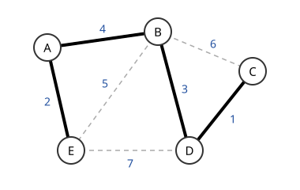

# 최소 신장트리

# 개요

**최소 신장트리(minimum spanning tree)** 는 그래프의 모든 정점을 잇는 간선 집합 가운데 가중치 합이 가장 작은 것이다. 마을 다섯 곳을 전선으로 모두 잇되 마을 쌍마다 전선 비용이 다를 때, 가장 싼 연결이 최소 신장트리다. 가벼운 간선부터 보면서 순환을 만들지 않으면 넣는 절차가 언제나 이 연결을 찾는다.

# 직관

아래 그림은 마을 $A,B,C,D,E$ 와 마을 쌍마다 전선 비용을 적은 그래프다. 비용은 $CD=1$, $AE=2$, $BD=3$, $AB=4$, $BE=5$, $BC=6$, $DE=7$ 이다.

싼 전선부터 보며 이미 이어진 두 마을을 다시 잇는 전선은 버린다. $CD$, $AE$, $BD$ 를 차례로 넣으면 $\lbrace A,E\rbrace$ 와 $\lbrace B,C,D\rbrace$ 두 무리가 생긴다. 다음 $AB$ 가 두 무리를 이으므로 넣고, 다섯 마을이 모두 이어진다. 남은 $BE$, $BC$, $DE$ 는 이미 이어진 마을을 다시 잇는다. 굵은 선이 고른 네 전선이고 비용 합은 $1+2+3+4=10$ 이다.

$AB$ 를 넣은 것이 손해가 아닌 이유는 두 무리 사이에 있다. $\lbrace A,E\rbrace$ 와 $\lbrace B,C,D\rbrace$ 를 잇는 전선은 $AB=4$, $BE=5$, $DE=7$ 이고, 다섯 마을을 모두 잇는 어느 연결도 이 셋 가운데 하나는 써야 한다. 그중 가장 싼 것을 쓰는 연결이 다른 것을 쓰는 연결보다 비싸지 않다.

# 정의

$G=(V,E)$ 를 유한 연결 무방향 그래프, $w(e)$ 를 간선의 [실수](real-numbers.md) 가중치라 하자. 모든 정점을 포함하고 연결되며 순환이 없는 간선 부분집합 $T$ 를 **신장트리(spanning tree)** 라 하고, 가중치 합

$$
w(T)=\sum_{e\in T}w(e)
$$

이 가장 작은 신장트리를 **최소 신장트리** 라 한다. 직관 절의 그림에서 $\lbrace CD,AE,BD,AB\rbrace$ 는 가중치 $10$ 인 최소 신장트리이고, $\lbrace CD,AE,BD,BE\rbrace$ 는 가중치 $11$ 인 신장트리다.

정점 집합을 공집합이 아닌 두 부분 $S$, $V\setminus S$ 로 나눈 것을 **컷(cut)** 이라 하고, 끝점이 양쪽에 하나씩 있는 간선을 그 컷을 **건너는(crossing)** 간선이라 한다. 그림에서 $S=\lbrace A,E\rbrace$ 인 컷을 건너는 간선은 $AB$, $BE$, $DE$ 다.

그래프가 연결되지 않으면 신장트리가 없고, 각 연결 성분의 최소 신장트리를 모은 것을 **최소 신장숲(minimum spanning forest)** 이라 한다.

# 성질

## 컷 성질과 순환 성질

- 컷 성질(cut property). 어느 컷에서든 그 컷을 건너는 간선 가운데 가중치가 유일하게 최소인 간선은 모든 최소 신장트리에 속한다.
- 순환 성질(cycle property). 어느 순환에서든 가중치가 유일하게 최대인 간선은 어떤 최소 신장트리에도 속하지 않는다.

컷 성질의 증명. 그 간선 $e$ 가 없는 최소 신장트리 $T$ 에 $e$ 를 더하면 순환이 생기고, 그 순환은 컷을 한 번 더 건너는 간선 $f$ 를 가진다. $T$ 에서 $f$ 를 빼고 $e$ 를 넣으면 신장트리이고 가중치가 $w(f)-w(e)\gt 0$ 만큼 줄어 모순이다. 그림에서 $S=\lbrace A,E\rbrace$ 인 컷에 쓰면 $AB$ 가 모든 최소 신장트리에 속하고, 순환 $B,C,D$ 에 순환 성질을 쓰면 $BC$ 는 어떤 최소 신장트리에도 속하지 않는다.

## Kruskal 알고리즘

Kruskal 알고리즘(Kruskal's algorithm)은 간선을 가벼운 순서로 훑어 이미 고른 간선과 순환을 만들지 않을 때만 더하는 절차다. 직관 절의 계산이 이 알고리즘이다. 연결 그래프에서는 $\lvert V\rvert-1$ 개를 고르면 끝난다.

정당성의 증명. 지금까지 고른 숲 $F$ 를 포함하는 최소 신장트리 $T$ 가 있다고 하자. 다음에 더할 간선 $e$ 가 $T$ 에 없으면 $T \cup \lbrace e\rbrace$ 에 순환이 하나 생기고, 그 순환에는 $e$ 의 한쪽 끝이 속한 $F$ 의 성분을 벗어나는 다른 간선 $f$ 가 있다. $f$ 는 $F$ 에 없고 더해도 순환을 만들지 않으므로 $w(e) \le w(f)$ 다. $T$ 에서 $f$ 를 빼고 $e$ 를 넣어도 신장트리이고 가중치가 늘지 않는다. $F = \varnothing$ 에서 시작해 귀납법으로 마지막 $F$ 가 최소 신장트리다.

## 유일성

가중치가 모두 다르면 최소 신장트리는 유일하다. 두 개가 있다면 한쪽에만 있는 가장 가벼운 간선을 잡아 위의 교환 논증으로 모순을 얻는다. 그림의 가중치는 모두 다르므로 $\lbrace CD,AE,BD,AB\rbrace$ 가 유일한 최소 신장트리다.

가중치가 같은 간선이 있으면 최소 신장트리가 여럿일 수 있다. 같은 가중치의 두 간선이 한 순환에 함께 들어가지 않으면 여전히 하나뿐이다.

## 음수 가중치

신장트리는 언제나 간선 $\lvert V\rvert-1$ 개를 가지므로 모든 가중치에 같은 상수를 더해도 최소 신장트리가 바뀌지 않는다. 그래서 음수 가중치도 그대로 다룬다. [최단경로](shortest-paths.md)에서는 경로마다 간선 수가 달라 이 논법이 통하지 않는다.

## 최단 경로 트리와의 차이

삼각형에서 $AB=2$, $BC=2$, $AC=3$ 이면 최소 신장트리는 $AB$ 와 $BC$ 로 가중치가 $4$ 다. $A$ 에서 각 정점까지의 최단 경로를 모은 최단 경로 트리(shortest path tree)는 $AB$ 와 $AC$ 로 가중치가 $5$ 다. 최소 신장트리는 전체 설치비를, 최단 경로 트리는 한 출발점에서의 이동 거리를 줄인다.

## 복잡도와 다른 알고리즘

Kruskal 알고리즘은 간선 정렬에 $O(\lvert E\rvert\log\lvert E\rvert)$ 시간이 들고, 순환 판정에 쓰는 [서로소 집합 자료구조](union-find.md)의 연산은 거의 상수 시간이라 전체가 정렬에 따라 정해진다. 가중치가 작은 정수여서 기수 정렬(radix sort)을 쓸 수 있으면 더 빨라진다.

| 알고리즘 | 복잡도 | 특징 |
|---|---|---|
| Kruskal | $O(\vert E\vert\log\vert E\vert)$ | 간선 정렬과 서로소 집합 |
| Prim ([이진 힙](binary-heaps.md)) | $O(\vert E\vert\log\vert V\vert)$ | 한 정점에서 나무를 키운다 |
| Borůvka | $O(\vert E\vert\log\vert V\vert)$ | 성분마다 동시에 간선을 고른다 |

세 알고리즘 모두 컷 성질로 정당화된다. Prim 알고리즘(Prim's algorithm)은 지금까지 키운 나무와 나머지 사이의 컷에, Borůvka 알고리즘(Borůvka's algorithm)은 각 성분과 나머지 사이의 컷에 컷 성질을 쓴다. Borůvka 알고리즘은 성분들이 동시에 간선을 고르므로 병렬 계산에 맞고, Karger–Klein–Tarjan 의 무작위 선형 시간 알고리즘도 이 단계를 쓴다.

## Matroid 의 탐욕법

순환이 없는 간선 집합들의 모임이 그래프 [Matroid](matroids.md) 의 독립집합족이고 신장트리가 그 기저다. Matroid 에서 탐욕법이 가중치 최소 기저를 준다는 정리로부터 Kruskal 알고리즘의 정당성이 유도된다. 벡터의 일차독립성, 횡단 조건, 분할 제약도 matroid 를 이루므로 같은 탐욕법이 통한다.

# 활용

- 연결 비용의 최소화. 통신망, 배전망, 도로망의 총 설치비를 줄이는 모형이다. 연결만 보장하므로 장애에 대비한 여분 경로, 최대 이동거리 제한, 용량 제약은 따로 넣는다.
- 군집화. 간선을 가벼운 순서로 합치다가 $k$ 개 성분이 남았을 때 멈추면 단일 연결 군집화(single-linkage clustering)가 된다. 최소 신장트리에서 가장 무거운 간선 $k-1$ 개를 지운 것과 같으므로 트리 하나로 모든 $k$ 의 군집화를 얻는다.
- [근사 알고리즘](approximation-algorithms.md). 삼각부등식을 만족하는 [외판원 문제](traveling-salesman-problem.md)에서 최소 신장트리의 가중치는 최적 순회의 하한이다. 트리를 두 번 순회하면 최적의 두 배 이하인 순회가 나오고, Christofides 알고리즘(Christofides algorithm)은 최소 가중치 완전 매칭을 더해 $1.5$ 배로 줄인다.[^1]

[^1]: Robert Sedgewick and Kevin Wayne, *Algorithms*, §4.3 Minimum Spanning Trees. 컷 성질, Kruskal 과 Prim 알고리즘, 시간 복잡도. https://algs4.cs.princeton.edu/43mst/

# 연관 문서

## 선수지식

- [Matroid](matroids.md)
- [서로소 집합 자료구조](union-find.md)
- [그래프 이론 개관](graph-theory-overview.md)

## 더 알아보기

- [유향 신장트리](arborescences.md)
- [Shannon 전환 게임](shannon-switching-game.md)
- [Steiner 나무 문제](steiner-tree-problem.md)

#graph_theory #algorithms
