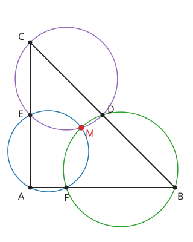

# Miquel 정리

# 개요

**Miquel 정리(Miquel's theorem)** 는 삼각형의 세 변 위에 점을 하나씩 잡고, 꼭짓점마다 그 꼭짓점과 양옆 변 위의 두 점을 지나는 원을 그리면 세 원이 한 점에서 만난다는 정리다. 종이에 삼각형을 그리고 세 변에 아무 점이나 찍은 뒤 원 세 개를 그려 보면, 두 원의 교점을 셋째 원이 언제나 지나간다. 세 점을 어디에 찍어도 그렇다는 것은 원에 내접하는 각이 같다는 사실 하나로 증명된다.

# 직관

$A=(0,0)$, $B=(4,0)$, $C=(0,4)$ 인 삼각형에서 변 $BC$ 위에 $D=(2,2)$, 변 $CA$ 위에 $E=(0,2)$, 변 $AB$ 위에 $F=(1,0)$ 을 잡는다. 세 점 $A,E,F$ 를 지나는 원, $B,F,D$ 를 지나는 원, $C,D,E$ 를 지나는 원은 차례로 다음과 같다.

$$
\begin{aligned}
x^2+y^2-x-2y&=0\cr
x^2+y^2-5x-y+4&=0\cr
x^2+y^2-2x-6y+8&=0
\end{aligned}
$$

첫째 식에서 둘째 식을 빼면 $4x-y-4=0$ 이다. 이것을 첫째 식에 넣으면 $17x^2-41x+24=0$ 이고, 근 $x=1$ 은 $F$ 이고 다른 근 $x=24/17$ 에서 $M=(24/17,28/17)$ 이 나온다.

$M$ 을 셋째 식에 넣으면 $80/17-48/17-168/17+136/17=0$ 이다. 첫째 원과 둘째 원이 $F$ 말고 만나는 점을 셋째 원도 지난다.

그림의 파란 원, 초록 원, 보라 원이 빨간 점 $M$ 에서 만난다. 변 위의 점을 옮기면 $M$ 도 움직이지만 세 원은 계속 한 점에서 만난다.

# 정의

## 유향각

두 직선 $\ell$, $m$ 에 대해 $\ell$ 을 $m$ 의 방향으로 돌리는 각을 $\pi$ 를 법으로 잰 값을 **유향각(directed angle)** $\angle(\ell,m)$ 이라 한다. 직선의 방향을 반대로 바꿔도 값이 같고, 세 직선에 대해 다음이 성립한다.

$$
\angle(\ell,m)+\angle(m,n)=\angle(\ell,n)
$$

유향각으로 원주각 정리(inscribed angle theorem)를 쓰면, 세 점씩 한 직선 위에 있지 않은 네 점 $P,Q,X,Y$ 가 한 원 위에 있는 것은 $\angle(XP,XQ)=\angle(YP,YQ)$ 와 동치다. 각의 크기 대신 유향각을 쓰면 $X$ 와 $Y$ 가 $PQ$ 의 같은 쪽에 있는지 반대쪽에 있는지 나눠 따지지 않아도 된다.

## Miquel 점

삼각형 $ABC$ 의 변 $BC$, $CA$, $AB$ 가 놓인 직선 위에 꼭짓점이 아닌 점 $D$, $E$, $F$ 를 잡는다. 원 $AEF$, $BFD$, $CDE$ 를 **Miquel 원(Miquel circles)** 이라 하고, 세 원이 만나는 점을 **Miquel 점(Miquel point)** 이라 한다. 직관 절의 Miquel 점은 $M=(24/17,28/17)$ 이다.

## 완전사변형

일반 위치에 있는 네 직선, 곧 어느 두 직선도 평행하지 않고 어느 세 직선도 한 점에서 만나지 않는 네 직선을 **완전사변형(complete quadrilateral)** 이라 한다. 네 직선 가운데 셋을 고르는 방법이 넷이므로 완전사변형에는 삼각형이 네 개 있다.

# 성질

## Miquel 정리

원 $AEF$, $BFD$, $CDE$ 는 한 점에서 만난다.

증명의 요지. 원 $AEF$ 와 원 $BFD$ 가 $F$ 말고 만나는 점을 $M$ 이라 한다. $A,E,F,M$ 이 한 원 위에 있으므로 $\angle(ME,MF)=\angle(AE,AF)=\angle(CA,AB)$ 이고, $B,F,D,M$ 이 한 원 위에 있으므로 $\angle(MF,MD)=\angle(AB,BC)$ 다. 두 식을 더하면 다음이 나온다.

$$
\angle(ME,MD)=\angle(CA,BC)=\angle(CE,CD)
$$

원주각 정리로 $C,D,E,M$ 이 한 원 위에 있다.

## 같은 각

Miquel 점 $M$ 에서 세 점 $D,E,F$ 로 그은 직선은 각자 놓인 변과 같은 유향각을 이룬다.

$$
\angle(AB,MF)=\angle(BC,MD)=\angle(CA,ME)
$$

$A,E,F,M$ 이 한 원 위에 있으므로 $\angle(FA,FM)=\angle(EA,EM)$ 이고, 이것이 첫째 항과 셋째 항의 등식이다. 첫째 항과 둘째 항의 등식은 원 $BFD$ 에서 같은 방법으로 나온다. 직관 절에서 $M-F$ 는 $(1,4)$ 방향, $M-D$ 는 $(5,3)$ 방향, $M-E$ 는 $(4,-1)$ 방향이고, 세 직선이 변 $AB$, $BC$, $CA$ 와 이루는 각의 탄젠트가 모두 $4$ 다.

거꾸로 점 $M$ 에서 세 변에 같은 유향각 $\theta$ 로 직선을 그어 변과 만나는 점을 $D,E,F$ 라 하면 $M$ 이 그 세 점의 Miquel 점이다. $\theta=\pi/2$ 이면 $D,E,F$ 는 $M$ 의 수선의 발이고, 이때 원 $AEF$ 는 $AM$ 을 지름으로 하는 원이다.

## 완전사변형의 Miquel 점

완전사변형의 네 삼각형의 외접원은 한 점에서 만난다. 이 점을 완전사변형의 Miquel 점이라 한다.

예를 들어 직관 절의 세 직선 $AB$, $CA$, $BC$ 에 직선 $x+2y=2$ 를 더한다. 넷째 직선은 $AB$ 와 $P=(2,0)$, $CA$ 와 $Q=(0,1)$, $BC$ 와 $R=(6,-2)$ 에서 만난다. 네 외접원은 다음과 같다.

$$
\begin{aligned}
ABC:&\quad x^2+y^2-4x-4y=0\cr
APQ:&\quad x^2+y^2-2x-y=0\cr
BPR:&\quad x^2+y^2-6x+6y+8=0\cr
CQR:&\quad x^2+y^2-9x-5y+4=0
\end{aligned}
$$

네 원은 모두 $K=(12/13,-8/13)$ 을 지난다.

증명의 요지. 삼각형 $ABC$ 와 그 변 위의 점 $R,Q,P$ 에 Miquel 정리를 쓰면 원 $APQ$, $BPR$, $CQR$ 이 한 점 $K$ 에서 만난다. 다음으로 삼각형 $APQ$ 와 그 변 위의 점 $B,C,R$ 에 Miquel 정리를 쓰면 원 $ABC$, $PBR$, $QCR$ 이 한 점에서 만난다. 원 $PBR$ 과 $QCR$ 은 $R$ 과 $K$ 에서 만나고, $R$ 은 원 $ABC$ 위에 있지 않으므로 그 점은 $K$ 다.

## 외접원 중심들의 원

완전사변형의 네 외접원의 중심과 Miquel 점은 한 원 위에 있다. 위의 예에서 네 중심은 $(2,2)$, $(1,1/2)$, $(3,-3)$, $(9/2,5/2)$ 이고, 이 네 점과 $K$ 가 다음 원 위에 있다.

$$
x^2+y^2-\frac{15}{2}x+\frac{1}{2}y+6=0
$$

## 회전·확대의 중심

평면을 복소수로 보고, 점 $k$ 를 고정하는 사상 $z\mapsto k+\lambda(z-k)$ 를 $k$ 를 중심으로 하는 **회전·확대(spiral similarity)** 라 한다. $\lambda$ 의 절댓값이 확대율이고 편각이 회전각이다.

완전사변형의 Miquel 점은 $B$ 를 $P$ 로, $C$ 를 $Q$ 로 보내는 회전·확대의 중심이다. 위의 예에서 다음이 성립한다.

$$
\frac{p-k}{b-k}=\frac{q-k}{c-k}=\frac{3+i}{8}
$$

두 직선 $BP$, $CQ$ 가 만나는 점이 $A$ 이므로, 이 중심은 원 $ABC$ 와 원 $APQ$ 가 $A$ 말고 만나는 점이다. 같은 이유로 $K$ 는 $B$ 를 $C$ 로, $P$ 를 $Q$ 로 보내는 회전·확대의 중심이기도 하다.

# 활용

- 완전사변형의 [Simson 직선](simson-line.md). 완전사변형의 Miquel 점은 네 외접원 위에 있으므로, 네 삼각형 각각의 Simson–Wallace 정리로 네 직선에 내린 수선의 발이 한 직선 위에 놓인다. 위의 예에서 $K$ 의 네 수선의 발 $(12/13,0)$, $(0,-8/13)$, $(36/13,16/13)$, $(18/13,4/13)$ 이 직선 $26x-39y=24$ 위에 있다.
- 한 원 위에 있음과 한 점에서 만남의 증명. 기하 문제에서 원 세 개가 한 점에서 만남을 보일 때, 세 원을 어느 삼각형의 Miquel 원으로 보고 이 정리를 쓴다. 원 위의 네 점을 보일 때는 같은 각 성질로 유향각 등식을 만든다.
- 회전·확대의 중심 찾기. 두 선분을 서로 보내는 회전·확대의 중심을 작도할 때, 두 원의 교점으로 중심을 얻는다.
- Clifford 원 정리(Clifford's circle theorems). 일반 위치의 다섯 직선에서 한 직선씩 뺀 완전사변형 다섯 개의 Miquel 점은 한 원 위에 있다. 직선의 수를 늘리면 점과 원이 번갈아 나온다.

# 연관 문서

## 선수지식

- [Simson 직선](simson-line.md)

## 더 알아보기

아직 연결한 문서가 없다.

#algebra #linear_algebra
