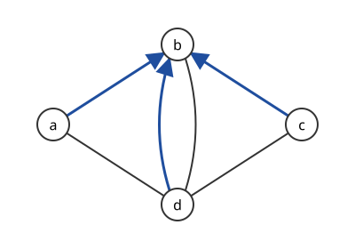

# 혼합 우편배달부 문제

# 개요

**혼합 우편배달부 문제(mixed postman problem)** 는 양방향 길과 일방통행 길이 섞인 그래프에서 모든 길을 한 번 이상 지나 출발점으로 돌아오는 가장 짧은 걸음을 찾는 문제다. 일방통행 길 세 개가 한 교차로로 들어오고 그 교차로에서 나가는 길이 양방향 길 하나뿐이면, 배달부는 그 양방향 길을 세 번 지나야 한다. 길마다 지나는 방향을 정하는 일과 몇 번 더 지날지 정하는 일이 함께 얽혀 있고, 모든 교차로에 붙은 길 수가 짝수이면 두 일이 [최소 비용 흐름](min-cost-flow.md) 하나로 풀린다.

# 직관

아래 그림은 교차로 $a,b,c,d$ 와 길 여섯 개로 된 동네다. 파란 화살표 $a\to b$, $c\to b$, $d\to b$ 는 일방통행 길이고, 검은 선 $ad$, $cd$, $bd$ 는 양방향 길이다. 길의 길이는 모두 $1$ 이다.

네 교차로에 붙은 길 수는 $a,c$ 가 $2$, $b,d$ 가 $4$ 로 모두 짝수다. [중국인 우편배달부 문제](chinese-postman-problem.md)라면 길 여섯 개를 한 번씩 걸어 길이 $6$ 으로 끝난다.

그런데 $b$ 로는 일방통행 길 세 개가 들어오고, $b$ 에서 나가는 길은 양방향 길 $bd$ 하나뿐이다. 배달부는 $b$ 에 세 번 들어오므로 세 번 나가야 하고, 그때마다 $bd$ 를 $b$ 에서 $d$ 방향으로 지난다. 그래서 $bd$ 를 두 번 더 걷고 길이는 $6+2=8$ 이다. 실제로 다음 걸음이 길이 $8$ 이다.

$$
b\to d\to a\to b\to d\to c\to b\to d\to b
$$

# 정의

## 혼합 그래프

**혼합 그래프(mixed graph)** $G=(V,E,A)$ 는 정점 집합 $V$, 방향이 없는 변의 집합 $E$, 방향이 있는 호의 집합 $A$ 로 된 그래프다. 정점의 차수는 그 정점에 붙은 변과 호의 수를 더한 값이다.

$S\subseteq V$ 에 대해 꼬리가 $S$ 에 있고 머리가 $S$ 밖에 있는 호의 집합을 $A^+(S)$, 반대인 호의 집합을 $A^-(S)$, 한 끝만 $S$ 에 있는 변의 집합을 $E(S)$ 로 쓴다. 직관 절에서 $S=\lbrace b\rbrace$ 이면 $A^+(S)=\varnothing$ 이고 $A^-(S)$ 는 호 세 개, $E(S)=\lbrace bd\rbrace$ 다.

## 혼합 우편배달부 문제

$G$ 를 강하게 연결된 혼합 그래프, $w:E\cup A\to\lbrack 0,\infty)$ 를 길이라 하자. 걸음은 변을 어느 방향으로든 지날 수 있고 호는 그 방향으로만 지난다. **혼합 우편배달부 문제** 는 모든 변과 호를 적어도 한 번 지나는 닫힌 걸음 가운데 길이가 최소인 것을 찾는 문제다.

$A=\varnothing$ 이면 중국인 우편배달부 문제이고, $E=\varnothing$ 이면 그 문서의 유향 판본이다. 직관 절의 최솟값은 $8$ 이다.

# 성질

## Euler 회로의 조건

연결된 혼합 그래프에 모든 변과 호를 정확히 한 번씩 지나는 닫힌 걸음이 있는 것은 다음 두 조건과 동치다. L. R. Ford 와 D. R. Fulkerson 이 증명했다[^1].

1. 모든 정점의 차수가 짝수다.
2. 모든 $S\subseteq V$ 에 대해 다음이 성립한다.

$$
\bigl\lvert\thinspace\lvert A^+(S)\rvert-\lvert A^-(S)\rvert\thinspace\bigr\rvert\le\lvert E(S)\rvert
$$

증명의 요지. 그런 걸음이 있으면 $S$ 를 나가는 횟수와 들어오는 횟수가 같으므로, 호가 만드는 차이를 $E(S)$ 의 변이 메워야 한다. 거꾸로 두 조건이 있으면 변의 방향을 정해 모든 정점에서 들어오는 수와 나가는 수를 맞추는 일이 하한과 상한이 있는 순환의 존재 문제가 되고, [Hoffman 순환 정리](hoffman-circulation-theorem.md)의 절단 조건이 조건 2 다. 방향을 다 정하면 유향 그래프의 [Euler 회로](eulerian-circuits.md)가 있다.

직관 절의 동네는 조건 1 을 만족하지만 $S=\lbrace b\rbrace$ 에서 왼쪽이 $3$, 오른쪽이 $1$ 이라 조건 2 를 만족하지 않는다.

## 짝수 차수인 경우

모든 정점의 차수가 짝수이면 혼합 우편배달부 문제는 다항 시간에 풀린다. J. Edmonds 와 E. L. Johnson 이 최소 비용 흐름으로 풀었다[^2]. 차수의 홀짝을 맞출 일이 없으므로 남는 일은 조건 2 가 깨진 자리를 메우는 것이고, 들어오는 수가 많은 정점에서 나가는 수가 많은 정점으로 걸음을 더 보내는 가장 싼 흐름이 더 지날 길을 정한다.

직관 절에서 $a$, $b$, $c$ 의 균형 때문에 변 $ad$, $cd$, $bd$ 의 방향이 $d\to a$, $d\to c$, $b\to d$ 로 정해지고, 그러면 $b$ 는 들어오는 수가 $2$ 많고 $d$ 는 나가는 수가 $2$ 많다. $b$ 에서 $d$ 로 두 단위를 보내는 가장 싼 흐름이 $bd$ 를 두 번 지나는 것이고 최솟값 $8$ 이 나온다.

## NP-완전성

차수에 제한이 없으면 혼합 우편배달부 문제의 판정 판본은 NP-완전(NP-complete, NP 는 nondeterministic polynomial time)이다. C. H. Papadimitriou 가 증명했다[^3]. 홀수 차수 정점을 짝짓는 일과 들고 남의 균형을 맞추는 일이 함께 얽혀, 어느 한쪽을 먼저 정하면 다른 쪽의 비용이 달라진다.

## 근사 알고리즘

G. N. Frederickson 의 [근사 알고리즘](approximation-algorithms.md)은 홀짝을 먼저 맞추는 방법과 균형을 먼저 맞추는 방법을 둘 다 돌려 짧은 쪽을 고르고, 그 길이는 최솟값의 $5/3$ 배 이하다[^4]. B. Raghavachari 와 J. Veerasamy 는 이 비율을 $3/2$ 로 낮췄다[^5].

# 활용

- 일방통행 길이 있는 도시의 경로 계획. 제설, 거리 청소, 쓰레기 수거, 우편 배달에서 양방향 길과 일방통행 길이 섞인 도로망의 경로가 이 문제로 세워진다. 정해진 길만 지나면 되는 경우는 [시골 우편배달부 문제](rural-postman-problem.md)와 합친 문제가 된다.
- [수송 문제](transportation-problem.md)와의 관계. $E=\varnothing$ 인 유향 판본에서는 더 지날 호를 정하는 일이 수송 문제이고, 짝수 차수인 혼합 판본에서는 같은 일을 변의 방향까지 함께 정하는 최소 비용 흐름으로 한다.

[^1]: L. R. Ford, D. R. Fulkerson, *Flows in Networks*, Princeton University Press (1962).
[^2]: J. Edmonds, E. L. Johnson, "Matching, Euler tours and the Chinese postman", Mathematical Programming 5 (1973), 88–124.
[^3]: C. H. Papadimitriou, "On the complexity of edge traversing", Journal of the ACM 23 (1976), 544–554.
[^4]: G. N. Frederickson, "Approximation algorithms for some postman problems", Journal of the ACM 26 (1979), 538–554.
[^5]: B. Raghavachari, J. Veerasamy, "A 3/2-approximation algorithm for the mixed postman problem", SIAM Journal on Discrete Mathematics 12 (1999), 425–433.

# 연관 문서

## 선수지식

- [중국인 우편배달부 문제](chinese-postman-problem.md)

## 더 알아보기

- [바람 부는 우편배달부 문제](windy-postman-problem.md)

#graph_theory #algorithms #optimization #complexity
