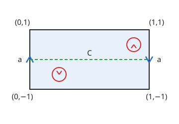

# Möbius 띠

# 개요

**Möbius 띠(Möbius strip)** 는 종이 띠를 반 바퀴 꼬아 두 끝을 붙인 곡면이다. 이 띠의 가운데 선을 따라 연필로 줄을 그으면 한 바퀴 뒤에 출발점의 뒷면에 도착하고, 두 바퀴를 돌아야 출발점으로 돌아온다. 이런 띠 위에서는 시계 방향을 한 가지로 정할 수 없으므로, 곡면에 방향을 줄 수 있는지는 그 곡면이 Möbius 띠를 포함하는지로 판정한다.

# 직관

가로 $30$ cm, 세로 $3$ cm 인 종이 띠의 두 끝을 꼬지 않고 붙이면 원기둥의 옆면이 된다. 가장자리는 위의 원과 아래의 원 두 개이고, 바깥 면에 그은 줄은 바깥 면에만 있다.

같은 띠를 반 바퀴 꼬아 붙이면 오른쪽 끝의 위 모서리가 왼쪽 끝의 아래 모서리에 붙는다. 위 가장자리를 따라 손가락을 밀면 한 바퀴 뒤에 아래 가장자리에 와 있고, 다시 한 바퀴를 돌면 출발점에 온다. 가장자리는 길이 $60$ cm 인 닫힌 곡선 하나다.

띠 위에 시계 방향으로 도는 작은 원을 그리고, 그 원을 띠를 따라 한 바퀴 밀고 간다. 꼬인 곳을 지나면 원의 위쪽이 아래쪽으로 옮겨지므로, 출발점에 돌아온 원은 반시계 방향으로 돈다. 띠의 어느 곳에서 시계 방향을 정해도 한 바퀴 돌고 나면 반대가 된다.

그림은 꼬기 전의 띠다. 같은 글자 $a$ 의 화살표끼리 방향을 맞춰 붙이므로 왼쪽 변의 아래 끝이 오른쪽 변의 위 끝에 붙는다. 왼쪽 아래의 시계 방향 원을 오른쪽 변까지 밀면 오른쪽 위의 반시계 방향 원에 붙는다. [원환면](torus.md)은 정사각형의 마주 보는 두 쌍의 변을 같은 방향으로 붙인 곡면이고, Möbius 띠는 한 쌍의 변만 반대 방향으로 붙인 곡면이다.

# 정의

## 직사각형의 몫으로서의 Möbius 띠

직사각형 $\lbrack 0,1\rbrack\times\lbrack -1,1\rbrack$ 의 왼쪽 변의 점 $(0,t)$ 와 오른쪽 변의 점 $(1,-t)$ 를 같다고 본 몫공간을 **Möbius 띠** $M$ 이라 한다.

$$
M=\lbrack 0,1\rbrack\times\lbrack -1,1\rbrack\thinspace/\thinspace(0,t)\sim(1,-t)
$$

직관 절의 그림에서 왼쪽 변의 아래 끝 $(0,-1)$ 이 오른쪽 변의 위 끝 $(1,1)$ 에 붙는 것이 이 동일시다. $(0,t)\sim(1,t)$ 로 붙이면 원기둥 $S^1\times\lbrack -1,1\rbrack$ 이 된다.

가운데 선 $t=0$ 은 $(0,0)\sim(1,0)$ 으로 닫혀 원이 되고, 이것을 **중심원(core circle)** $C$ 라 한다. 점 $(x,\pm 1)$ 전체를 Möbius 띠의 **경계(boundary)** $\partial M$ 이라 한다.

## 공간 속의 Möbius 띠

다음 사상은 $M$ 을 $\mathbb R^3$ 안의 꼬인 띠로 보내는 위상동형이다.

$$
\begin{aligned}
(x,t)\mapsto\bigl(&(2+t\cos\pi x)\cos 2\pi x,\cr
&(2+t\cos\pi x)\sin 2\pi x,\cr
&t\sin\pi x\bigr)
\end{aligned}
$$

$x$ 가 $0$ 에서 $1$ 로 가는 동안 띠는 반지름 $2$ 인 원을 따라 한 바퀴 돌고, 폭 방향은 각 $\pi x$ 만큼, 곧 반 바퀴 돈다. $x=0$ 에서 $(2+t,0,0)$ 이고 $x=1$ 에서 $(2-t,0,0)$ 이므로 $(0,t)$ 와 $(1,-t)$ 가 같은 점으로 가고, 사상이 $M$ 에서 정의된다.

## 원 위의 선다발

사영 $(x,t)\mapsto x$ 는 동일시 $(0,t)\sim(1,-t)$ 를 원 $S^1=\lbrack 0,1\rbrack/(0\sim 1)$ 의 한 점으로 보내므로 사상 $M\to S^1$ 을 준다. 각 점 위의 올은 선분 $\lbrack -1,1\rbrack$ 이다. 폭을 $\mathbb R$ 전체로 늘린 $\lbrack 0,1\rbrack\times\mathbb R/(0,t)\sim(1,-t)$ 는 원 위의 계수 $1$ [벡터다발](vector-bundles.md)이고, 이것을 Möbius 선다발(Möbius line bundle)이라 한다. 원을 두 호로 덮으면 이 다발의 전이함수는 한 겹침에서 $1$, 다른 겹침에서 $-1$ 이다.

# 성질

## 기본군

Möbius 띠의 [기본군](fundamental-group.md)은 $\mathbb Z$ 이고, 중심원 $C$ 를 한 번 도는 고리가 생성원이다.

증명의 요지. $H_s(x,t)=(x,(1-s)t)$ 는 $(0,t)$ 와 $(1,-t)$ 를 $(0,(1-s)t)$ 와 $(1,-(1-s)t)$ 로 보내므로 동일시를 지키고, $M$ 위에서 $s=0$ 의 항등사상과 $s=1$ 의 $C$ 로의 사영을 잇는다. 이 변형 동안 $C$ 의 점은 움직이지 않으므로 $M$ 은 원 $C$ 와 [호모토피 동치](homotopy-equivalence.md)이고, 기본군은 원의 기본군 $\mathbb Z$ 다.

## 경계 원

$\partial M$ 은 원 하나이고, 그 고리는 기본군에서 생성원의 $2$ 배다.

증명의 요지. $t=1$ 인 선분을 $x=0$ 부터 $1$ 까지 가면 $(1,1)\sim(0,-1)$ 에 닿고, 이어서 $t=-1$ 인 선분을 가면 $(1,-1)\sim(0,1)$, 곧 출발점에 닿는다. 그래서 두 선분이 이어져 원 하나가 된다. 앞 절의 사영 $H_1$ 은 이 고리를 $x$ 가 $0$ 에서 $1$ 로 두 번 가는 고리, 곧 $C$ 를 두 번 도는 고리로 보낸다.

원기둥은 기본군이 같은 $\mathbb Z$ 이지만 경계가 원 두 개이고 각 경계가 생성원을 한 번 감는다. 위상동형은 경계를 경계로 보내므로 Möbius 띠와 원기둥은 위상동형이 아니다.

## 방향을 줄 수 없음

곡면의 **방향(orientation)** 은 각 점에서 시계 방향 하나를 연속적으로 고르는 것이다. 매끄러운 곡면이면 각 점의 접평면에 순서 있는 기저를 연속적으로 고르되, 두 좌표계가 만나는 곳에서 좌표 변환의 Jacobi 행렬식이 양수가 되게 고르는 것이다. Möbius 띠에는 방향이 없다.

증명의 요지. 오른쪽 변과 왼쪽 변을 붙이는 변환 $(x,t)\mapsto(x-1,-t)$ 의 Jacobi 행렬은 대각 성분이 $1$ 과 $-1$ 이고 행렬식이 $-1$ 이다. 기저 $(\partial_x,\partial_t)$ 를 $C$ 를 따라 $x=0$ 에서 $x=1$ 까지 연속적으로 옮기면, 붙인 자리에서 $(\partial_x,-\partial_t)$ 와 만나 시계 방향이 반대가 된다. 원기둥의 변환 $(x,t)\mapsto(x-1,t)$ 는 행렬식이 $1$ 이므로 방향이 있다.

$2$ 차원 다양체에 방향이 있는 것과 어디서도 $0$ 이 되지 않는 $2$ 형식이 있는 것은 동치다([미분형식](differential-forms.md)). 그래서 Möbius 띠에는 어디서도 $0$ 이 되지 않는 $2$ 형식이 없다.

## Euler 지표

직사각형의 꼭짓점 넷은 $(0,1)\sim(1,-1)$ 과 $(0,-1)\sim(1,1)$ 의 두 점으로 붙는다. 변은 붙인 왼쪽·오른쪽 변 하나와 위 변, 아래 변으로 셋이고, 면은 하나다. [Euler 지표](euler-characteristic.md)는 다음과 같다.

$$
\chi(M)=2-3+1=0
$$

원과 호모토피 동치이므로 원의 Euler 지표 $1-1=0$ 과 같다.

## 원판을 붙이면 실사영평면

Möbius 띠의 경계는 원 하나이므로 그 원을 따라 원판을 붙일 수 있다. 그 결과는 [실사영공간](real-projective-space.md) $\mathbb{RP}^2$, 곧 $\mathbb R^3$ 의 원점을 지나는 직선 전체다.

증명의 요지. 수평면과 이루는 각 $\varphi$ 가 $\vert\varphi\vert\le\pi/4$ 인 직선은 수평 방향의 각 $\pi x$ 와 기울기 $t=\tan\varphi$ 로 정해지고, $x\in\lbrack 0,1\rbrack$, $t\in\lbrack -1,1\rbrack$ 이다. 방향 각을 $\pi$ 만큼 돌린 직선은 같은 직선이지만 기울기의 부호가 바뀌므로, $(0,t)$ 와 $(1,-t)$ 가 같은 직선이다. 그래서 이 직선들의 집합은 $M$ 이다. 남은 직선, 곧 수직선에 가까운 직선들은 위 반구의 작은 원판 하나로 정해지고, 두 집합은 각이 $\pi/4$ 인 직선들의 원에서 만난다.

같은 방법으로 Möbius 띠 두 개를 경계끼리 붙이면 Klein 병이 된다. Klein 병의 정의와 분류는 [곡면의 분류](classification-of-surfaces.md)에 있다.

# 활용

- [곡면의 분류](classification-of-surfaces.md). 닫힌 곡면이 Möbius 띠를 부분공간으로 포함하지 않는 것을 가향의 정의로 쓰고, 비가향 닫힌 곡면은 사영평면 $k$ 개의 연결합으로 분류된다.
- [Stiefel–Whitney 류](stiefel-whitney-classes.md). 원 위의 실 선다발은 자명한 띠와 Möbius 선다발 둘뿐이고, 둘은 첫째 Stiefel–Whitney 류 $w_1$ 로 구별된다.
- [위상 K 이론](topological-k-theory.md). Möbius 선다발에서 자명한 선다발을 뺀 원소가 $\widetilde{KO}(S^1)=\mathbb Z/2$ 의 생성원이다.
- [Thom 공간](thom-space.md). Möbius 선다발의 Thom 공간은 $M$ 의 경계를 한 점으로 모은 공간이다. 이 공간은 경계에 원판을 붙인 뒤 그 원판을 한 점으로 모은 공간과 같으므로 $\mathbb{RP}^2$ 다.
- 컨베이어 벨트. 벨트를 반 바퀴 꼬아 걸면 벨트의 면이 하나라서 양쪽이 고르게 닳는다.

# 연관 문서

## 선수지식

- [원환면](torus.md)
- [기본군](fundamental-group.md)

## 더 알아보기

- [곡면의 분류](classification-of-surfaces.md)

#topology #algebraic_topology #differential_geometry
