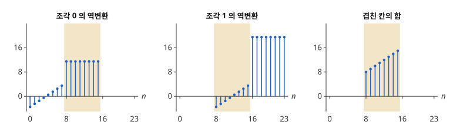

# 수정 이산 코사인 변환

# 개요

**수정 이산 코사인 변환(modified discrete cosine transform, MDCT)** 은 반씩 겹친 길이 $2N$ 의 조각마다 코사인 계수 $N$ 개를 계산하는 변환이다. 소리를 조각으로 잘라 조각마다 주파수 성분으로 바꾸어 저장할 때, 조각을 겹치지 않게 자르면 조각 경계에서 소리가 튀고, 반씩 겹쳐 자르면 [단시간 Fourier 변환](short-time-fourier-transform.md)처럼 저장할 수가 원래 표본 수의 두 배가 된다. MDCT 는 조각마다 표본 수의 절반만 남기고, 이웃 조각의 역변환을 더할 때 각 조각의 역변환에 생긴 오차가 서로 지워지게 한다.

# 직관

$N=2$ 로 놓고 수열 $\dots,a,b,c,d,e,f,\dots$ 를 길이 4 의 조각 $(a,b,c,d)$, $(c,d,e,f)$, $\dots$ 로 자른다. 이웃한 두 조각은 두 칸씩 겹친다. 조각마다 수를 2 개만 남기면 전체 개수는 표본 수와 같다.

조각 $(a,b,c,d)$ 에서 수 2 개를 남기고 되살리면 원래 네 값은 돌아오지 않는다. MDCT 는 앞 절반에서 차이 $a-b$, 뒤 절반에서 합 $c+d$ 만 남기는 변환이고, 역변환은 $\bigl(\frac{a-b}2,\frac{b-a}2,\frac{c+d}2,\frac{d+c}2\bigr)$ 를 내놓는다. 다음 조각 $(c,d,e,f)$ 의 역변환은 앞 절반이 $\bigl(\frac{c-d}2,\frac{d-c}2\bigr)$ 다.

겹친 두 칸에서 두 역변환을 더하면 $\frac{c+d}2+\frac{c-d}2=c$, $\frac{d+c}2+\frac{d-c}2=d$ 다. 한 조각의 역변환에서 $c$ 자리에 섞여 들어간 $d$ 가 다음 조각의 역변환에서 부호가 반대로 섞여 들어가 지워진다.

아래 그림은 $N=8$ 이고 $x\lbrack n\rbrack=n$ 일 때다. 조각 0 은 $n=0,\dots,15$, 조각 1 은 $n=8,\dots,23$ 이고 색칠한 칸이 겹친 부분이다. 조각 0 의 역변환은 겹친 칸에서 $11.5$ 로 평평하고, 조각 1 의 역변환은 같은 칸에서 $-3.5$ 부터 $3.5$ 까지 오른다. 둘을 더하면 $8,9,\dots,15$ 가 된다.

# 정의

## 변환과 역변환

길이 $2N$ 의 조각 $x\lbrack 0\rbrack,\dots,x\lbrack 2N-1\rbrack$ 의 **MDCT** 는 다음 $N$ 개의 수다[^1].

$$
X\lbrack k\rbrack=\sum_{n=0}^{2N-1}x\lbrack n\rbrack\cos\Bigl\lbrack\frac{\pi}{N}\Bigl(n+\frac12+\frac N2\Bigr)\Bigl(k+\frac12\Bigr)\Bigr\rbrack,\qquad k=0,\dots,N-1
$$

역변환은 같은 코사인으로 길이 $2N$ 의 수열을 만든다.

$$
y\lbrack n\rbrack=\frac1N\sum_{k=0}^{N-1}X\lbrack k\rbrack\cos\Bigl\lbrack\frac{\pi}{N}\Bigl(n+\frac12+\frac N2\Bigr)\Bigl(k+\frac12\Bigr)\Bigr\rbrack,\qquad n=0,\dots,2N-1
$$

입력 $2N$ 개에서 출력 $N$ 개가 나오므로 MDCT 는 단사가 아니다.

## 겹쳐 더하기

수열을 $N$ 칸씩 건너뛰며 길이 $2N$ 의 조각으로 자르고, 조각마다 MDCT 와 역변환을 한 뒤 각 결과를 원래 자리에 놓고 더한다. 이 절차를 MDCT 의 **겹쳐 더하기(overlap-add)** 라 한다. 직관 절은 $N=2$ 와 $N=8$ 의 경우다.

# 성질

## 시간 영역 되접힘

조각을 앞 절반 $A$ 와 뒤 절반 $B$ 로 나누고, $A^{\mathrm R}$ 을 $A$ 의 순서를 뒤집은 것이라 한다. 역변환의 결과는 다음과 같다[^1].

$$
y=\Bigl(\frac{A-A^{\mathrm R}}2,\thinspace\frac{B+B^{\mathrm R}}2\Bigr)
$$

증명의 요지. 코사인의 인수 $\frac{\pi}{N}(n+\frac12+\frac N2)(k+\frac12)$ 는 앞 절반에서 $n\mapsto N-1-n$ 으로 바꾸면 부호가 반대인 코사인 값을 주고, 뒤 절반에서 $n\mapsto 3N-1-n$ 으로 바꾸면 같은 코사인 값을 준다. 그래서 $X$ 는 $A-A^{\mathrm R}$ 과 $B+B^{\mathrm R}$ 에만 의존하고, 남은 코사인 $N$ 개가 직교하므로 역변환이 이 둘을 반으로 돌려준다. $A^{\mathrm R}$, $B^{\mathrm R}$ 항을 **시간 영역 되접힘(time-domain aliasing)** 이라 한다. 직관 절의 $x\lbrack n\rbrack=n$ 에서 $B+B^{\mathrm R}$ 은 상수라서 평평하게 나타났다.

## 되접힘 상쇄

겹쳐 더하기에서 조각 $m$ 의 뒤 절반과 조각 $m+1$ 의 앞 절반은 같은 표본 $B$ 다. 두 역변환을 더하면 $\frac{B+B^{\mathrm R}}2+\frac{B-B^{\mathrm R}}2=B$ 이므로 처음과 마지막 $N$ 칸을 뺀 모든 표본이 정확히 복원된다. 이것을 **시간 영역 되접힘 상쇄(time-domain aliasing cancellation, TDAC)** 라 한다[^1].

## 창과 Princen–Bradley 조건

조각에 길이 $2N$ 의 창 $w$ 를 MDCT 앞과 역변환 뒤에 한 번씩 곱한다. $w\lbrack 2N-1-n\rbrack=w\lbrack n\rbrack$ 이면 겹친 칸의 합은 $\frac12(w\lbrack n\rbrack^2+w\lbrack n+N\rbrack^2)$ 배의 $B$ 이고 되접힘 항은 여전히 지워진다. 그래서 $w\lbrack n\rbrack^2+w\lbrack n+N\rbrack^2$ 이 상수이면 상수배를 빼고 복원된다. 이 상수를 $1$ 로 맞춘 조건을 **Princen–Bradley 조건(Princen–Bradley condition)** 이라 하고, 이때 결과에 $2$ 를 곱한다. 사인 창 $w\lbrack n\rbrack=\sin\bigl(\frac{\pi}{2N}(n+\frac12)\bigr)$ 은 $w\lbrack n+N\rbrack=\cos\bigl(\frac{\pi}{2N}(n+\frac12)\bigr)$ 이므로 조건을 만족한다.

## 필터 뱅크로 본 MDCT

고정된 $k$ 에서 조각 번호 $m$ 에 따른 $X\_m\lbrack k\rbrack$ 은 길이 $2N$ 의 [FIR 필터](fir-filters.md)(finite impulse response)의 출력을 $N$ 칸에 하나씩 남긴 수열이다. 그래서 MDCT 는 채널 $N$ 개, 다운샘플링 $N$ 의 [다중률 신호처리](multirate-signal-processing.md) 필터 뱅크이고, 되접힘 상쇄는 그 필터 뱅크의 완전 재구성이다.

# 활용

- 오디오 부호화. MP3(MPEG-1 Audio Layer III), AAC(Advanced Audio Coding), Vorbis, Opus 의 주파수 변환에 MDCT 가 들어 있다. 계수 $X\lbrack k\rbrack$ 를 귀가 덜 느끼는 주파수에서 거칠게 양자화하고, 겹쳐 더하기가 조각 경계의 불연속을 막는다.
- 조각 길이의 전환. 갑자기 큰 소리가 시작되는 자리에서는 $N$ 을 줄인 조각으로 바꾼다. 긴 조각에서는 양자화 오차가 조각 전체로 퍼져, 소리가 시작되기 전에도 잡음이 들린다.

[^1]: J. P. Princen, A. W. Johnson, A. B. Bradley, "Subband/transform coding using filter bank designs based on time domain aliasing cancellation", *Proc. IEEE ICASSP* (1987), 2161–2164.

# 연관 문서

## 선수지식

- [단시간 Fourier 변환](short-time-fourier-transform.md)
- [다중률 신호처리](multirate-signal-processing.md)

## 더 알아보기

아직 연결한 문서가 없다.

#signal_processing #analysis #algorithms
