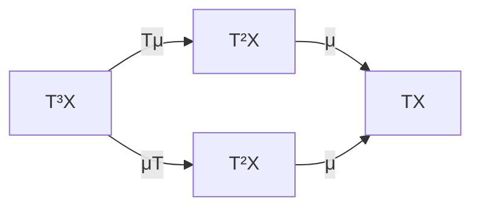

# Monad

# 개요

**Monad** 는 어떤 구성을 덧붙이는 규칙과, 두 번 덧붙인 것을 한 번으로 합치는 규칙을 함께 가진 구조다. 원소 $x$ 를 목록 $\lbrack x\rbrack$ 로 감쌀 수 있고, 목록의 목록 $\lbrack\lbrack 1,2\rbrack,\lbrack 3\rbrack\rbrack$ 을 펼쳐 $\lbrack 1,2,3\rbrack$ 으로 합칠 수 있다. Monad 는 감싸기와 펼치기가 지킬 결합법칙과 단위법칙을 정해, 목록, 확률분포, 예외 처리 같은 구성을 한 [범주](category.md) 위의 같은 틀로 다룬다.

# 직관

수 하나에 수의 목록을 주는 두 함수 $f(n)=\lbrack n,n+1\rbrack$ 과 $g(m)=\lbrack m,10m\rbrack$ 을 이으려 한다. $f(1)=\lbrack 1,2\rbrack$ 은 목록이고 $g$ 는 수를 받으므로 $g(f(1))$ 은 정의되지 않는다.

목록의 원소마다 $g$ 를 적용하면 $\lbrack g(1),g(2)\rbrack=\lbrack\lbrack 1,10\rbrack,\lbrack 2,20\rbrack\rbrack$ 이 나온다. 목록이 두 겹이 되어 $g$ 같은 함수를 다시 이을 수 없으니, 안쪽 목록을 이어 붙여 한 겹의 $\lbrack 1,10,2,20\rbrack$ 으로 만든다. 이 펼치기로 $f$ 와 $g$ 를 이은 함수 $1\mapsto\lbrack 1,10,2,20\rbrack$ 이 정해진다.

펼치기는 두 조건을 지켜야 한다. 목록이 세 겹이면 바깥 두 겹을 먼저 펼치든 안쪽 두 겹을 먼저 펼치든 결과가 같아야 한다. 수 $x$ 를 길이 1 인 목록 $\lbrack x\rbrack$ 으로 감쌌다가 펼치면 아무것도 바뀌지 않아야 한다. 감싸기와 펼치기가 이 두 조건을 지키는 구성을 monad 라 한다.

# 정의

## 세 쌍 (T, η, μ)

범주 $\mathcal C$ 위의 **monad** 는 [함자](functors.md) $T : \mathcal C \to \mathcal C$ 와 [자연변환](natural-transformations.md) $\eta : \mathrm{id}\_{\mathcal C} \Rightarrow T$ , $\mu : T \circ T \Rightarrow T$ 로 다음 두 등식을 모든 대상에서 만족하는 것이다.

$$
\mu\circ T\mu=\mu\circ\mu T,\qquad \mu\circ T\eta=\mathrm{id}\_T=\mu\circ\eta T
$$

$\eta$ 를 **unit**, $\mu$ 를 **곱셈(multiplication)** 이라 하고, 첫 등식을 **결합법칙(associativity law)**, 둘째 등식을 **단위법칙(unit law)** 이라 한다. $T\mu$ 는 성분이 $T(\mu_X)$ 인 자연변환이고 $\mu T$ 는 성분이 $\mu_{T(X)}$ 인 자연변환이다. 결합법칙은 같은 $T^3(X) \to T(X)$ 를 만드는 두 방법이 일치한다는 등식이다.

직관 절의 목록에서 $T(X)=\mathrm{List}(X)$ 는 $X$ 의 원소로 된 유한 목록 전체의 집합이고, $\eta_X$ 는 원소를 길이 1 인 목록으로 감싸며 $\mu_X$ 는 목록의 목록을 이어 붙인다.

$$
\eta_X(x)=\lbrack x\rbrack,\qquad \mu_X\big(\lbrack\lbrack 1,2\rbrack,\lbrack\thinspace\rbrack,\lbrack 3\rbrack\rbrack\big)=\lbrack 1,2,3\rbrack
$$

세 겹 목록 $\lbrack\lbrack\lbrack 1\rbrack,\lbrack 2\rbrack\rbrack,\lbrack\lbrack 3\rbrack\rbrack\rbrack$ 에서 $T\mu$ 로 안쪽을 먼저 펼치면 $\lbrack\lbrack 1,2\rbrack,\lbrack 3\rbrack\rbrack$, $\mu T$ 로 바깥을 먼저 펼치면 $\lbrack\lbrack 1\rbrack,\lbrack 2\rbrack,\lbrack 3\rbrack\rbrack$ 이고, 둘 다 $\mu$ 를 거쳐 $\lbrack 1,2,3\rbrack$ 이 된다. 이것이 결합법칙이다.

## 다른 예

목록 밖에도 감싸기와 펼치기를 가진 구성이 있다. 아래에서 $T(X)$ 는 $X$ 의 값을 표의 둘째 열이 말하는 정보와 함께 담은 것이다.

| T | 담는 정보 | μ 가 하는 일 |
|---|---|---|
| `List` | 결과 여러 개 | 결과 목록의 목록을 이어 붙인다 |
| $X\mapsto X\sqcup\lbrace\ast\rbrace$ (`Maybe`) | 실패할 수 있음 | 두 겹 가운데 한 겹이라도 실패이면 실패를 준다 |
| $X \mapsto (X \times S)^S$ | 상태를 읽고 쓰기 | 상태 변화를 순서대로 잇는다 |
| $X \mapsto$ 확률분포 | 무작위성 | 분포의 혼합을 하나의 분포로 |
| $X \mapsto$ 자유군 | 형식적 낱말 | 낱말의 낱말을 펼쳐 쓴다 |

## T 대수

Monad $T$ 에 대한 **T 대수(T-algebra)** 는 대상 $A$ 와 사상 $a : T(A) \to A$ 로 다음을 만족하는 것이다.

$$
a\circ\eta_A=\mathrm{id}\_A,\qquad a\circ\mu_A=a\circ T(a)
$$

$a$ 는 쌓아 둔 것을 값 하나로 계산하는 사상이고, 두 조건은 그 계산이 $\eta$ 와 $\mu$ 와 맞는다는 뜻이다. $T$ 대수와 그 사이의 사상들이 이루는 범주를 **Eilenberg–Moore 범주(Eilenberg–Moore category)** $\mathcal C^T$ 라 한다.

`List` 에서 자연수의 합 $a(\lbrack 2,3,5\rbrack)=10$ 은 $T$ 대수다. $\lbrack\lbrack 2,3\rbrack,\lbrack 5\rbrack\rbrack$ 을 $\mu$ 로 펼쳐 더해도, $T(a)$ 로 안쪽을 먼저 더한 $\lbrack 5,5\rbrack$ 을 더해도 $10$ 이 나온다.

# 성질

## 자기 함자 범주의 monoid

결합법칙과 단위법칙은 monoid 의 곱과 항등원이 만족하는 법칙과 같은 꼴이다. $\mathcal C$ 에서 $\mathcal C$ 로 가는 함자들의 범주에서 합성을 곱으로 보면 monad 는 그 안의 monoid 다.

## Kleisli 형태

$\mu$ 대신 확장 연산 $(-)^\ast$ 를 쓰는 동치인 정의가 있다. 대상마다 $\eta_X : X \to T(X)$ 를 주고 각 사상 $f : X \to T(Y)$ 에 $f^\ast : T(X) \to T(Y)$ 를 대응시키되 다음을 요구한다.

$$
f^\ast\circ\eta_X=f,\qquad \eta_X^\ast=\mathrm{id}\_{T(X)},\qquad (g^\ast\circ f)^\ast=g^\ast\circ f^\ast
$$

$T(f) = (\eta \circ f)^\ast$ 와 $\mu = (\mathrm{id}\_{T(X)})^\ast$ 를 정의하면 앞의 정의가 복원되고, 반대로 $f^\ast = \mu \circ T(f)$ 로 두면 이쪽이 복원된다. 직관 절에서 $f$ 와 $g$ 를 이은 함수가 $g^\ast\circ f$ 이고, $g^\ast(\lbrack 1,2\rbrack)=\lbrack 1,10,2,20\rbrack$ 이다. 프로그래밍 언어의 `return` 과 `bind` 가 $\eta$ 와 $(-)^\ast$ 다.

## 수반에서 나오는 monad

[수반](adjunctions.md) $F \dashv G$ 에 unit $\eta$ 와 counit $\varepsilon$ 이 있으면 $T = GF$ 와 $\mu = G\varepsilon F$ 가 monad 법칙을 만족한다. 삼각항등식으로부터 단위법칙이 유도되고 $\varepsilon$ 의 자연성으로부터 결합법칙이 유도된다. [자유군](groups.md) 수반의 monad 는 집합에 형식적 낱말을 붙이는 연산, [가군](modules.md)의 자유 수반의 monad 는 형식적 선형결합을 취하는 연산이다.

## monad 의 수반 분해

역방향은 유일하지 않다. $T=GF$ 가 되는 수반 $F\dashv G$ 가 여럿 있고, 그 전체가 하나의 범주를 이루며 양 끝이 있다. 시작대상(initial object)이 사상을 $X\to T(Y)$ 로 바꾼 Kleisli 범주(Kleisli category) $\mathcal C_T$ 이고 종단대상(terminal object)이 Eilenberg–Moore 범주 $\mathcal C^T$ 다. 두 구성과 그 사이의 비교 함자는 [Kleisli 범주와 Eilenberg–Moore 범주](kleisli-eilenberg-moore.md) 문서에 있다.

## 대수 이론으로서의 monad

`List` 의 $T$ 대수는 결합적 곱과 항등원을 가진 집합, 곧 monoid 다. 집합의 범주 위의 monad 가운데 유한 항수의 연산과 등식으로 주어지는 것들은 대수 구조와 일대일로 대응한다. monoid, 군, 환, 가군, 볼록결합이 모두 어떤 monad 의 대수 범주다. 체는 역원을 부분적으로만 취할 수 있어 등식만으로 서술되지 않으므로 이렇게 나오지 않는다.

## 쌍대 개념

화살표를 뒤집으면 comonad $(W, \varepsilon : W \Rightarrow \mathrm{id}, \delta : W \Rightarrow W^2)$ 가 된다. monad 가 값을 정보와 함께 담는 쪽이라면 comonad 는 담긴 것에서 값을 꺼내고 담긴 정보를 복제하는 쪽이며, 스트림과 이웃을 보는 계산이 그 예다.

# 활용

- 계산 효과. 순수 함수만 있는 언어에서 예외, 상태, 입출력, 비결정성을 다루는 표준 방법이다. 효과가 다른 두 계산을 잇는 일이 Kleisli 합성이 되고 결합법칙이 프로그램 변형의 안전성을 보장한다. `do` 표기법은 Kleisli 합성을 순차 실행처럼 쓴 문법이다.
- 확률과 측도. 집합에 그 위의 [확률분포](random-variables.md) 전체를 대응시키면 monad 가 된다. $\eta$ 는 한 점에 질량을 몰아 주는 분포, $\mu$ 는 분포에서 분포를 뽑아 섞는 연산이다. [Markov 연쇄](markov-chains.md)의 한 걸음이 $X \to T(X)$ 꼴 Kleisli 사상이고 여러 걸음을 잇는 일이 Chapman–Kolmogorov 방정식(Chapman–Kolmogorov equation)이다.
- 자유 구성. 자유군, 자유가군, [다항식환](polynomial-rings.md)처럼 생성원만 주고 관계식은 최소한만 넣는 구성이 전부 어떤 monad 의 자유대수다.

# 연관 문서

## 선수지식

- [수반](adjunctions.md)

## 더 알아보기

- [Kleisli 범주와 Eilenberg–Moore 범주](kleisli-eilenberg-moore.md)

#category_theory #computation #probability #construction
