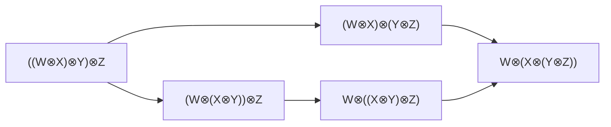

# 모노이드 범주

# 개요

**모노이드 범주(monoidal category)** 는 두 대상을 곱해 새 대상을 만드는 연산이 있고, 그 곱의 결합법칙이 등식 대신 정해진 동형으로 성립하는 범주다. 벡터 공간 셋의 [텐서곱](tensor-products.md) $(U\otimes V)\otimes W$ 와 $U\otimes(V\otimes W)$ 는 같은 집합이 아니지만, $(u\otimes v)\otimes w\mapsto u\otimes(v\otimes w)$ 로 짝지어진다. 공간이 넷이면 괄호를 옮기는 길이 여러 가지이고, 길마다 같은 동형이 나와야 괄호를 무시하고 계산할 수 있다. 모노이드 범주는 이 조건을 오각형 등식 하나로 요구해, 괄호를 옮기는 모든 길이 같은 동형을 주게 한다.

# 직관

벡터공간 셋의 텐서곱에서 $(U\otimes V)\otimes W$ 와 $U\otimes(V\otimes W)$ 는 같은 집합이 아니다. 앞의 것은 $(u\otimes v)\otimes w$ 꼴 원소가 생성하고 뒤의 것은 $u\otimes(v\otimes w)$ 꼴 원소가 생성한다. 그런데 계산에서는 괄호를 적지 않고 $U\otimes V\otimes W$ 라 쓴다.

괄호를 지울 수 있는 근거는 두 공간 사이의 동형이다. $(u\otimes v)\otimes w\mapsto u\otimes(v\otimes w)$ 가 선형동형 $a\_{U,V,W}$ 를 주고, 이것은 $U,V,W$ 에 대해 [자연변환](natural-transformations.md)의 조건을 만족한다. 괄호가 다른 두 공간은 다르지만 표준적인 동형으로 이어진다.

대상이 넷이면 사정이 달라진다. 넷을 묶는 방법은 $((U\otimes V)\otimes W)\otimes X$ 부터 $U\otimes(V\otimes(W\otimes X))$ 까지 다섯 가지이고, 첫 것에서 마지막 것으로 가는 길이 두 개 있다. 하나는 결합자를 세 번, 다른 하나는 두 번 쓴다. 두 길이 같은 동형을 준다는 보장이 정의에 없다.

그래서 두 길이 같다는 것을 공리로 요구한다. 이 공리를 오각형 등식이라 한다.

# 정의

**모노이드 범주** 는 다음을 갖춘 범주 $\mathcal C$ 다.

- 함자 $\otimes:\mathcal C\times\mathcal C\to\mathcal C$.
- **단위 대상(unit object)** $I$.
- **결합자(associator)** 라 부르는 자연동형 $a\_{X,Y,Z}:(X\otimes Y)\otimes Z\to X\otimes(Y\otimes Z)$.
- **단위자(unitor)** 라 부르는 자연동형 $l_X:I\otimes X\to X$ 와 $r_X:X\otimes I\to X$.

이들이 두 등식을 만족한다. 하나는 네 대상의 결합자가 이루는 오각형 등식이고, 다른 하나는 단위자와 결합자가 이루는 삼각형 등식 $(\mathrm{id}\_X\otimes l_Y)\circ a\_{X,I,Y}=r_X\otimes\mathrm{id}\_Y$ 다.

위 다이어그램의 두 경로가 같은 사상을 준다는 것이 **오각형 등식(pentagon identity)** 이고, 단위자의 등식을 **삼각형 등식(triangle identity)** 이라 한다.

직관 절의 벡터 공간과 텐서곱에서 단위 대상은 $\mathbb R$ 이고, 결합자는 $(u\otimes v)\otimes w\mapsto u\otimes(v\otimes w)$, 단위자 $l_V$ 는 $t\otimes v\mapsto tv$ 다.

## 엄격 모노이드 범주

$a$, $l$, $r$ 이 모두 항등사상이면 **엄격(strict)** 하다고 한다. 집합의 모노이드는 한 대상만 가진 엄격 모노이드 범주이고, 작은 범주들과 함자 합성도 엄격하다.

## 꼬임과 대칭

자연동형 $c\_{X,Y}:X\otimes Y\to Y\otimes X$ 가 두 개의 육각형 등식(hexagon identities)을 만족하면 **꼬임 모노이드 범주(braided monoidal category)** 라 한다. $c\_{Y,X}\circ c\_{X,Y}=\mathrm{id}$ 까지 성립하면 **대칭 모노이드 범주(symmetric monoidal category)** 다. 벡터 공간에서 $u\otimes v\mapsto v\otimes u$ 는 두 번 하면 항등이므로 대칭 모노이드 범주를 준다.

## 쌍대 대상

대상 $X$ 에 대해 $X^{\ast}$ 와 사상 $\varepsilon:X^{\ast}\otimes X\to I$, $\eta:I\to X\otimes X^{\ast}$ 가 있어 둘을 합성한 것이 항등이 되면 $X^{\ast}$ 를 $X$ 의 **쌍대 대상(dual object)** 이라 한다. 모든 대상이 쌍대를 가지면 **강직(rigid)** 하다고 한다. 유한차원 벡터 공간 $V$ 에서 쌍대 대상은 쌍대공간 $V^\ast$ 이고, $\varepsilon(\varphi\otimes v)=\varphi(v)$ 이며 $\eta(1)$ 은 기저 $e_i$ 와 쌍대기저 $e^i$ 로 $\sum_i e_i\otimes e^i$ 다.

# 성질

## 연접 정리

**정리 (Mac Lane 연접 정리, coherence theorem).** 대상들과 $\otimes$, $I$ 로 만든 두 표현식 사이에서 결합자와 단위자를 합성해 얻는 사상은 유일하다. 곧 그런 사상이 둘 있으면 둘은 같다.[^1]

증명의 요지는 엄격화다. $\mathcal C$ 를 괄호를 지운 표현식들의 범주로 옮기는 모노이드 함자를 만들면 그것이 모노이드 동치이고, 옮긴 쪽이 엄격하므로 모든 결합자가 항등이 된다. 따라서 모든 모노이드 범주는 엄격 모노이드 범주와 모노이드 동치다.

## 단위 대상의 자기사상

$f,g:I\to I$ 에 대해 $f\otimes g$ 를 단위자로 두 번 옮기면 $f\circ g$ 와 $g\circ f$ 가 모두 나오므로, $\mathrm{End}(I)$ 는 가환 모노이드다.

벡터공간의 범주에서 $\mathrm{End}(I)$ 는 바탕체이고, 이 때문에 선형범주의 사상 집합이 그 체 위의 벡터공간이 된다.

## 모노이드 대상

$\mathcal C$ 의 대상 $M$ 과 사상 $m:M\otimes M\to M$, $e:I\to M$ 이 결합법칙과 단위법칙의 가환도를 만족하면 $M$ 을 $\mathcal C$ 의 **모노이드 대상(monoid object)** 이라 한다.

바탕 범주를 바꾸면 익숙한 대수 구조가 나온다. 집합과 직적에서는 모노이드, 벡터공간과 텐서곱에서는 결합대수, 아벨군과 텐서곱에서는 환이다. 한 범주의 자기함자들이 합성으로 이루는 엄격 모노이드 범주에서의 모노이드 대상이 [모나드](monads.md)다.

## 꼬임과 Yang–Baxter 방정식

꼬임 모노이드 범주에서 육각형 등식은 $c$ 가 세 대상의 곱 위에서 Yang–Baxter 방정식

$$(c\otimes\mathrm{id})(\mathrm{id}\otimes c)(c\otimes\mathrm{id})=(\mathrm{id}\otimes c)(c\otimes\mathrm{id})(\mathrm{id}\otimes c)$$

를 만족한다는 것을 준다. 그러므로 대상 $X$ 의 $n$ 중 곱 위에 [땋임군](braid-groups.md) $B_n$ 의 표현이 생긴다.[^2]

[^1]: Saunders Mac Lane, *Categories for the Working Mathematician*, 2판, Springer, 1998, 7 장. 오각형 등식, 연접 정리, 엄격화가 여기 있다.
[^2]: Christian Kassel, *Quantum Groups*, Springer, 1995, 11 장과 15 장. 꼬임 모노이드 범주, Yang–Baxter 방정식, 땋임군 표현의 대응이 여기 있다.

# 활용

- **표현론.** 군 $G$ 의 표현들은 텐서곱으로 대칭 모노이드 범주를 이루고, 쌍대표현이 쌍대 대상이다. 유한군의 표현 범주를 모노이드 범주로 복원하는 것이 [Tannaka 쌍대성](tannaka-duality.md)이다.
- **모듈러 텐서범주.** 꼬임과 쌍대와 반정형 구조를 더하고 꼬임 [행렬](matrices.md)이 비퇴화인 것이 [모듈러 텐서범주](modular-tensor-categories.md)이고, 그 데이터가 3 차원 위상적 장론을 결정한다.
- **양자군.** 양자군의 표현 범주는 꼬임을 갖지만 대칭이 아니다. 꼬임이 주는 땋임군 표현에서 Jones 다항식이 나온다.
- **텐서곱의 보편성질.** 텐서곱이 쌍선형사상을 선형사상으로 바꾸는 보편성질로 정의되고, 그 구성이 모노이드 구조의 전형이다.

# 연관 문서

## 선수지식

- [자연변환](natural-transformations.md)

## 더 알아보기

- [Tannaka 쌍대성](tannaka-duality.md)
- [위상 양자장론](topological-quantum-field-theory.md)
- [모듈러 텐서범주](modular-tensor-categories.md)
- [양자군](quantum-groups.md)

#category_theory #algebra #topology
