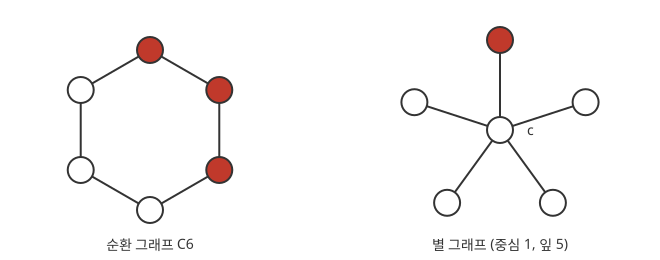

# 그래프 위의 Moran 모형

# 개요

**그래프 위의 Moran 모형(Moran process on graphs)** 은 개체가 그래프의 정점에 놓이고, 자식이 부모와 이웃한 정점의 개체만 대체하는 [Moran 모형](moran-model.md)이다. 원 모양으로 늘어선 개체들은 양옆과만 자손을 주고받고, 별 모양의 집단에서는 가운데 개체가 모든 개체와 이웃하고 가장자리 개체끼리는 이웃하지 않는다. 유리한 돌연변이가 하나 생겼을 때, 집단의 모양이 그 돌연변이가 퍼질 확률을 바꾸는지가 이 모형의 물음이다.

그래프 위의 Moran 모형은 돌연변이 무리에서 나가는 대체와 들어오는 대체의 비를 세어, 그 비가 모든 상태에서 같은 그래프는 고정 확률도 같다는 것을 보인다.

# 직관

아래 그림의 왼쪽은 개체 $6$ 개가 원으로 늘어선 집단이고, 빨간 정점이 돌연변이다. 오른쪽은 가운데 정점 $c$ 하나에 가장자리 정점 $5$ 개가 붙은 집단이다.

원에서 돌연변이의 적합도를 $r$ 이라 하고, 자식을 낳을 개체는 적합도에 비례해 고르고 자식은 양옆 가운데 하나를 반씩의 확률로 대체한다고 하자. 돌연변이는 늘 이어진 한 줄을 이룬다. 줄이 늘어나는 것은 양끝의 돌연변이가 낳은 자식이 바깥쪽을 대체할 때이고, 그 세기는 $r\cdot 2\cdot\frac12=r$ 이다. 줄이 줄어드는 것은 양끝 바깥의 개체가 낳은 자식이 안쪽을 대체할 때이고, 그 세기는 $1\cdot 2\cdot\frac12=1$ 이다.

늘 때와 줄 때의 비가 줄의 길이와 상관없이 $r:1$ 이므로, 돌연변이의 수는 이웃이 정해지지 않은 Moran 모형과 같은 걷기를 한다. 그래서 $r=2$ 인 돌연변이 하나가 원 전체로 퍼질 확률은 Moran 모형의 공식대로 다음과 같다.

$$
\frac{1-1/2}{1-1/2^6}=\frac{32}{63}
$$

# 정의

## 그래프 위의 Moran 모형

정점이 $N$ 개인 유향 [그래프](graphs.md)의 각 변 $(i,j)$ 에 가중치 $w_{ij}\ge 0$ 이 있고, 각 $i$ 에서 $\sum_jw_{ij}=1$ 이라 하자. 정점마다 개체가 하나 있고 그 유형은 돌연변이 또는 기존 유형이다. 한 단계에서 정점 $i$ 를 그 개체의 적합도에 비례하는 확률로 고르고, $i$ 의 자식이 확률 $w_{ij}$ 로 정점 $j$ 의 개체를 대체한다. 돌연변이 정점의 집합 $S_t$ 의 변화를 **그래프 위의 Moran 모형** 이라 한다[^1].

모든 $i,j$ 에서 $w_{ij}=1/N$ 이면 이웃이 정해지지 않은 Moran 모형이다. 직관 절의 원은 $i$ 의 양옆 $j$ 에서 $w_{ij}=1/2$ 이고 나머지가 $0$ 인 경우다.

## 고정 확률

$S_t$ 가 정점 전체가 되는 것을 돌연변이의 고정이라 한다. 돌연변이 하나를 고르게 고른 정점에 두고 출발했을 때 고정될 확률을 **고정 확률(fixation probability)** $\rho_G(r)$ 라 한다. Moran 모형의 고정 확률을 $\rho_M(r)=(1-1/r)/(1-1/r^N)$ 으로 적는다.

## 등온 그래프

정점 $j$ 로 들어오는 가중치의 합 $T_j=\sum_iw_{ij}$ 를 $j$ 의 **온도(temperature)** 라 한다. 모든 정점의 온도가 $1$ 이면, 곧 행렬 $W=(w_{ij})$ 의 행의 합과 열의 합이 모두 $1$ 이면 그래프를 **등온(isothermal)** 이라 한다.

직관 절의 원은 정점마다 양옆에서 $1/2$ 씩 들어오므로 등온이다. 별에서 각 잎은 중심의 자식만 받고 중심은 잎 $5$ 개 모두의 자식을 받는다. 중심은 잎을 $1/5$ 씩 고르므로 잎의 온도는 $1/5$, 중심의 온도는 $5$ 이고 등온이 아니다.

# 성질

## 등온 정리

정리(등온 정리, isothermal theorem). 그래프가 등온이면, 처음 돌연변이 집합이 무엇이든 크기가 $i$ 이면 고정될 확률이 Moran 모형의 값 $(1-r^{-i})/(1-r^{-N})$ 과 같다[^1].

증명의 요지. 돌연변이 집합이 $S$ 일 때 돌연변이가 하나 늘어날 확률과 하나 줄어들 확률은 다음 두 합에 비례하고, 비례 상수가 같다.

$$
r\sum_{i\in S,\thickspace j\notin S}w_{ij},\qquad \sum_{j\notin S,\thickspace i\in S}w_{ji}
$$

$W$ 의 행의 합과 열의 합이 모두 $1$ 이면 $S$ 에서 나가는 가중치의 합과 $S$ 로 들어오는 가중치의 합이 같다. 그러므로 두 확률의 비가 $S$ 와 상관없이 $r:1$ 이고, 돌연변이 수의 걷기가 Moran 모형의 [출생사망 과정](birth-death-process.md)과 같은 걷기가 된다.

무향 그래프에서 모든 정점의 차수가 같고 이웃을 고르게 고르면 등온이다. 직관 절의 원이 그 예다.

## 별 그래프의 증폭

정리. 잎이 $N-1$ 개인 별 그래프에서 $N$ 이 크면 고정 확률이 다음에 가깝다[^1][^2].

$$
\rho_{\mathrm{star}}(r)\approx\frac{1-1/r^2}{1-1/r^{2N}}
$$

$r=2$ 이고 $N$ 이 크면 Moran 모형의 $1/2$ 대신 약 $3/4$ 이다. 돌연변이는 대개 잎에서 출발하고, 잎의 돌연변이가 퍼지려면 먼저 중심을 차지해야 한다. 중심의 온도가 높아 중심의 개체는 자주 바뀌고, 그 사이에 적합도의 차이가 두 번 작용해 실효 적합도가 $r^2$ 이 된다.

별 그래프처럼 $r\gt 1$ 에서 $\rho_G(r)\gt\rho_M(r)$ 인 그래프를 **증폭기(amplifier)**, $\rho_G(r)\lt\rho_M(r)$ 인 그래프를 **억제기(suppressor)** 라 한다. 들어오는 변이 없는 정점 하나에서 모든 정점으로 유향 경로가 있는 그래프에서는 그 정점의 개체가 바뀌지 않고 그 유형이 결국 모든 정점을 차지한다. 그래서 돌연변이가 그 정점에서 출발할 확률 $1/N$ 이 고정 확률이고, 이 그래프는 억제기다[^1].

## 고정 확률의 계산

일반 그래프에서 고정 확률은 상태 $2^N$ 개의 [Markov 연쇄](markov-chains.md)의 흡수 확률이므로 정확한 계산이 어렵다. 무향 그래프에서는 고정까지의 평균 단계 수가 $N$ 의 다항식으로 유계라서, 무작위로 여러 번 모의하면 다항 시간에 고정 확률을 근사한다[^3].

# 활용

- 조직의 세포 집단. 세포가 놓인 모양을 그래프로 두고, 그 모양이 돌연변이의 확산을 증폭하는지 억제하는지를 고정 확률로 비교한다[^2].
- 공간 구조의 진화 게임. 정점에 전략을 두고 이웃과 게임을 해 얻은 이득을 적합도로 쓰면 [복제자 방정식](replicator-equation.md)의 공간 판본이 된다.

[^1]: Erez Lieberman, Christoph Hauert, Martin A. Nowak, "Evolutionary dynamics on graphs", *Nature* 433 (2005), 312–316.
[^2]: Martin A. Nowak, *Evolutionary Dynamics: Exploring the Equations of Life*, Harvard University Press, 2006, Ch. 8.
[^3]: Josep Díaz, Leslie Ann Goldberg, George B. Mertzios, David Richerby, Maria Serna, Paul G. Spirakis, "Approximating fixation probabilities in the generalized Moran process", *Algorithmica* 69 (2014), 78–91.

# 연관 문서

## 선수지식

- [Moran 모형](moran-model.md)

## 더 알아보기

아직 연결한 문서가 없다.

#probability #graph_theory
