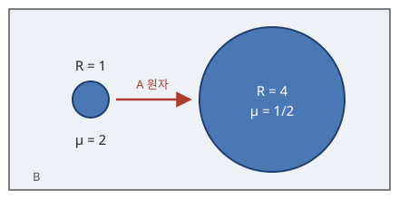

# Mullins–Sekerka 문제

# 개요

**Mullins–Sekerka 문제(Mullins–Sekerka problem)** 는 두 상의 경계가 원자의 확산에 끌려 움직이는 방식을 경계만으로 적은 자유 경계 문제다. 금속 B 안에 금속 A 의 방울이 여럿 흩어진 합금을 오래 두면 작은 방울은 사라지고 큰 방울은 커진다. 어느 방울이 얼마나 빨리 줄어드는지가 이 문제의 물음이다.

이 문제는 방울 바깥과 안쪽에서 [조화함수](harmonic-functions.md) 하나를 풀고, 그 기울기로 경계의 속도를 정한다.

# 직관

[Cahn–Hilliard 방정식](cahn-hilliard-equation.md)의 해는 스피노달 분해 뒤 $u\approx 1$ 인 방울과 $u\approx -1$ 인 바탕으로 나뉘고, 그 사이에 폭 $\varepsilon$ 의 얇은 층이 남는다. 이 뒤로는 층이 아주 느리게 움직이므로, 층의 안쪽 구조 대신 경계의 위치만 따라가면 된다.

방울 안과 바탕에서는 $u$ 가 거의 상수이고 시간에 따라 거의 바뀌지 않는다. 그러면 $u_t=\Delta\mu$ 에서 $\Delta\mu=0$ 이 남는다. 경계에서는 층의 에너지가 화학 퍼텐셜을 정하는데, 많이 휜 경계일수록 $\mu$ 가 크다. 반지름 $R$ 인 공 모양 방울의 경계에서는 $\mu=2\sigma/R$ 이고, $\sigma\gt 0$ 은 층의 에너지로 정해지는 상수다.

그림은 $\sigma=1$ 일 때 반지름 $1$ 인 방울과 $4$ 인 방울이다. 작은 방울의 경계에서 $\mu=2$, 큰 방울의 경계에서 $\mu=1/2$ 이다. 원자는 $\mu$ 가 높은 곳에서 낮은 곳으로 흐르므로 A 원자가 작은 방울에서 빠져나와 큰 방울로 간다.

속도를 계산하려고 방울 하나만 놓고, 다른 방울들의 영향을 멀리서의 값 $\mu\to\mu_\infty$ 로 둔다. 방울 안에서는 $\mu$ 가 경계의 상수값 $2\sigma/R$ 와 같고, 바깥에서는 공 대칭 조화함수 $\mu(r)=\mu_\infty+(2\sigma/R-\mu_\infty)R/r$ 다. 경계를 지나며 $u$ 가 $1$ 에서 $-1$ 로 $2$ 만큼 바뀌므로, 경계가 속력 $\dot R$ 로 나아가려면 바깥에서 들어오는 흐름 $\mu'(R)$ 이 $2\dot R$ 과 같아야 한다.

$$
\frac{dR}{dt}=\frac{1}{2R}\Bigl(\mu_\infty-\frac{2\sigma}{R}\Bigr)
$$

$\sigma=1$, $\mu_\infty=1$ 이면 $R=1$ 인 방울은 $dR/dt=-1/2$ 로 줄고 $R=4$ 인 방울은 $dR/dt=1/16$ 으로 자란다. 반지름 $R^\ast=2\sigma/\mu_\infty=2$ 보다 작은 방울은 줄고 큰 방울은 자란다.

# 정의

$\Omega\subset\mathbb R^n$ 은 매끄러운 경계를 갖는 유계 열린집합이다. 시각마다 $\Omega$ 안의 열린집합 $\Omega^+(t)$ 를 A 의 상으로, 나머지 $\Omega^-(t)$ 를 B 의 상으로 두고, 둘의 경계 $\Gamma(t)$ 는 $\Omega$ 안에 놓인 매끄러운 닫힌 곡면이다. $n$ 은 $\Gamma$ 위에서 $\Omega^+$ 의 바깥을 향하는 단위법벡터, $\kappa$ 는 $n$ 에 대한 주곡률의 합, $V$ 는 $n$ 방향의 법선 속도다. 반지름 $R$ 인 공에서 $\kappa=(n-1)/R$ 이고 $V=\dot R$ 이다.

함수 $\mu(\cdot,t)$ 와 경계 $\Gamma(t)$ 가 상수 $\sigma\gt 0$ 에 대해 다음을 만족하는 것을 **Mullins–Sekerka 문제** 라 한다[^1][^2].

$$
\begin{aligned}
\Delta\mu&=0 &&\text{in }\Omega\setminus\Gamma(t)\cr
\mu&=\sigma\kappa &&\text{on }\Gamma(t)\cr
V&=-\tfrac12\lbrack\partial\mu/\partial n\rbrack &&\text{on }\Gamma(t)\cr
\partial\mu/\partial\nu&=0 &&\text{on }\partial\Omega
\end{aligned}
$$

$\lbrack\partial\mu/\partial n\rbrack$ 는 $\Omega^+$ 쪽에서 잰 법선 미분에서 $\Omega^-$ 쪽에서 잰 법선 미분을 뺀 값이다. 둘째 식을 **Gibbs–Thomson 조건(Gibbs–Thomson condition)** 이라 한다.

직관 절의 공 모양 방울을 이 정의로 확인한다. $n=3$ 이면 $\kappa=2/R$ 이므로 경계에서 $\mu=2\sigma/R$ 이다. 안쪽의 법선 미분은 $0$ 이고 바깥쪽은 $\mu'(R)=-(2\sigma/R-\mu_\infty)/R$ 이므로 $V=-\tfrac12(0-\mu'(R))$ 가 직관 절의 $dR/dt$ 와 같다.

$\mu$ 는 경계 위의 값만으로 정해지므로 $V$ 는 $\Gamma$ 의 모양 전체에 의존한다. 같은 꼴의 문제를 Hele-Shaw 모형(Hele-Shaw model)이라고도 부른다[^3].

# 성질

## 부피의 보존

$\Omega^+(t)$ 의 부피는 일정하다. 부피의 시간 미분은 $\int_\Gamma V$ 이고, $\Omega^+$ 와 $\Omega^-$ 에서 각각 [발산 정리](divergence-theorem.md)를 쓰면 $\int_\Gamma\partial\mu/\partial n$ 이 양쪽에서 $0$ 이다. $\Omega^-$ 쪽에서는 바깥 경계 $\partial\Omega$ 의 기여가 Neumann 조건(Neumann condition)으로 사라진다.

## 넓이의 감소

경계의 넓이 $\vert\Gamma(t)\vert$ 는 다음과 같이 줄어든다.

$$
\frac{d}{dt}\vert\Gamma(t)\vert=\int_\Gamma\kappa V=-\frac{1}{2\sigma}\int_\Omega\vert\nabla\mu\vert^2dx\le 0
$$

첫 등식은 넓이의 첫 변분 공식이다. 둘째 등식은 $\kappa=\mu/\sigma$ 를 넣고 양쪽 상에서 $\int\vert\nabla\mu\vert^2$ 를 부분적분한 것이다. Mullins–Sekerka 문제는 부피를 고정한 곡면 위에서 넓이의 $H^{-1}$ 기울기 흐름이다.

## 평형 상태

넓이가 줄지 않는 상태에서는 $\nabla\mu=0$ 이므로 $\mu$ 가 상수이고, 경계의 $\kappa$ 가 상수다. 직관 절의 식에서 $\mu_\infty=2\sigma/R$ 이면 $dR/dt=0$ 인 것이 이 경우다. 공 모양 방울은 평형이고, 하나뿐인 방울이 공에 가까우면 해가 모든 시간에 존재하며 공으로 수렴한다[^4].

## 평평한 경계의 섭동

평면의 경계 $y=h(x,t)$ 를 $h=\delta(t)\cos(kx)$ 로 조금 흔들면, 선형화한 문제의 해는 $\delta'=-\sigma k^3\delta$ 를 만족한다. 경계에서 $\mu\approx\sigma k^2\delta\cos(kx)$ 이고, 양쪽의 $\mu$ 가 $e^{-k\vert y\vert}$ 로 줄어 법선 미분의 차가 그 $2k$ 배가 된다. [평균곡률 흐름](mean-curvature-flow.md)에서 같은 섭동은 $k^2$ 의 비율로 줄어든다.

## 해의 존재

처음 경계가 매끄러우면 짧은 시간 동안 매끄러운 해가 유일하게 존재한다[^5]. 방울이 합쳐지거나 사라지는 시각을 넘어서는 매끄러운 해를 기대할 수 없으므로, 모든 시간의 해는 약해의 뜻으로 구한다. Luckhaus 와 Sturzenhecker 는 시간을 쪼갠 변분 문제의 극한으로 약해를 만들었다[^6].

## Cahn–Hilliard 방정식의 극한

$\varepsilon\to 0$ 이고 시간을 $1/\varepsilon$ 배로 늘리면, Cahn–Hilliard 방정식의 해가 경계를 이루고 그 경계가 Mullins–Sekerka 문제를 따른다. Pego 가 형식 전개로 이 극한을 유도했고[^2], Alikakos, Bates, Chen 이 매끄러운 해가 존재하는 시간 안에서 증명했다[^3].

# 활용

- 방울의 굵어짐. 방울이 아주 많고 부피 비율이 작으면 각 방울은 직관 절의 식을 따르고, $\mu_\infty$ 는 전체 부피가 보존되도록 정해진다. Lifshitz–Slyozov–Wagner 이론(Lifshitz–Slyozov–Wagner theory)은 이 모형에서 평균 반지름의 세제곱이 시간에 대해 선형으로 자란다는 것을 유도했다[^7][^8]. Cahn–Hilliard 방정식의 $t^{1/3}$ 굵어짐이 이것이다.
- 결정 성장의 형태 불안정성. Mullins 와 Sekerka 는 과포화된 용액에서 자라는 공 모양 입자에 이 모형을 써서, 입자가 충분히 크면 표면의 작은 굴곡이 자라 공 모양이 유지되지 않음을 보였다[^1].
- 수치 계산. 경계를 직접 따라가는 경계 적분법이나 Cahn–Hilliard 방정식을 작은 $\varepsilon$ 으로 푸는 상장 방법(phase-field method)으로 계산한다.

[^1]: W. W. Mullins, R. F. Sekerka, "Morphological stability of a particle growing by diffusion or heat flow", *Journal of Applied Physics* **34** (1963), 323–329.

[^2]: R. L. Pego, "Front migration in the nonlinear Cahn–Hilliard equation", *Proceedings of the Royal Society of London A* **422** (1989), 261–278.

[^3]: N. D. Alikakos, P. W. Bates, X. Chen, "Convergence of the Cahn–Hilliard equation to the Hele-Shaw model", *Archive for Rational Mechanics and Analysis* **128** (1994), 165–205.

[^4]: J. Escher, G. Simonett, "A center manifold analysis for the Mullins–Sekerka model", *Journal of Differential Equations* **143** (1998), 267–292.

[^5]: X. Chen, J. Hong, F. Yi, "Existence, uniqueness, and regularity of classical solutions of the Mullins–Sekerka problem", *Communications in Partial Differential Equations* **21** (1996), 1705–1727.

[^6]: S. Luckhaus, T. Sturzenhecker, "Implicit time discretization for the mean curvature flow equation", *Calculus of Variations and Partial Differential Equations* **3** (1995), 253–271.

[^7]: I. M. Lifshitz, V. V. Slyozov, "The kinetics of precipitation from supersaturated solid solutions", *Journal of Physics and Chemistry of Solids* **19** (1961), 35–50.

[^8]: C. Wagner, "Theorie der Alterung von Niederschlägen durch Umlösen (Ostwald-Reifung)", *Zeitschrift für Elektrochemie* **65** (1961), 581–591.

# 연관 문서

## 선수지식

- [Cahn–Hilliard 방정식](cahn-hilliard-equation.md)
- [조화함수](harmonic-functions.md)

## 더 알아보기

아직 연결한 문서가 없다.

#analysis #differential_geometry
