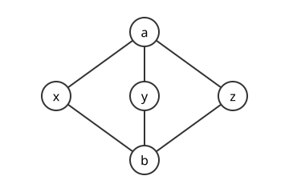

# 다품종 흐름

# 개요

**다품종 흐름(multicommodity flow)** 은 출발점과 도착점이 서로 다른 여러 쌍이 각자의 양을 같은 망으로 동시에 보내는 문제다. 통신망에서 서울–부산, 대전–광주 사이의 통화가 같은 회선을 나눠 쓰면, 한 쌍만 보낼 때의 [네트워크 흐름](network-flow.md)과 달리 회선 하나를 누가 얼마나 쓰는지가 서로 얽힌다. 다품종 흐름은 쌍마다의 흐름을 변수로 둔 선형계획으로 이 배분을 정하고, 망의 절단이 모든 수요를 지나가게 할 만큼 넓어도 흐름이 없을 수 있다는 점에서 한 쌍의 경우와 다르다.

# 직관

아래 그림의 그래프는 정점 $a,b$ 가 정점 $x,y,z$ 와 각각 이어진 무향 그래프이고, 간선 여섯 개의 용량은 모두 $1$ 이다. 네 쌍 $x\text{–}y$, $y\text{–}z$, $z\text{–}x$, $a\text{–}b$ 가 각각 $1$ 단위를 보내려 한다.

정점을 두 무리로 나누면, 두 무리 사이를 지나야 하는 수요는 사이의 간선 용량을 넘지 않는다. $x$ 하나를 떼면 사이의 간선은 $xa,xb$ 둘이고 지나야 하는 수요는 $x\text{–}y$, $x\text{–}z$ 둘이다. $\lbrace a,x\rbrace$ 를 떼면 간선 $ay,az,xb$ 셋에 수요 $a\text{–}b$, $x\text{–}y$, $x\text{–}z$ 셋이다. 다른 나눔도 같은 꼴로 확인된다.

그러나 네 쌍을 동시에 보낼 수는 없다. 네 쌍 모두 이어진 간선이 없어 어느 경로든 간선을 두 개 이상 지난다. 그러므로 네 단위를 보내려면 용량이 $2\cdot 4=8$ 이상 들지만, 간선 용량의 합은 $6$ 이다.

# 정의

## 다품종 흐름 문제

용량 $c:E\to\mathbb R\_{\ge 0}$ 이 있는 무향 그래프 $G=(V,E)$ 와 품종(commodity) $k$ 개 $(s\_i,t\_i,d\_i)$ 가 주어진다. $d\_i\ge 0$ 은 $s\_i$ 에서 $t\_i$ 로 보낼 수요다. $s\_i$ 에서 $t\_i$ 로 가는 경로 전체를 $\mathcal P\_i$ 로 둔다. 다음을 만족하는 $f\ge 0$ 을 **다품종 흐름** 이라 한다.

$$
\sum\_{P\in\mathcal P\_i}f\_P=d\_i\thinspace(i=1,\dots,k),\qquad\sum\_{i=1}^{k}\sum\_{P\in\mathcal P\_i,\thinspace P\ni e}f\_P\le c\_e\thinspace(e\in E)
$$

첫 식은 품종마다 수요를 다 보낸다는 것이고, 둘째 식은 간선마다 모든 품종이 함께 쓰는 양이 용량 이하라는 것이다. 유향 그래프에서도 같은 꼴로 정의한다. 직관 절에서 $k=4$, $d\_i=1$, $c\_e=1$ 이다.

## 절단 조건

정점 부분집합 $S$ 에 대해 $\delta(S)$ 를 $S$ 와 그 밖을 잇는 간선의 집합, $D(S)$ 를 $s\_i,t\_i$ 가운데 하나만 $S$ 에 든 품종의 수요 합으로 둔다. 모든 $S$ 에서 다음이 성립하는 것을 **절단 조건(cut condition)** 이라 한다.

$$
c(\delta(S))\ge D(S)
$$

$S$ 를 떠나야 하는 흐름은 모두 $\delta(S)$ 의 간선을 지나므로, 다품종 흐름이 있으면 절단 조건이 성립한다. 직관 절의 예는 절단 조건이 성립하지만 다품종 흐름이 없다.

# 성질

## 거리 조건

정리(Iri, Onaga–Kakusho). 다품종 흐름이 있을 필요충분조건은, 간선 길이 $\ell:E\to\mathbb R\_{\ge 0}$ 을 어떻게 주어도 다음이 성립하는 것이다[^1].

$$
\sum\_{i=1}^{k}d\_i\thinspace\mathrm{dist}\_\ell(s\_i,t\_i)\le\sum\_{e\in E}c\_e\ell\_e
$$

$\mathrm{dist}\_\ell$ 은 길이 $\ell$ 에 대한 최단 거리다. 이 조건을 **거리 조건(distance condition)** 이라 한다.

증명의 요지. 다품종 흐름 문제는 경로 변수에 대한 선형계획이고, [Farkas 보조정리](farkas-lemma.md)를 적용하면 허용해가 없다는 것은 위 부등식을 어기는 음 아닌 간선 길이가 있다는 것과 같다. 흐름이 있으면 $f\_P$ 마다 $\ell(P)\ge\mathrm{dist}\_\ell$ 이므로 부등식이 바로 나온다.

직관 절에서 $\ell\equiv 1$ 이면 좌변이 $4\cdot 2=8$, 우변이 $6$ 이다. 절단 $\delta(S)$ 의 간선에만 길이 $1$ 을 준 $\ell$ 에서 거리 조건은 절단 조건이 된다. 그러므로 절단 조건은 거리 조건을 길이가 $0$ 과 $1$ 인 절단 길이로만 확인한 것이다.

## 절단 조건이 충분한 경우

- 품종이 하나이면 최대유량 최소절단 정리로 절단 조건이 충분하다.
- Hu 정리(Hu's theorem). 무향 그래프에서 품종이 둘이면 절단 조건이 충분하고, 용량과 수요가 정수이면 반정수 흐름이 있다[^2].
- Okamura–Seymour 정리(Okamura–Seymour theorem). 평면 그래프에서 모든 $s\_i,t\_i$ 가 바깥 면 위에 있고, 각 정점에서 용량과 수요의 합이 짝수이면 절단 조건이 충분하고 정수 흐름이 있다[^3].

유향 그래프에서는 품종이 둘이어도 절단 조건이 충분하지 않다.

## 흐름과 절단의 차이

모든 품종의 수요에 같은 수 $\lambda$ 를 곱해 보낼 수 있는 가장 큰 $\lambda$ 를 최대 동시 흐름(maximum concurrent flow)이라 하고, $c(\delta(S))/D(S)$ 의 최솟값을 가장 희소한 절단(sparsest cut)의 값이라 한다. 절단 조건으로 최대 동시 흐름은 가장 희소한 절단의 값 이하다.

정리(Linial–London–Rabinovich, Aumann–Rabani). 무향 그래프에서 가장 희소한 절단의 값은 최대 동시 흐름의 $O(\log k)$ 배 이하다[^4].

증명의 요지는 거리 조건의 최적 길이 $\ell$ 이 주는 거리 공간을 [Bourgain 매장 정리](bourgain-embedding-theorem.md)로 $\ell\_1$ 공간에 $O(\log k)$ 의 왜곡으로 넣고, $\ell\_1$ 거리를 절단 거리의 합으로 쪼개는 것이다. Leighton 과 Rao 는 정점이 $n$ 개인 [Expander 그래프](expander-graphs.md)에서 모든 쌍을 품종으로 두면 이 비가 $\Omega(\log n)$ 임을 보였다[^5].

## 정수 흐름의 어려움

선형계획이므로 분수 흐름의 존재는 다항 시간에 판정된다. 그러나 정수 흐름의 존재는 품종이 둘이어도 NP(nondeterministic polynomial time) 완전이다[^6]. 수요가 모두 $1$ 인 정수 흐름은 품종마다 간선을 공유하지 않는 경로를 고르는 간선 서로소 경로 문제(edge-disjoint paths problem)이고, [Menger 정리](menger-theorem.md)는 품종이 하나인 경우다.

# 활용

- 통신망과 수송망의 경로 배정. 회선이나 도로마다의 용량 안에서 여러 출발지와 도착지 사이의 수요를 나눠 보낸다. 경로 변수의 선형계획을 [Dantzig–Wolfe 분해](dantzig-wolfe-decomposition.md)의 주 문제로 보고, 품종마다의 최단 경로 문제로 [열 생성](column-generation.md)의 가격을 결정한다.
- 가장 희소한 절단의 근사. 최대 동시 흐름의 선형계획을 풀고 거리 공간을 절단으로 반올림해 $O(\log k)$ 근사를 얻는다. 그래프 분할과 분할 정복 알고리즘에서 이 근사를 쓴다.
- 교통 배정과 [가격 무정부](price-of-anarchy.md). 간선의 비용이 흐르는 양에 따라 늘면, 운전자마다 자기 경로를 고르는 다품종 흐름 위의 균형 문제가 된다.

[^1]: M. Iri, "On an extension of the maximum-flow minimum-cut theorem to multicommodity flows", *Journal of the Operations Research Society of Japan* 13 (1971), 129–135. K. Onaga, O. Kakusho, "On feasibility conditions of multicommodity flows in networks", *IEEE Transactions on Circuit Theory* 18 (1971), 425–429.
[^2]: T. C. Hu, "Multi-commodity network flows", *Operations Research* 11 (1963), 344–360.
[^3]: H. Okamura, P. D. Seymour, "Multicommodity flows in planar graphs", *Journal of Combinatorial Theory, Series B* 31 (1981), 75–81.
[^4]: N. Linial, E. London, Y. Rabinovich, "The geometry of graphs and some of its algorithmic applications", *Combinatorica* 15 (1995), 215–245. Y. Aumann, Y. Rabani, "An O(log k) approximate min-cut max-flow theorem and approximation algorithm", *SIAM Journal on Computing* 27 (1998), 291–301.
[^5]: T. Leighton, S. Rao, "Multicommodity max-flow min-cut theorems and their use in designing approximation algorithms", *Journal of the ACM* 46 (1999), 787–832.
[^6]: S. Even, A. Itai, A. Shamir, "On the complexity of timetable and multicommodity flow problems", *SIAM Journal on Computing* 5 (1976), 691–703.

# 연관 문서

## 선수지식

- [네트워크 흐름](network-flow.md)

## 더 알아보기

아직 연결한 문서가 없다.

#graph_theory #optimization #algorithms
