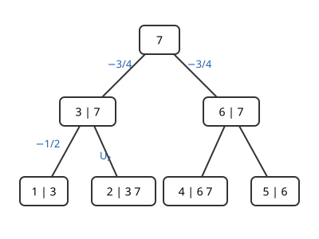

# 다전선 방법

# 개요

**다전선 방법(multifrontal method)** 은 희소한 대칭 연립방정식을 소거할 때, 미지수 하나를 소거하는 일을 그 미지수와 관련된 성분만 모은 작은 밀집 행렬에서 하고 남은 변화를 소거 나무의 부모에게 넘기는 방법이다. 막대 위 일곱 점의 연립방정식에서 한 미지수의 소거는 많아야 두 이웃의 식만 바꾸지만, 행렬 전체를 0 이 많은 채로 다루면 어느 성분이 바뀌는지 매번 찾아야 한다. 다전선 방법은 소거마다 크기 3 이하의 밀집 행렬 하나를 만들어 계산하고, 결과를 나무를 따라 위로 모은다.

# 직관

[소거 나무](elimination-trees.md) 문서의 막대를 다시 본다. 일곱 점을 $1,3,2,7,4,6,5$ 로 번호 붙였고, 각 식은 대각 성분 $2$ 와 이웃한 점의 성분 $-1$ 로 되어 있다. 소거 나무는 $7$ 을 뿌리로 $3$ 과 $6$ 이 자식이고, $3$ 아래에 $1,2$, $6$ 아래에 $4,5$ 가 있다.

$2$ 를 소거할 때 쓰는 성분은 $2$ 행과 $2$ 열에서 $2$ 이상인 번호의 것뿐이고, 바뀌는 성분은 채운 그래프에서 $2$ 의 큰 이웃 $3,7$ 이 만드는 $2\times2$ 자리다. 그래서 행과 열의 번호를 $2,3,7$ 로 한 작은 행렬을 만든다.

$$F_2=\begin{pmatrix}2&-1&-1\cr -1&0&0\cr -1&0&0\end{pmatrix}$$

첫 행과 첫 열에는 원래 행렬의 성분을 넣고, 나머지는 $0$ 으로 둔다. 이 행렬에서 [Gauss 소거](gaussian-elimination.md)를 한 단계 하면 첫 열이 $L$ 의 $2$ 열이 되고, 오른쪽 아래에 다음이 남는다.

$$U_2=\begin{pmatrix}0&0\cr 0&0\end{pmatrix}-\frac12\begin{pmatrix}-1\cr -1\end{pmatrix}\begin{pmatrix}-1&-1\end{pmatrix}=\begin{pmatrix}-1/2&-1/2\cr -1/2&-1/2\end{pmatrix}$$

$U_2$ 는 $2$ 의 소거가 번호 $3,7$ 의 성분에 더하는 변화다. 이 변화를 바로 큰 행렬에 더하지 않고 부모 $3$ 에게 넘긴다. 같은 방법으로 $1$ 을 번호 $1,3$ 의 행렬에서 소거하면 $3$ 자리에 $-1/2$ 이 남는다.

$3$ 의 차례에는 번호 $3,7$ 의 행렬에 원래 성분 $a_{33}=2$, $a_{73}=0$ 을 넣고, 두 자식이 넘긴 변화를 번호를 맞추어 더한다.

$$F_3=\begin{pmatrix}2&0\cr 0&0\end{pmatrix}+\begin{pmatrix}-1/2&0\cr 0&0\end{pmatrix}+\begin{pmatrix}-1/2&-1/2\cr -1/2&-1/2\end{pmatrix}=\begin{pmatrix}1&-1/2\cr -1/2&-1/2\end{pmatrix}$$

$F_3$ 의 첫 열은 $1$ 과 $2$ 를 소거한 뒤 큰 행렬의 $3$ 열과 같다. $3$ 을 소거하면 $7$ 자리에 $-1/2-(1/4)/1=-3/4$ 가 남아 $7$ 에게 간다. 오른쪽 가지도 같아서 $7$ 의 행렬은 $2-3/4-3/4=1/2$ 이다. 아래 그림은 나무의 정점마다 작은 행렬의 번호와 부모에게 넘기는 변화를 적은 것이다. 이렇게 작은 행렬을 나무를 따라 계산하는 방법을 다전선 방법이라 한다.

# 정의

## 전선 행렬과 갱신 행렬

대칭 행렬 $A$ 의 소거 순서 $1,\dots,n$ 에서 $S_j$ 를 채운 그래프에서 $j$ 와 이웃한 $j$ 보다 큰 정점들의 집합이라 하자. 번호 집합 $\lbrace j\rbrace\cup S_j$ 위의 밀집 대칭 행렬 $F_j$ 를 $j$ 의 **전선 행렬(frontal matrix)** 이라 한다. $F_j$ 를 소거 나무의 자식 $c$ 들에 대해 다음과 같이 만든다.

$$F_j=\begin{pmatrix}a_{jj}&a_{S_j,j}^{\mathrm T}\cr a_{S_j,j}&0\end{pmatrix}\mathbin{\updownarrow} U_{c_1}\mathbin{\updownarrow}\cdots\mathbin{\updownarrow} U_{c_r}$$

$a_{S_j,j}$ 는 $A$ 의 $j$ 열에서 $S_j$ 의 행만 모은 것이다. $F_j$ 를 첫 성분으로 나누어 쓰고 그 [Schur 보수](schur-complement.md)를 취한다.

$$F_j=\begin{pmatrix}d&b^{\mathrm T}\cr b&E\end{pmatrix},\qquad U_j=E-\frac{1}{d}bb^{\mathrm T}$$

$U_j$ 는 번호 집합 $S_j$ 위의 행렬이고 $j$ 의 **갱신 행렬(update matrix)** 이라 한다. 직관 절의 $F_2$, $U_2$, $F_3$ 가 이 정의의 예다.

## 확장 합

기호 $\updownarrow$ 는 **확장 합(extend-add)** 이다. 번호 집합이 다른 두 행렬을 두 번호 집합의 합집합 위로 0 을 채워 넓힌 뒤 같은 번호의 성분끼리 더한다. 직관 절에서 번호 $3$ 위의 $U_1=(-1/2)$ 은 번호 $3,7$ 위로 넓혀 $(3,3)$ 성분에만 $-1/2$ 를 둔 뒤 더했다.

## 다전선 방법

자식이 부모보다 앞에 오는 순서로 정점 $j$ 마다 $F_j$ 를 만들고, $d$ 와 $b$ 로 $L$ 의 $j$ 열을 $l_{jj}=\sqrt d$, $l_{S_j,j}=b/\sqrt d$ 로 정하고, $U_j$ 를 부모에게 넘긴다. 이 절차를 **다전선 방법** 이라 한다.

# 성질

## 갱신 행렬이 부모에 들어맞음

자식 $c$ 의 부모가 $p$ 이면 $S_c\subseteq\lbrace p\rbrace\cup S_p$ 다. 그래서 $U_c$ 의 번호가 모두 $F_p$ 의 번호 안에 있고 확장 합이 $F_p$ 의 크기를 늘리지 않는다.

증명의 요지. $c$ 를 소거하면 $S_c$ 의 정점끼리 모두 이어진다. $p$ 는 $S_c$ 의 가장 작은 정점이므로 $S_c$ 의 나머지 정점은 채운 그래프에서 $p$ 보다 큰 $p$ 의 이웃, 곧 $S_p$ 의 원소다.

## 정확성

다전선 방법이 만든 $L$ 은 $A=LL^{\mathrm T}$ 의 Cholesky 분해(Cholesky decomposition)와 같다[^1].

증명의 요지. 귀납으로 $U_c$ 는 $c$ 의 부분나무에 있는 정점 $m$ 들의 기여 $l_{im}l_{km}$ 의 합에 $-1$ 을 곱한 것이다. $F_j$ 의 첫 열 성분 $(i,j)$ 에 기여하는 $m\lt j$ 는 $l_{jm}\ne0$ 이어야 하고, 소거 나무의 조상 정리로 그런 $m$ 은 모두 $j$ 의 자손이다. 그래서 $F_j$ 의 첫 열은 $1,\dots,j-1$ 을 소거한 뒤의 $j$ 열과 같다. 첫 열이 아닌 성분에는 $j$ 의 부분나무 밖의 기여가 빠져 있고, 그 기여는 조상의 전선 행렬에서 더해진다.

## 스택 하나로 충분함

소거 나무의 후위순(postorder), 곧 부분나무 하나를 연속으로 처리하는 순서로 계산하면, 갱신 행렬은 나중에 만든 것이 먼저 쓰인다. 그래서 갱신 행렬을 스택 하나에 쌓고 꺼내 쓰면 된다. 필요한 기억 공간의 최댓값은 자식을 처리하는 순서에 따라 달라지고, 그 최솟값을 주는 자식 순서는 나무를 따라 올라가며 정해진다[^2].

## 계산 비용

$\lvert S_j\rvert=s_j$ 이면 $U_j$ 를 계산하는 곱셈이 $s_j^2$ 에 비례하므로 전체 곱셈은 $\sum_j s_j^2$ 에 비례한다. 이것은 같은 순서로 Gauss 소거를 할 때의 곱셈 수와 같다. 차이는 모든 계산이 번호가 연속인 밀집 행렬에서 일어난다는 것이고, 번호를 찾는 비용은 확장 합에만 든다.

# 활용

- [유한요소법](finite-element-method.md)의 큰 희소 연립방정식. 격자의 요소마다 작은 행렬을 더해 가며 소거하는 전선법(frontal method)을 여러 전선으로 넓힌 것이 이 방법이다[^1].
- 초절점(supernode). 소거 나무에서 한 줄로 이어지고 큰 이웃의 구조가 같은 열들을 한 전선 행렬에 모아 여러 미지수를 한 번에 소거한다. 행렬과 행렬의 곱으로 계산되어 계산기의 캐시를 잘 쓴다.
- 병렬 계산. 서로 다른 부분나무의 전선 행렬을 서로 다른 처리기가 계산하고, 뿌리 가까이의 큰 전선 행렬은 여러 처리기가 나누어 계산한다. [중첩 분할](nested-dissection.md) 순서가 나무를 낮고 넓게 만든다.
- 부정부호 행렬. 양의 정부호가 아닌 대칭 행렬에서는 전선 행렬 안에서 피벗(pivot)을 고르고, 고를 수 없는 미지수의 소거를 부모의 전선 행렬로 미룬다[^1].

[^1]: I. S. Duff, J. K. Reid, "The multifrontal solution of indefinite sparse symmetric linear equations", *ACM Transactions on Mathematical Software* **9** (1983), 302–325.
[^2]: J. W. H. Liu, "On the storage requirement in the out-of-core multifrontal method for sparse factorization", *ACM Transactions on Mathematical Software* **12** (1986), 249–264.

# 연관 문서

## 선수지식

- [소거 나무](elimination-trees.md)
- [Schur 보수](schur-complement.md)

## 더 알아보기

아직 연결한 문서가 없다.

#graph_theory #linear_algebra #algorithms
