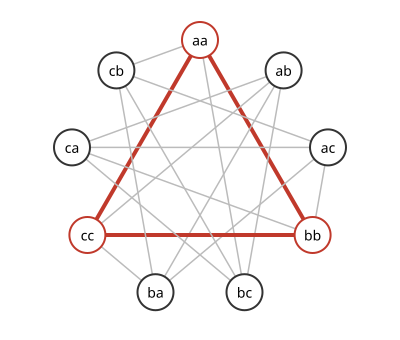

# 곱셈적 그래프

# 개요

**곱셈적 그래프(multiplicative graph)** 는 두 그래프의 곱이 자기에게 준동형으로 보내지면 두 그래프 가운데 하나도 자기에게 보내지는 그래프다. 삼각형 두 개를 곱한 그래프에는 삼각형이 들어 있어 두 색으로 칠할 수 없고, 두 색으로 칠할 수 없는 그래프끼리 곱하면 언제나 그렇다. 이 성질을 두 색 대신 그래프 $K$ 로 가는 준동형에 대해 묻는 것이 곱셈성이고, $K$ 가 완전그래프 $K_n$ 이면 [Hedetniemi 추측](hedetniemi-conjecture.md)의 $n$ 에 대한 판본이 된다.

# 직관

Hedetniemi 추측 문서의 곱 $G\times H$ 를 두 색으로 칠할 수 있으면 $G$ 나 $H$ 도 두 색으로 칠할 수 있는지 묻는다. 삼각형 $K_3$ 의 정점을 $a,b,c$ 로 두고 $K_3\times K_3$ 을 그리면 아래와 같다. 정점 $ab$ 는 쌍 $(a,b)$ 이고, 두 쌍은 첫 성분끼리 다르고 둘째 성분끼리도 다를 때 이웃한다.

빨간 선의 세 정점 $aa,bb,cc$ 는 두 성분이 모두 서로 다르므로 서로 이웃해 삼각형을 이룬다. 그래서 $K_3\times K_3$ 은 두 색으로 칠할 수 없다.

삼각형 대신 $G$ 의 길이 $p$ 인 홀수 고리와 $H$ 의 길이 $q$ 인 홀수 고리를 쓰면, $G$ 의 고리를 $q$ 바퀴 도는 걸음과 $H$ 의 고리를 $p$ 바퀴 도는 걸음을 짝지어 $G\times H$ 에 길이 $pq$ 인 닫힌 걸음이 생긴다. $pq$ 가 홀수이므로 곱은 두 색으로 칠할 수 없다. 따라서 곱이 두 색으로 칠해지면 $G$ 와 $H$ 가운데 하나는 두 색으로 칠해진다.

# 정의

## 곱셈적 그래프

그래프 $K$ 가 다음을 만족하면 **곱셈적(multiplicative)** 이라 한다. $G\times H\to K$ 이면 $G\to K$ 이거나 $H\to K$ 이다. 여기서 $\times$ 는 텐서곱이고 $\to$ 는 [그래프 준동형](graph-homomorphisms.md)이 있다는 뜻이다.

$G\to K_2$ 는 $G$ 를 두 색으로 칠할 수 있다는 것과 같으므로, 직관 절은 $K_2$ 가 곱셈적이라는 증명이다. $K_n$ 이 곱셈적이라는 진술은 Hedetniemi 추측의 $n$ 에 대한 판본과 같다.

## 지수 그래프

그래프 $G$, $K$ 에 대해 **지수 그래프(exponential graph)** $K^G$ 는 사상 $f:V(G)\to V(K)$ 전부를 정점으로 두고, $G$ 의 모든 간선 $uv$ 에서 $f(u)g(v)$ 와 $f(v)g(u)$ 가 $K$ 의 간선일 때 $f$ 와 $g$ 를 잇는 그래프다. $K=K_n$ 이면 Hedetniemi 추측 문서의 $K_n^G$ 다.

$K_2^{K_3}$ 의 정점은 $\lbrace a,b,c\rbrace$ 에서 $\lbrace 1,2\rbrace$ 로 가는 사상 여덟 개다. 상수 사상 $111$ 과 $222$ 는 서로 이웃한다. 상수가 아닌 사상 $f$ 에는 나머지 두 정점에서 값 $1$ 과 $2$ 를 모두 갖는 정점 $v$ 가 있고, $g(v)$ 는 두 값과 모두 달라야 하므로 $f$ 에는 이웃이 없다. 따라서 $K_2^{K_3}$ 은 간선 하나와 고립점 여섯 개다.

# 성질

## 지수 그래프 판정

Hedetniemi 추측 문서의 환원과 같은 논증으로 모든 그래프 $G$, $H$, $K$ 에 대해 다음이 성립한다.

$$
G\times H\to K\iff H\to K^G
$$

따라서 $K$ 가 곱셈적인 것과, $G\not\to K$ 인 모든 그래프 $G$ 에 대해 $K^G\to K$ 인 것은 동치다. $G\times K^G\to K$ 는 언제나 성립하므로, $K$ 가 곱셈적이고 $G\not\to K$ 이면 $K^G\to K$ 다. 거꾸로 이 조건이 있으면 $G\times H\to K$ 이고 $G\not\to K$ 일 때 $H\to K^G\to K$ 다.

$K=K_2$, $G=K_3$ 에서 $K_2^{K_3}$ 은 간선 하나와 고립점이므로 $K_2$ 로 보내진다.

## 핵에만 의존

$K$ 와 $K'$ 이 서로에게 준동형으로 보내지면, 모든 $G$ 에 대해 $G\to K$ 와 $G\to K'$ 이 동치이므로 둘 중 하나가 곱셈적이면 다른 하나도 곱셈적이다. 그래서 곱셈성은 $K$ 의 [그래프의 핵](graph-cores.md)으로 정해진다.

## 준동형 순서의 기약 원소

그래프의 핵 문서의 준동형 순서에서 $G\times H$ 는 $G$ 와 $H$ 의 최대 하계다. 따라서 $K$ 가 곱셈적인 것은 다음과 같다. $G\wedge H\le K$ 이면 $G\le K$ 이거나 $H\le K$ 이다. 곧 $K$ 아래에 있지 않은 원소들의 집합이 최대 하계로 닫혀 있다.

## 알려진 곱셈적 그래프

- $K_1$ 은 곱셈적이다. $G\times H$ 에 간선이 없으면 $G$ 나 $H$ 에 간선이 없다.
- $K_2$ 는 곱셈적이다. 직관 절의 홀수 걸음 논증이다.
- $K_3$ 은 곱셈적이다. M. El-Zahar 와 N. Sauer 가 증명했다[^1].
- 홀수 고리 $C_{2k+1}$ 은 곱셈적이다. R. Häggkvist, P. Hell, D. J. Miller, V. Neumann Lara 가 증명했다[^2].
- [원형 채색수](circular-chromatic-number.md) 문서의 원형 클릭 $K_{p/q}$ 는 $p/q\lt 4$ 이면 곱셈적이다. C. Tardif 가 증명했다[^3].

## 곱셈적이지 않은 완전그래프

Y. Shitov 의 반례는 $n$ 이 충분히 크면 $K_n$ 이 곱셈적이지 않음을 보였다[^4]. C. Tardif 는 채색수가 $14$ 인 두 그래프 $G$, $H$ 로 $G\times H\to K_{13}$ 인 예를 만들었다[^5]. $G\not\to K_{13}$ 이고 $H\not\to K_{13}$ 이므로 $K_{13}$ 은 곱셈적이지 않다.

# 활용

- Hedetniemi 추측. $n$ 에 대한 추측이 $K_n$ 의 곱셈성이고, $n=2$ 와 $n=3$ 의 증명과 $n\ge 13$ 의 반례가 위의 결과다.
- 원형 채색수 $\chi_c$ 의 곱. $\chi_c(G)$ 와 $\chi_c(H)$ 가운데 작은 쪽이 $4$ 이하이면 $p/q\lt 4$ 인 $K_{p/q}$ 의 곱셈성에서 다음이 따라 나온다.

  $$
  \chi_c(G\times H)=\min\bigl(\chi_c(G),\chi_c(H)\bigr)
  $$

[^1]: M. El-Zahar, N. Sauer, "The chromatic number of the product of two 4-chromatic graphs is 4", Combinatorica 5 (1985), 121–126.
[^2]: R. Häggkvist, P. Hell, D. J. Miller, V. Neumann Lara, "On multiplicative graphs and the product conjecture", Combinatorica 8 (1988), 63–74.
[^3]: C. Tardif, "Multiplicative graphs and semi-lattice endomorphisms in the category of graphs", Journal of Combinatorial Theory, Series B 95 (2005), 338–345.
[^4]: Y. Shitov, "Counterexamples to Hedetniemi's conjecture", Annals of Mathematics 190 (2019), 663–667.
[^5]: C. Tardif, "The chromatic number of the product of 14-chromatic graphs can be 13", Combinatorica 42 (2022).

# 연관 문서

## 선수지식

- [Hedetniemi 추측](hedetniemi-conjecture.md)

## 더 알아보기

아직 연결한 문서가 없다.

#graph_theory #combinatorics #order_theory #category_theory
