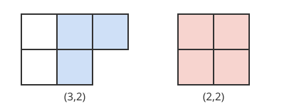

# Murnaghan–Nakayama 규칙

# 개요

**Murnaghan–Nakayama 규칙(Murnaghan–Nakayama rule)** 은 대칭군 $S_n$ 의 기약표현의 지표값을 Young 도형에서 칸 띠를 차례로 떼어 내며 부호를 더해 계산하는 규칙이다. $S_5$ 의 5 차 기약표현이 다섯 칸을 한 번에 도는 순환에서 갖는 값을 구한다고 하자. 모양 $(3,2)$ 의 도형에서 다섯 칸을 한 띠로 떼어 낼 수 없으므로 값은 $0$ 이다. 다항식을 전개하지 않고 도형의 칸을 세어 지표표의 칸이 채워진다.

# 직관

[Specht 가군](specht-modules.md) 문서에서 $S_3$ 의 [지표표](character-table.md)의 한 행, 곧 $S^{(2,1)}$ 의 지표값 $2,0,-1$ 은 멱합 대칭함수 $p_\mu$ 를 Schur 다항식으로 전개해 계수로 읽었다. $S_5$ 에서 같은 일을 하려면 멱합 일곱 개를 각각 Schur 다항식 일곱 개로 전개해야 한다.

$S^{(2,1)}$ 에서 3-순환의 값 $-1$ 을 도형으로 읽는다. 도형 $(2,1)$ 의 세 칸은 오른쪽 위 칸에서 왼쪽 아래 칸까지 변을 맞대고 한 줄로 이어진다. 이 띠는 두 행에 걸쳐 있고, 걸친 행 수에서 $1$ 을 뺀 $1$ 이 지수가 되어 $(-1)^1=-1$ 이 값이다.

호환의 순환 꼴은 $(2,1)$ 이고, 호환에서의 값 $0$ 도 같은 방법으로 읽는다. 먼저 두 칸짜리 띠를 떼고 남은 것이 도형이어야 하는데, 두 칸 $(1,2)$ 와 $(2,1)$ 은 꼭짓점만 맞대고 다른 두 칸 쌍은 떼면 도형이 남지 않는다. 뗄 띠가 없으므로 값은 $0$ 이다.

# 정의

## 테두리 띠

두 분할 $\nu\subseteq\lambda$ 의 Young 도형의 차 $\lambda/\nu$ 가 변을 맞댄 칸으로 이어져 있고 $2\times2$ 정사각형을 포함하지 않으면 $\lambda/\nu$ 를 **테두리 띠(border strip)** 라 한다. 띠가 걸친 행의 수에서 $1$ 을 뺀 것을 띠의 **높이(height)** $\mathrm{ht}$ 라 한다.

아래 그림의 왼쪽은 $(3,2)$ 에서 칸 $(1,2),(1,3),(2,2)$ 를 색칠한 것이다. 이 세 칸은 높이 $1$ 인 테두리 띠이고 떼면 $(1,1)$ 이 남는다. 오른쪽의 $(2,2)$ 전체는 $2\times2$ 정사각형이라 테두리 띠가 아니다.

## Murnaghan–Nakayama 규칙

$\chi^\lambda$ 를 $S^\lambda$ 의 지표, $\chi^\lambda(\mu)$ 를 순환 꼴이 $\mu=(\mu_1,\dots,\mu_k)$ 인 원소에서의 값이라 하자. $\mu_1$ 개의 칸으로 된 테두리 띠 $\xi$ 를 $\lambda$ 에서 떼어 남은 도형이 $\lambda-\xi$ 일 때 다음이 성립한다[^1].

$$
\chi^\lambda(\mu)=\sum_{\xi}(-1)^{\mathrm{ht}(\xi)}\thinspace\chi^{\lambda-\xi}(\mu_2,\dots,\mu_k),\qquad \chi^{\varnothing}(\varnothing)=1
$$

합은 떼어 낸 뒤 남은 것이 분할의 도형인 띠 $\xi$ 전체에 걸친다. 순환 꼴 $(3,1,1)$, 곧 3-순환에서 $\chi^{(3,2)}$ 를 구한다. 세 칸 띠는 그림 왼쪽의 하나뿐이고 높이가 $1$ 이며, 남은 $(1,1)$ 에서 $\chi^{(1,1)}(1,1)=1$ 이므로 $\chi^{(3,2)}(3,1,1)=-1$ 이다.

# 성질

## 증명의 요지

[Schur 다항식](schur-polynomials.md) $s_\lambda$ 에 멱합 $p_r$ 을 곱하면 $\lambda$ 에 $r$ 칸 테두리 띠를 붙인 모양들에 부호를 단 합이 나온다.

$$
p_r\thinspace s_\nu=\sum_{\lambda/\nu\ \text{테두리 띠},\ \vert\lambda/\nu\vert=r}(-1)^{\mathrm{ht}(\lambda/\nu)}\thinspace s_\lambda
$$

이 식은 $s_\nu$ 를 두 행렬식의 비로 쓰고 분자의 각 행 지수에 $r$ 을 더한 뒤 행을 다시 정렬해 얻는다. 정렬에 드는 행 교환의 수가 띠의 높이다. $p_\mu=p_{\mu_k}\cdots p_{\mu_1}\cdot 1$ 에 이 식을 되풀이해 적용하고 Frobenius 지표 공식 $p_\mu=\sum_\lambda\chi^\lambda(\mu)s_\lambda$ 와 계수를 맞추면 규칙이 나온다.

## 항등원과 모서리 점화식

$\mu=(1,\dots,1)$ 이면 한 칸 띠는 모서리 칸이고 높이는 $0$ 이다. 규칙은 $\chi^\lambda(1^n)=\sum_c\chi^{\lambda-c}(1^{n-1})$ 이 되고, 이것이 [갈고리 길이 공식](hook-length-formula.md) 문서의 모서리 점화식이다. 따라서 $\chi^\lambda(1^n)=f^\lambda$ 다.

## 긴 순환에서의 값

$n$-순환에서 $\chi^\lambda$ 의 값은 $\lambda$ 가 갈고리 모양 $(n-k,1^k)$ 이면 $(-1)^k$ 이고 그 밖이면 $0$ 이다. $n$ 칸 띠는 도형 전체이고, $2\times2$ 정사각형이 없는 도형은 갈고리 모양뿐이며 그 높이가 $k$ 다. 개요의 $(3,2)$ 는 갈고리 모양이 아니므로 $0$ 이고, $(2,1)$ 은 $k=1$ 이므로 $-1$ 이다.

## 떼는 순서

증명의 요지에서 $p_{\mu_i}$ 들의 곱은 순서와 무관하므로, 규칙은 $\mu$ 의 부분을 어떤 순서로 떼어도 같은 값을 준다. 그래서 큰 부분부터 떼어 갈래 수를 줄일 수 있다. 값이 정수라는 것도 규칙에서 바로 나온다.

# 활용

- 지표표. $S_n$ 의 지표표는 행 $\lambda$ 와 열 $\mu$ 마다 이 규칙으로 채워진다. $S_5$ 의 5 차 표현 $\chi^{(3,2)}$ 의 값은 항등원, 호환, 호환 두 개의 곱, 3-순환, 3-순환과 호환의 곱, 4-순환, 5-순환에서 $5,1,1,-1,1,-1,0$ 이다.
- 컴퓨터 대수. 규칙은 $\lambda$ 에서 띠를 떼는 재귀이고, 남은 도형과 남은 $\mu$ 의 쌍마다 값을 저장하면 같은 계산을 되풀이하지 않는다. 대칭군의 지표표를 계산하는 프로그램이 이 재귀를 쓴다.
- 양의 표수의 표현. Nakayama 는 두 분할 $\lambda,\mu$ 의 Specht 가군이 표수 $p$ 에서 같은 블록에 드는 것이 두 도형에서 $p$ 칸 테두리 띠를 더 뗄 수 없을 때까지 뗀 도형, 곧 [p 핵](p-cores.md)이 같은 것과 동치라고 추측했다. Brauer 와 Robinson 이 이것을 증명했다[^2].

[^1]: F. D. Murnaghan, The characters of the symmetric group, *Amer. J. Math.* **59** (1937), 437–488. T. Nakayama, On some modular properties of irreducible representations of a symmetric group I, *Jap. J. Math.* **17** (1941), 165–184. R. Stanley, *Enumerative Combinatorics II* (1999), 7.17 절.
[^2]: G. James, A. Kerber, *The Representation Theory of the Symmetric Group*, Addison-Wesley (1981), 6 장.

# 연관 문서

## 선수지식

- [지표표](character-table.md)
- [Specht 가군](specht-modules.md)

## 더 알아보기

- [p 핵](p-cores.md)

#group_theory #combinatorics #algebra
