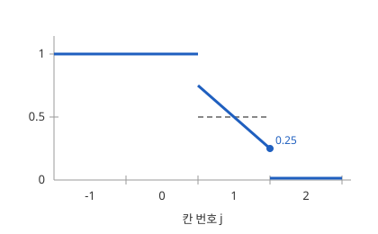

# MUSCL 방법

# 개요

**MUSCL 방법(monotone upstream-centered schemes for conservation laws, MUSCL scheme)** 은 칸마다 평균값 하나만 들던 유한 부피 방법에서 칸 안의 값을 기울기가 있는 직선으로 놓고, 그 기울기를 줄여 가며 경계를 지나는 양을 계산하는 방법이다. 강물에 실린 오염 물질의 경계를 [Godunov 방법](godunov-method.md)으로 옮기면 경계가 걸음마다 넓게 퍼진다. MUSCL 방법은 칸 안에서 값이 어느 쪽으로 기울었는지를 직선으로 들고 다녀 퍼짐을 줄이고, 기울기를 제한해 경계 앞에 봉우리가 생기지 않게 한다.

# 직관

[수송 방정식](transport-equation.md) $u\_t+u\_x=0$ 을 칸 너비 $h=1$, $\nu=k/h=0.5$ 로 푼다. 칸 $j\le 0$ 의 평균은 $1$, 칸 $j\ge 1$ 의 평균은 $0$ 이다. 참해는 계단을 한 걸음에 반 칸씩 오른쪽으로 옮기므로, 두 걸음 뒤 칸 $0,1,2,3$ 의 평균은 $1,1,0,0$ 이다.

Godunov 방법은 경계를 지나는 양을 경계 왼쪽 칸의 평균으로 계산한다. 칸 $0,1,2,3$ 의 값은 한 걸음 뒤 $1,0.5,0,0$ 이고 두 걸음 뒤 $1,0.75,0.25,0$ 이다. 한 걸음 뒤 칸 $1$ 은 왼쪽 절반이 $1$, 오른쪽 절반이 $0$ 인데, Godunov 방법은 이 칸을 $0.5$ 인 상수로 보고 둘째 걸음에 오른쪽 경계로 내보낸다. 참해에서는 둘째 걸음 동안 이 경계로 아무것도 나가지 않는다.

그래서 칸 안의 값을 이웃 칸과의 차이로 기울인 직선으로 놓는다. 기울기를 왼쪽 차이와 오른쪽 차이의 평균으로 정하면, 첫 걸음에서 칸 $0$ 은 왼쪽 차이 $0$, 오른쪽 차이 $-1$ 이라 기울기가 $-0.5$ 다. 그러면 한 걸음 뒤 칸 $-1,0,1,2$ 의 값이 $1,1.0625,0.5,-0.0625$ 가 되어 계단 앞뒤에 봉우리와 골이 생긴다.

봉우리는 칸 $0$ 처럼 한쪽 차이가 $0$ 인 자리에 기울기를 주어서 생겼다. 그래서 두 차이의 부호가 다르거나 하나가 $0$ 이면 기울기를 $0$ 으로 두고, 부호가 같으면 절댓값이 작은 쪽을 기울기로 쓴다. 첫 걸음에서는 모든 칸의 기울기가 $0$ 이라 결과가 Godunov 방법과 같은 $1,1,0.5,0$ 이다. 둘째 걸음에서는 칸 $1$ 의 두 차이가 모두 $-0.5$ 라 기울기가 $-0.5$ 이고, 나머지 칸의 기울기는 $0$ 이다.

아래 그림의 점선은 Godunov 방법이 칸 $1$ 에 놓는 상수 $0.5$ 이고, 실선은 기울기를 준 직선이다. 칸 $1$ 의 직선은 왼쪽 끝 $0.75$ 에서 오른쪽 끝 $0.25$ 로 내려간다.

둘째 걸음 동안 경계 $3/2$ 를 지나는 물질은 걸음이 시작될 때 경계 왼쪽 반 칸에 있던 것이다. 그 반 칸에서 직선의 평균은 $0.375$ 이므로 지나는 양은 $0.5\cdot 0.375$ 다. 경계 $1/2$ 로는 $0.5\cdot 1$ 이 들어온다.

두 걸음 뒤 칸 $1$ 은 $0.5+0.5-0.1875=0.8125$, 칸 $2$ 는 $0.1875$ 다. 칸 $0,1,2,3$ 의 값 $1,0.8125,0.1875,0$ 은 Godunov 방법의 $1,0.75,0.25,0$ 보다 참해 $1,1,0,0$ 에 가깝고, 봉우리도 없다.

# 정의

## 직선 재구성

칸 $j$ 의 구간을 $\lbrack x\_{j-1/2},x\_{j+1/2}\rbrack$, 가운데를 $x\_j$, 평균을 $U\_j$ 라 한다. 칸 안의 값을 다음 직선으로 놓는 것을 **직선 재구성(piecewise linear reconstruction)** 이라 하고, $\sigma\_j$ 를 칸 $j$ 의 **기울기(slope)** 라 한다.

$$
\tilde u(x)=U\_j+\sigma\_j\bigl(x-x\_j\bigr),\qquad x\_{j-1/2}\le x\le x\_{j+1/2}
$$

직선이 칸 가운데에서 $U\_j$ 를 지나므로 칸 안의 평균은 $U\_j$ 로 그대로다. 직관 절 둘째 걸음의 칸 $1$ 은 $U\_1=0.5$, $\sigma\_1=-0.5$ 다.

## 기울기 제한자

기울기를 이웃 차이에서 정하는 함수를 **기울기 제한자(slope limiter)** 라 한다. 직관 절에서 쓴 것은 다음 함수다.

$$
\mathrm{minmod}(a,b)=\begin{cases}a & ab\gt 0,\thinspace\vert a\vert\le\vert b\vert \cr b & ab\gt 0,\thinspace\vert b\vert\lt\vert a\vert \cr 0 & ab\le 0\end{cases}
$$

다음 $\sigma\_j$ 를 **minmod 기울기(minmod slope)** 라 한다.

$$
\sigma\_j=\mathrm{minmod}\Bigl(\frac{U\_j-U\_{j-1}}{h},\frac{U\_{j+1}-U\_j}{h}\Bigr)
$$

직관 절 둘째 걸음의 칸 $0$ 은 $\mathrm{minmod}(0,-0.5)=0$, 칸 $1$ 은 $\mathrm{minmod}(-0.5,-0.5)=-0.5$ 다.

## MUSCL–Hancock 갱신

보존 법칙 $u\_t+f(u)\_x=0$ 에서 한 걸음은 세 단계다.[^1][^2]

1. 칸 양 끝의 값 $U\_j^{\pm}=U\_j\pm\frac h2\sigma\_j$ 를 계산한다.
2. 반 걸음 뒤의 끝 값을 다음으로 예측한다.

$$
\bar U\_j^{\pm}=U\_j^{\pm}-\frac{k}{2h}\Bigl(f\bigl(U\_j^{+}\bigr)-f\bigl(U\_j^{-}\bigr)\Bigr)
$$

3. 경계 $x\_{j+1/2}$ 에서 왼쪽 상태 $\bar U\_j^{+}$, 오른쪽 상태 $\bar U\_{j+1}^{-}$ 의 [Riemann 문제](riemann-problem.md)를 풀어 수치 플럭스 $F\_{j+1/2}$ 를 얻고, 보존형 갱신 $U\_j-\frac kh\bigl(F\_{j+1/2}-F\_{j-1/2}\bigr)$ 을 한다.

이 방법을 **MUSCL–Hancock 방법** 이라 한다. $f(u)=au$, $a\gt 0$ 이면 셋째 단계의 플럭스는 $F\_{j+1/2}=a\bar U\_j^{+}$ 이고, 다음과 같다.

$$
F\_{j+1/2}=a\Bigl(U\_j+\frac{1-\nu}{2}h\sigma\_j\Bigr),\qquad \nu=\frac{ak}{h}
$$

직관 절 둘째 걸음의 경계 $3/2$ 에서는 $0.5+0.25\cdot(-0.5)=0.375$ 다.

# 성질

## 플럭스 제한자 방법과의 관계

$f(u)=au$, $a\gt 0$ 이면 MUSCL–Hancock 방법은 다음 갱신이다.

$$
U^{n+1}\_j=U^n\_j-\nu\bigl(U^n\_j-U^n\_{j-1}\bigr)-\frac{\nu(1-\nu)}{2}\bigl(h\sigma\_j-h\sigma\_{j-1}\bigr)
$$

$h\sigma\_j=\phi(r\_j)\bigl(U\_{j+1}-U\_j\bigr)$ 로 쓰면 [전체 변동 감소 방법](tvd-schemes.md)의 플럭스 제한자 방법과 같다. minmod 기울기는 minmod 제한자 $\phi(r)=\max(0,\min(1,r))$ 에 대응한다. 그래서 $0\le\nu\le 1$ 이고 $\phi$ 가 Sweby 영역(Sweby region)에 들면 MUSCL–Hancock 방법은 전체 변동 감소 방법이다.[^3]

다른 기울기 제한자도 같은 방식으로 대응한다. $\Delta\_-=U\_j-U\_{j-1}$, $\Delta\_+=U\_{j+1}-U\_j$ 라 할 때 van Leer 기울기는 다음이고, van Leer 제한자 $(r+\vert r\vert)/(1+\vert r\vert)$ 에 대응한다.[^1]

$$
h\sigma\_j=\frac{\Delta\_-\Delta\_++\vert\Delta\_-\Delta\_+\vert}{\Delta\_-+\Delta\_+}
$$

## 정확도

칸 평균이 일차함수에서 온 것이면 이웃 차이의 비가 $r\_j=1$ 이고 minmod 기울기가 그 일차함수의 기울기와 같다. 예측 단계는 반 걸음 뒤의 경계값을 주므로 플럭스가 시간 방향의 중점 공식이 된다. 그래서 해가 매끄럽고 극값이 아닌 곳에서 MUSCL–Hancock 방법은 공간과 시간 모두 2 차 정확도를 갖는다.[^3] 극값에서는 두 차이의 부호가 달라 기울기가 $0$ 이 되고, 그 칸에서는 Godunov 방법과 같은 1 차로 떨어진다.

## 보존과 충격파 속도

MUSCL–Hancock 방법은 보존형이므로 $\sum\_jU\_j$ 가 걸음마다 보존된다. 보존형 방법이 수렴하면 극한은 약해이고([Lax–Wendroff 정리](lax-wendroff-theorem.md)), 충격파는 Rankine–Hugoniot 조건(Rankine–Hugoniot condition)의 속도로 움직인다.[^3]

## 연립 방정식

압축성 [Euler 방정식](euler-equations-fluid.md) 같은 연립 보존 법칙에서는 기울기를 성분마다 따로 제한하면 경계 근처에 진동이 남는다. 그래서 이웃 차이를 Jacobian 의 고유벡터로 분해한 특성 변수(characteristic variables)에서 성분마다 제한하고 원래 변수로 바꾼다.[^2] 셋째 단계의 Riemann 문제는 [Roe 풀이](roe-solver.md)나 [HLL 풀이](hll-solver.md)(Harten–Lax–van Leer solver)로 근사한다.

## 반이산형

시간 방향을 예측 단계 대신 [상미분방정식](ordinary-differential-equations.md) 풀이에 맡길 수도 있다. 경계 왼쪽 값 $U\_j^{+}$ 와 오른쪽 값 $U\_{j+1}^{-}$ 의 Riemann 플럭스로 다음 식을 만든다.

$$
\frac{d}{dt}U\_j=-\frac1h\bigl(F\_{j+1/2}-F\_{j-1/2}\bigr)
$$

이 연립 상미분방정식을 2 단 [Runge–Kutta 방법](runge-kutta-methods.md)으로 푼다. [선의 방법](method-of-lines.md)으로 쓴 이 판도 2 차 정확도를 갖는다.[^2]

# 활용

- 기체 역학. 충격파 관 문제와 초음속 흐름에서 압축성 Euler 방정식을 MUSCL–Hancock 방법과 근사 Riemann 풀이로 계산한다.[^2]
- 얕은 물 방정식과 자기유체역학. 댐 붕괴와 자기장이 있는 플라스마 흐름의 유한 부피 계산에서 직선 재구성과 기울기 제한자를 쓴다.
- 더 높은 차수의 재구성. 칸 안의 값을 포물선으로 놓는 [구간별 포물선 방법](piecewise-parabolic-method.md)(piecewise parabolic method, PPM)과 여러 후보 다항식 가운데 매끄러운 것을 고르는 [ENO 방법](eno-schemes.md)(essentially non-oscillatory scheme)이 직선 재구성을 고차로 바꾼 것이다.

[^1]: B. van Leer, "Towards the ultimate conservative difference scheme. V. A second-order sequel to Godunov's method", *Journal of Computational Physics* 32 (1979), 101–136.

[^2]: E. F. Toro, *Riemann Solvers and Numerical Methods for Fluid Dynamics*, 3rd ed., Springer (2009), 13 장, 14 장.

[^3]: R. J. LeVeque, *Finite Volume Methods for Hyperbolic Problems*, Cambridge University Press (2002), 6 장, 12 장.

# 연관 문서

## 선수지식

- [Godunov 방법](godunov-method.md)
- [전체 변동 감소 방법](tvd-schemes.md)

## 더 알아보기

- [ENO 방법](eno-schemes.md)
- [구간별 포물선 방법](piecewise-parabolic-method.md)

#functional_analysis #analysis #computation
