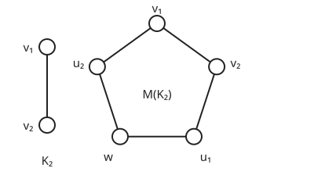
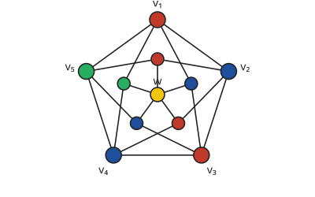

# Mycielski 구성

# 개요

**Mycielski 구성(Mycielski construction)** 은 그래프 하나에서 정점을 두 배보다 하나 많게 늘려, 삼각형은 새로 생기지 않고 칠하는 데 드는 색은 하나 늘어난 그래프를 만드는 방법이다. 서로 이웃한 세 정점이 없는 그래프는 색이 적게 들 것처럼 보이지만, 다섯 칸 고리는 삼각형이 없는데도 세 색이 든다.

이 구성을 되풀이하면 삼각형이 없으면서 색이 원하는 만큼 많이 드는 그래프가 차례로 나온다.

# 직관

[그래프 색칠](graph-coloring.md)에서 삼각형이 있으면 그 세 정점에 서로 다른 색이 들어야 한다. 그러면 삼각형이 없는 그래프는 언제나 적은 색으로 칠해지는가.

간선 하나 $K\_2$ 의 두 정점 $v\_1,v\_2$ 에 짝 정점 $u\_1,u\_2$ 를 하나씩 붙인다. $u\_1$ 은 $v\_1$ 의 이웃인 $v\_2$ 와 잇고, $u\_2$ 는 $v\_1$ 과 잇는다. 마지막으로 새 정점 $w$ 를 $u\_1,u\_2$ 와 잇는다. 그러면 다음 그림처럼 다섯 칸 고리 $v\_1,v\_2,u\_1,w,u\_2$ 가 나온다.

$K\_2$ 는 두 색이 들고 다섯 칸 고리는 세 색이 든다. 둘 다 삼각형이 없다. 같은 일을 다섯 칸 고리에 하면 정점이 $11$ 개인 그래프가 나온다.

그림에서 바깥 고리는 빨강, 파랑, 빨강, 파랑, 초록으로 칠했고, 안쪽 정점 $u\_i$ 는 바깥의 $v\_i$ 와 같은 색을, 가운데 $w$ 는 넷째 색을 받았다. 이 그래프도 삼각형이 없고, 아래 성질 절에서 보듯 세 색으로는 칠할 수 없다.

# 정의

## Mycielski 그래프

정점이 $v\_1,\dots,v\_n$ 인 그래프 $G$ 의 **Mycielski 그래프(Mycielskian)** $M(G)$ 는 정점이 $v\_1,\dots,v\_n,u\_1,\dots,u\_n,w$ 인 다음 그래프다.

- $G$ 의 간선 $v\_iv\_j$ 를 모두 둔다.
- $v\_iv\_j$ 가 $G$ 의 간선이면 $u\_i$ 와 $v\_j$ 를 잇는다.
- $w$ 를 $u\_1,\dots,u\_n$ 과 잇는다.

$u\_i$ 는 $v\_i$ 와 이웃이 같은 복사본이고, $u\_i$ 끼리는 잇지 않는다. $G$ 의 정점이 $n$ 개, 간선이 $m$ 개이면 $M(G)$ 의 정점은 $2n+1$ 개, 간선은 $3m+n$ 개다.

직관 절의 두 그림이 $M(K\_2)$ 와 $M(M(K\_2))$ 다. $M(K\_2)$ 는 다섯 칸 고리 $C\_5$ 이고, 정점 $5$ 개와 간선 $5$ 개에서 정점 $11$ 개와 간선 $3\cdot 5+5=20$ 개가 나온다.

## Grötzsch 그래프

$M(C\_5)$ 를 **Grötzsch 그래프(Grötzsch graph)** 라 한다. 직관 절의 둘째 그림이다. $M\_2=K\_2$, $M\_{k+1}=M(M\_k)$ 로 정의한 그래프의 열에서 $M\_3=C\_5$, $M\_4$ 가 Grötzsch 그래프이고, $M\_5$ 는 정점이 $23$ 개다.

# 성질

## 삼각형 없음의 보존

$G$ 에 삼각형이 없으면 $M(G)$ 에도 삼각형이 없다[^1].

$w$ 의 이웃 $u\_1,\dots,u\_n$ 은 서로 이웃하지 않으므로 $w$ 는 삼각형에 들지 않는다. 같은 이유로 삼각형에는 $u$ 꼴 정점이 많아야 하나 들어간다. 삼각형 $u\_iv\_jv\_k$ 가 있으면 $v\_j,v\_k$ 가 이웃이고 둘 다 $v\_i$ 의 이웃이므로 $v\_iv\_jv\_k$ 가 $G$ 의 삼각형이다.

## 채색수의 증가

$\chi$ 를 채색수라 하면

$$
\chi(M(G))=\chi(G)+1
$$

이다[^1].

$G$ 를 $k=\chi(G)$ 색으로 칠한 것에서 $u\_i$ 에 $v\_i$ 의 색을 주고 $w$ 에 새 색을 주면 $M(G)$ 의 적절한 $k+1$ 색칠이다. $u\_i$ 의 이웃 $v\_j$ 는 $v\_i$ 의 이웃이라 $v\_i$ 와 색이 다르기 때문이다.

거꾸로 $M(G)$ 를 $k$ 색으로 칠한 것 $c$ 가 있다고 하고, $w$ 의 색을 $k$ 라 한다. $u\_i$ 는 모두 $w$ 와 이웃하므로 색 $k$ 를 받지 않는다.

$G$ 의 정점에 $c(v\_i)\ne k$ 이면 $c(v\_i)$ 를, $c(v\_i)=k$ 이면 $c(u\_i)$ 를 준다. 이웃한 $v\_i,v\_j$ 가 둘 다 $k$ 일 수는 없고, $c(v\_i)=k$ 이면 $u\_i$ 와 $v\_j$ 가 이웃이라 $c(u\_i)\ne c(v\_j)$ 다. 그래서 이것은 $G$ 의 적절한 색칠이고 색 $k$ 를 쓰지 않으므로 $\chi(G)\le k-1$ 이 되어 모순이다.

## 임계성의 보존

간선 하나만 지워도 채색수가 줄어드는 그래프를 [임계 그래프](critical-graphs.md)라 한다. $G$ 가 $k$ 임계이면 $M(G)$ 는 $k+1$ 임계다[^4].

증명의 요지. $M(G)$ 의 간선 $e$ 마다 $M(G)-e$ 의 $k$ 색칠을 만든다. $G$ 가 $k$ 임계이므로 $G$ 에서 간선 하나나 정점 하나를 지운 그래프는 $k-1$ 색으로 칠해지고, 그 색칠 $c$ 에 색 $k$ 를 하나 더해 쓴다.

- $e=wu\_i$ 이면 $c$ 를 $G-v\_i$ 의 색칠로 잡는다. $v\_i,u\_i,w$ 에 색 $k$ 를, 나머지 $v\_j,u\_j$ 에 $c(v\_j)$ 를 준다.
- $e=u\_iv\_j$ 이면 $c$ 를 $G-v\_iv\_j$ 의 색칠로 잡는다. $v\_i,w$ 에 색 $k$ 를, 나머지 $v\_l$ 과 모든 $u\_l$ 에 $c(v\_l)$ 을 준다.
- $e=v\_iv\_j$ 이면 $c$ 를 $G-v\_iv\_j$ 의 색칠로 잡는다. $v\_i,v\_j,w$ 에 색 $k$ 를, 나머지 $v\_l$ 과 모든 $u\_l$ 에 $c(v\_l)$ 을 준다.

## 삼각형 없는 그래프의 채색수

두 성질을 합치면 $M\_k$ 는 삼각형이 없고 $\chi(M\_k)=k$ 다. 그러므로 어떤 $k$ 에 대해서도 삼각형이 없고 $k$ 색이 드는 그래프가 있다. 가장 큰 클릭의 크기 $\omega$ 는 $M\_k$ 에서 모두 $2$ 이므로, $\chi$ 는 $\omega$ 의 함수로 위에서 묶이지 않는다.

삼각형이 없는 [평면 그래프](planar-graphs.md)는 세 색으로 칠해진다는 [Grötzsch 정리](grotzsch-theorem.md)가 있으므로, Grötzsch 그래프는 평면 그래프가 아니다. Chvátal 은 Grötzsch 그래프가 삼각형이 없고 채색수가 $4$ 인 그래프 가운데 정점이 가장 적은 것임을 증명했다[^2].

## 분수 채색수

분수 채색수(fractional chromatic number) $\chi\_f$ 는

$$
\chi_f(M(G))=\chi_f(G)+\frac{1}{\chi_f(G)}
$$

를 만족한다[^3]. $\chi\_f(M\_k)$ 는 $2,\tfrac52,\tfrac{29}{10},\dots$ 이고 $\sqrt{2k}$ 정도로 자라므로, 채색수와 분수 채색수의 차가 $M\_k$ 에서 한없이 커진다.

# 활용

- [완벽그래프와 강한 완벽그래프 정리](perfect-graphs.md). 완벽 그래프는 모든 유도 부분그래프에서 $\chi=\omega$ 인 그래프다. $M\_k$ 는 $\omega=2$ 이고 $\chi=k$ 이므로 $k\ge 3$ 에서 완벽 그래프가 아니고, 두 값의 차가 $k-2$ 다.
- 큰 둘레와 큰 채색수. 짧은 고리가 없고 채색수가 큰 그래프의 존재는 Erdős 가 [확률적 방법](probabilistic-method.md)으로 증명했다. Mycielski 구성은 길이 $3$ 의 고리만 막는 명시적 구성이다. $G$ 에 경로 $v\_iv\_jv\_k$ 가 있으면 $M(G)$ 에 길이 $4$ 의 고리 $v\_iv\_jv\_ku\_j$ 가 생긴다.

[^1]: J. Mycielski, "Sur le coloriage des graphs", *Colloquium Mathematicum* 3 (1955), 161–162.
[^2]: V. Chvátal, "The minimality of the Mycielski graph", *Graphs and Combinatorics*, Lecture Notes in Mathematics 406, Springer (1974), 243–246.
[^3]: M. Larsen, J. Propp, D. Ullman, "The fractional chromatic number of Mycielski's graphs", *Journal of Graph Theory* 19 (1995), 411–416.
[^4]: T. R. Jensen, B. Toft, *Graph Coloring Problems*, Wiley (1995).

# 연관 문서

## 선수지식

- [그래프 색칠](graph-coloring.md)

## 더 알아보기

아직 연결한 문서가 없다.

#graph_theory #combinatorics
