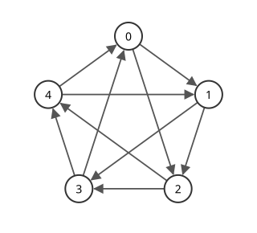

# Nash-Williams 방향 정리

# 개요

**Nash-Williams 방향 정리(Nash-Williams orientation theorem)** 는 간선 $2k$ 연결 그래프의 간선에 방향을 정해, 어느 두 정점 사이에도 간선을 공유하지 않는 방향 경로가 $k$ 개씩 있게 만들 수 있다는 정리다. 도시의 모든 도로를 일방통행으로 바꾸면서 어느 도로 하나가 막혀도 모든 지점 사이를 오갈 수 있게 하려면, 원래 도로망이 어떤 조건을 만족해야 하는지 묻는다. 이 정리는 어느 지점 집합을 떼어 내도 그 경계를 지나는 도로가 넷 이상이면 충분하다고 답한다.

# 직관

일방통행으로 바꾼 뒤에도 모든 지점 사이를 오갈 수 있으려면 다리가 없어야 하고, [귀 분해](ear-decomposition.md) 문서의 Robbins 정리에 따라 그것으로 충분하다. 도로 하나가 막혀도 오갈 수 있으려면 어느 지점 집합 $S$ 에서도 $S$ 밖으로 나가는 일방통행로가 둘 이상이어야 한다. 들어오는 길도 둘 이상이어야 하므로, 원래 도로망에서 $S$ 의 경계를 지나는 도로가 넷 이상이어야 한다.

정점 다섯 개의 완전그래프 $K\_5$ 는 어느 $S$ 의 경계에도 간선이 넷 이상 있다. 정점 $i$ 에서 $i+1$ 과 $i+2$ 로 (나머지는 $5$ 로 나눈 것) 방향을 정하면 아래 그림이 된다.

모든 정점에서 나가는 화살표와 들어오는 화살표가 둘씩이다. 그래서 어느 $S$ 에서도 나가는 화살표의 수와 들어오는 화살표의 수가 같고, 둘 다 경계 간선 수의 절반인 $2$ 이상이다.

모든 정점의 차수가 짝수이면 같은 방법이 통한다. 그래프의 간선을 한 번씩 지나는 닫힌 걸음을 따라 방향을 정하면 정점마다 나가는 수와 들어오는 수가 같아진다. 차수가 홀수인 정점이 있으면 이 방법을 그대로 쓸 수 없고, 정리의 증명은 그 경우를 다룬다.

# 정의

$G=(V,E)$ 는 다중 간선을 허용하는 유한 그래프다. 정점 집합 $S$ 에 대해 $S$ 의 정점과 $S$ 밖의 정점을 잇는 간선의 수를 $d(S)$ 로 쓴다.

공집합도 $V$ 도 아닌 모든 $S$ 에서 $d(S)\ge k$ 이면 $G$ 를 **간선 $k$ 연결(k-edge-connected)** 이라 한다. [Menger 정리](menger-theorem.md)에 따라 이것은 어느 두 정점 사이에도 간선을 공유하지 않는 경로가 $k$ 개 있는 것과 같다. $K\_5$ 는 간선 $4$ 연결이다.

$G$ 의 간선마다 한쪽 방향을 고른 유향 그래프를 $G$ 의 **방향(orientation)** 이라 한다. 방향에서 $S$ 의 정점에서 $S$ 밖의 정점으로 가는 화살표의 수를 $d^+(S)$ 로 쓴다.

공집합도 $V$ 도 아닌 모든 $S$ 에서 $d^+(S)\ge k$ 이면 그 방향을 **$k$ 호 연결(k-arc-connected)** 이라 한다. Menger 정리의 유향판에 따라 이것은 어느 정점에서 어느 정점으로도 화살표를 공유하지 않는 방향 경로가 $k$ 개 있는 것과 같다. 직관 절의 그림은 $K\_5$ 의 $2$ 호 연결 방향이다.

# 성질

## 정리

**정리(Nash-Williams, 1960).** 그래프 $G$ 에 $k$ 호 연결 방향이 있는 것과 $G$ 가 간선 $2k$ 연결인 것은 동치다[^1].

필요성은 직관 절의 셈이다. $d(S)$ 는 $d^+(S)$ 와 $d^+(V\setminus S)$ 의 합이고 두 항이 모두 $k$ 이상이다. $k=1$ 이 Robbins 정리다.

## 증명의 요지

충분성을 간선 수에 대한 귀납법으로 보인다. 간선을 하나 지워도 간선 $2k$ 연결이면 지운 그래프의 방향에 그 간선을 아무 방향으로나 더한다. 그렇지 않은 그래프, 곧 극소 간선 $2k$ 연결 그래프에는 차수가 정확히 $2k$ 인 정점 $s$ 가 있다(Mader)[^2].

$s$ 의 간선 $su$, $sv$ 두 개를 지우고 간선 $uv$ 를 더하는 것을 떼어내기(splitting off)라 한다. Lovász 의 떼어내기 정리(Lovász's splitting-off theorem)에 따르면 차수가 짝수인 $s$ 의 간선 $2k$ 개를 짝지어 모두 떼어내면서 $s$ 밖의 정점 사이의 간선 $2k$ 연결을 유지할 수 있다[^3]. 그러고 $s$ 를 지운 그래프는 간선이 $k$ 개 적다.

귀납법으로 그 그래프에 $k$ 호 연결 방향이 있다. 떼어낸 간선 $uv$ 가 $u\to v$ 로 정해졌으면 원래 간선을 $u\to s\to v$ 로 정한다. 그러면 $s$ 에서 나가고 들어오는 화살표가 $k$ 개씩이다.

$s$ 를 포함하지 않는 $S$ 에서는 $u\to v$ 가 $S$ 를 나가면 $u\to s$ 도 $S$ 를 나가므로, $S$ 를 나가고 들어오는 화살표의 수가 떼어낸 그래프의 값 이상이다. $s$ 를 포함하는 $S$ 는 여집합으로 같은 셈을 한다.

## 강한 판본

Nash-Williams 는 더 강한 진술을 증명했다. 모든 그래프에 방향이 있어, 어느 두 정점 $u,v$ 사이에서도 $u$ 에서 $v$ 로 가는 화살표 서로소 방향 경로의 수가 $u,v$ 사이의 간선 서로소 경로의 최대 수의 절반을 내림한 값 이상이다[^1]. 이 방향을 잘 균형 잡힌 방향(well-balanced orientation)이라 한다. 증명은 차수가 홀수인 정점들을 짝지어 간선을 더한 뒤 닫힌 걸음을 따라 방향을 정하는 방법을 쓴다.

# 활용

- 일방통행 설계. 개요의 물음처럼 도로망의 경계 간선 수만 보고, 도로 $k-1$ 개가 막혀도 모든 지점이 서로 닿는 일방통행 배치가 있는지 판정한다.
- [Matroid 합 정리](matroid-union.md). 간선 $2k$ 연결 그래프에는 간선을 공유하지 않는 신장트리가 $k$ 개 있다. 정점을 $p$ 덩어리로 나누면 덩어리마다 경계 간선이 $2k$ 이상이라 덩어리 사이의 간선이 $kp$ 이상이므로, Nash-Williams–Tutte 정리의 조건 $k(p-1)$ 이 만족된다.
- 부분모듈 흐름(submodular flow). 방향의 존재를 $d^+(S)$ 에 대한 부등식계로 보면, 하한이 있는 방향 문제를 부분모듈 흐름의 실행 가능성 문제로 풀 수 있다[^4].

[^1]: C. St. J. A. Nash-Williams, "On orientations, connectivity and odd-vertex-pairings in finite graphs", *Canadian Journal of Mathematics* 12 (1960), 555–567.
[^2]: W. Mader, "Minimale n-fach kantenzusammenhängende Graphen", *Mathematische Annalen* 191 (1971), 21–28.
[^3]: L. Lovász, *Combinatorial Problems and Exercises*, North-Holland, 1979, 6장.
[^4]: A. Frank, *Connections in Combinatorial Optimization*, Oxford University Press, 2011.

# 연관 문서

## 선수지식

- [귀 분해](ear-decomposition.md)

## 더 알아보기

아직 연결한 문서가 없다.

#graph_theory #combinatorics #optimization
