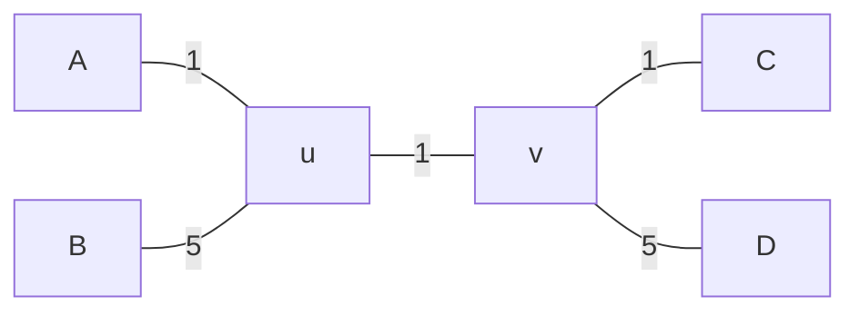

# 이웃 결합법

# 개요

**이웃 결합법(neighbor joining)** 은 생물 종 사이의 거리를 모은 표에서 계통수를 세우는 절차다. 네 종 A, B, C, D 의 거리를 재 보니 A 와 C 가 $3$ 으로 가장 가깝다. 그런데 실제 나무에서 A 는 B 와, C 는 D 와 먼저 묶이고, B 와 D 로 가는 가지가 길어서 A 와 C 가 가까워 보인 것일 수 있다.

이웃 결합법은 거리 하나 대신, 두 종의 거리에서 각 종이 나머지 모두와 떨어진 정도를 뺀 값으로 묶을 쌍을 고른다. 거리가 실제 나무의 가지 길이 합과 같으면 이 절차는 그 나무를 정확히 되찾는다.

# 직관

다음 나무에서 출발한다. A 와 B 가 노드 $u$ 에, C 와 D 가 노드 $v$ 에 붙어 있고, 가지 길이는 그림의 숫자다.

두 종의 거리를 둘을 잇는 경로의 가지 길이 합으로 두면 거리표는 다음이다.

|   | A | B  | C | D  |
| - | - | -- | - | -- |
| A | 0 | 6  | 3 | 7  |
| B | 6 | 0  | 7 | 11 |
| C | 3 | 7  | 0 | 6  |
| D | 7 | 11 | 6 | 0  |

가장 가까운 쌍은 A 와 C 이지만 둘은 나무에서 이웃이 아니다. B 와 D 는 가지가 길어 모든 종에서 멀다. 그래서 종마다 다른 종들과의 거리를 더한 값 $R$ 을 구하면 A 와 C 는 $16$, B 와 D 는 $24$ 다.

쌍 $(i,j)$ 마다 $2d(i,j)-R_i-R_j$ 를 계산한다. A 와 C 는 $6-32=-26$ 이고, A 와 B 는 $12-40=-28$ 이다. 이 값이 가장 작은 쌍은 A 와 B, 그리고 C 와 D 이며, 실제 나무의 이웃과 같다.

# 정의

## 가법 거리

종의 집합 $X$ 위의 거리 $d$ 가 어떤 나무의 가지에 양의 길이를 주어 $d(i,j)$ 가 $i$ 와 $j$ 를 잇는 경로의 길이 합이 되게 할 수 있으면 $d$ 를 **가법 거리(additive metric)** 또는 나무 거리(tree metric)라 한다. 직관 절의 거리표는 가법 거리다.

## 이웃 결합법

종이 $n$ 개인 거리표 $d$ 에서 다음을 되풀이하는 절차를 **이웃 결합법** 이라 한다[^1]. 직관 절의 표에서 $n=4$ 이다.

1. 종마다 $R_i=\sum_k d(i,k)$ 를 구한다.
2. 쌍마다 다음 값을 구하고, 이 값이 가장 작은 쌍 $(i,j)$ 를 고른다.

$$
M(i,j)=(n-2)\thinspace d(i,j)-R_i-R_j
$$

3. 새 노드 $u$ 를 만들어 $i$ 와 $j$ 를 붙이고, 가지 길이를 다음으로 정한다.

$$
\delta(i,u)=\frac{d(i,j)}{2}+\frac{R_i-R_j}{2(n-2)},\qquad \delta(j,u)=d(i,j)-\delta(i,u)
$$

4. $i$ 와 $j$ 를 표에서 지우고, 남은 종 $k$ 마다 $u$ 와의 거리를 다음으로 넣는다.

$$
d(u,k)=\frac{d(i,k)+d(j,k)-d(i,j)}{2}
$$

5. 종이 셋 남으면 세 가지를 한 노드에 붙이고 끝낸다.

직관 절의 표에서 첫 단계는 A 와 B 를 고른다. $\delta(\mathrm A,u)=3+(16-24)/4=1$, $\delta(\mathrm B,u)=5$ 이고, $d(u,\mathrm C)=(3+7-6)/2=2$, $d(u,\mathrm D)=(7+11-6)/2=6$ 이다. 남은 세 종 $u$, C, D 를 한 노드 $v$ 에 붙이면 가지 길이는 $1$, $1$, $5$ 로 처음 나무와 같다.

# 성질

## 가법 거리의 복원

정리. $d$ 가 모든 내부 가지의 길이가 양인 나무의 가법 거리이면, 이웃 결합법은 그 나무와 가지 길이를 정확히 되찾는다[^2].

증명의 요지. $M(i,j)$ 가 가장 작은 쌍은 나무에서 한 노드에 함께 붙은 잎 쌍임을 보인다. 4 단계의 새 거리표가 $i$, $j$ 를 $u$ 하나로 줄인 나무의 가법 거리이므로 귀납이 이어진다.

## 네 점 조건

정리. 거리 $d$ 가 가법 거리일 필요충분조건은 모든 네 점 $i,j,k,l$ 에서 다음 세 합 가운데 큰 두 값이 같은 것이다. 이것을 **네 점 조건(four-point condition)** 이라 한다[^3].

$$
d(i,j)+d(k,l),\qquad d(i,k)+d(j,l),\qquad d(i,l)+d(j,k)
$$

직관 절의 표에서 세 합은 $6+6=12$, $3+11=14$, $7+7=14$ 이고, 큰 두 값이 같다. 가장 작은 합을 주는 짝짓기 $\lbrace\mathrm{AB},\mathrm{CD}\rbrace$ 가 나무에서 갈라지는 방식이다.

## 오차에 대한 안정성

정리. 관측한 거리와 가법 거리의 차가 모든 쌍에서 가장 짧은 내부 가지 길이의 절반보다 작으면, 이웃 결합법은 나무의 모양을 정확히 되찾는다[^4].

## 계산량

단계마다 쌍 $O(n^2)$ 개의 $M$ 을 계산하고 단계가 $n-3$ 번이므로 전체는 $O(n^3)$ 이다.

# 활용

- 계통수 추정. 서열 쌍마다 [Jukes–Cantor 모형](jukes-cantor-model.md)의 거리를 구해 거리표를 만들고 이웃 결합법으로 나무를 세운다. 서열이 수천 개여도 계산이 끝나므로 [Felsenstein 가지치기 알고리즘](felsenstein-pruning-algorithm.md)을 쓰는 최대가능도 탐색의 출발 나무로 쓴다.
- 거리 행렬로만 주어진 자료의 위계 구조 추정. 언어, 필사본, 바이러스 표본의 거리표에도 같은 절차를 쓴다.

[^1]: N. Saitou, M. Nei, "The neighbor-joining method: a new method for reconstructing phylogenetic trees", *Molecular Biology and Evolution* 4 (1987), 406–425.
[^2]: J. A. Studier, K. J. Keppler, "A note on the neighbor-joining algorithm of Saitou and Nei", *Molecular Biology and Evolution* 5 (1988), 729–731.
[^3]: P. Buneman, "A note on the metric properties of trees", *Journal of Combinatorial Theory, Series B* 17 (1974), 48–50.
[^4]: K. Atteson, "The performance of neighbor-joining methods of phylogenetic reconstruction", *Algorithmica* 25 (1999), 251–278.

# 연관 문서

## 선수지식

- [Jukes–Cantor 모형](jukes-cantor-model.md)

## 더 알아보기

아직 연결한 문서가 없다.

#statistics #algorithms #graph_theory
