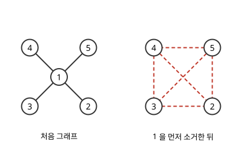

# 중첩 분할

# 개요

**중첩 분할(nested dissection)** 은 희소한 대칭 연립방정식을 Gauss 소거법으로 풀 때, 미지수를 소거하는 순서를 그래프의 분리자로 정하는 방법이다. 격자 위의 온도 분포를 구하는 방정식처럼 미지수마다 이웃 몇 개와만 엮인 연립방정식도, 소거 순서를 잘못 고르면 소거 도중에 0 이던 계수가 대량으로 0 이 아니게 되어 저장량과 계산량이 커진다. 중첩 분할은 그래프를 둘로 가르는 정점을 맨 나중에 소거하기를 재귀로 되풀이해, 평면 격자에서 새로 생기는 0 아닌 계수를 $O(n\log n)$ 개로 줄인다.

# 직관

미지수 $x\_1,\dots,x\_5$ 에서 $x\_1$ 이 나머지 넷과 모두 엮이고 나머지 넷끼리는 엮이지 않은 연립방정식을 푼다. 계수 행렬에서 0 이 아닌 자리를 $\ast$ 로 적으면 다음과 같다.

$$
\begin{pmatrix}\ast&\ast&\ast&\ast&\ast\cr \ast&\ast&&&\cr \ast&&\ast&&\cr \ast&&&\ast&\cr \ast&&&&\ast\end{pmatrix}
$$

[Gauss 소거법](gaussian-elimination.md)으로 첫 식을 써서 $x\_1$ 을 먼저 없애면, 둘째부터 다섯째 식에 첫 식의 상수배를 빼면서 $x\_2,\dots,x\_5$ 가 모든 식에 들어간다. 남은 $4\times4$ 행렬이 꽉 차서 0 이던 자리 $12$ 개가 0 이 아니게 된다.

$x\_1$ 을 맨 나중에 없애면 사정이 다르다. $x\_2$ 를 없앨 때 $x\_2$ 가 들어간 식은 첫 식뿐이어서 첫 식의 $x\_2$ 항만 없어지고 새 항은 생기지 않는다. $x\_3,x\_4,x\_5$ 도 같고, 새로 0 이 아니게 되는 자리가 하나도 없다.

미지수를 정점으로, 한 식에 함께 들어간 두 미지수를 간선으로 두면 이 연립방정식은 $1$ 을 가운데로 한 별 그래프다. 아래 그림의 오른쪽처럼 $1$ 을 먼저 소거하면 나머지 네 정점이 모두 이어진다.

$1$ 은 지우면 그래프가 넷으로 갈라지는 정점이고, 그런 정점을 나중에 소거하면 갈라진 조각 사이에는 간선이 생기지 않는다.

# 정의

## 소거 그래프와 채움

대칭 행렬 $A$ 의 그래프 $G(A)$ 는 행 번호를 정점으로, $a\_{ij}\ne0$ ($i\ne j$) 인 쌍을 간선으로 둔 그래프다. 정점 $v$ 를 소거하면 $v$ 를 지우고 $v$ 의 이웃끼리를 모두 간선으로 잇는다. 정한 순서대로 소거하면서 새로 더해진 간선을 **채움(fill-in)** 이라 한다. 채움 간선은 소거 도중 0 이 아니게 되는 행렬 성분이다. 직관 절에서 $1$ 을 먼저 소거하면 채움 간선이 $6$ 개, 대칭인 행렬 성분으로 $12$ 개이고, $1$ 을 나중에 소거하면 $0$ 개다.

## 중첩 분할 순서

그래프 $G$ 의 분리자 $S$ 를 골라 $G-S$ 의 조각들을 각각 재귀로 순서를 정하고, 그 뒤에 $S$ 의 정점을 놓는다. 조각이 충분히 작으면 아무 순서나 쓴다. 이렇게 얻은 소거 순서를 **중첩 분할 순서** 라 한다. 직관 절에서 $\lbrace 1\rbrace$ 이 별 그래프의 분리자이고, 중첩 분할 순서는 $2,3,4,5,1$ 이다.

# 성질

## 분리자 사이의 채움

$S$ 를 맨 나중에 소거하면 $G-S$ 의 서로 다른 조각에 속한 두 정점 사이에는 채움 간선이 생기지 않는다. 채움 간선 $uw$ 가 생기는 것은 $u$ 와 $w$ 보다 먼저 소거한 정점들만 지나는 경로가 $u$ 와 $w$ 를 이을 때다. 다른 조각으로 가는 경로는 모두 아직 소거하지 않은 $S$ 를 지나므로 그런 경로가 없다.

## 격자와 평면 그래프의 한계

$k\times k$ 격자, 곧 정점 $n=k^2$ 개의 5점 차분 방정식에서 가운데 줄을 분리자로 쓰는 중첩 분할 순서는 채움이 $O(n\log n)$ 개이고 소거의 곱셈 수가 $O(n^{3/2})$ 이다[^1]. 줄 순서대로 소거하면 띠 행렬이 되어 채움이 $O(n^{3/2})$ 개, 곱셈 수가 $O(n^2)$ 이다. 격자에서는 어떤 소거 순서도 곱셈 수가 $cn^{3/2}$ 보다 작을 수 없으므로 중첩 분할의 곱셈 수는 차수가 최적이다[^2].

[평면 분리자 정리](planar-separator-theorem.md)로 분리자를 고르면 임의의 평면 그래프에서 같은 $O(n\log n)$ 채움과 $O(n^{3/2})$ 곱셈 수가 성립한다[^3].

## 채움 최소화의 어려움

채움 간선 수를 가장 작게 하는 소거 순서를 찾는 문제는 NP-완전(NP-complete, NP 는 nondeterministic polynomial time)이다[^4]. 그래서 실제로는 중첩 분할이나 차수가 가장 작은 정점을 먼저 소거하는 최소 차수 순서 같은 어림 규칙을 쓴다.

# 활용

- 편미분방정식의 직접 풀이. 2 차원 유한 요소법과 유한 차분법의 강성 행렬을 Cholesky 분해로 풀 때 미지수 순서를 중첩 분할로 정한다. 희소 행렬 프로그램의 순서 정하기 단계가 그래프 분할 프로그램으로 분리자를 찾는다.
- 병렬 소거. $G-S$ 의 조각들 사이에는 채움도 의존도 없으므로 조각들을 서로 다른 처리기에서 동시에 소거한다.
- 평면 그래프의 알고리즘. 평면 그래프의 [Laplacian](graph-laplacian.md) 연립방정식, 최단 경로, 최대 흐름을 분리자로 재귀 분할해 푸는 알고리즘이 같은 구조를 쓴다.

[^1]: A. George, "Nested dissection of a regular finite element mesh", *SIAM Journal on Numerical Analysis* **10** (1973), 345–363.
[^2]: A. J. Hoffman, M. S. Martin, D. J. Rose, "Complexity bounds for regular finite difference and finite element grids", *SIAM Journal on Numerical Analysis* **10** (1973), 364–369.
[^3]: R. J. Lipton, D. J. Rose, R. E. Tarjan, "Generalized nested dissection", *SIAM Journal on Numerical Analysis* **16** (1979), 346–358.
[^4]: M. Yannakakis, "Computing the minimum fill-in is NP-complete", *SIAM Journal on Algebraic and Discrete Methods* **2** (1981), 77–79.

# 연관 문서

## 선수지식

- [평면 분리자 정리](planar-separator-theorem.md)
- [Gauss 소거법](gaussian-elimination.md)

## 더 알아보기

아직 연결한 문서가 없다.

#graph_theory #linear_algebra #algorithms
