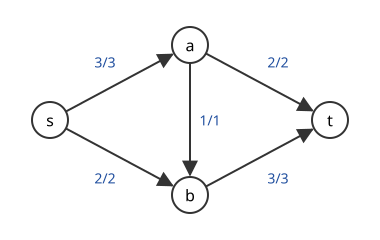

# 네트워크 흐름

# 개요

**네트워크 흐름(network flow)** 은 간선마다 용량이 정해진 유향 [그래프](graphs.md)에서 출발점 $s$ 로부터 도착점 $t$ 로 최대한 많은 양을 흘려보내는 문제다. 굵기가 다른 수도관으로 이어진 배수망에서 정수장의 물을 마을로 1초에 얼마까지 보낼 수 있는지가 이 꼴이다. 남은 용량이 있는 경로를 찾아 흘리고, 이미 흘린 양을 취소할 수 있는 역방향 간선을 함께 두면서 반복하면 최대 흐름이 나온다.

# 직관

아래 그림은 정점 $s,a,b,t$ 와 간선 $s\to a$, $s\to b$, $a\to b$, $a\to t$, $b\to t$ 의 네트워크이고, 간선의 수는 흐르는 양/용량이다. $s$ 에서 $5$ 가 나가 $t$ 에 $5$ 가 들어간다. $s$ 에서 나가는 두 간선의 용량 합이 $3+2=5$ 이므로 이보다 많이 보낼 수 없다.

용량이 모두 $1$ 이면 사정이 다르다. 남은 용량이 있는 경로를 하나 골라 흘리기를 되풀이하는데, 처음에 $s\to a\to b\to t$ 를 고르면 $s\to a$, $a\to b$, $b\to t$ 가 모두 차서 $s$ 에서 $t$ 로 더 흘릴 경로가 없다. 흐른 양은 $1$ 이지만 $s\to a\to t$ 와 $s\to b\to t$ 에 하나씩 흘리면 $2$ 다.

막힌 이유는 $a\to b$ 에 흘린 $1$ 을 되돌릴 수 없는 것이다. $s\to b$ 로 $1$ 을 보내 $b$ 에서 $a\to b$ 의 흐름을 거꾸로 취소하고, 그 $1$ 을 $a\to t$ 로 보내면 흐름이 $2$ 가 된다. 이미 흘린 양을 취소하는 거꾸로 간선을 함께 두고 경로를 찾는 것이 아래 잔여 그래프다.

# 정의

## 네트워크와 흐름

**네트워크(network)** 는 유향 그래프 $G = (V, E)$ 와 용량(capacity) 함수 $c : E \to \mathbb{R}\_{\ge 0}$ 과 서로 다른 두 정점 출발점(source) $s$ 와 도착점(sink) $t$ 의 조합이다.

**흐름(flow)** 은 다음 두 조건을 만족하는 함수 $f : E \to \mathbb{R}$ 다.

$$
0 \le f(e) \le c(e) \quad (\forall e \in E)
$$

$$
\sum_{e \in \delta^{-}(v)} f(e) \thickspace=\thickspace \sum_{e \in \delta^{+}(v)} f(e) \quad (\forall v \in V \setminus \lbrace s, t\rbrace)
$$

여기서 $\delta^-(v)$ 와 $\delta^+(v)$ 는 각각 $v$ 로 들어오는 간선 집합과 나가는 간선 집합이다. 첫 조건이 **용량 제약(capacity constraint)**, 둘째가 **흐름 보존(flow conservation)** 이다. 흐름의 **값(value)** 은

$$
|f| \thickspace=\thickspace \sum_{e \in \delta^{+}(s)} f(e) \thickspace-\thickspace \sum_{e \in \delta^{-}(s)} f(e)
$$

이고, 값이 가장 큰 흐름을 **최대 흐름(maximum flow)** 이라 한다.

직관 절의 그림에서 $a$ 로는 $3$ 이 들어오고 $a\to b$ 로 $1$, $a\to t$ 로 $2$ 가 나가며, $b$ 로는 $2+1=3$ 이 들어오고 $b\to t$ 로 $3$ 이 나가므로 흐름 보존이 성립한다. 값은 $3+2=5$ 다.

## 절단

$s \in S$ 이고 $t \in T = V \setminus S$ 인 분할 $(S, T)$ 를 **$s$–$t$ 절단(s-t cut)** 이라 하고, 그 용량을

$$
\mathrm{cap}(S, T) \thickspace=\thickspace \sum_{\substack{e = (u,v) \in E \cr u \in S,\ v \in T}} c(e)
$$

로 정의한다. $T$ 에서 $S$ 로 가는 간선은 세지 않는다. 그림에서 $S=\lbrace s\rbrace$ 이면 용량이 $3+2=5$ 이고, $S=\lbrace s,a\rbrace$ 이면 $s\to b$, $a\to b$, $a\to t$ 가 건너가 용량이 $2+1+2=5$ 다.

## 잔여 그래프

흐름 $f$ 와 간선 $e = (u, v) \in E$ 에 대해 앞방향 $(u,v)$ 의 **잔여 용량(residual capacity)** 은 $c(e) - f(e)$ 이고, 거꾸로 $(v, u)$ 의 잔여 용량은 $f(e)$ 다. 잔여 용량이 양수인 간선만 모은 유향 그래프를 **잔여 그래프(residual graph)** $G_f$ 라 한다.

$G_f$ 에서 $s$ 로부터 $t$ 로 가는 경로를 **증가 경로(augmenting path)** 라 하고, 그 경로의 잔여 용량 가운데 가장 작은 값을 **병목(bottleneck)** 이라 한다.

직관 절의 용량 $1$ 인 네트워크에서 $s\to a\to b\to t$ 에 $1$ 을 흘린 흐름의 잔여 그래프는 $s\to b$, $a\to t$ 와 거꾸로 간선 $a\to s$, $b\to a$, $t\to b$ 로 이루어진다. $s\to b\to a\to t$ 가 병목 $1$ 인 증가 경로이고, 직관 절의 취소가 이 경로를 따라 흘리는 것이다.

# 성질

## 약 쌍대성

약 쌍대성(weak duality)은 임의의 흐름 $f$ 와 임의의 $s$–$t$ 절단 $(S, T)$ 에 대한 다음 부등식이다.

$$
|f| \thickspace=\thickspace \sum_{\substack{(u,v) \in E \cr u \in S, v \in T}} f(u,v) \thickspace-\thickspace \sum_{\substack{(u,v) \in E \cr u \in T, v \in S}} f(u,v) \thickspace\le\thickspace \mathrm{cap}(S, T)
$$

증명의 요지. 흐름 보존식을 $S$ 의 모든 정점에 대해 더한다. $s$ 를 제외한 $S$ 의 정점에서는 좌우가 상쇄되어 0이고, $s$ 에서는 $\lvert f \rvert$ 가 남는다. $S$ 내부를 오가는 간선은 한 번은 유입, 한 번은 유출로 두 번 세어져 사라지므로, 결국 $S$ 에서 $T$ 로 나가는 흐름의 합에서 $T$ 에서 $S$ 로 들어오는 흐름의 합을 뺀 값이 $\lvert f \rvert$ 다. 앞항은 $\mathrm{cap}(S, T)$ 이하이고 뒷항은 0 이상이므로 부등식이 성립한다. ∎

따름정리로 $\max \lvert f \rvert \le \min \mathrm{cap}(S, T)$ 를 얻는다. 어떤 흐름과 어떤 절단에서 등호가 성립하면 둘 다 최적이다. 그림의 흐름과 $S=\lbrace s\rbrace$ 가 그런 쌍이다.

## Ford–Fulkerson 과 최대유량 최소절단 정리

Ford–Fulkerson 알고리즘(Ford–Fulkerson algorithm, 1956[^1])은 다음 절차다. $f = 0$ 에서 시작한다. 잔여 그래프 $G_f$ 에서 $s \to t$ 경로를 하나 찾는다. 없으면 종료한다. 있으면 그 병목 $b$ 만큼 경로 위의 앞방향 간선에는 흐름을 더하고 거꾸로 간선에 대응하는 원래 간선에서는 흐름을 빼서 갱신한다. 반복한다.

갱신 후에도 용량 제약과 흐름 보존이 유지되고 값이 정확히 $b$ 만큼 증가한다. 직관 절의 용량 $1$ 인 네트워크에서는 두 번의 증가로 값이 $2$ 가 된다.

최대유량 최소절단 정리(max-flow min-cut theorem)는 최대 흐름의 값과 최소 절단의 용량이 같다는 정리다.

$$
\max_{f} |f| \thickspace=\thickspace \min_{(S,T)} \mathrm{cap}(S, T)
$$

증명은 다음 세 명제가 동치임을 보인다. (1) $f$ 는 최대 흐름이다. (2) $G_f$ 에 증가 경로가 없다. (3) 어떤 절단 $(S, T)$ 에 대해 $\lvert f \rvert = \mathrm{cap}(S, T)$ 가 성립한다.

(1) 에서 (2) 로. 증가 경로가 있으면 값을 늘릴 수 있으므로 최대가 아니다.

(2) 에서 (3) 로. $S$ 를 $G_f$ 에서 $s$ 로부터 도달 가능한 정점 집합으로, $T = V \setminus S$ 로 둔다. 가정에서 $t \notin S$ 이므로 이는 $s$–$t$ 절단이다. $u \in S$ 이고 $v \in T$ 이고 $(u,v) \in E$ 라면 잔여 용량이 0이어야 하므로 $f(u,v) = c(u,v)$ 다. $u \in T$ 이고 $v \in S$ 이고 $(u,v) \in E$ 라면 역방향 잔여 용량이 0이어야 하므로 $f(u,v) = 0$ 이다. 약 쌍대성 보조정리의 등식에 대입하면 $\lvert f \rvert = \mathrm{cap}(S, T)$ 를 얻는다.

(3) 에서 (1) 로. 약 쌍대성으로 모든 흐름이 $\mathrm{cap}(S, T)$ 이하인데 $f$ 가 그 값을 달성하므로 최대다.

모든 용량이 정수면, 각 증가 단계가 값을 최소 1 늘리므로 알고리즘은 유한 번에 끝나고 정수 최대 흐름이 나온다. [무리수](irrational-numbers.md) 용량에서는 증가가 끝나지 않고 최대 흐름이 아닌 값으로 수렴하는 예가 있어, 증가 경로를 고르는 규칙이 필요하다.

## Edmonds–Karp 와 복잡도

Edmonds–Karp 알고리즘(Edmonds–Karp algorithm, 1972[^2])은 증가 경로로 잔여 그래프에서 간선 수가 가장 적은 경로를 [그래프 탐색](graph-search.md)의 너비 우선 탐색(breadth-first search, BFS)으로 고른다. 그러면 증가 횟수는 $O(VE)$ 이하이고 전체 시간은 $O(VE^2)$ 다. 이 경계는 용량 값과 무관하다.

증명의 요지. $d_f(v)$ 를 $G_f$ 에서 $s$ 로부터 $v$ 까지의 최단 거리라 하자. 두 보조정리를 보인다. 첫째, 증가를 거듭해도 각 $d_f(v)$ 는 절대 감소하지 않는다(역간선이 새로 생기더라도 최단 거리를 줄일 수 없음을 최단 경로의 정의로 확인한다). 둘째, 어떤 간선이 병목이 되어 잔여 그래프에서 사라진 뒤 다시 나타나려면 그 사이에 양 끝점 거리 차가 2 이상 늘어야 한다. 거리는 $V$ 이하이므로 각 간선은 $O(V)$ 번만 병목이 될 수 있고, 간선이 $E$ 개이므로 증가 횟수는 $O(VE)$ 다. 각 증가는 BFS 한 번이므로 $O(E)$ 가 든다. ∎

Dinic 알고리즘(Dinic's algorithm)은 $O(V^2 E)$ 시간이고 용량이 모두 $1$ 이면 $O(E\sqrt{E})$ 시간이다. Goldberg–Tarjan 의 push–relabel 알고리즘은 $O(V^3)$ 시간이고, Chen, Kyng, Liu, Peng, Probst Gutenberg, Sachdeva 는 $E^{1+o(1)}$ 시간 알고리즘을 주었다[^3].

## LP 로서의 흐름과 쌍대성

최대유량은 [선형계획법](linear-programming.md)(linear programming, LP)의 문제다.

$$
\max \ |f| \quad \text{s.t.} \quad 0 \le f(e) \le c(e), \quad \text{보존식}
$$

경로마다 변수를 두어 쓸 수도 있다. $P$ 를 모든 $s\text{-}t$ 경로의 집합이라 하고 $x_p \ge 0$ 을 경로 $p$ 에 흘리는 양이라 하면

$$
\max \sum_{p \in P} x_p \quad \text{s.t.} \quad \sum_{p \ni e} x_p \le c(e) \ (\forall e), \quad x \ge 0
$$

이다. 이 LP 의 쌍대는 간선마다 변수 $y_e \ge 0$ 을 두고

$$
\min \sum_{e \in E} c(e)\thinspace y_e \quad \text{s.t.} \quad \sum_{e \in p} y_e \ge 1 \ (\forall p \in P), \quad y \ge 0
$$

가 된다. 이것은 모든 $s$–$t$ 경로의 길이가 $1$ 이상이 되도록 간선에 길이를 주는 방법 가운데 비용이 최소인 것을 찾는 분수 절단(fractional cut) 문제다. 최대유량 최소절단 정리는 이 LP 의 최적해 가운데 $0/1$ 값인 것이 있다는 정리와 같다. 흐름 문제의 제약 [행렬](matrices.md)인 접합 행렬은 완전 단모듈러(totally unimodular)이므로 꼭짓점이 정수점이다. LP 쌍대성의 일반론은 [Lagrange 쌍대성](lagrange-duality.md)에 있다.

상보 여유 조건(complementary slackness)은 최대유량 최소절단 정리의 등호 조건과 같다. 절단을 $S$ 에서 $T$ 로 건너는 간선은 흐름이 용량과 같고, $T$ 에서 $S$ 로 건너는 간선은 흐름이 $0$ 이다.

## Menger 정리

[Menger 정리](menger-theorem.md)(1927)는 유향 그래프에서 $s$ 와 $t$ 를 잇는 간선-서로소 경로의 최대 개수는, 제거하면 $s\text{-}t$ 경로가 모두 끊기는 간선 집합의 최소 크기와 같다는 정리다. 정점 판본도 성립한다.

증명의 요지. 모든 간선 용량을 1로 두면 정수 최대 흐름은 간선-서로소 경로들의 모임으로 분해되고, 최소 절단은 끊는 간선 집합이다. 최대유량 최소절단 정리를 그대로 적용한다. 정점 판본은 각 정점 $v$ 를 $v_{\text{in}} \to v_{\text{out}}$ 용량 1의 간선으로 쪼개는 표준 변환을 먼저 한다. ∎

그래프의 연결도(connectivity)가 이 정리로 두 정점 사이의 경로 개수로 계산된다.

# 활용

## 이분 매칭 환원

이분 그래프 $G = (X \cup Y, E)$ 에 새 정점 $s$ 와 $t$ 를 추가한다. 모든 $x \in X$ 에 대해 $s \to x$ 를, 모든 $y \in Y$ 에 대해 $y \to t$ 를 용량 1로 두고, 원래 간선 $x \to y$ 를 용량 1(또는 무한대)로 둔다. 그러면 정수 흐름과 매칭이 일대일 대응하고, 최대유량이 최대 매칭 크기다. 최소 절단은 최소 정점 덮개에 대응하므로 König 정리(Kőnig's theorem)가 최대유량 최소절단 정리의 따름정리로 나온다.

이렇게 만든 단위 용량 네트워크에서 Dinic 알고리즘은 $O(E\sqrt{V})$ 시간이 들고, 단계마다 하는 일이 Hopcroft–Karp 알고리즘과 같다.

## 확장과 응용

- 최소 비용 최대 흐름(minimum-cost maximum flow). 간선마다 단위 비용을 두고 같은 값의 흐름 중 비용이 최소인 것을 찾는다. 음수 순환이 없는 잔여 그래프에서 비용이 최소인 경로로 증가하는 연속 최단 경로법(successive shortest path method)으로 푼다. [매칭](matchings.md)의 헝가리안 방법(Hungarian method)이 이것의 특수한 경우다.
- 출발점과 도착점이 여럿인 경우, 정점 용량, 흐름의 하한은 모두 정점과 간선을 더하는 변환으로 기본 문제에 환원된다. 하한이 있는 흐름이 존재하는지는 Hoffman 순환 정리(Hoffman's circulation theorem)로 판정한다.
- 이득이 있는 작업을 고르되 선행 작업을 반드시 포함해야 하는 폐포 문제(closure problem)는 최소 절단으로 풀린다. 영상 분할(image segmentation)의 그래프 절단(graph cut) 방법이 같은 틀이다.
- 신뢰성과 연결도. Menger 정리로부터 간선/정점 연결도를 최대유량 여러 번으로 계산하고, 전역 최소 절단은 [Stoer–Wagner 알고리즘](stoer-wagner-algorithm.md)으로 더 빠르게 얻는다.
- Hall 결혼 정리(Hall's marriage theorem), König 정리, [Dilworth 정리](dilworth-theorem.md)([부분순서](partial-orders.md)의 사슬 분해), Menger 정리가 모두 최대유량 최소절단 정리 또는 그 LP 쌍대성에서 유도된다.

## 구현과 알고리즘 선택

[실수](real-numbers.md) 용량으로 Ford–Fulkerson 을 그냥 돌리면 종료가 보장되지 않는다. 정수나 유리수로 다루거나 Edmonds–Karp 알고리즘, 용량 스케일링(capacity scaling), Dinic 알고리즘을 쓴다. 규모가 커지면 흐름 분해를 명시적으로 유지하지 말고 간선별 흐름값만 관리하는 편이 낫다. 최적성 증명이 필요하면 최소 절단을 함께 출력한다. 잔여 그래프에서 $s$ 의 도달 가능 집합을 BFS 한 번으로 구하므로 $O(E)$ 시간이 더 들 뿐이고, [최소 신장트리](minimum-spanning-tree.md)의 절단 성질처럼 검증 가능한 증명서가 된다.

[^1]: L. R. Ford, D. R. Fulkerson, "Maximal Flow Through a Network", Canadian Journal of Mathematics 8 (1956), https://doi.org/10.4153/CJM-1956-045-5
[^2]: J. Edmonds, R. M. Karp, "Theoretical Improvements in Algorithmic Efficiency for Network Flow Problems", Journal of the ACM 19 (1972), https://doi.org/10.1145/321694.321699
[^3]: L. Chen, R. Kyng, Y. P. Liu, R. Peng, M. Probst Gutenberg, S. Sachdeva, "Maximum Flow and Minimum-Cost Flow in Almost-Linear Time", 63rd IEEE Symposium on Foundations of Computer Science (2022), https://doi.org/10.1109/FOCS54457.2022.00064

# 연관 문서

## 선수지식

- [그래프](graphs.md)
- [선형계획법](linear-programming.md)

## 더 알아보기

- [가격 무정부](price-of-anarchy.md)
- [Menger 정리](menger-theorem.md)

#graph_theory #algorithms
