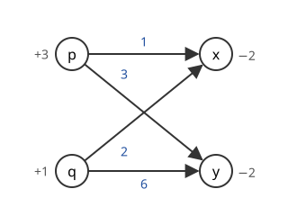
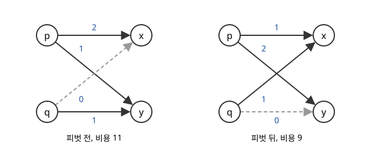

# 네트워크 단체법

# 개요

**네트워크 단체법(network simplex method)** 은 [최소 비용 흐름](min-cost-flow.md) 문제를 신장 트리(spanning tree) 위의 흐름에서 출발해, 트리에 간선 하나를 넣고 하나를 빼는 교환을 되풀이하며 푸는 [단체법](simplex-method.md)이다. 창고 두 곳에서 매장 두 곳으로 물건을 나르는 계획이 있을 때, 쓰지 않던 길 하나로 물건을 돌리면 운송비가 줄어드는지, 줄어든다면 얼마나 돌릴 수 있는지를 묻는 문제가 이 꼴이다. 네트워크 단체법은 이 물음을 쓰는 길들이 이루는 트리 위의 덧셈과 뺄셈만으로 답하고, 줄어드는 길이 없을 때 멈춘다.

# 직관

아래 그림은 창고 $p,q$ 가 물건을 $3$ 개와 $1$ 개 내보내고 매장 $x,y$ 가 $2$ 개씩 받는 네트워크다. 간선 위의 수는 한 개를 보내는 비용이고, 길마다 실을 수 있는 양에는 상한이 없다.

$q$ 의 $1$ 개를 $y$ 로 보내는 계획에서 시작한다. 그러면 $y$ 는 $p$ 에서 $1$ 개를 더 받아야 하고 $x$ 는 $p$ 에서 $2$ 개를 받는다. 쓰는 길은 $p\to x$, $p\to y$, $q\to y$ 세 개이고 비용은 $2\cdot1+1\cdot3+1\cdot6=11$ 이다.

쓰지 않는 길 $q\to x$ 로 $1$ 개를 돌린다. $x$ 가 $q$ 에서 $1$ 개를 받으므로 $p\to x$ 를 $1$ 줄이고, 그만큼 $p$ 가 $p\to y$ 로 $1$ 을 더 보내고, $y$ 가 그만큼 더 받으므로 $q\to y$ 를 $1$ 줄인다. 비용은 $2-1+3-6=-2$ 만큼 바뀌어 줄어든다.

돌릴 수 있는 양은 줄이는 길 $p\to x$ 와 $q\to y$ 에 흐르는 $2$ 와 $1$ 가운데 작은 $1$ 이다. $1$ 을 돌리면 $q\to y$ 가 비고 비용은 $11-2=9$ 다. 아래 그림의 왼쪽이 처음 계획이고 오른쪽이 돌린 뒤의 계획이다. 점선은 쓰지 않는 길이다.

오른쪽 계획에서 남은 빈 길 $q\to y$ 로 $1$ 개를 돌리면 $q\to x$ 와 $p\to y$ 를 줄이고 $p\to x$ 를 늘리므로 비용이 $6-2+1-3=2$ 만큼 늘어난다. 줄어드는 길이 없으므로 비용 $9$ 가 최소다.

# 정의

## 신장 트리 해

이 절의 문제는 용량 상한이 없는 최소 비용 흐름 문제다. 유향 그래프 $G=(V,E)$ 의 간선 방향을 무시해 얻은 그래프에서 모든 정점을 잇고 순환이 없는 간선 집합 $T\subseteq E$ 를 **신장 트리(spanning tree)** 라 한다.

$T$ 밖의 간선에 $0$ 을 흘리고 $T$ 의 간선 흐름을 공급 조건으로 정한 흐름을 $T$ 의 **신장 트리 해(spanning tree solution)** 라 하고, $T$ 의 흐름이 모두 $0$ 이상이면 **허용 트리(feasible tree)** 라 한다. 트리의 잎에서 시작해 잎 하나의 공급량이 그 잎에 붙은 간선의 흐름을 정하므로 신장 트리 해는 하나로 정해진다.

직관 절의 처음 계획은 $T=\lbrace p\to x,\thinspace p\to y,\thinspace q\to y\rbrace$ 의 신장 트리 해다. 잎 $q$ 의 공급량 $1$ 이 $q\to y$ 의 흐름 $1$ 을, 잎 $x$ 의 수요 $2$ 가 $p\to x$ 의 흐름 $2$ 를 정하고, 남은 $p\to y$ 는 $1$ 이다.

## 트리 퍼텐셜

$T$ 의 **트리 퍼텐셜(tree potential)** 은 한 정점 $r$ 에서 $\pi(r)=0$ 이고, $T$ 의 모든 간선 $(u,v)$ 에서 축소 비용 $w(u,v)+\pi(u)-\pi(v)$ 가 $0$ 인 함수 $\pi:V\to\mathbb R$ 다. $r$ 에서 트리를 따라가며 값을 정하므로 하나로 정해진다.

직관 절의 처음 트리에서 $\pi(p)=0$ 으로 두면 $p\to x$ 에서 $\pi(x)=1$, $p\to y$ 에서 $\pi(y)=3$, $q\to y$ 에서 $6+\pi(q)-3=0$ 이므로 $\pi(q)=-3$ 이다. 트리 밖 간선 $q\to x$ 의 축소 비용은 $2+(-3)-1=-2$ 이고, 직관 절에서 $1$ 개를 돌릴 때 바뀐 비용과 같다.

## 피벗

허용 트리 $T$ 와 그 퍼텐셜 $\pi$ 에서 다음 교환을 **피벗(pivot)** 이라 한다.

1. 축소 비용이 음수인 트리 밖 간선 $e$ 를 들어올 간선으로 고른다. 없으면 멈춘다.
2. $T\cup\lbrace e\rbrace$ 에는 순환이 하나 있다. 그 순환에서 $e$ 와 같은 방향의 간선을 앞간선(forward edge), 반대 방향의 간선을 뒷간선(backward edge)이라 한다.
3. 뒷간선이 없으면 이 순환으로 얼마든지 흘릴 수 있어 비용의 하한이 없다. 있으면 뒷간선 흐름의 최솟값 $\theta$ 를 구한다.
4. 앞간선에 $\theta$ 를 더하고 뒷간선에서 $\theta$ 를 뺀다. 흐름이 $0$ 이 된 뒷간선 하나를 나갈 간선으로 $T$ 에서 빼고 $e$ 를 넣는다.

직관 절의 피벗에서 들어올 간선은 $q\to x$ 이고, 순환은 $q\to x$, $p\to x$, $p\to y$, $q\to y$ 다. 뒷간선은 $p\to x$ 와 $q\to y$ 이고 $\theta=\min(2,1)=1$ 이며, 나갈 간선은 $q\to y$ 다.

# 성질

## 기저와 신장 트리

보존식의 계수 행렬은 유향 그래프의 접합 행렬(incidence matrix)이고, 연결 그래프에서 그 계수는 $\lvert V\rvert-1$ 이다. 한 행을 지운 행렬에서 열 $\lvert V\rvert-1$ 개가 기저인 것은 그 열의 간선이 신장 트리인 것과 동치다[^1].

증명의 요지. 간선 집합에 순환이 있으면 순환을 따라 $\pm1$ 을 곱해 더한 열의 합이 $0$ 이므로 일차종속이다. 신장 트리이면 잎의 행에는 $0$ 이 아닌 성분이 하나뿐이고, 잎을 차례로 떼어 내는 순서로 행과 열을 놓으면 대각 성분이 $\pm1$ 인 삼각 행렬이 된다. ∎

그래서 [선형계획법](linear-programming.md)의 기저 허용해가 허용 트리의 신장 트리 해이고, 피벗이 단체법의 피벗이다. 삼각 행렬의 대각 성분이 $\pm1$ 이므로 공급량이 정수이면 신장 트리 해도 정수다.

## 축소 비용과 순환 비용

트리 밖 간선 $e$ 의 축소 비용은 $T\cup\lbrace e\rbrace$ 의 순환을 $e$ 의 방향으로 돌 때 앞간선의 비용은 더하고 뒷간선의 비용은 뺀 값과 같다. 순환을 돌면 $\pi(u)-\pi(v)$ 항이 모두 지워지고 트리 간선의 축소 비용은 $0$ 이므로 두 값이 같다. 직관 절의 $2-1+3-6=-2$ 가 이 계산이다.

## 최적성

정리. 허용 트리의 모든 트리 밖 간선에서 축소 비용이 $0$ 이상이면 그 신장 트리 해는 최소 비용 흐름이다.

증명의 요지. 트리 퍼텐셜에서 트리 간선의 축소 비용은 $0$ 이고 트리 밖 간선은 $0$ 이상이다. 흐름이 양수인 간선은 모두 트리에 있으므로 거꾸로 간선의 축소 비용도 $0$ 이다. 최소 비용 흐름 문서의 퍼텐셜 조건이 성립한다. ∎

직관 절의 마지막 트리 $\lbrace p\to x,\thinspace p\to y,\thinspace q\to x\rbrace$ 의 퍼텐셜은 $\pi(p)=0$, $\pi(x)=1$, $\pi(y)=3$, $\pi(q)=-1$ 이고, 트리 밖 간선 $q\to y$ 의 축소 비용은 $6-1-3=2$ 다.

## 퍼텐셜의 갱신

나갈 간선을 빼면 트리가 두 조각으로 나뉜다. 피벗 뒤의 퍼텐셜은 $r$ 이 없는 조각의 모든 정점에 같은 상수를 더한 것이고, 그 상수의 절댓값은 들어온 간선의 축소 비용의 절댓값이다. 직관 절에서 $q\to y$ 를 빼면 $q$ 만 떨어지고, $\pi(q)$ 가 $-3$ 에서 $-1$ 로 $2$ 만큼 바뀐다.

## 순환과 강허용 트리

$\theta=0$ 인 피벗은 흐름과 비용을 바꾸지 않고 트리만 바꾼다. 이런 피벗이 이어지면 같은 트리로 돌아와 끝나지 않을 수 있다. Cunningham 의 **강허용 트리(strongly feasible tree)** 는 흐름이 $0$ 인 트리 간선이 모두 뿌리 쪽을 향하는 허용 트리이고, 나갈 간선을 이 성질이 유지되게 고르면 피벗이 유한 번에 끝난다[^2].

## 피벗 횟수

들어올 간선을 축소 비용이 가장 작은 것으로 고르는 규칙에서 피벗 횟수가 정점 수에 대해 지수인 예가 있다[^3]. Orlin 은 피벗 횟수가 다항식인 네트워크 단체법을 주었다[^4].

# 활용

- 수송 문제(transportation problem). Dantzig 가 단체법을 수송 문제에 쓴 것이 네트워크 단체법의 시작이다[^5]. 직관 절의 문제가 수송 문제다.
- 대규모 최소 비용 흐름의 풀이. 피벗 한 번이 트리 위의 경로 찾기와 조각의 퍼텐셜 갱신이므로 행렬을 저장하지 않는다. 상용 선형계획 풀이기가 네트워크 구조를 찾아 이 방법으로 푼다.
- [쌍대 단체법](dual-simplex-method.md)의 네트워크 판본. 축소 비용이 모두 $0$ 이상인 트리에서 음수 흐름인 트리 간선을 내보내는 피벗을 되풀이한다. 공급량만 바뀐 문제를 원래의 최적 트리에서 다시 풀 때 쓴다.
- 정수성. 공급량이 정수이면 모든 신장 트리 해가 정수이므로, [할당 문제](assignment-problem.md)와 정수 수송 문제를 정수 조건 없이 푼다. [완전 단일모듈 행렬](totally-unimodular-matrices.md)의 꼭짓점 정수성이 같은 사실을 준다.

[^1]: Ravindra K. Ahuja, Thomas L. Magnanti, James B. Orlin, *Network Flows: Theory, Algorithms, and Applications*, Prentice Hall, 1993, 11 장.
[^2]: W. H. Cunningham, "A network simplex method", *Mathematical Programming* **11** (1976), 105–116.
[^3]: Norman Zadeh, "A bad network problem for the simplex method and other minimum cost flow algorithms", *Mathematical Programming* **5** (1973), 255–266.
[^4]: James B. Orlin, "A polynomial time primal network simplex algorithm for minimum cost flows", *Mathematical Programming* **78** (1997), 109–129.
[^5]: George B. Dantzig, "Application of the simplex method to a transportation problem", in T. C. Koopmans (ed.), *Activity Analysis of Production and Allocation*, Wiley, 1951, 359–373.

# 연관 문서

## 선수지식

- [최소 비용 흐름](min-cost-flow.md)
- [단체법](simplex-method.md)

## 더 알아보기

아직 연결한 문서가 없다.

#graph_theory #optimization #algorithms
